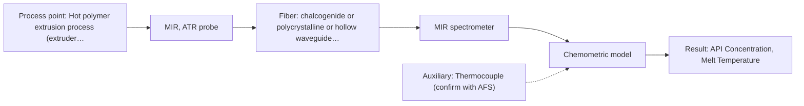

# First technical assessment: API concentration during hot polymer extrusion

## Answer

**Customer request (our summary):** The customer wants to know if optical spectroscopy can monitor composition changes in a hot polymer extrusion process involving an active pharmaceutical ingredient.

### Brief answer

To monitor active pharmaceutical ingredient composition in hot polymer extrusion, Mid-IR ATR spectroscopy using a robust immersion probe is recommended as the primary approach based on industrial extrusion precedents. Raman spectroscopy offers a viable alternative if polymer fluorescence permits. Initial feasibility trials with representative polymer-API blends and offline reference assays should be conducted to establish chemometric calibration robustness and evaluate potential fouling behavior at the process interface.

### Proposal

- **Best current option:** O2 (recommended)
- **Basis:** supplied AFS sources
- **What would change it:** If material build-up on the ATR crystal proves insurmountable or if fluorescence background swamps Raman, evaluation of transmission or alternative cleaning purge designs would be required.
- **Next step:** Conduct multi-method laboratory trials using representative polymer-API samples to establish initial calibration models.

**Secondary evidence (external, not AFS material):** G1: no usable external source found; G2: no usable external source found. See Expert detail.

**Decision status:** Provisional feasibility assessment

### Solution options

| ID | Tier | Methods | Confidence | Cost class, S01 Table 1 (p.6) | Ease of use | Maintenance | Performance fit | Sources |
|---|---|---|---|---|---|---|---|---|
| O1 | Simple | M2 Raman probe | Low: open question: Q1 (starts at Medium); uncited auxiliary sensor | high cost (row 12) | Moderate optical alignment | Requires laser safety and clean optics | Provides complementary vibrational spectra with minimal water interference | [1: S01 p.11] [2: S01 p.11] |
| O2 | Recommended | M1 MIR, ATR probe | Low: open question: Q1 (starts at Medium); precedent only; uncited auxiliary sensor | high cost (row 2) | High for in-line extruder mount | Periodic crystal cleaning to prevent fouling | High molecular selectivity and established industrial precedent for API monitoring in polymer extrusion | [3: S02 p.14] [4: S02 p.14] |

*Confidence rates the basis of the advice (how much is known and cited), not a predicted accuracy or probability of success. It starts at High, or at Medium when a key question on the method or the option is open, and drops one level per weakness listed (floor Low).*

*Cost class is the relative rating in S01 Table 1 (p.6) for the in-line method+technique rows named (the highest one for a multi-method option); it is not a price.*

### Setup sketch

*Recommended option O2; drawn by code from the option, a schematic, not a configuration.*

### Key questions

1. What are the specific polymer and active pharmaceutical ingredient types, and what is the required concentration detection range?
2. What is the operating temperature and pressure of the extrusion melt at the measurement location?
3. What is the expected severity of material build-up or fouling on the probe interface, and is a purging or wiping mechanism required?

## Expert detail

**Customer enquiry**

> We are developing a hot polymer extrusion process that incorporates an active pharmaceutical ingredient. We want to investigate whether an optical measurement can detect composition changes while the melt is being processed. We have offline assays, but the process interface is hot and may be exposed to material build up. We need an initial comparison plan and the questions required before choosing a probe.

**Decision status:** Provisional feasibility assessment. A provisional shortlist of MIR-ATR and Raman spectroscopy can be formed for hot polymer extrusion based on industrial precedents, but exact feasibility depends on polymer-API optical properties, temperature limits, and fouling behavior.

### Parameters

| ID | Parameter | Kind | Need | Measured by | Why | Sources |
|---|---|---|---|---|---|---|
| P1 | API Concentration | quantitative | required | Reference lab method: HPLC assay | To quantify the active pharmaceutical ingredient in the polymer melt. | *(no verified source: engineering judgement)* |
| P2 | Melt Temperature | quantitative | required | Auxiliary sensor: Thermocouple (engineering judgement: confirm availability with AFS) | To ensure process conditions stay within probe and fiber operating limits. | *(no verified source: engineering judgement)* |

### Solution option details

- **O1 cost drivers:** Raman spectrometer, laser source, and standard probe hardware
- **O2 cost drivers:** FTIR spectrometer and CIR/PIR fiber ATR probe system

### Premise check

- **Precedent only:** An optical measurement can successfully detect composition changes in the extrusion melt. Source material demonstrates polymer extrusion monitoring using MIR-ATR spectroscopy, establishing a strong precedent for testing but not a guaranteed outcome for a new formulation. [3: S02 p.14]

### Requirements

**Stated by the customer**

- Hot polymer extrusion process incorporating an active pharmaceutical ingredient
- Detect composition changes while the melt is being processed
- Offline assays available
- Process interface is hot and may be exposed to material build-up

**Key unknowns**

- Specific polymer and API types and target concentration ranges
- Exact process temperature and melt optical properties
- Fouling tendency and cleaning mechanisms for the probe interface

### Clarification questions (most decision-relevant first)

Q1. What are the specific polymer and active pharmaceutical ingredient types, and what is the required concentration detection range? *Why it matters:* Determines specific absorption bands and method suitability. *(affects: method)*
Q2. What is the operating temperature and pressure of the extrusion melt at the measurement location? *Why it matters:* Ensures the selected probe, optics, and fiber materials stay within thermal and mechanical ratings. *(affects: installation)*
Q3. What is the expected severity of material build-up or fouling on the probe interface, and is a purging or wiping mechanism required? *Why it matters:* Fouling directly impairs ATR and optical contact measurements over time. *(affects: installation)*
Q4. Do you need surface-layer monitoring (a few micrometres via ATR) or bulk melt penetration? *Why it matters:* Defines the required optical technique and probe geometry. *(affects: technique)*

### Recommendation

- **M1 · Primary candidate: MIR, ATR probe.** Mid-IR ATR spectroscopy provides high molecular selectivity and has proven industrial precedent for monitoring active pharmaceutical ingredients in hot polymer extrusion using diamond cone ATR probes. *Conditions:* Melt must maintain good contact with the ATR crystal, and process temperature must remain within probe and fiber limits. [4: S02 p.14]
- **M2 · Comparison candidate: Raman probe.** Raman spectroscopy provides complementary vibrational information on molecular backbones and is well-suited for polymer systems where water interference is minimal. *Conditions:* Polymer or additive fluorescence must not swamp the weak Raman scattering signal. [2: S01 p.11]

### Measurement concept

- **Probe and geometry:** Mid-IR Diamond ATR immersion probe mounted flush in the extruder barrel or die adapter.
- **Location:** Hot polymer extrusion process (extruder barrel or die adapter).
- **Fiber link:** Chalcogenide (CIR) or polycrystalline infrared (PIR) fiber cables connecting the ATR probe to the FTIR spectrometer. [5: S01 p.10] [6: S02 p.14]

### Spectral range

- **MIR:** Nominal range 4000-400 cm-1 (2.5-25 µm); usable range depends on the instrument, chalcogenide or polycrystalline fiber, and ATR crystal actually selected. [7: S01 p.9]
- **Raman:** Raman shift expressed in wavenumbers (cm-1) with laser excitation wavelength stated separately; usable range depends on the spectrometer, laser, and probe configuration. [8: S01 p.11]

### Risks and uncertainty

- Material build-up or fouling on the ATR crystal can obscure the optical measurement and mimic composition changes. *(rules: R-MIR-3)* [9: S01 p.13]
- High processing temperatures can exceed fiber or probe seal thermal ratings. *(rules: R-GEN-1)* [10: S02 p.7]
- Overlapping spectral bands of the bulk polymer matrix and the API may complicate quantitative chemometric calibration. *(rules: R-NIR-2)* [11: S01 p.10]

### First feasibility experiment

1. **Prepare representative polymer-API blend samples across the expected concentration range.** Cover anticipated chemical variation. *(no verified source: engineering judgement)*
2. **Record offline reference assays for each sample using standard laboratory methods.** Provide independent reference measurements. *(no verified source: engineering judgement)*
3. **Acquire initial spectra using MIR-ATR and Raman probes under simulated or actual melt conditions.** Test single methods first. *(no verified source: engineering judgement)*
4. **Build and cross-validate initial chemometric regression models (PLS) to predict composition.** Establish predictive performance. *(no verified source: engineering judgement)*
5. **Validate the model on held-out test batches against customer-defined accuracy criteria.** Verify robustness. *(no verified source: engineering judgement)*

**Reference measurements:** Offline reference assays (e.g., HPLC or gravimetric reference methods).

**Decision basis:** Go/no-go based on whether the cross-validated prediction error meets the customer's required concentration accuracy threshold.

### Assumptions

- The polymer melt flows adequately past the probe interface to maintain representative sampling.
- Process temperatures are within standard optical fiber and probe sealing limits.

### Further notes

- **Chemometrics:** Partial Least Squares (PLS) regression models must be built on reference spectra to correlate spectral absorbance with offline assay concentrations.
- **Real-time tracking:** In-line continuous tracking enables real-time detection of composition changes in the extruder barrel or die adapter.
- **Future direction:** Integration of automated probe purging mechanisms or multi-method data fusion if single-method calibration proves insufficient.

### Secondary evidence (external, not AFS material)

*Found by a literature search for gaps the supplied AFS sources leave open. Not AFS material and not proof for this case; every quote below was verified verbatim against the fetched text.*

*Live search unavailable (library only: cache miss (europepmc); cache miss (openalex)); curated library only.*

**G1 · auxiliary sensor:** In-line measurement of Melt Temperature with Thermocouple

- No usable external source found.

**G2 · parameter without a source:** Measuring API Concentration: To quantify the active pharmaceutical ingredient in the polymer melt.

- No usable external source found.

### Evidence (verified quotes)

1. ✓ **S01 p.11** (general): "Measurement of the Raman scattering (RS) effect, is also a type of vibrational spectroscopy."
2. ✓ **S01 p.11** (general): "This property makes mid-IR and Raman spectra complementary, that is, they complement each other."
3. ✓ **S02 p.14** (application precedent): "NIR-Reflex & MIR-ATR-spectroscopy to control polymer extrusion in-line"
4. ✓ **S02 p.14** (application precedent): "Spectra of API in hot polymer obtained with Diamond cone ATR probe coupled to iC10 FTIR (MTAC)"
5. ✓ **S01 p.10** (general): "ATR fiber probes (Fig.1) enable the analysis of liquids and solid elastic samples"
6. ✓ **S02 p.14** (application precedent): "Spectra of API in hot polymer obtained with Diamond cone ATR probe"
7. ✓ **S01 p.9** (general): "Vibrational spectroscopy in the mid-IR range (4000-400 cm-1) is one of the most informative methods of chemical analysis."
8. ✓ **S01 p.11** (general): "The Raman shift is used as the horizontal (spectral) axis in Raman spectroscopy, while the vertical axis shows the absolute intensity"
9. ✓ **S01 p.13** (general): "typically at a depth of few microns"
10. ✓ **S02 p.7** (general): "High temperature resistance - Increased durability, high strength, hermetically sealed"
11. ✓ **S01 p.10** (general): "The broad absorption bands observed in this region overlap, suggesting the use of chemometrics for quantitative and qualitative analysis of spectral data."

### Verification

- Citations verified: 12 of 12 (exact or whitespace/hyphen-tolerant match on the cited page, scope checked).
- Hard check failures before deterministic corrections: 0; still open: 0; soft warnings: 2; repair rounds: 0.
- Removed 1 intake item(s) not quoted verbatim from the enquiry:
  - intake.process[0]: enquiry_quote not found verbatim in the enquiry
- External evidence (cache): 0 quote(s) verified verbatim (exact or whitespace/hyphen-tolerant, at most 400 characters and 2 sentences, against the cited paragraph); 0 item(s) dropped.
- External search: 3 query(ies), 0 hit(s), 3 source(s) (3 from the curated library); ⚠ library only: cache miss (europepmc); cache miss (openalex).
- External step: 2 model call(s), 2.3 s extra (cost in the run JSON).

*Run D07-20261018T080635Z-262d · models google/gemini-3.5-flash-lite*
