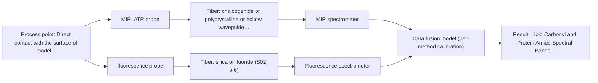

# First technical assessment: Local measurements of heterogeneous model tissues

## Answer

**Customer request (our summary):** A research group evaluating MIR ATR and fluorescence for classifying heterogeneous model biological tissues requests a first comparison experiment design and result interpretation.

### Brief answer

To classify heterogeneous model biological tissues (chicken muscle, fat, and liver), we recommend evaluating MIR-ATR and fluorescence spectroscopy. Because sequential measurements risk sampling different locations on heterogeneous samples, a combined multispectral probe capturing both signals simultaneously is ideal. A feasibility experiment comparing single-method performance against low-level data fusion using PCA will demonstrate whether the combined approach successfully separates all tissue classes.

### Proposal

- **Best current option:** O2 (recommended)
- **Basis:** supplied AFS sources
- **What would change it:** If single-method MIR-ATR achieves complete classification separation on its own, the extended multi-method option would be unnecessary.
- **Next step:** Conduct a laboratory comparison experiment using model chicken tissues and evaluate data fusion of MIR-ATR and fluorescence spectra via PCA.

**Secondary evidence (external, not AFS material):** G1: no usable external source found. See Expert detail.

**Decision status:** Provisional feasibility assessment

### Solution options

| ID | Tier | Methods | Confidence | Cost class, S01 Table 1 (p.6) | Ease of use | Maintenance | Performance fit | Sources |
|---|---|---|---|---|---|---|---|---|
| O1 | Simple | M1 MIR, ATR probe | Low: open question: Q1 (starts at Medium); precedent only | high cost (row 2) | Straightforward single-method ATR setup | Routine cleaning of ATR crystal | Good for surface lipid and protein identification but insufficient for full tissue separation | [1: S04 p.4] [2: S01 p.13] [3: S04 p.3] |
| O2 | Recommended | M1 MIR, ATR probe; M2 fluorescence probe + MIR (combination) | Low: open question: Q1 (starts at Medium); fit for soft solid to be tested, sample clarity unknown, fluorescent target unknown; precedent only; multi-method, fusion benefit not yet shown | high cost (rows 2, 19) | Combined multispectral probe simplifies dual-method contact | Dual instrument calibration and probe maintenance | Optimal separation of heterogeneous tissues by combining complementary chemical and fluorescence data from the same spot | [4: S04 p.4] [2: S01 p.13] [3: S04 p.3] [5: S04 p.3] |

*Confidence rates the basis of the advice (how much is known and cited), not a predicted accuracy or probability of success. It starts at High, or at Medium when a key question on the method or the option is open, and drops one level per weakness listed (floor Low).*

*Cost class is the relative rating in S01 Table 1 (p.6) for the in-line method+technique rows named (the highest one for a multi-method option); it is not a price.*

### Setup sketch

*Recommended option O2; drawn by code from the option, a schematic, not a configuration.*

### Key questions

1. Will measurements be performed using a single combined multispectral probe or sequential individual probes?
2. What is the target classification error rate or accuracy required to distinguish muscle, fat, and liver samples?
3. What specific excitation wavelength is intended for the fluorescence channel in your laboratory setup?

## Expert detail

**Customer enquiry**

> Our research group is evaluating a spectral measurement interface using model biological tissues such as chicken muscle, fat and liver. We want to compare MIR ATR and fluorescence information, because the material is heterogeneous and sequential measurements may not sample the same location. This is a laboratory classification study. We need a first comparison experiment and a clear statement of what its results would demonstrate.

**Decision status:** Provisional feasibility assessment. Supplied sources detail the use of combined MIR-ATR and fluorescence spectroscopy with a multispectral fiber probe for classifying model biological tissues such as muscle, fat, and liver, supporting a provisional experimental design.

### Parameters

| ID | Parameter | Kind | Need | Measured by | Why | Sources |
|---|---|---|---|---|---|---|
| P1 | Tissue Category | qualitative | required | Reference lab method: Anatomical and visual inspection | Defines the target class labels (muscle, fat, liver) for classification. | *(no verified source: engineering judgement)* |
| P2 | Lipid Carbonyl and Protein Amide Spectral Bands | quantitative | required | Spectroscopy: MIR | Captures molecular vibrational features via MIR-ATR. | [3: S04 p.3] |
| P3 | Intrinsic Fluorescence Emission | quantitative | required | Spectroscopy: Fluorescence | Provides complementary emission data sensitive to specific tissue fluorophores. | [5: S04 p.3] |

### Solution option details

- **O1 cost drivers:** Single FTIR spectrometer and ATR probe
- **O2 cost drivers:** Combined multispectral probe and two spectrometers
- **O2 combining methods:** Data fusion is performed by low-level concatenation of normalized MIR-ATR and fluorescence spectra into an augmented matrix. Measurements must be collected simultaneously from the exact same spot using a combined ATR/fluorescence probe to overcome tissue heterogeneity. Each spectral block requires independent calibration and diagnostics, and the fused model must demonstrate improved class separation over single-method models.

### Premise check

- **Supported:** A first comparison experiment and a clear statement of what its results would demonstrate can be provided. Published studies and technical notes in the sources demonstrate how to combine MIR-ATR and fluorescence for tissue classification and evaluate the synergy. [6: S04 p.3]
- **Supported:** Sequential measurements may not sample the same location on heterogeneous material. Sources explicitly state that for heterogeneous samples, simultaneous measurement with a combined probe avoids the limitations of sequential probing. [7: S04 p.2]

### Requirements

**Stated by the customer**

- Compare MIR ATR and fluorescence information using model biological tissues (chicken muscle, fat, liver)
- Address material heterogeneity where sequential measurements may not sample the same location
- Provide a first comparison experiment design and a clear statement of what results demonstrate for classification

**Key unknowns**

- Specific instrument hardware and spectrometer models for MIR and fluorescence acquisition
- Exact optical and fluorescence properties of the specific model tissue batches
- Required quantitative classification accuracy thresholds

### Clarification questions (most decision-relevant first)

Q1. Will measurements be performed using a single combined multispectral probe or sequential individual probes? *Why it matters:* A combined probe ensures identical sampling spots on heterogeneous tissue, whereas sequential probes may introduce spatial mismatch. *(affects: technique, installation, M1, M2)*
Q2. What is the target classification error rate or accuracy required to distinguish muscle, fat, and liver samples? *Why it matters:* Defines the success criteria for the go/no-go feasibility decision. *(affects: status)*
Q3. What specific excitation wavelength is intended for the fluorescence channel in your laboratory setup? *Why it matters:* Affects the fluorophore excitation efficiency and spectral background overlap. *(affects: technique)*

### Recommendation

- **M1 · Primary candidate: MIR, ATR probe.** Mid-IR ATR provides chemical fingerprint information from the sample surface, capturing lipid carbonyl and protein amide bands characteristic of tissue types. [2: S01 p.13] [3: S04 p.3]
- **M2 · Comparison candidate: fluorescence probe + MIR (combination).** Fluorescence provides complementary emission data sensitive to intrinsic fluorophores like porphyrins, enhancing tissue classification when fused with MIR-ATR. *Conditions:* Applied in a combined multispectral approach to resolve tissue classes that single methods fail to separate fully. [5: S04 p.3] [4: S04 p.4] Later hypothesis, after single-method tests.

### Measurement concept

- **Probe and geometry:** Combined multispectral probe featuring an ATR crystal head (such as ZrO2 frustum) with integrated chalcogenide infrared (CIR) fibers for MIR-ATR and silica fibers for orthogonal fluorescence illumination and collection.
- **Location:** Direct contact with the surface of model biological tissue samples (chicken muscle, fat, liver).
- **Fiber link:** Chalcogenide As-S IR fibers (CIR) for MIR and silica fibers for fluorescence. [8: S04 p.2] [9: S04 p.2]

### Spectral range

- **MIR:** Nominal method range is 4000-400 cm-1; actual usable range depends on the instrument, fiber, and ATR crystal configuration. [10: S01 p.9]
- **Fluorescence:** Emission range depends on the fluorescent species and excitation wavelength; not a product specification. [11: S01 p.12]

### Risks and uncertainty

- Fouling or deposition of soft tissue residues on the ATR crystal interface can degrade the MIR signal quality. *(rules: R-MIR-3, R-GEN-5)* [12: S01 p.13]
- Spatial misalignment or separate probing of heterogeneous tissue regions can prevent effective data fusion. *(rules: R-CMB-2)* [13: S01 p.8]
- High background or overlapping emission bands can obscure weaker fluorescence features. *(rules: R-FLU-2)* [14: S04 p.3]

### First feasibility experiment

1. **Prepare representative sample sets of chicken muscle (breast), fat, and liver, ensuring multiple measurement points per tissue type to capture heterogeneity.** To establish a representative dataset spanning the physical and chemical variation of model tissues. [15: S04 p.3]
2. **Obtain independent reference categorization for each sample and measurement point based on anatomical and histological type.** To provide ground-truth class labels for classification modeling. *(no verified source: engineering judgement)*
3. **Acquire single-method baseline spectra (MIR-ATR and fluorescence separately) across all sample points.** To evaluate individual method performance and identify limitations of single-modality classification. [16: S04 p.4]
4. **Acquire simultaneous multispectral data using a combined probe or strictly aligned measurement points, and apply low-level data fusion (concatenation with scaling).** To test the hypothesis that combining heterogeneous information overcomes single-method classification limits. [4: S04 p.4]
5. **Build and compare multivariate classification models (e.g., PCA) to validate whether the fused multispectral approach achieves complete separation of muscle, fat, and liver classes.** To establish a go/no-go basis for the multispectral measurement interface. [17: S04 p.4]

**Reference measurements:** Independent anatomical and visual tissue classification (chicken muscle/breast, fat, liver).

**Decision basis:** Successful clustering and separation of chicken muscle, fat, and liver tissue classes in PCA score plots, demonstrating superior classification performance for the combined multispectral approach compared to single methods.

### Assumptions

- Model biological tissues (chicken muscle, fat, liver) adequately simulate the chemical and physical heterogeneity required for the study.
- A combined ATR/fluorescence probe is available or can be constructed for simultaneous point measurement.
- The optical regime and presence of intrinsic fluorophores in the model tissues support simultaneous ATR and fluorescence interrogation.

### Further notes

- **Chemometrics:** Multivariate exploratory analysis using Principal Component Analysis (PCA) on mean-centered and normalized spectral blocks without complex preprocessing demonstrates clear class separation upon data fusion.
- **Future direction:** Extension of the multispectral probe design to include diffuse reflectance or NIR/Raman techniques for broader biomedical and process applications.

### Secondary evidence (external, not AFS material)

*Found by a literature search for gaps the supplied AFS sources leave open. Not AFS material and not proof for this case; every quote below was verified verbatim against the fetched text.*

*Live search unavailable (library only: cache miss (europepmc); cache miss (openalex)); curated library only.*

**G1 · parameter without a source:** Measuring Tissue Category: Defines the target class labels (muscle, fat, liver) for classification.

- No usable external source found.

### Evidence (verified quotes)

1. ✓ **S04 p.4** (general): "none of the individual techniques was sufficient to completely separate the three sample classes on the PCA score plots"
2. ✓ **S01 p.13** (general): "The MIR-ATR component captures the "chemical fingerprint" of the tissue's surface layer, typically at a depth of few microns, providing information on molecular composition and biochemical changes."
3. ✓ **S04 p.3** (general): "The discriminative power of mid-IR spectroscopy (Figure 2a and Figure S-4) toward rich in lipids fat samples is related to the stretching vibration band of the ester carbonyl C=O at about 1740 cm-1, which is characteristic of saturated triglycerides."
4. ✓ (precedent only) **S04 p.4** (method gain): "At the same time, the PCA model built on the concatenated IR and fluorescence data revealed three distinct groups of samples corresponding to tissue types"
5. ✓ **S04 p.3** (general): "The most selective peak at 613 nm, which can be assigned to porphyrins, has sufficient specificity to distinguish the liver from other measured samples."
6. ✓ **S04 p.3** (application precedent): "The developed multispectral probe was tested in the practical analysis of biological tissue samples using different organs and parts of the chicken: breast, fat, and liver."
7. ✓ **S04 p.2** (general): "The main challenge of such local multispectral analysis is related to the necessity to perform different spectroscopic measurements at the same point simultaneously."
8. ✓ **S04 p.2** (general): "The proposed solution (Figure 1) is based on a precise determination of the optical configuration of the ATR crystal head, which, in this case, plays the role of a common measurement interface for both methods."
9. ✓ **S04 p.2** (general): "ZrO2 crystal was chosen due to its high (close to the diamond) refractive index, high transparency in the working spectral regions of both chalcogenide infrared (CIR) and UV silica fibers, as well as small intrinsic fluorescence."
10. ✓ **S01 p.9** (general): "Vibrational spectroscopy in the mid-IR range (4000-400 cm-1) is one of the most informative methods of chemical analysis."
11. ✓ **S01 p.12** (general): "Fluorimetry is based on measuring the broad emission signal observed upon irradiation of certain samples in the UV and visible regions."
12. ✓ **S01 p.13** (general): "typically at a depth of few microns"
13. ✓ **S01 p.8** (general): "It is crucial that the spectral information obtained by different methods-Mid-IR, NIR, Raman, and fluorescence spectra-is collected from the same small, even pinpoint, area of the sample. This is difficult to achieve by using two probes alternately for measurements."
14. ✓ **S04 p.3** (general): "This possible distortion, however, does not play any significant role in the sample classification."
15. ✓ **S04 p.3** (application precedent): "To provide the necessary statistical representativeness of the data, three samples of each tissue type were prepared. The samples were large enough to reflect the possible heterogeneity of the tissue. Each sample was represented by five distributed points."
16. ✓ **S04 p.4** (general): "PCA models for individual data blocks confirmed the above conclusions based on the spectral interpretation that IR spectroscopy works better for the discrimination of fat (Figure 3a), whereas fluorescence is well suited for the recognition of liver tissue (Figure 3b)."
17. ✓ (precedent only) **S04 p.4** (method gain): "This simple example illustrates the gain that can be obtained using the proposed multispectral probe in the qualitative analysis of biological tissue."

### Verification

- Citations verified: 21 of 21 (exact or whitespace/hyphen-tolerant match on the cited page, scope checked).
- Hard check failures before deterministic corrections: 0; still open: 0; soft warnings: 4; repair rounds: 1.
- External evidence (cache): 0 quote(s) verified verbatim (exact or whitespace/hyphen-tolerant, at most 400 characters and 2 sentences, against the cited paragraph); 0 item(s) dropped.
- External search: 2 query(ies), 0 hit(s), 0 source(s) (0 from the curated library); ⚠ library only: cache miss (europepmc); cache miss (openalex).
- External step: 1 model call(s), 0.6 s extra (cost in the run JSON).

*Run D08-20261018T080635Z-afa9 · models google/gemini-3.5-flash-lite*
