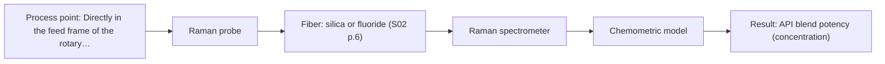
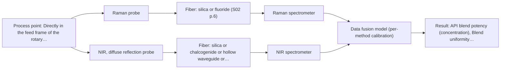

# First technical assessment: Blend potency in a tablet press feed frame

## Answer

**Customer request (our summary):** The customer wants to assess whether a fiber-based optical measurement installed in a tablet press feed frame can monitor API concentration changes in real time.

### Brief answer

In-line monitoring of API blend potency inside a tablet press feed frame is supported by literature precedent for Raman and NIR spectroscopy. We recommend testing a single Raman contact probe first for its high chemical selectivity toward organic active ingredients, alongside NIR diffuse reflection as a simpler comparison. Before committing to equipment, clarify API concentration range, excipient composition, and mechanical clearance inside the feed frame.

### Proposal

- **Best current option:** O2 (recommended)
- **Basis:** supplied AFS sources
- **What would change it:** If API spectral peaks overlap severely with excipients or strong fluorescence occurs, the choice would shift to the dual-method combination (O3) or single NIR (O1).
- **Next step:** Test static benchtop Raman and NIR diffuse reflection on customer blend samples spanning target concentration ranges to confirm spectral contrast and evaluate fluorescence.

**Secondary evidence (external, not AFS material):** G1: E02 ¶31, E02 ¶82; G2: no usable external source found; G3: no usable external source found; G4: no usable external source found. See Expert detail.

**Decision status:** Provisional feasibility assessment

### Solution options

| ID | Tier | Methods | Confidence | Cost class, S01 Table 1 (p.6) | Ease of use | Maintenance | Performance fit | Sources |
|---|---|---|---|---|---|---|---|---|
| O1 | Simple | M2 NIR, diffuse reflection probe | Medium: open question: Q1, Q3 (starts at Medium) | average cost (row 8) | Standard lamp optics with simple fiber interface | Periodic window wipe and dark/white reference checks | Diffuse reflection covers broad bulk matrix overtones | [1: S01 p.15] [2: S01 p.5] [3: S01 p.10] |
| O2 | Recommended | M1 Raman probe | Medium: open question: Q1, Q3 (starts at Medium) | high cost (row 12) | Compact contact probe with standard laser enclosure | Laser power monitoring and window cleanliness checks | High selectivity resolves API backbone from excipients | [4: S01 p.15] [5: S01 p.15] [6: S01 p.12] |
| O3 | Extended (multi-method) | M3 Raman probe + NIR (combination) | Low: open question: Q1 (starts at Medium); precedent only; multi-method, fusion benefit not yet shown | high cost (rows 8, 12) | Dual spectrometer synchronization and fused data stream | Dual instrument calibration and combined window inspection | Fused polar and backbone data maximizes potency robustness | [7: S01 p.15] [8: S01 p.15] [9: S01 p.15] [10: S01 p.15] |

*Confidence rates the basis of the advice (how much is known and cited), not a predicted accuracy or probability of success. It starts at High, or at Medium when a key question on the method or the option is open, and drops one level per weakness listed (floor Low).*

*Cost class is the relative rating in S01 Table 1 (p.6) for the in-line method+technique rows named (the highest one for a multi-method option); it is not a price.*

### Setup sketch

*Recommended option O2; drawn by code from the option, a schematic, not a configuration.*

### Key questions

1. What are the chemical identities and expected concentration range (nominal and range of variation) of the API and excipients?
2. What optical port, mounting interface, or paddle clearance exists within the rotary tablet press feed frame?
3. Does the powder blend tend to stick or cake on optical surfaces, and what cleaning or purge mechanism is permissible?

## Expert detail

**Customer enquiry**

> We manufacture tablets from a powder blend containing an active pharmaceutical ingredient and excipients. Laboratory checks tell us whether the blend is on target, but results arrive after the material has moved through the press. We want to assess whether a fiber based measurement in the feed frame could follow API concentration changes. Our first pilot should compare reasonable measurement options before we commit to production equipment.

**Decision status:** Provisional feasibility assessment. In-line monitoring of API blend potency in a tablet press feed frame is supported by literature precedent for NIR reflection and Raman spectroscopy. A provisional assessment shortlists single Raman and NIR diffuse reflection alongside a combined probe hypothesis, pending clarification of API loading, excipients, and feed frame clearance.

### Parameters

| ID | Parameter | Kind | Need | Measured by | Why | Sources |
|---|---|---|---|---|---|---|
| P1 | API blend potency (concentration) | quantitative | required | Spectroscopy: Raman | Tracking API concentration in real time verifies that the powder blend entering the tablet press dies meets potency specifications. | [11: S01 p.14] |
| P2 | Blend uniformity and excipient matrix profile | quantitative | required | Spectroscopy: NIR | Monitoring overall powder composition and excipient distribution ensures blend homogeneity before tablet compaction. | [9: S01 p.15] |
| P3 | Reference API potency assay | quantitative | required | Reference lab method: HPLC | Provides independent primary analytical values to calibrate and validate in-line chemometric regression models. | *(no verified source: engineering judgement)* |

### Solution option details

- **O1 cost drivers:** Standard NIR spectrometer and diffuse reflection probe
- **O2 cost drivers:** 785 nm stabilized laser, spectrometer, filtered probe
- **O3 cost drivers:** Dual spectrometers, NIRaman probe shaft, fusion chemometrics
- **O3 combining methods:** Low-level data fusion combines synchronized NIR reflection and Raman spectra into a single augmented matrix normalized to a common time step. The combined probe shaft inspects the exact same powder volume in the feed frame to prevent spatial mismatch. Each instrument requires separate baseline calibration and diagnostics, and the fused PLS model must demonstrate statistically superior prediction accuracy over the best single method.

*Extended (multi-method) option O3; drawn by code from the option, a schematic, not a configuration.*

### Premise check

- **Precedent only:** A fiber-based optical measurement can be installed directly in the feed frame to reliably track API concentration changes. Literature precedent demonstrates in-line monitoring of API blend potency directly in a rotary tablet press feed frame using NIR reflection and Raman spectroscopy, but feasibility in a new formulation depends on specific API loading, excipient interference, and powder flow behavior. [12: S01 p.15]

### Requirements

**Stated by the customer**

- Manufacture tablets from a powder blend containing an active pharmaceutical ingredient and excipients.
- Laboratory checks tell whether the blend is on target, but results arrive after material has moved through the press.
- Assess whether a fiber-based measurement in the feed frame could follow API concentration changes.
- First pilot should compare reasonable measurement options before committing to production equipment.

**Key unknowns**

- Specific chemical identity, molecular structure, and spectra of the API and excipients.
- Nominal API concentration and expected dynamic range of variation in the blend.
- Feed frame dimensions, paddle clearance, optical window access, and mounting geometry.
- Powder physical properties including particle size distribution, flowability, and propensity for window adhesion.
- Required analytical accuracy, precision, and sampling response time for process decisions.
- Distance between the tablet press feed frame and the analyzer installation location.

### Clarification questions (most decision-relevant first)

Q1. What are the chemical identities and expected concentration range (nominal and range of variation) of the API and excipients? *Why it matters:* API concentration and spectral contrast against excipients determine whether single-method Raman or NIR diffuse reflection provides adequate sensitivity and selectivity. *(affects: method, technique)*
Q2. What optical port, mounting interface, or paddle clearance exists within the rotary tablet press feed frame? *Why it matters:* Probe shaft dimensions, window clearance from rotating feeder paddles, and immersion depth dictate probe mechanical design. *(affects: installation, technique)*
Q3. Does the powder blend tend to stick or cake on optical surfaces, and what cleaning or purge mechanism is permissible? *Why it matters:* Window fouling or powder adhesion distorts reflection and Raman signals, requiring non-fouling coatings, purge geometries, or regular reference wiping. *(affects: installation, M1, M2)*
Q4. What are the required measurement frequency, response time, and analytical precision compared to the laboratory reference method? *Why it matters:* Integration times and precision targets govern detector choice, laser power, and whether data fusion is necessary to outperform single methods. *(affects: method, status)*

### Recommendation

- **M1 · Primary candidate: Raman probe.** Raman spectroscopy provides high chemical selectivity for the molecular backbone of organic active pharmaceutical ingredients, yielding distinct fingerprint peaks that resolve from excipient matrix signals. Fiber-optic immersion probes can be inserted directly into the feed frame to track API concentration changes at high acquisition speeds. *Conditions:* The powder blend must not exhibit strong laser-induced fluorescence that swamps the weak Raman scatter. [4: S01 p.15] [5: S01 p.15] [6: S01 p.12]
- **M2 · Comparison candidate: NIR, diffuse reflection probe.** NIR diffuse reflectance is the established industry benchmark for solid dosage forms, penetrating several millimetres into scattering powders using standard tungsten-halogen sources and silica fibers. It provides rapid screening of blend potency, though broad overlapping overtone bands require chemometric multivariate calibration. *Conditions:* The API must be present at sufficient concentration with resolvable overtone or combination bands distinguishable from excipients. [1: S01 p.15] [2: S01 p.5] [3: S01 p.10]
- **M3 · Comparison candidate: Raman probe + NIR (combination).** Combining Raman and NIR reflection gathers complementary chemical information on non-polar molecular backbones and polar hydrogen bonding simultaneously. Literature precedent in rotary press feed frames demonstrates that low-level data fusion yields higher prediction accuracy and robustness for blend potency than either single method. *Conditions:* Applies if neither single method alone achieves the required accuracy or if physical powder variations destabilise single-technique calibrations. [9: S01 p.15] [10: S01 p.15] Later hypothesis, after single-method tests.

### Measurement concept

- **Probe and geometry:** Direct-contact immersion fiber-optic probe (or combined multispectral NIR-Raman shaft) flush-mounted into the tablet press feed frame, collecting diffuse reflection and backscattered Raman emission from flowing powder.
- **Location:** Directly in the feed frame of the rotary tablet press, positioned in a powder flow channel clear of rotating feeder paddles.
- **Fiber link:** Low-OH silica fibers (or metal-coated silica fibers free of jacket fluorescence) routing signals between the feed frame and spectrometers located remotely away from press vibration and dust. [13: S01 p.15] [14: S01 p.15] [15: S02 p.7]

### Spectral range

- **Raman:** Raman shift is expressed in cm-1 with a 785 nm excitation wavelength; usable range depends on spectrometer grating, laser wavelength, optical filters, and probe construction. [16: S01 p.11] [17: S01 p.15]
- **NIR:** Nominal NIR range of 780-2500 nm; usable range depends on spectrometer detector, source, fiber transmission, and probe optics. [18: S01 p.10] [19: REF §3]

### Risks and uncertainty

- Laser-induced background fluorescence from excipients or trace impurities could overwhelm weak Raman emission bands. *(rules: R-RAM-1)* [20: S01 p.11]
- Powder caking or coating on the probe window in the feed frame could distort spectral signals and mimic concentration drifts. *(rules: R-GEN-5)* [21: S01 p.7]
- Variations in powder density, particle size, or flow rate in the feed frame can alter light scattering and degrade NIR calibration accuracy. *(rules: R-GEO-6, R-CAL-1)* [22: S01 p.17]
- Low API loading could fall beneath the detection limit of single-method NIR diffuse reflection. *(rules: R-NIR-4)* [23: S01 p.16]

### First feasibility experiment

1. **Acquire offline Raman and NIR diffuse reflection spectra on static reference powder blends across the expected range of API concentration, including individual pure API and excipients.** Identify characteristic spectral bands, evaluate baseline fluorescence in Raman, and establish single-method spectral contrast. [24: REF §3]
2. **Perform dynamic bench-scale flow trials using an agitated powder funnel or simulated feed frame to record spectra under moving powder conditions.** Assess the impact of powder motion, particle packing, and integration time on spectral signal-to-noise ratio and window fouling. *(no verified source: engineering judgement)*
3. **Build preliminary univariate or PLS regression calibration models for API content separately for Raman and NIR.** Evaluate single-method prediction accuracy, linearity, and limit of detection against independent HPLC reference values. [25: S01 p.15]
4. **Test low-level data fusion combining synchronized Raman and NIR spectra into an augmented matrix and validate whether fused PLS models outperform single methods.** Evaluate whether dual-method synergy justifies the additional instrument complexity before production pilot installation. [7: S01 p.15]
5. **Execute an in-line feed frame pilot run on the rotary tablet press across controlled blend potency transitions with independent tablet core sampling.** Verify real-time tracking performance, probe mechanical clearance from feed frame paddles, and long-term window stability under actual manufacturing conditions. [5: S01 p.15]

**Reference measurements:** Primary chromatographic laboratory assay (e.g., validated HPLC/UPLC) of extracted powder aliquots and pressed tablet cores taken from the press run.

**Decision basis:** Pilot go/no-go is determined by customer-defined target criteria for API prediction error (e.g., RMSEP relative to HPLC), detection of concentration excursions within required time limits, and absence of fouling over typical run duration.

### Assumptions

- The tablet press feed frame allows insertion or flush-mounting of an optical fiber probe without interfering with moving feeder paddles.
- The powder blend API content is high enough to generate detectable spectral signals without excessive sample burning under laser irradiation.
- The customer will provide independent laboratory reference assays (e.g., HPLC) for calibration development and model validation.

### Not covered by the supplied sources

- Achievable detection limit, precision, or response time for the customer's specific proprietary API and excipient mixture.
- Specific mechanical drawings, port dimensions, or paddle clearance profiles for the customer's rotary tablet press make and model.

### Further notes

- **Chemometrics:** Quantitative prediction of API concentration requires multivariate regression models such as Partial Least Squares (PLS). Spectral preprocessing (e.g. Standard Normal Variate or first/second derivatives) is necessary to eliminate scatter variations caused by powder flow and particle size before model calibration.
- **Real-time tracking:** In-line feed frame measurements enable real-time tracking of blend potency and transient concentration disturbances as powder moves across the probe tip, eliminating laboratory turnaround delays before tablet compaction.
- **Future direction:** Following successful blend potency tracking in the feed frame, the same optical fiber platform could be extended to downstream unit operations, such as monitoring coating thickness during tablet or pellet pan coating.

### Secondary evidence (external, not AFS material)

*Found by a literature search for gaps the supplied AFS sources leave open. Not AFS material and not proof for this case; every quote below was verified verbatim against the fetched text.*

*Live search unavailable (library only: cache miss (europepmc); cache miss (openalex)); curated library only.*

**G1 · multi-method:** Combining several spectroscopy methods (data fusion) (Low-level data fusion combines synchronized NIR reflection and Raman spectra into a single augmented matrix normalized to a common time step. The combined probe shaft inspects the exact same powder volume in the feed frame to prevent spatial mismatch. Each instrument requires separate baseline calibration and diagnostics, and the fused PLS model must demonstrate statistically superior prediction accuracy over the best single method.)

- **E02 ¶31** Low-level data fusion operates by concatenating variables from distinct sources sequentially into an aggregated data matrix. *How it applies:* This supports testing whether concatenating NIR and Raman data blocks directly into an augmented matrix is mathematically feasible for feed frame monitoring. It suggests verifying if low-level input combination provides true informational complementarity before committing to combined models. *Limits and transfer risks:* The cited paper is a general review of PAT data fusion methods rather than an empirical demonstration on pharmaceutical solid dosage forms in a rotary press feed frame. Differences in sensor sampling rates, powder movement, and signal-to-noise ratios could disrupt simple matrix concatenation. *(supports O3)*
  > "Low-level data fusion (LLDF) is considered the simplest method to achieve a combination of inputs. In this case, the data is rearranged into a new data matrix, where the variables coming from different sources are placed one after the other."
  > Challenges and Opportunities of Implementing Data Fusion in Process Analytical Technology-A Review. (2022) · Molecules (Basel, Switzerland) · doi:10.3390/molecules27154846 · https://europepmc.org/article/PMC/PMC9369811 · retrieved 2026-10-17, full text, licence: cc by, via curated library
- **E02 ¶82** Prior to combining multi-source data, assessing each dataset's contribution and complementary value is necessary. *How it applies:* This highlights the need to benchmark single-sensor models (NIR alone and Raman alone) to confirm that combining both modalities provides real predictive advantages. It reinforces establishing separate predictive metrics before deploying a dual-technique setup. *Limits and transfer risks:* The source is a conceptual overview and does not provide specific performance criteria or empirical validation for powder blending in a tablet press. The actual benefit will depend heavily on the customer's specific API optical properties and measurement dynamics. *(supports O3)*
  > "Before fusing data from multiple sources, it is essential to evaluate the contribution of each dataset to the model and its complementarity."
  > Challenges and Opportunities of Implementing Data Fusion in Process Analytical Technology-A Review. (2022) · Molecules (Basel, Switzerland) · doi:10.3390/molecules27154846 · https://europepmc.org/article/PMC/PMC9369811 · retrieved 2026-10-17, full text, licence: cc by, via curated library

**G2 · not in the supplied sources:** Achievable detection limit, precision, or response time for the customer's specific proprietary API and excipient mixture.

- No usable external source found.

**G3 · not in the supplied sources:** Specific mechanical drawings, port dimensions, or paddle clearance profiles for the customer's rotary tablet press make and model.

- No usable external source found.

**G4 · parameter without a source:** Measuring Reference API potency assay: Provides independent primary analytical values to calibrate and validate in-line chemometric regression models.

- No usable external source found.

### Evidence (verified quotes)

1. ✓ **S01 p.15** (application precedent): "NIR spectrometer and light source coupled with a NIR reflection probe"
2. ✓ **S01 p.5** (general): "NIR spectroscopy, with its relatively large penetration depth (up to several millimetres) even into dense solid samples due to low absorption and strong scattering, allows the use of ordinary glass for optics"
3. ✓ **S01 p.10** (general): "The broad absorption bands observed in this region overlap, suggesting the use of chemometrics for quantitative and qualitative analysis of spectral data."
4. ✓ **S01 p.15** (application precedent): "Raman spectrometer and Raman fiber probe for contact measurements with 785 nm excitation wavelength"
5. ✓ **S01 p.15** (application precedent): "As the powder blend passes the probe tip, the system captures spectra at high speeds without interrupting the production flow."
6. ✓ **S01 p.12** (general): "Therefore, Raman spectra (as well as IR absorption spectra) can be used to construct chemometric models-calibration or classification ones."
7. ✓ **S01 p.15** (application precedent): "Data processing for pharmaceutical tasks relies on "low-level data fusion," where the synchronized NIR and Raman spectra are merged into a single augmented matrix."
8. ✓ **S01 p.15** (application precedent): "Fig. 6. A multispectral NIRaman fiber probe has industrial grade design that combines NIR reflection and Raman optical techniques in a compact shaft that fits in a tablet press feed frame."
9. ✓ **S01 p.15** (general): "NIR detects hydrogen bonds and asymmetric polar groups, while Raman provides information on the molecular backbone and symmetrical non-polar groups."
10. ✓ (precedent only) **S01 p.15** (method gain): "By combining Raman and NIR, these models can predict API potency or coating thickness with higher accuracy and robustness than single-method models."
11. ✓ **S01 p.14** (application precedent): "The primary objective is to determine "blend potency" - the precise concentration and uniformity of the Active Pharmaceutical Ingredient (API) - directly within the production line, specifically in the feed frame of a rotary tablet press."
12. ✓ **S01 p.15** (application precedent): "During the experimental action, the probes are inserted directly into the process environment, such as the feed frame of a rotary tablet press. As the powder blend passes the probe tip, the system captures spectra at high speeds without interrupting the production flow."
13. ✓ **S01 p.15** (application precedent): "During the experimental action, the probes are inserted directly into the process environment, such as the feed frame of a rotary tablet press."
14. ✓ **S01 p.15** (general): "The use of fiber optics is critical here, as it allows the sensitive spectrometers to be located safely away from the vibration and dust of the manufacturing floor."
15. ✓ **S02 p.7** (general): "Free of Polymer jacket fluorescence for Raman and Fluo- Spectroscopy"
16. ✓ **S01 p.11** (general): "The difference between the observed frequencies and the laser frequency is called the Raman shift, expressed in units of frequency-wavenumbers (cm-1)."
17. ✓ **S01 p.15** (application precedent): "785 nm excitation wavelength"
18. ✓ **S01 p.10** (general): "NIR spectra (780-2500 nm) contain predominantly overtones and component bands of fundamental vibrations"
19. ✓ **REF §3** (general): "A nominal method range is not the range of a specific instrument, fiber or probe."
20. ✓ **S01 p.11** (general): "superposition of luminescence (fluorescence), which has a significantly higher intensity."
21. ✓ **S01 p.7** (general): "Morphological factors, such as sample inhomogeneity (e.g., biological tissue) or process turbulence, must also be considered when selecting a measurement technique."
22. ✓ **S01 p.17** (general): "the method is sensitive to the surface characteristics and fat globule size."
23. ✓ **S01 p.16** (general): "may lack the sensitivity to detect trace compounds below 0.1 percent."
24. ✓ **REF §3** (general): "Representative samples or process states, independent reference measurements, what is compared, and the basis for the go / no-go decision."
25. ✓ **S01 p.15** (application precedent): "Then regression models, such as Partial Least Squares (PLS), are applied to these fused datasets."

### Verification

- Citations verified: 30 of 30 (exact or whitespace/hyphen-tolerant match on the cited page, scope checked).
- Hard check failures before deterministic corrections: 0; still open: 0; soft warnings: 2; repair rounds: 1.
- External evidence (cache): 2 quote(s) verified verbatim (exact or whitespace/hyphen-tolerant, at most 400 characters and 2 sentences, against the cited paragraph); 0 item(s) dropped.
- External search: 5 query(ies), 0 hit(s), 3 source(s) (3 from the curated library); ⚠ library only: cache miss (europepmc); cache miss (openalex).
- External step: 2 model call(s), 8.0 s extra (cost in the run JSON).

*Run D01-20261018T080635Z-0e8c · models google/gemini-3.8-flash*
