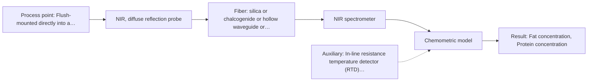

# First technical assessment: Fat and protein monitoring in opaque dairy product

## Answer

**Customer request (our summary):** The customer wants an initial spectroscopy concept and a practical comparison experiment to monitor in-line fat and protein composition changes in an opaque, concentrated milk product with varying temperature and texture.

### Brief answer

We recommend testing in-line Near-Infrared (NIR) diffuse reflection spectroscopy first, using a flush-mounted probe to track fat and protein composition changes directly in your concentrated milk line. Multivariate PLS calibration with scatter correction will be needed to handle varying product texture and temperature. Key open questions include your target measurement ranges and accuracy, line operating conditions, and cleaning-in-place protocols, which will be verified in initial laboratory trials alongside your existing reference checks.

### Proposal

- **Best current option:** O2 (recommended)
- **Basis:** supplied AFS sources
- **What would change it:** If feasibility trials reveal that high optical density prevents reliable reflectance modeling, or conversely that the product remains sufficiently transparent across a defined gap without saturation, the technique choice would shift toward transflection or mid-IR ATR.
- **Next step:** Perform initial multi-method laboratory trials on representative concentrated milk samples spanning operating temperature and texture ranges to calibrate and evaluate NIR diffuse reflection.

**Secondary evidence (external, not AFS material):** G1: no usable external source found; G2: no usable external source found; G3: no usable external source found; G4: no usable external source found. See Expert detail.

**Decision status:** Provisional feasibility assessment

### Solution options

| ID | Tier | Methods | Confidence | Cost class, S01 Table 1 (p.6) | Ease of use | Maintenance | Performance fit | Sources |
|---|---|---|---|---|---|---|---|---|
| O1 | Simple | M2 NIR, transmission/transflection probe | Low: suitability for this sample not confirmed; uncited auxiliary sensor | average cost (row 7) | Direct probe immersion into pipe port | Periodic gap cleaning and visual inspection | Evaluates transflection across variable dairy solids | [1: S01 p.18] [2: S01 p.18] |
| O2 | Recommended | M1 NIR, diffuse reflection probe | Low: open question: Q1 (starts at Medium); precedent only; uncited auxiliary sensor | average cost (row 8) | Flush installation avoids obstructing fluid stream | Standard CIP wash and window checks | Optimal backscattering geometry for opaque dairy | [3: S01 p.17] [4: S01 p.17] |

*Confidence rates the basis of the advice (how much is known and cited), not a predicted accuracy or probability of success. It starts at High, or at Medium when a key question on the method or the option is open, and drops one level per weakness listed (floor Low).*

*Cost class is the relative rating in S01 Table 1 (p.6) for the in-line method+technique rows named (the highest one for a multi-method option); it is not a price.*

### Setup sketch

*Recommended option O2; drawn by code from the option, a schematic, not a configuration.*

### Key questions

1. What are the target concentration ranges and required measurement accuracy or precision for fat and protein?
2. What are the line operating temperatures, pressures, and flow velocities at the candidate measurement point?
3. What CIP/SIP cleaning cycles, chemical agents, and peak temperatures are applied to the pipeline?

## Expert detail

**Customer enquiry**

> We produce an opaque, concentrated milk product that flows through a processing line. We currently sample it for fat and protein analysis and would like earlier information about composition changes. Product temperature and texture vary during production. We want an initial spectroscopy concept and a practical comparison experiment, while retaining our laboratory checks.

**Decision status:** Provisional feasibility assessment. Sourced precedent supports in-line NIR diffuse reflection for fat and protein determination in opaque, concentrated dairy products, but optical attenuation, texture variations, and probe fouling must be verified experimentally on the customer line.

### Parameters

| ID | Parameter | Kind | Need | Measured by | Why | Sources |
|---|---|---|---|---|---|---|
| P1 | Fat concentration | quantitative | required | Spectroscopy: NIR | Primary composition parameter needed to standardize product quality and detect formulation drifts in-line. | [4: S01 p.17] |
| P2 | Protein concentration | quantitative | required | Spectroscopy: NIR | Key nutritional and functional constituent required to maintain batch consistency and process control. | [4: S01 p.17] |
| P3 | Process temperature | quantitative | required | Auxiliary sensor: In-line resistance temperature detector (RTD) (engineering judgement: confirm availability with AFS) | Temperature variations alter water absorption bands and spectral baselines, requiring input for calibration compensation. | *(no verified source: engineering judgement)* |
| P4 | Laboratory reference values | quantitative | required | Reference lab method: Customer standard laboratory testing methods | Essential reference analytical data needed to build, validate, and periodically calibrate in-line optical models. | *(no verified source: engineering judgement)* |

### Solution option details

- **O1 cost drivers:** Standard NIR spectrometer and transflection probe
- **O2 cost drivers:** Standard NIR spectrometer and reflection probe

### Requirements

**Stated by the customer**

- In-line optical monitoring of an opaque, concentrated milk product flowing through a processing line
- Earlier detection of composition changes for fat and protein than current manual sampling allows
- Accommodation of product temperature and texture variations during production
- Definition of an initial spectroscopy concept and practical comparison experiment while maintaining routine laboratory checks

**Key unknowns**

- Expected concentration ranges and target accuracy or precision for fat and protein
- Line operating temperature, pressure ranges, and flow rates during production
- Pipe geometry, line dimensions, and available mounting port options
- Cleaning-in-place (CIP/SIP) procedures, cleaning agents, and maximum cleaning temperatures
- Specific analytical methods and repeatability of current laboratory reference tests

### Clarification questions (most decision-relevant first)

Q1. What are the target concentration ranges and required measurement accuracy or precision for fat and protein? *Why it matters:* These values establish the quantitative calibration target and the go/no-go criteria for the feasibility assessment. *(affects: status, M1)*
Q2. What are the line operating temperatures, pressures, and flow velocities at the candidate measurement point? *Why it matters:* Operating conditions define probe pressure ratings, seal selection, and the required scope of spectral temperature compensation. *(affects: installation, technique)*
Q3. What CIP/SIP cleaning cycles, chemical agents, and peak temperatures are applied to the pipeline? *Why it matters:* Cleaning regimens govern probe optical window materials, hygienic seals, and window maintenance schedules. *(affects: installation)*
Q4. Which analytical methods are currently used in the laboratory for fat and protein analysis, and what is their turnaround time? *Why it matters:* The reference analytical error directly sets the benchmark and upper accuracy limit for multivariate calibration models. *(affects: status)*

### Recommendation

- **M1 · Primary candidate: NIR, diffuse reflection probe.** NIR diffuse reflection is the established technique for opaque or concentrated dairy streams such as yogurt, butter, and whole milk concentrates to determine fat and protein. A flush-mounted probe collects backscattered light directly from the flowing stream without obstructing the line. [3: S01 p.17] [4: S01 p.17]
- **M2 · Conditional candidate: NIR, transmission/transflection probe.** Transflection probes can serve across variable fat levels in some dairy products. However, transmission setups can fail if the sample is excessively opaque or concentrated, so this technique applies only if sufficient light returns without complete signal attenuation. *Conditions:* Applicable only if optical penetration in the concentrated milk matrix allows adequate signal return across the transflection gap. [1: S01 p.18] [2: S01 p.18]
- **M3 · Comparison candidate: MIR, ATR probe.** Mid-IR ATR provides sharp fundamental vibrational peaks and high molecular specificity for detailed dairy analysis. It is evaluated as a secondary comparison if severe texture or scatter variations undermine NIR overtone modeling, though its micrometer penetration depth is vulnerable to surface deposits. [5: S01 p.18] [6: S01 p.13]

### Measurement concept

- **Probe and geometry:** An in-line diffuse reflection fiber optic probe with a sapphire optical window, flush-mounted into the pipe wall to collect backscattered light from the flowing concentrated product without creating dead legs.
- **Location:** Flush-mounted directly into a representative, fully flooded pipe section of the processing line or an automated sample bypass loop.
- **Fiber link:** Standard low-OH silica optical fibers in protective industrial armored conduit routing light between the probe head and a remotely stationed NIR spectrometer. [7: S01 p.17] [8: S02 p.7] [9: S01 p.15]

### Spectral range

- **NIR:** Nominal method range is 780 to 2500 nm. Actual usable coverage depends on the specific spectrometer detector, silica fiber solarization limits, and reflection probe window materials. [10: S01 p.10] [11: REF §5]

### Risks and uncertainty

- Physical texture shifts and fat globule size changes alter light scattering, which can mimic composition changes if multivariate scatter correction is neglected. *(rules: R-GEO-6)* [12: S01 p.17]
- Temperature variations during processing alter water absorption bands and broad overtones, necessitating explicit temperature compensation in the calibration model. *(rules: R-NIR-2, R-CAL-1)* [13: S01 p.10]
- Product deposits or protein fouling on the probe window can distort optical reflection signals over continuous runs. *(rules: R-MIR-3)* [14: REF §5]
- Chemometric calibrations are matrix-specific and must be re-validated if product formulation or homogenization regimes change. *(rules: R-CAL-1)* [15: REF §5]

### First feasibility experiment

1. **Collect representative concentrated milk samples spanning the expected operating ranges of fat, protein, temperature, and physical texture.** Assemble a calibration and validation sample set reflecting real process variability. [16: REF §3]
2. **Perform benchtop diffuse reflection NIR measurements across all samples at multiple controlled temperatures matching plant variations.** Evaluate optical signal-to-noise ratio, spectral reproducibility, and temperature sensitivity on the target matrix. *(no verified source: engineering judgement)*
3. **Conduct parallel laboratory reference analyses for fat and protein on split aliquots of each collected sample.** Establish independent reference values for chemometric training and prediction assessment. *(no verified source: engineering judgement)*
4. **Develop PLS regression models incorporating scatter corrections (SNV or MSC) and test primary NIR reflection against conditional transflection and MIR ATR datasets.** Compare single-method predictive performance and determine model robustness against physical matrix changes. [4: S01 p.17]
5. **Validate models on independent held-out production batches to establish real prediction errors under dynamic line conditions.** Provide statistical proof of calibration stability before moving to permanent in-line installation. *(no verified source: engineering judgement)*

**Reference measurements:** Certified laboratory methods currently used by the customer for fat and protein determination (such as Gerber, Rose-Gottlieb, or Kjeldahl testing).

**Decision basis:** Customer-defined numerical targets for prediction error (e.g. root mean square error of prediction) and correlation relative to laboratory reference accuracy.

### Assumptions

- The concentrated milk product provides sufficient backscattering for diffuse reflectance detection without complete light absorption.
- Routine laboratory reference checks offer adequate precision and repeatability to serve as training targets for multivariate calibration.
- The process pipeline permits flush-mounted hygienic probe installation at a location with continuous, fully flooded product flow.

### Not covered by the supplied sources

- Specific spectral calibration equations and prediction error limits for the customer's proprietary concentrated milk product.
- Mechanical pressure limits and CIP chemical compatibility ratings for specific commercial probe housings.

### Further notes

- **Chemometrics:** A multivariate Partial Least Squares (PLS) regression model is required to resolve overlapping NIR overtone and combination bands for fat and protein. Preprocessing algorithms such as Standard Normal Variate (SNV) or Multiplicative Scatter Correction (MSC) must be applied to separate physical light-scattering changes caused by texture and fat globule size from true chemical absorption changes. Temperature variations should be incorporated directly into the model calibration space.
- **Real-time tracking:** In-line diffuse reflection measurements can capture spectra at short intervals directly in the flowing pipe, providing rapid trend detection for fat and protein shifts well before laboratory sampling results return.
- **Future direction:** Once an in-line full-spectrum NIR reflection calibration is established, dedicated optical multisensor systems (OMS) utilizing selected discrete wavelengths could be considered for lower-cost distributed monitoring across secondary line locations.

### Secondary evidence (external, not AFS material)

*Found by a literature search for gaps the supplied AFS sources leave open. Not AFS material and not proof for this case; every quote below was verified verbatim against the fetched text.*

*Live search unavailable (library only: cache miss (europepmc); cache miss (openalex)); curated library only.*

**G1 · auxiliary sensor:** In-line measurement of Process temperature with In-line resistance temperature detector (RTD)

- No usable external source found.

**G2 · not in the supplied sources:** Specific spectral calibration equations and prediction error limits for the customer's proprietary concentrated milk product.

- No usable external source found.

**G3 · not in the supplied sources:** Mechanical pressure limits and CIP chemical compatibility ratings for specific commercial probe housings.

- No usable external source found.

**G4 · parameter without a source:** Measuring Laboratory reference values: Essential reference analytical data needed to build, validate, and periodically calibrate in-line optical models.

- No usable external source found.

### Evidence (verified quotes)

1. ✓ **S01 p.18** (application precedent): "In some cases, a Transflection probe can already be a combined solution working well for low-fat and high-fat containing milk products."
2. ✓ **S01 p.18** (general): "it fails when the milk becomes too "thick" or fat-rich, as the light cannot penetrate the sample."
3. ✓ **S01 p.17** (application precedent): "Inline NIR Reflection is primarily used for opaque or highly concentrated dairy products, such as yogurt, butter, or whole milk concentrates."
4. ✓ **S01 p.17** (general): "Data processing may involve converting the reflectance values to absorbance and applying Multiplicative Scatter Correction (MSC) or Standard Normal Variate (SNV) transformations to remove physical interference caused by the scattering nature of the milk particles before using Partial Least Squares (PLS) regression to quantify fat and protein."
5. ✓ **S01 p.18** (application precedent): "While NIR is the workhorse of the dairy industry, advanced labs often incorporate Fluorescence, Raman, and Mid-Infrared (MIR) ATR fiber optic techniques to capture specific chemical or structural information that NIR might miss."
6. ✓ **S01 p.13** (general): "typically at a depth of few microns"
7. ✓ **S01 p.17** (application precedent): "The main equipment includes a fiber optic probe where one set of fibers delivers light to the sample and the other collects the "backscattered" light. Experimentally, the probe is flush-mounted into a pipe or vat to interact directly with the flowing medium."
8. ✓ **S02 p.7** (performance figure): "Robust 100-300m cables made with Silica fibers of low OH-content (<0.1ppm OH) enable remote industrial process-control"
9. ✓ **S01 p.15** (general): "located safely away from the vibration and dust of the manufacturing floor."
10. ✓ **S01 p.10** (general): "NIR spectra (780-2500 nm) contain predominantly overtones and component bands of fundamental vibrations"
11. ✓ **REF §5** (general): "It is not a product specification: actual spectral coverage, fiber length, component ratings, detection limits and accuracy depend on the configuration and the sample."
12. ✓ **S01 p.17** (general): "the method is sensitive to the surface characteristics and fat globule size."
13. ✓ **S01 p.10** (general): "The broad absorption bands observed in this region overlap, suggesting the use of chemometrics for quantitative and qualitative analysis of spectral data."
14. ✓ **REF §5** (general): "Usable range limited by fiber and crystal; contact, fouling, compatibility."
15. ✓ **REF §5** (general): "physical variation; calibration specific to the matrix."
16. ✓ **REF §3** (general): "Representative samples or process states, independent reference measurements, what is compared, and the basis for the go / no-go decision."

### Verification

- Citations verified: 23 of 23 (exact or whitespace/hyphen-tolerant match on the cited page, scope checked).
- Hard check failures before deterministic corrections: 0; still open: 0; soft warnings: 0; repair rounds: 1.
- External evidence (cache): 0 quote(s) verified verbatim (exact or whitespace/hyphen-tolerant, at most 400 characters and 2 sentences, against the cited paragraph); 0 item(s) dropped.
- External search: 4 query(ies), 0 hit(s), 3 source(s) (3 from the curated library); ⚠ library only: cache miss (europepmc); cache miss (openalex).
- External step: 2 model call(s), 3.8 s extra (cost in the run JSON).

*Run D02-20261018T080635Z-05c9 · models google/gemini-3.8-flash*
