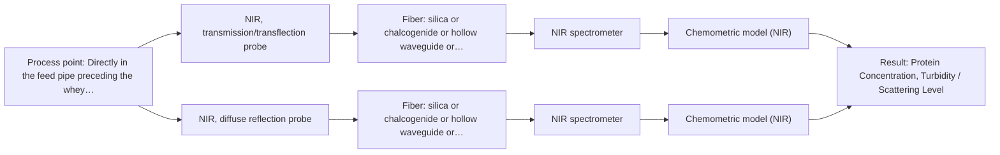
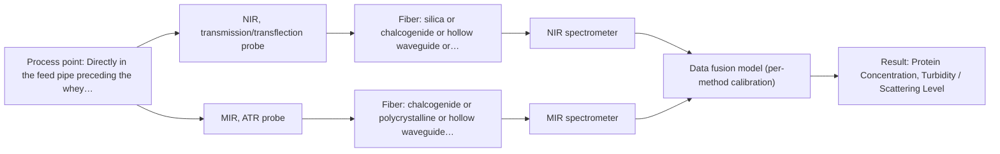

# First technical assessment: A clear whey stream before concentration

## Answer

**Customer request (our summary):** The customer wants to know if in-line spectroscopy can track protein concentration in a whey stream that shifts between clear and turbid.

### Brief answer

NIR spectroscopy is the recommended approach to track protein concentration in whey streams undergoing turbidity shifts. An initial feasibility study should evaluate an NIR transflection probe alongside diffuse reflection to determine the optimal optical pathlength that avoids signal extinction while maintaining sensitivity. Key open questions include the expected protein concentration range, the physical cause of turbidity, and process pipe specifications.

### Proposal

- **Best current option:** O2 (recommended)
- **Basis:** supplied AFS sources
- **What would change it:** Clarification showing that stream turbidity never exceeds the transmission limit would favor the single transflection probe option O1. Conversely, if scattering variations prove impossible to correct in NIR, the MIR ATR option O3 would be required.
- **Next step:** Conduct feasibility trials on representative clear and turbid whey samples using NIR transflection and reflection geometries against reference laboratory protein measurements.

**Secondary evidence (external, not AFS material):** G1: E02 ¶16; G2: no usable external source found; G3: no usable external source found; G4: no usable external source found. See Expert detail.

**Decision status:** Provisional feasibility assessment

### Solution options

| ID | Tier | Methods | Confidence | Cost class, S01 Table 1 (p.6) | Ease of use | Maintenance | Performance fit | Sources |
|---|---|---|---|---|---|---|---|---|
| O1 | Simple | M1 NIR, transmission/transflection probe | Low: open question: Q1, Q2 (starts at Medium); precedent only | average cost (row 7) | Standard single-port probe insertion | Periodic optical window cleaning inspection | Covers moderate turbidity using transflection | [1: S01 p.18] [2: S01 p.18] |
| O2 | Recommended | M1 NIR, transmission/transflection probe; M2 NIR, diffuse reflection probe | Medium: open question: Q1, Q2 (starts at Medium) | average cost (rows 7, 8) | Dual probe interfaces sharing spectrometer | Routine hygiene check on windows | Robust coverage across extreme turbidity | [3: S01 p.18] [4: S01 p.18] [2: S01 p.18] [1: S01 p.18] [5: S01 p.17] [6: S01 p.18] |
| O3 | Extended (multi-method) | M1 NIR, transmission/transflection probe; M3 MIR, ATR probe | Low: open question: Q1, Q2 (starts at Medium); multi-method, fusion benefit not yet shown | high cost (rows 2, 7) | Complex multi-analyzer integration required | High maintenance across two spectrometers | Turbidity immunity with fundamental bands | [7: S01 p.8] [8: S01 p.8] [2: S01 p.18] [1: S01 p.18] [9: S01 p.9] [10: S01 p.18] |

*Confidence rates the basis of the advice (how much is known and cited), not a predicted accuracy or probability of success. It starts at High, or at Medium when a key question on the method or the option is open, and drops one level per weakness listed (floor Low).*

*Cost class is the relative rating in S01 Table 1 (p.6) for the in-line method+technique rows named (the highest one for a multi-method option); it is not a price.*

### Setup sketch

*Recommended option O2; drawn by code from the option, a schematic, not a configuration.*

### Key questions

1. What is the expected protein concentration range and what target measurement accuracy or precision is required?
2. What causes the turbidity increase, and does it involve suspended fat globules, protein aggregates, or mineral precipitants?
3. What are the line temperature, operating pressure, and clean-in-place (CIP) cycling conditions at the measurement port?

## Expert detail

**Customer enquiry**

> Our dairy process includes a relatively clear whey stream before a concentration stage. We want to investigate whether spectroscopy can track protein concentration as the stream changes, with laboratory results used as the reference. The stream can become more turbid under some operating conditions. We need a first measurement concept that handles this change rather than assuming the liquid always remains clear.

**Decision status:** Provisional feasibility assessment. Near-infrared spectroscopy is established in dairy PAT for whey and milk streams, and transflection or dual-probe transmission and reflection setups can accommodate variable turbidity, though calibration across the full turbidity range requires empirical validation.

### Parameters

| ID | Parameter | Kind | Need | Measured by | Why | Sources |
|---|---|---|---|---|---|---|
| P1 | Protein Concentration | quantitative | required | Spectroscopy: NIR | This is the primary process control target required by the customer before the concentration stage. | [11: S01 p.17] |
| P2 | Turbidity / Scattering Level | qualitative | optional | Spectroscopy: NIR | Tracking turbidity indicates whether the stream is clear or scattering, enabling model branch selection or baseline diagnostics. | [12: S01 p.17] |
| P3 | Reference Laboratory Protein Content | quantitative | required | Reference lab method: Standard laboratory protein assay (Kjeldahl / Dumas) | Independent analytical values are required to build and validate multivariate chemometric calibration models. | *(no verified source: engineering judgement)* |

### Solution option details

- **O1 cost drivers:** Single NIR spectrometer, silica fiber cable, single transflection probe
- **O2 cost drivers:** NIR spectrometer with multiplexed channels, silica fibers, transflection and reflection probes
- **O3 cost drivers:** NIR spectrometer, FTIR spectrometer, IR fibers, ATR probe, multiplexer
- **O3 combining methods:** NIR transflection and MIR ATR data must be acquired simultaneously from the exact same stream point and synchronized to a common time step. Preprocessing requires block scaling to balance differing variable counts and signal variances. The fused model must be validated against independent laboratory references and demonstrate superior predictive accuracy over the single best NIR model before justifying ongoing multi-instrument hardware maintenance.

*Extended (multi-method) option O3; drawn by code from the option, a schematic, not a configuration.*

### Premise check

- **Precedent only:** A single optical spectroscopy concept can track protein concentration while adapting to whey stream changes from clear to turbid. Dairy literature precedents report that transflection probes can bridge low-fat and high-fat regimes in some cases, but performance under fluctuating turbidity in a specific whey process must be verified experimentally. [1: S01 p.18]

### Requirements

**Stated by the customer**

- Track protein concentration in a dairy whey stream before a concentration stage
- Account for turbidity changes between relatively clear and turbid conditions
- Use laboratory analytical results as the reference method

**Key unknowns**

- Expected range of protein concentration and required measurement accuracy
- Physical cause and magnitude of turbidity variations (e.g. fat carryover, suspended solids, mineral precipitation)
- Process stream temperature, line pressure, and flow dynamics at the installation point
- Fouling propensity, CIP/SIP procedures, and cleaning chemical compatibility
- Pipe diameter and mechanical fitting constraints for probe mounting

### Clarification questions (most decision-relevant first)

Q1. What is the expected protein concentration range and what target measurement accuracy or precision is required? *Why it matters:* Determining the concentration range establishes whether NIR sensitivity and signal-to-noise ratio meet process control limits across turbidity shifts. *(affects: method, status)*
Q2. What causes the turbidity increase, and does it involve suspended fat globules, protein aggregates, or mineral precipitants? *Why it matters:* The underlying scattering mechanism dictates the appropriate probe optical pathlength, scattering correction pre-treatments, or whether reflectance is necessary. *(affects: technique, M1, M2)*
Q3. What are the line temperature, operating pressure, and clean-in-place (CIP) cycling conditions at the measurement port? *Why it matters:* Process conditions define probe seal materials, optical window brazing requirements, and thermal stability considerations. *(affects: installation)*
Q4. What is the pipe diameter, flow velocity, and available port style before the concentration stage? *Why it matters:* Installation dimensions govern whether an immersion transflection probe or a flush-mounted diffuse reflection interface is hydraulically suitable. *(affects: installation, technique)*

### Recommendation

- **M1 · Primary candidate: NIR, transmission/transflection probe.** NIR transmission is the standard approach for clear whey streams, and a transflection probe can provide a balanced optical pathlength that accommodates moderate turbidity increases. Chemometric scatter correction is applied to resolve protein absorption overtones despite optical path changes. *Conditions:* The optical pathlength must remain small enough to avoid signal saturation during peak turbidity episodes. [2: S01 p.18] [1: S01 p.18]
- **M2 · Comparison candidate: NIR, diffuse reflection probe.** Diffuse reflection relies on backscattered light and does not suffer from pathlength blackout in highly turbid conditions. Evaluating reflection in comparison to transflection determines if severe turbidity invalidates transmission-based measurements. *Conditions:* Applies if the whey stream develops severe turbidity where transflection light transmission is extinguished. [5: S01 p.17] [6: S01 p.18]
- **M3 · Conditional candidate: MIR, ATR probe.** Mid-IR spectroscopy with an ATR probe interrogates an evanescent wave penetration depth of only a few micrometers, rendering the measurement invariant to bulk sample turbidity. It provides sharp fundamental absorption bands for protein amide groups without scattering interference. *Conditions:* Applies if NIR multivariate models cannot deconvolve severe scattering changes from true chemical protein variations. [9: S01 p.9] [10: S01 p.18]

### Measurement concept

- **Probe and geometry:** An in-line NIR transflection immersion probe with a controlled optical gap, alongside an optional secondary flush-mounted diffuse reflection probe head sharing the spectrometer module.
- **Location:** Directly in the feed pipe preceding the whey concentration stage, oriented to ensure continuous liquid sweep across optical windows.
- **Fiber link:** Silica optical fiber cables routing light between the process port and a remote spectrometer. [3: S01 p.18]

### Spectral range

- **NIR:** The nominal NIR method range is 780-2500 nm; usable wavelengths depend on the specific spectrometer detector, silica fiber solarization or attenuation, and probe optics. [13: S01 p.10]
- **MIR:** The nominal mid-IR range spans 4000-400 cm-1 (2.5-25 µm); practical in-line fiber transmission is constrained by chalcogenide or polycrystalline fiber windows and ATR crystal cutoffs. [9: S01 p.9]

### Risks and uncertainty

- Severe turbidity surges may extinguish optical transmission in transflection gaps, causing signal saturation and model failure. *(rules: R-GEO-2, R-GEN-4)* [14: S01 p.18]
- Fluctuating particle size distributions during turbidity changes can introduce baseline scattering shifts that mimic concentration changes if uncorrected. *(rules: R-GEO-6, R-CAL-1)* [12: S01 p.17]
- Fouling or protein coating on the optical window surfaces over extended run times can distort calibration integrity. *(rules: R-MIR-3, R-GEN-5)* [15: REF §5]
- Water overtone absorption bands strongly dominate the NIR spectrum and require robust chemometric deconvolution. *(rules: R-GEN-3, R-NIR-2)* [16: S01 p.18]

### First feasibility experiment

1. **Collect representative static whey samples spanning the full clear, transitional, and turbid operational regimes alongside standard reference laboratory assays.** Define the optical transmission boundaries, pathlength limitations, and reference protein concentration baseline. [17: REF §3]
2. **Acquire spectra on benchtop spectrometers comparing NIR transflection with varied pathlengths against NIR diffuse reflection.** Identify the optical pathlength and probe geometry that maintain adequate signal across both clear and turbid samples. *(no verified source: engineering judgement)*
3. **Preprocess spectra with Multiplicative Scatter Correction or Standard Normal Variate to isolate protein absorption bands from scatter variance.** Eliminate physical scattering interference caused by varying turbidity. [11: S01 p.17]
4. **Construct and validate Partial Least Squares regression models on independent, held-out validation batches.** Verify model prediction accuracy and assess whether a single model or dual-branch calibration is required. *(no verified source: engineering judgement)*
5. **Evaluate performance against customer accuracy thresholds across clear and turbid validation subsets to establish go/no-go status.** Confirm measurement reliability before undertaking plant installation and mechanical probe integration. [17: REF §3]

**Reference measurements:** Independent standard dairy laboratory protein assays (e.g. Kjeldahl or Dumas combustion nitrogen analysis) on identical paired sample aliquots.

**Decision basis:** A go/no-go decision based on the customer-specified prediction error threshold (e.g. RMSEP) and successful tracking across both clear and turbid conditions without signal extinction.

### Assumptions

- Protein concentrations fall within the sensitivity range measurable by NIR overtone spectroscopy.
- Turbidity does not completely block NIR light across an optimized short transflection pathlength.
- Process temperature remains within stable operating bounds or is compensated via auxiliary sensor inputs.
- Standard cleaning procedures prevent long-term organic fouling on probe optical surfaces.

### Not covered by the supplied sources

- Specific optical absorption cross-sections or quantitative detection limits for whey protein under changing turbidity
- Pressure ratings and sanitary connection specifications for specific dairy pipe diameters

### Further notes

- **Chemometrics:** A Partial Least Squares (PLS) regression model should be trained with laboratory reference data. Preprocessing should incorporate Multiplicative Scatter Correction (MSC) or Standard Normal Variate (SNV) to remove physical baseline variations caused by light scattering in turbid whey.
- **Real-time tracking:** In-line fiber-optic acquisition provides continuous second-by-second tracking of protein content directly in the feed pipe, alerting operators immediately to composition shifts prior to concentration.
- **Future direction:** If turbidity shifts correlate with specific macro-components like fat carryover or mineral fouling, spectral feature extraction can be expanded to simultaneously monitor fat-to-protein ratios.

### Secondary evidence (external, not AFS material)

*Found by a literature search for gaps the supplied AFS sources leave open. Not AFS material and not proof for this case; every quote below was verified verbatim against the fetched text.*

*Live search unavailable (library only: cache miss (europepmc); cache miss (openalex)); curated library only.*

**G1 · multi-method:** Combining several spectroscopy methods (data fusion) (NIR transflection and MIR ATR data must be acquired simultaneously from the exact same stream point and synchronized to a common time step. Preprocessing requires block scaling to balance differing variable counts and signal variances. The fused model must be validated against independent laboratory references and demonstrate superior predictive accuracy over the single best NIR model before justifying ongoing multi-instrument hardware maintenance.)

- **E02 ¶16** Although block scaling is frequently suggested for data fusion, it can occasionally degrade results compared to alternative pre-processing techniques. *How it applies:* When combining spectral modalities for dairy monitoring, multiple preprocessing strategies should be evaluated rather than assuming block scaling is optimal. *Limits and transfer risks:* The cited review summarizes general dairy applications, so the comparative performance of block scaling may vary depending on the specific optical instruments and stream conditions. *(supports O3)*
  > "While block scaling is often recommended for data fusion, sometimes it can have a worse effect on results than other pre-processing methods (17)."
  > Spectroscopic technologies and data fusion: Applications for the dairy industry. (2022) · Frontiers in nutrition · doi:10.3389/fnut.2022.1074688 · https://europepmc.org/article/PMC/PMC9875022 · retrieved 2026-10-17, full text, licence: cc by, via curated library

**G2 · not in the supplied sources:** Specific optical absorption cross-sections or quantitative detection limits for whey protein under changing turbidity

- No usable external source found.

**G3 · not in the supplied sources:** Pressure ratings and sanitary connection specifications for specific dairy pipe diameters

- No usable external source found.

**G4 · parameter without a source:** Measuring Reference Laboratory Protein Content: Independent analytical values are required to build and validate multivariate chemometric calibration models.

- No usable external source found.

### Evidence (verified quotes)

1. ✓ **S01 p.18** (application precedent): "In some cases, a Transflection probe can already be a combined solution working well for low-fat and high-fat containing milk products."
2. ✓ **S01 p.18** (application precedent): "Transmission is the preferred method for transparent or semi-transparent liquids, such as skim milk, whey, or permeate."
3. ✓ **S01 p.18** (general): "NIR Spectrometer and NIR light source remain the same for both reflection and transmission techniques."
4. ✓ **S01 p.18** (general): "The Advantage of Dual-Technique Availability: having both fiber optic techniques available in a lab rather than relying on one provides the flexibility needed to monitor the entire production chain."
5. ✓ **S01 p.17** (application precedent): "The use of Near-Infrared (NIR) spectroscopy for the inline monitoring of milk is a cornerstone of modern dairy "Process Analytical Technology" (PAT)."
6. ✓ **S01 p.18** (general): "reflection can work well in highly scattering environments but can be less representative for clear liquids."
7. ✓ **S01 p.8** (general): "two or more probes, belonging to different methods, can be used for measurements, but the data from each method must be obtained simultaneously."
8. ✓ **S01 p.8** (general): "Ultimately, the measurement data must be normalized to a common time step."
9. ✓ **S01 p.9** (general): "Vibrational spectroscopy in the mid-IR range (4000-400 cm-1) is one of the most informative methods of chemical analysis."
10. ✓ **S01 p.18** (application precedent): "While NIR is the workhorse of the dairy industry, advanced labs often incorporate Fluorescence, Raman, and Mid-Infrared (MIR) ATR fiber optic techniques to capture specific chemical or structural information that NIR might miss."
11. ✓ **S01 p.17** (application precedent): "applying Multiplicative Scatter Correction (MSC) or Standard Normal Variate (SNV) transformations to remove physical interference caused by the scattering nature of the milk particles before using Partial Least Squares (PLS) regression to quantify fat and protein."
12. ✓ **S01 p.17** (general): "the method is sensitive to the surface characteristics and fat globule size."
13. ✓ **S01 p.10** (general): "NIR spectra (780-2500 nm) contain predominantly overtones and component bands of fundamental vibrations"
14. ✓ **S01 p.18** (general): "it fails when the milk becomes too "thick" or fat-rich, as the light cannot penetrate the sample."
15. ✓ **REF §5** (general): "Usable range limited by fiber and crystal; contact, fouling, compatibility."
16. ✓ **S01 p.18** (general): "if the pathlength is too wide, the signal is lost to absorption"
17. ✓ **REF §3** (general): "Representative samples or process states, independent reference measurements, what is compared, and the basis for the go / no-go decision."

### Verification

- Citations verified: 24 of 24 (exact or whitespace/hyphen-tolerant match on the cited page, scope checked).
- Hard check failures before deterministic corrections: 0; still open: 0; soft warnings: 0; repair rounds: 1.
- External evidence (cache): 1 quote(s) verified verbatim (exact or whitespace/hyphen-tolerant, at most 400 characters and 2 sentences, against the cited paragraph); 0 item(s) dropped.
- External search: 6 query(ies), 0 hit(s), 3 source(s) (3 from the curated library); ⚠ library only: cache miss (europepmc); cache miss (openalex).
- External step: 2 model call(s), 6.5 s extra (cost in the run JSON).

*Run D03-20261018T080635Z-79ed · models google/gemini-3.8-flash*
