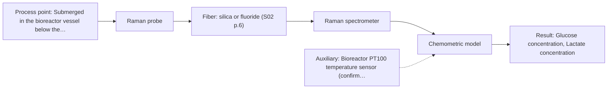

# First technical assessment: Glucose and lactate trends in an aqueous bioprocess

## Answer

**Customer request (our summary):** The customer is looking to explore an in situ optical spectroscopy pilot to monitor glucose and lactate in a cell culture process as an alternative to delayed laboratory sample testing.

### Brief answer

In situ Raman spectroscopy is the recommended primary method to pilot for monitoring glucose and lactate in your aqueous cell culture, as water does not interfere strongly with Raman scattering. Mid-IR ATR serves as a benchmark alternative. Multi-method offline trials on representative broth samples should be conducted first to evaluate background fluorescence and confirm detection limits before probe installation.

### Proposal

- **Best current option:** O1 (recommended)
- **Basis:** supplied AFS sources
- **What would change it:** High media autofluorescence swamping the Raman spectrum or analyte levels below Raman detection thresholds would favor testing MIR ATR or an alternative technique.
- **Next step:** Test Raman spectra on representative offline broth samples across different batch stages to assess baseline fluorescence and signal clarity before installing an in situ probe.

**Secondary evidence (external, not AFS material):** G1: no usable external source found; G2: no usable external source found; G3: no usable external source found; G4: no usable external source found. See Expert detail.

**Decision status:** Provisional feasibility assessment

### Solution options

| ID | Tier | Methods | Confidence | Cost class, S01 Table 1 (p.6) | Ease of use | Maintenance | Performance fit | Sources |
|---|---|---|---|---|---|---|---|---|
| O1 | Recommended | M1 Raman probe | Medium: open question: Q1 (starts at Medium) | high cost (row 12) | Standard in situ immersion probe insertion | Window cleaning between cultivation batch runs | Tolerates aqueous broth with molecular specificity | [1: S01 p.16] [2: S01 p.16] [3: S01 p.12] |
| O2 | Simple | M2 MIR, ATR probe | Medium: open question: Q1 (starts at Medium) | high cost (row 2) | ATR immersion probe direct broth contact | Crystal inspection for biofilm or fouling | Strong fundamental bands but shallow sampling | [4: S01 p.5] [5: S01 p.10] |

*Confidence rates the basis of the advice (how much is known and cited), not a predicted accuracy or probability of success. It starts at High, or at Medium when a key question on the method or the option is open, and drops one level per weakness listed (floor Low).*

*Cost class is the relative rating in S01 Table 1 (p.6) for the in-line method+technique rows named (the highest one for a multi-method option); it is not a price.*

### Setup sketch

*Recommended option O1; drawn by code from the option, a schematic, not a configuration.*

### Key questions

1. What are the minimum, maximum, and critical decision concentrations for glucose and lactate across your cultivation run?
2. What specific laboratory reference method and turnaround time are currently used to quantify glucose and lactate from samples?
3. What bioreactor vessel type, working volume, and probe connection port standards are available, and what sterilization protocol is required?

## Expert detail

**Customer enquiry**

> We run a cell culture process in an aqueous medium. Glucose and lactate are measured from samples, and the delay makes it difficult to see changes promptly. We are exploring an in situ spectroscopy pilot that can be checked against those existing laboratory measurements. The medium and cell population change during the run; we have not yet selected a probe or a calibration strategy.

**Decision status:** Provisional feasibility assessment. Raman spectroscopy with an immersible probe is justified as the primary candidate for aqueous glucose and lactate monitoring, with mid-IR ATR as a benchmark. Confirmation depends on testing real broth across cell-density ranges to evaluate fluorescence background and crystal fouling.

### Parameters

| ID | Parameter | Kind | Need | Measured by | Why | Sources |
|---|---|---|---|---|---|---|
| P1 | Glucose concentration | quantitative | required | Spectroscopy: Raman | Primary metabolic carbon source that must be tracked promptly to guide feeding decisions and prevent depletion. | [6: S01 p.16] |
| P2 | Lactate concentration | quantitative | required | Spectroscopy: Raman | Key inhibitory by-product whose accumulation indicates metabolic shifts or cellular stress. | [6: S01 p.16] |
| P3 | Laboratory reference glucose and lactate values | quantitative | required | Reference lab method: Customer laboratory reference analyzer (e.g., enzymatic analyzer or HPLC) | Independent analytical baseline required to calibrate and validate chemometric regression models. | *(no verified source: engineering judgement)* |
| P4 | Broth temperature | quantitative | optional | Auxiliary sensor: Bioreactor PT100 temperature sensor (engineering judgement: confirm availability with AFS) | Thermal variation affects spectral band shapes and optical sensor response, making temperature compensation beneficial. | *(no verified source: engineering judgement)* |

### Solution option details

- **O1 cost drivers:** Raman spectrometer, laser source, and filtered immersion fiber probe
- **O2 cost drivers:** FTIR spectrometer, IR chalcogenide/polycrystalline fibers, ATR probe head

### Premise check

- **Precedent only:** In situ optical spectroscopy can directly monitor glucose and lactate in an aqueous cell culture broth. Published literature reports tracking glucose and lactate in bioprocesses via Raman spectroscopy, which is favoured because water has low Raman background. However, feasibility and accuracy depend on the specific cell line, medium components, and matrix effects. [2: S01 p.16]
- **Precedent only:** In situ spectroscopy can replace delayed offline laboratory testing during dynamic cultivation runs. Fiber-optic probes permit in situ process tracking, but optical chemometric models require validation across changing cell densities and matrix variations against standard reference analyses. [7: S01 p.2] [8: REF §5]

### Requirements

**Stated by the customer**

- Cell culture process running in an aqueous medium
- Target analytes are glucose and lactate
- Monitor concentration dynamics in situ to avoid offline sampling delays
- Cross-validate optical predictions against existing laboratory reference analyses
- Account for evolving medium composition and changing cell population over the run

**Key unknowns**

- Expected dynamic concentration ranges and target limits of detection for glucose and lactate
- Current laboratory reference analytical technique (e.g., enzymatic analyzer, bio-profile analyzer, or HPLC)
- Bioreactor scale, vessel interface, port size and type, and sterilisation requirements (autoclave, SIP, or single-use)
- Turbidity, optical density, and peak biomass range across the run duration
- Presence of fluorescent medium ingredients (such as riboflavin or aromatic amino acids) or bubbling/aeration interference

### Clarification questions (most decision-relevant first)

Q1. What are the minimum, maximum, and critical decision concentrations for glucose and lactate across your cultivation run? *Why it matters:* Determines whether Raman spectroscopy has sufficient sensitivity or if low-concentration phases fall below spectroscopic detection limits. *(affects: method, status, M1)*
Q2. What specific laboratory reference method and turnaround time are currently used to quantify glucose and lactate from samples? *Why it matters:* The reference method defines the analytical truth, calibration accuracy ceiling, and validation protocol for the chemometric models. *(affects: status)*
Q3. What bioreactor vessel type, working volume, and probe connection port standards are available, and what sterilization protocol is required? *Why it matters:* Dictates probe mechanical dimensions, sealing materials, optical window composition, and compatibility with autoclavable or CIP/SIP environments. *(affects: technique, installation)*
Q4. Does the broth contain strongly autofluorescent components (e.g., riboflavin, vitamins, complex media feeds), and does sparging introduce heavy aeration bubbles near port locations? *Why it matters:* Severe fluorescence background can swamp weak Raman signals, requiring excitation wavelength optimization or optical filtering. *(affects: method, M1)*

### Recommendation

- **M1 · Primary candidate: Raman probe.** Raman spectroscopy provides sharp vibrational fingerprinting for both glucose and lactate. It is particularly well-suited to bioprocessing because water exhibits low Raman scattering compared to infrared methods. [2: S01 p.16] [3: S01 p.12]
- **M2 · Comparison candidate: MIR, ATR probe.** Mid-IR spectroscopy exhibits strong fundamental vibrational absorptions for organic metabolites. Using an ATR crystal interface avoids total water pathlength saturation by restricting light penetration to a few micrometers. *Conditions:* Cell adhesion, protein fouling, or biofilm formation on the ATR crystal must be manageable. [4: S01 p.5] [5: S01 p.10]
- **M3 · Conditional candidate: NIR, transmission/transflection probe.** Near-infrared spectroscopy can monitor glucose in the millimolar range using standard glass optics. However, its broad overlapping bands and high water absorption require precise pathlength control and may lack sensitivity for low lactate levels. *Conditions:* Applicable only if cell turbidity does not completely block transmission and analyte concentrations remain above 0.1 percent. [9: S01 p.16] [10: S01 p.18]

### Measurement concept

- **Probe and geometry:** Immersion probe inserted directly into the bioreactor broth. For Raman, an immersion Raman probe with sapphire window and optical filtering; for mid-IR, an ATR immersion probe with an ATR crystal (e.g., diamond or ZrO2).
- **Location:** Submerged in the bioreactor vessel below the minimum working liquid level, positioned in an active mixing zone away from direct sparger bubbles.
- **Fiber link:** Flexible silica fiber optic cables for Raman (excitation and collection). If mid-IR ATR is compared, polycrystalline infrared (PIR) or chalcogenide (CIR) fibers transmit mid-IR radiation. [11: S01 p.5] [12: S01 p.15] [13: S02 p.6] [14: S02 p.6]

### Spectral range

- **Raman:** Raman spectra are reported as Raman shift in wavenumbers (cm-1), with the laser excitation wavelength (such as 785 nm) stated separately. The usable range depends on the instrument, fiber, and probe actually selected. [15: S01 p.11] [16: REF §5] [17: S01 p.15]
- **MIR:** Nominal fundamental vibrational mid-IR range is 4000-400 cm-1; usable range is constrained by probe crystal transmittance and infrared fiber transmission windows. [18: S01 p.9] [19: REF §3]

### Risks and uncertainty

- Fluorescence from cultivation media ingredients or cellular metabolites can superimpose on weak Raman scattering, degrading signal-to-noise ratio. *(rules: R-RAM-1)* [20: S01 p.11]
- Cell aggregation, protein adsorption, or biofilm accumulation on the immersion probe optical surface can cause signal drift and degrade analytical accuracy. *(rules: R-MIR-3, R-GEN-5)* [21: S01 p.7] [22: REF §5]
- Raman and infrared calibrations are matrix-specific; shifts in background nutrients, feed supplements, or cell debris may undermine chemometric model accuracy if not captured in the training data. *(rules: R-CAL-1)* [8: REF §5]
- Strong water absorption limits optical penetration in infrared methods, requiring strict pathlength control or shallow ATR evanescent wave sampling. *(rules: R-GEN-3, R-GEN-4)* [23: S01 p.18]

### First feasibility experiment

1. **Offline multi-method matrix screening** Collect Raman and MIR-ATR spectra on sterile media, standard glucose/lactate spike solutions, and spent broth samples to verify spectral band resolution and check for background fluorescence. [24: S01 p.3]
2. **Calibration set generation spanning run variability** Acquire spectra from a series of bioreactor broth samples spanning early, exponential, and stationary phases with varying cell densities and nutrient concentrations. [25: REF §3]
3. **Independent reference analysis pairing** Analyze every calibration sample synchronously with the existing laboratory analytical reference method to obtain paired reference concentration values. [25: REF §3]
4. **Single-method chemometric model building and validation** Develop PLS regression models for glucose and lactate using Raman (and MIR ATR for benchmark comparison); evaluate predictive performance on independent, held-out process runs. [26: S01 p.5]
5. **In situ pilot evaluation in live bioreactor** Install the leading immersion probe in the pilot bioreactor to track dynamic glucose and lactate profiles in real time, assessing optical window fouling and baseline stability. [7: S01 p.2]

**Reference measurements:** Independent quantitative concentration data from the customer's established laboratory reference method (such as an enzymatic bioanalyzer or HPLC) run on paired broth aliquots.

**Decision basis:** A go/no-go outcome based on customer-defined accuracy targets (e.g., target RMSEP and correlation R2 against lab references) across the full operational range, without prohibitive fluorescence or window fouling.

### Assumptions

- The target analyte concentrations (glucose and lactate) are within the typical bioprocess millimolar operating regime accessible to vibrational spectroscopy.
- Optical window fouling by cell adhesion or protein deposition can be mitigated through process flow or validated probe cleaning protocols.
- The bioreactor has an accessible standard port below the liquid level to accommodate an immersion probe.

### Not covered by the supplied sources

- Specific spectral cross-sections or detection limits for lactate in mammalian or microbial cell broths
- Pressure, temperature, and steam-sterilisation ratings for specific probe housings
- Commercially available fiber probe part numbers or pricing

### Further notes

- **Chemometrics:** Multivariate regression (such as PLS) is essential to extract overlapping metabolite signatures from background media components. The calibration must incorporate spectra from diverse culture phases and changing cell counts, paired with accurate laboratory reference values, and validated against independent batches.
- **Real-time tracking:** In situ optical acquisition generates continuous or periodic spectral updates in real time, eliminating the delay of manual sampling and sample prep so that metabolic changes can be identified promptly.
- **Future direction:** If biomass monitoring or nutrient broad-range surveillance is added later, combining Raman with UV-Vis turbidity tracking or multi-channel LED sensors could provide comprehensive bioprocess control.

### Secondary evidence (external, not AFS material)

*Found by a literature search for gaps the supplied AFS sources leave open. Not AFS material and not proof for this case; every quote below was verified verbatim against the fetched text.*

*Live search unavailable (library only: cache miss (europepmc); cache miss (openalex)); curated library only.*

**G1 · auxiliary sensor:** In-line measurement of Broth temperature with Bioreactor PT100 temperature sensor

- No usable external source found.

**G2 · not in the supplied sources:** Specific spectral cross-sections or detection limits for lactate in mammalian or microbial cell broths

- No usable external source found.

**G3 · not in the supplied sources:** Pressure, temperature, and steam-sterilisation ratings for specific probe housings

- No usable external source found.

**G4 · not in the supplied sources:** Commercially available fiber probe part numbers or pricing

- No usable external source found.

### Evidence (verified quotes)

1. ✓ **S01 p.16** (general): "Raman is particularly well-suited for aqueous environments, as it exhibits low absorbance for water molecules compared to infrared methods."
2. ✓ **S01 p.16** (application precedent): "Raman spectroscopy can be used in the same reactor to provide a "molecular fingerprint" for direct detection of specific metabolites like glucose, acetate, or lactate. This combination is practical because Raman is particularly well-suited for aqueous environments, as it exhibits low absorbance for water molecules compared to infrared methods."
3. ✓ **S01 p.12** (general): "Therefore, Raman spectra (as well as IR absorption spectra) can be used to construct chemometric models-calibration or classification ones."
4. ✓ **S01 p.5** (general): "strong absorption in the mid-IR region limits the corresponding spectral method to the analysis of very thin samples (usually less than 50 μm), but it opens up the possibility of using attenuated total reflectance (ATR)"
5. ✓ **S01 p.10** (general): "ATR fiber probes (Fig.1) enable the analysis of liquids and solid elastic samples, such as biological tissue, using specialized probes utilizing high-transmission fiber optics in the Mid-IR region."
6. ✓ **S01 p.16** (application precedent): "Raman spectroscopy can be used in the same reactor to provide a "molecular fingerprint" for direct detection of specific metabolites like glucose, acetate, or lactate."
7. ✓ **S01 p.2** (general): "Fiber optic probes and cells are being integrated into reactors and production lines of ongoing technological processes, enabling on-site online analysis and obtaining results in near real time."
8. ✓ **REF §5** (general): "Weak signal, fluorescence background; calibration specific to the matrix."
9. ✓ **S01 p.16** (general): "NIR spectroscopy is effective for tracking major components like glucose or glycerol in the millimolar range but may lack the sensitivity to detect trace compounds below 0.1 percent."
10. ✓ **S01 p.18** (general): "the precise control of the optical pathlength (usually 1 - 10 mm); if the pathlength is too wide, the signal is lost to absorption; if too narrow, the sample represents a negligible volume."
11. ✓ **S01 p.5** (general): "Immersible fiber optic probes operating in various spectral regions from UV to mid-IR are increasingly being used for measuring liquid and soft or powdered solid samples."
12. ✓ **S01 p.15** (general): "The use of fiber optics is critical here, as it allows the sensitive spectrometers to be located safely away from the vibration and dust of the manufacturing floor."
13. ✓ **S02 p.6** (general): "350 nm Standard VIS-NIR Silica Fibers Al/Cu-coated VIS-NIR Silica Fibers 2400 nm"
14. ✓ **S02 p.6** (general): "3000 nm Polycrystalline Infrared Fibers 17 μm"
15. ✓ **S01 p.11** (general): "The Raman shift is used as the horizontal (spectral) axis in Raman spectroscopy"
16. ✓ **REF §5** (general): "Raman shift (cm-1) and laser excitation (nm) are stated separately"
17. ✓ **S01 p.15** (application precedent): "Raman spectrometer and Raman fiber probe for contact measurements with 785 nm excitation wavelength"
18. ✓ **S01 p.9** (general): "Vibrational spectroscopy in the mid-IR range (4000-400 cm-1) is one of the most informative methods of chemical analysis."
19. ✓ **REF §3** (general): "A nominal method range is not the range of a specific instrument, fiber or probe."
20. ✓ **S01 p.11** (general): "superposition of luminescence (fluorescence), which has a significantly higher intensity."
21. ✓ **S01 p.7** (general): "Morphological factors, such as sample inhomogeneity (e.g., biological tissue) or process turbulence, must also be considered when selecting a measurement technique."
22. ✓ **REF §5** (general): "Usable range limited by fiber and crystal; contact, fouling, compatibility."
23. ✓ **S01 p.18** (general): "if the pathlength is too wide, the signal is lost to absorption; if too narrow, the sample represents a negligible volume."
24. ✓ **S01 p.3** (general): "samples of incompletely known composition, in order to select the most suitable method or combination of methods."
25. ✓ **REF §3** (general): "Representative samples or process states, independent reference measurements, what is compared, and the basis for the go / no-go decision."
26. ✓ **S01 p.5** (general): "Chemometric algorithms are implemented in specialized software that enables preliminary data preparation (preprocessing), construction, validation, and application of predictive models, specifically calibration or classification models."

### Verification

- Citations verified: 34 of 34 (exact or whitespace/hyphen-tolerant match on the cited page, scope checked).
- Hard check failures before deterministic corrections: 0; still open: 0; soft warnings: 1; repair rounds: 1.
- External evidence (cache): 0 quote(s) verified verbatim (exact or whitespace/hyphen-tolerant, at most 400 characters and 2 sentences, against the cited paragraph); 0 item(s) dropped.
- External search: 4 query(ies), 0 hit(s), 3 source(s) (3 from the curated library); ⚠ library only: cache miss (europepmc); cache miss (openalex).
- External step: 2 model call(s), 4.9 s extra (cost in the run JSON).

*Run D04-20261018T080635Z-a0b2 · models google/gemini-3.8-flash*
