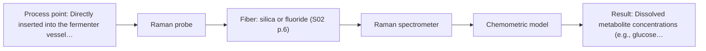
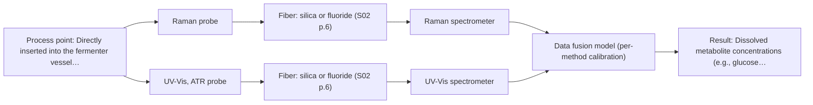

# First technical assessment: Biomass related monitoring during yeast fermentation

## Answer

**Customer request (our summary):** The customer is seeking an optical spectroscopy approach to monitor growth and detect changes early during yeast fermentation, specifically asking how to structure a feasibility study with appropriate reference measurements given undefined biomass and metabolic targets.

### Brief answer

We recommend testing Raman spectroscopy first with an immersion probe to capture molecular fingerprints of dissolved metabolites without water interference. For biomass growth tracking across increasing optical density, UV-Vis ATR should be evaluated as a low-cost comparison. Combining both methods remains a secondary hypothesis if a single technique cannot resolve both targets. Next, please specify your target metabolites and reference methods to finalize the feasibility protocol.

### Proposal

- **Best current option:** O2 (recommended)
- **Basis:** supplied AFS sources
- **What would change it:** If the customer requires only general growth tracking rather than molecular speciation, the simpler UV-Vis option (O1) would be preferred; if neither method individually resolves both growth and metabolites, the fused option (O3) will be evaluated.
- **Next step:** Define the target metabolite species and offline reference methods, and supply representative broth samples for preliminary laboratory testing.

**Secondary evidence (external, not AFS material):** G1: no usable external source found; G2: no usable external source found; G3: no usable external source found; G4: no usable external source found. See Expert detail.

**Decision status:** Provisional feasibility assessment

### Solution options

| ID | Tier | Methods | Confidence | Cost class, S01 Table 1 (p.6) | Ease of use | Maintenance | Performance fit | Sources |
|---|---|---|---|---|---|---|---|---|
| O1 | Simple | M2 UV-Vis, ATR probe | Medium: open question: Q1, Q2 (starts at Medium) | average cost (row 14) | Simple single probe immersion setup | Periodic optical face cleaning required | Directly tracks turbidity growth trends | [1: S01 p.16] [2: S01 p.16] |
| O2 | Recommended | M1 Raman probe | Medium: open question: Q1, Q2 (starts at Medium) | high cost (row 12) | Straightforward single Raman probe operation | Periodic laser verification and cleaning | Resolves chemical fingerprints despite water | [3: S01 p.16] [4: S01 p.16] |
| O3 | Extended (multi-method) | M1 Raman probe; M2 UV-Vis, ATR probe; M3 Raman probe + UV-Vis (combination) | Low: open question: Q1, Q2 (starts at Medium); multi-method, fusion benefit not yet shown | high cost (rows 12, 14) | Complex multi-sensor alignment required | Dual instrument maintenance and calibration | Simultaneously resolves growth and chemistry | [5: S01 p.8] [6: S01 p.8] [7: REF §5] [4: S01 p.16] [3: S01 p.16] [1: S01 p.16] [2: S01 p.16] [8: REF §5] |

*Confidence rates the basis of the advice (how much is known and cited), not a predicted accuracy or probability of success. It starts at High, or at Medium when a key question on the method or the option is open, and drops one level per weakness listed (floor Low).*

*Cost class is the relative rating in S01 Table 1 (p.6) for the in-line method+technique rows named (the highest one for a multi-method option); it is not a price.*

### Setup sketch

*Recommended option O2; drawn by code from the option, a schematic, not a configuration.*

### Key questions

1. Which specific dissolved metabolites (such as glucose, ethanol, acetate, or glycerol) do you need to monitor, and what are their target concentration ranges?
2. What primary offline analytical methods (such as dry cell weight or OD600 for biomass, and HPLC or enzymatic kits for metabolites) will be used to calibrate the optical data?
3. What port dimensions or mounting type (e.g., standard Ingold or sanitary flange) and hygiene protocols (such as SIP or autoclaving) must the in-line probe support?

## Expert detail

**Customer enquiry**

> We would like an optical measurement during yeast fermentation to help us follow growth and notice changes earlier. Our team has mentioned both a biomass signal and a metabolic signal, but these have not been defined as separate targets. The broth becomes more optically dense as the run develops. We need help turning this request into an initial feasibility study with useful reference measurements.

**Decision status:** Provisional feasibility assessment. A provisional assessment is justified based on established bioprocess precedents for Raman metabolite fingerprinting and UV-Vis ATR biomass tracking. Definitive configuration depends on clarifying the specific target analytes and selecting offline reference methods.

### Parameters

| ID | Parameter | Kind | Need | Measured by | Why | Sources |
|---|---|---|---|---|---|---|
| P1 | Dissolved metabolite concentrations (e.g., glucose, ethanol, organic acids) | quantitative | required | Spectroscopy: Raman | Quantifying carbon source depletion and product formation reveals metabolic state changes across the fermentation cycle. | [4: S01 p.16] |
| P2 | Biomass density (cell suspension turbidity / optical density) | quantitative | required | Spectroscopy: UV-Vis | Monitoring cell suspension light attenuation provides a continuous proxy for yeast biomass accumulation. | [9: S01 p.16] |
| P3 | Offline reference metabolite concentrations | quantitative | required | Reference lab method: HPLC or enzymatic assay kits | Independent chromatographic or enzymatic measurements are required to calibrate and validate in-line Raman models. | *(no verified source: engineering judgement)* |
| P4 | Offline reference biomass (dry cell weight) | quantitative | required | Reference lab method: Gravimetric filtration and drying (DCW) | Gravimetric dry cell weight provides an absolute primary reference to calibrate optical turbidity measurements. | *(no verified source: engineering judgement)* |

### Solution option details

- **O1 cost drivers:** Standard UV-Vis spectrometer, UV-ATR immersion probe, and silica fiber patch cords
- **O2 cost drivers:** Stabilized laser source, high-resolution Raman spectrometer, and Raman immersion probe
- **O3 cost drivers:** Dual spectrometers, separate laser and UV-Vis light sources, dual probes, and data fusion software
- **O3 combining methods:** Spectral data from both the Raman and UV-Vis instruments must be collected from equivalent sample locations and synchronized to a common time step. Preprocessing requires block autoscaling to normalize different signal scales, with independent calibration models maintained for each hardware block. Fused regression models must demonstrate a statistically significant accuracy improvement over the best single method on held-out validation batches before justifying two operational instruments.

*Extended (multi-method) option O3; drawn by code from the option, a schematic, not a configuration.*

### Requirements

**Stated by the customer**

- Follow yeast growth and notice process changes earlier during fermentation.
- Address both a biomass signal and a metabolic signal, which are currently undefined as separate targets.
- Accommodate fermentation broth that increases in optical density as the run develops.
- Formulate an initial feasibility study protocol with useful reference measurements.

**Key unknowns**

- Specific metabolic analytes of interest (e.g., glucose, ethanol, glycerol, organic acids) and their expected concentration profiles.
- Quantitative biomass metric and primary reference method (e.g., dry cell weight, OD600, or viable cell count).
- Fermenter vessel volume, port dimensions (e.g., standard Ingold port), and available probe insertion points.
- Aeration and agitation conditions that may generate interfering gas bubbles at the optical probe interface.
- Vessel cleaning and sterilization requirements (e.g., CIP, SIP, or autoclaving).
- Fouling characteristics and biofilm adhesion of the yeast broth on optical probe surfaces during late-stage fermentation.

### Clarification questions (most decision-relevant first)

Q1. Which specific dissolved metabolites (such as glucose, ethanol, acetate, or glycerol) do you need to monitor, and what are their target concentration ranges? *Why it matters:* The specific chemical targets and their concentrations dictate whether Raman spectroscopy provides adequate sensitivity and selectivity. *(affects: method)*
Q2. What primary offline analytical methods (such as dry cell weight or OD600 for biomass, and HPLC or enzymatic kits for metabolites) will be used to calibrate the optical data? *Why it matters:* Accurate, independent reference assays are required to build and validate chemometric calibration models. *(affects: method, technique)*
Q3. What port dimensions or mounting type (e.g., standard Ingold or sanitary flange) and hygiene protocols (such as SIP or autoclaving) must the in-line probe support? *Why it matters:* Mechanical dimensions, seal materials, and temperature/pressure ratings define probe design and fermenter mounting. *(affects: installation)*
Q4. What are the typical agitation speeds and sparging rates, and does the broth form deposits or films on immersed surfaces? *Why it matters:* Entrained gas bubbles and surface fouling can distort optical paths and evanescent wave coupling. *(affects: technique, installation)*

### Recommendation

- **M1 · Primary candidate: Raman probe.** Raman spectroscopy provides a direct molecular fingerprint for specific dissolved metabolites such as sugars and acids with minimal interference from water. An immersion probe operates directly in aqueous fermentation broth without requiring sample dilution. [4: S01 p.16] [3: S01 p.16]
- **M2 · Comparison candidate: UV-Vis, ATR probe.** UV-Vis ATR utilizes evanescent wave attenuation across a very short penetration depth, preventing signal saturation in highly turbid broths. It serves as a robust and low-cost indicator to track cell suspension turbidity as a growth proxy. [1: S01 p.16] [2: S01 p.16]
- **M3 · Conditional candidate: Raman probe + UV-Vis (combination).** Coupling Raman spectroscopy with UV-Vis ATR allows simultaneous monitoring of chemical metabolite kinetics and overall biomass growth. This multi-method configuration is treated as a later hypothesis to test against the best single method. *Conditions:* Applies if single-method evaluations show that neither Raman nor UV-Vis ATR alone can resolve both growth and metabolic targets. [4: S01 p.16] [8: REF §5]

### Measurement concept

- **Probe and geometry:** Immersion probe configuration utilizing an immersion Raman probe with filtered optics for inelastic scattering, or a UV-Vis ATR probe utilizing internal reflection at a crystal interface to sample a superficial liquid layer.
- **Location:** Directly inserted into the fermenter vessel through a dedicated side port below minimum broth level, oriented away from direct aeration sparger streams to minimize bubble interference.
- **Fiber link:** Low-OH silica fibers housed in ruggedized, metal- or polymer-sheathed industrial cables connecting the in-tank optical probe to spectrometers positioned safely away from process washdown areas. [10: S01 p.15] [11: S02 p.7] [12: S02 p.7]

### Spectral range

- **Raman:** Raman spectroscopy records vibrational transitions as a Raman shift in cm-1, with the excitation wavelength stated separately; usable range and resolution depend on the specific spectrometer, laser source, and probe chosen. [13: S01 p.11] [14: REF §3]
- **UV-Vis:** Nominal UV range is cited as 190-360 nm within the broader UV-Vis region; usable bandwidth is constrained by the light source, detector array, and fiber transmission limits. [15: S01 p.5] [14: REF §3]

### Risks and uncertainty

- Fluorescence background from complex media components or extracellular yeast secretions may superimpose and obscure weak Raman vibrational bands. *(rules: R-RAM-1)* [16: S01 p.11]
- Cellular adhesion or biofilm formation on the optical window or ATR crystal face could degrade spectral quality over extended fermentation cycles. *(rules: R-MIR-3, R-GEN-5)* [17: REF §5]
- Agitation and vigorous aeration can cause air bubbles to pass across the probe window, causing severe optical scattering noise. *(rules: R-GEN-5)* [18: S01 p.7]
- Broth turbidity measured by UV-Vis correlates with light attenuation rather than direct cell counts, which can decouple from viable biomass if cell morphology changes. *(rules: R-UV-2)* [19: REF §5]

### First feasibility experiment

1. **Collect representative broth samples at multiple time points across the fermentation profile (lag, exponential growth, and stationary phases) covering the full turbidity and nutrient concentration range.** Provide a comprehensive calibration sample set reflecting realistic chemical and optical variability. [20: REF §3]
2. **Perform independent offline reference assays on all samples, analyzing biomass (spectrophotometric OD600 and gravimetric dry cell weight) and dissolved metabolites (HPLC or enzymatic kits).** Generate definitive primary analytical data to calibrate and assess optical spectral responses. [20: REF §3]
3. **Conduct single-method at-line bench trials testing Raman spectroscopy and UV-Vis ATR individually on the collected broth samples.** Evaluate optical signal-to-noise, water interference, and fluorescence background for each candidate technique separately. [21: S02 p.20]
4. **Develop chemometric regression models (e.g., PLS) for each method and validate predictions using independent, held-out fermentation batches.** Verify model robustness against batch-to-batch variation and avoid statistical overfitting. *(no verified source: engineering judgement)*
5. **Evaluate dual-method data fusion combining Raman and UV-Vis ATR spectra, testing whether the fused model statistically outperforms the single best method.** Establish whether the added instrumental complexity of running two analytical systems is justified by performance gains. [7: REF §5]

**Reference measurements:** Independent laboratory analysis including HPLC or enzymatic assay kits for specific dissolved sugars, ethanol, and organic acids, alongside gravimetric dry cell weight (DCW) and spectrophotometric OD600 for biomass tracking.

**Decision basis:** Quantitative go/no-go criteria based on customer-specified limits for prediction error (e.g., RMSEP relative to reference HPLC) and tracking correlation; numerical thresholds must be finalized with the customer prior to trials.

### Assumptions

- The fermentation vessel provides a standard port below liquid level suitable for immersion probe installation.
- Broth media ingredients and yeast metabolites produce manageable fluorescence background at the selected Raman laser wavelength.
- Broth optical density and turbidity changes correlate consistently with offline biomass reference measurements.
- Wetted probe materials (such as stainless steel, sapphire, or fused silica) satisfy sanitary bioprocess standards.

### Not covered by the supplied sources

- Quantitative limits of detection, precision, and accuracy for specific yeast broth metabolites.
- Long-term fouling rates, biofilm persistence, and cleanability cycles for optical probe faces in continuous yeast fermentation.

### Further notes

- **Chemometrics:** Chemometric multivariate regression (such as PLS) will be necessary to resolve overlapping Raman peaks and map spectra to offline HPLC and biomass values. Preprocessing routines including baseline correction and scatter normalization must be developed on representative fermentation runs and validated on independent batches.
- **Real-time tracking:** In-line optical measurement enables continuous, real-time observation of fermentation kinetics, allowing operators to detect substrate exhaustion, diauxic shifts, or growth slowdown far earlier than discrete offline grab sampling.
- **Future direction:** If monitoring trace cofactors or extracellular vitamins (such as NADH or riboflavin) becomes a priority in subsequent project phases, integrating a high-sensitivity fluorescence channel could be investigated.

### Secondary evidence (external, not AFS material)

*Found by a literature search for gaps the supplied AFS sources leave open. Not AFS material and not proof for this case; every quote below was verified verbatim against the fetched text.*

*Live search unavailable (library only: cache miss (europepmc); cache miss (openalex)); curated library only.*

**G1 · multi-method:** Combining several spectroscopy methods (data fusion) (Spectral data from both the Raman and UV-Vis instruments must be collected from equivalent sample locations and synchronized to a common time step. Preprocessing requires block autoscaling to normalize different signal scales, with independent calibration models maintained for each hardware block. Fused regression models must demonstrate a statistically significant accuracy improvement over the best single method on held-out validation batches before justifying two operational instruments.)

- No usable external source found.

**G2 · not in the supplied sources:** Quantitative limits of detection, precision, and accuracy for specific yeast broth metabolites.

- No usable external source found.

**G3 · not in the supplied sources:** Long-term fouling rates, biofilm persistence, and cleanability cycles for optical probe faces in continuous yeast fermentation.

- No usable external source found.

**G4 · parameter without a source:** Measuring Offline reference metabolite concentrations: Independent chromatographic or enzymatic measurements are required to calibrate and validate in-line Raman models.

- No usable external source found.

### Evidence (verified quotes)

1. ✓ **S01 p.16** (application precedent): "UV/Vis spectroscopy can be deployed as a low-cost, robust tool for real-time biomass monitoring, as cell suspension turbidity correlates well with cell density."
2. ✓ **S01 p.16** (general): "extremely short path length that enables the measurement of "black" or highly scattering fluids without dilution."
3. ✓ **S01 p.16** (general): "Raman is particularly well-suited for aqueous environments, as it exhibits low absorbance for water molecules compared to infrared methods."
4. ✓ **S01 p.16** (application precedent): "While UV/Vis tracks growth, Raman spectroscopy can be used in the same reactor to provide a "molecular fingerprint" for direct detection of specific metabolites like glucose, acetate, or lactate."
5. ✓ **S01 p.8** (general): "two or more probes, belonging to different methods, can be used for measurements, but the data from each method must be obtained simultaneously."
6. ✓ **S01 p.8** (general): "Ultimately, the measurement data must be normalized to a common time step."
7. ✓ **REF §5** (general): "compare with the best single method."
8. ✓ **REF §5** (general): "Sampling location and timing must be aligned; a gain is a hypothesis to test."
9. ✓ **S01 p.16** (general): "cell suspension turbidity correlates well with cell density."
10. ✓ **S01 p.15** (general): "located safely away from the vibration and dust of the manufacturing floor."
11. ✓ **S02 p.7** (performance figure): "Robust 100-300m cables made with Silica fibers of low OH-content (<0.1ppm OH) enable remote industrial process-control"
12. ✓ **S02 p.7** (general): "Free of Polymer jacket fluorescence for Raman and Fluo- Spectroscopy"
13. ✓ **S01 p.11** (general): "The Raman shift is used as the horizontal (spectral) axis in Raman spectroscopy"
14. ✓ **REF §3** (general): "A nominal method range is not the range of a specific instrument, fiber or probe."
15. ✓ **S01 p.5** (general): "It has very high sensitivity, especially in the UV region (190-360 nm)"
16. ✓ **S01 p.11** (general): "superposition of luminescence (fluorescence), which has a significantly higher intensity."
17. ✓ **REF §5** (general): "Usable range limited by fiber and crystal; contact, fouling, compatibility."
18. ✓ **S01 p.7** (general): "Morphological factors, such as sample inhomogeneity (e.g., biological tissue) or process turbulence, must also be considered when selecting a measurement technique."
19. ✓ **REF §5** (general): "optical density is not a viable cell count."
20. ✓ **REF §3** (general): "Representative samples or process states, independent reference measurements, what is compared, and the basis for the go / no-go decision."
21. ✓ **S02 p.20** (general): "1. Multi-Method Lab Trials AFS tests your process using all key fiber optic spectroscopy methods."

### Verification

- Citations verified: 28 of 28 (exact or whitespace/hyphen-tolerant match on the cited page, scope checked).
- Hard check failures before deterministic corrections: 0; still open: 0; soft warnings: 1; repair rounds: 1.
- External evidence (cache): 0 quote(s) verified verbatim (exact or whitespace/hyphen-tolerant, at most 400 characters and 2 sentences, against the cited paragraph); 0 item(s) dropped.
- External search: 6 query(ies), 0 hit(s), 3 source(s) (3 from the curated library); ⚠ library only: cache miss (europepmc); cache miss (openalex).
- External step: 2 model call(s), 4.2 s extra (cost in the run JSON).

*Run D05-20261018T080635Z-a37b · models google/gemini-3.8-flash*
