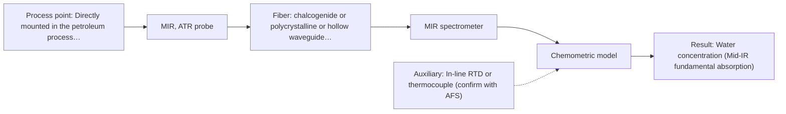

# First technical assessment: Water content in a petroleum stream

## Answer

**Customer request (our summary):** The customer wants to know which technical parameters to clarify and what an initial comparison experiment should establish to evaluate a remote, fiber-coupled optical measurement of water in a petroleum stream.

### Brief answer

Mid-IR ATR spectroscopy should be evaluated first, supported by demonstrated precedent for measuring water in petroleum streams, with NIR transmission as an alternative if long fiber distances are required. Key open factors include the expected water concentration range, stream transparency, and the exact distance to the external analyzer. A laboratory feasibility comparison on representative petroleum samples against Karl Fischer titration is recommended to establish sensitivity and detection limits.

### Proposal

- **Best current option:** O1 (recommended)
- **Basis:** supplied AFS sources
- **What would change it:** If the physical routing distance from the process line to the analyzer exceeds mid-IR fiber capabilities, or if the stream is transparent and demands long fiber lengths, the recommended choice would switch to option O2.
- **Next step:** Obtain representative samples of the petroleum stream spanning normal and elevated water levels to perform initial benchtop mid-IR ATR and NIR feasibility trials against laboratory Karl Fischer reference data.

**Secondary evidence (external, not AFS material):** G1: E03 ¶12; G2: no usable external source found; G3: no usable external source found; G4: no usable external source found. See Expert detail.

**Decision status:** Provisional feasibility assessment

### Solution options

| ID | Tier | Methods | Confidence | Cost class, S01 Table 1 (p.6) | Ease of use | Maintenance | Performance fit | Sources |
|---|---|---|---|---|---|---|---|---|
| O1 | Recommended | M1 MIR, ATR probe | Low: open question: Q1, Q2, Q3 (starts at Medium); physical state unknown, sample clarity unknown | high cost (row 2) | Immersion ATR probe with automated logging | Periodic inspection for crystal fouling | High selectivity for fundamental water bands | [1: S02 p.13] [2: S01 p.10] |
| O2 | Simple | M2 NIR, transmission/transflection probe | Low: open question: Q1, Q2, Q3 (starts at Medium); physical state unknown, sample clarity unknown | average cost (row 7) | Standard transmission probe and silica cabling | Regular cleaning of transmission optical gap | Enables long remote silica fiber runs | [3: S02 p.7] [4: S01 p.18] |

*Confidence rates the basis of the advice (how much is known and cited), not a predicted accuracy or probability of success. It starts at High, or at Medium when a key question on the method or the option is open, and drops one level per weakness listed (floor Low).*

*Cost class is the relative rating in S01 Table 1 (p.6) for the in-line method+technique rows named (the highest one for a multi-method option); it is not a price.*

### Setup sketch

*Recommended option O1; drawn by code from the option, a schematic, not a configuration.*

### Key questions

1. What is the expected water concentration range (e.g., ppm level or volume percent) and required limit of detection?
2. What is the physical distance between the intended in-line probe location and the analyzer outside the process area?
3. What is the optical nature and consistency of the petroleum stream (e.g., clear refined distillate, dark crude, or turbid emulsion)?

## Expert detail

**Customer enquiry**

> We handle a petroleum stream and currently send samples to a laboratory for water determination. We want to investigate a fiber based measurement closer to the process so that changes can be noticed sooner. The analyzer would be outside the process area. Before selecting equipment, we need to know what to clarify and what a first comparison experiment should establish.

**Decision status:** Provisional feasibility assessment. A provisional shortlist can be established based on demonstrated laboratory precedent for water determination in petroleum via mid-IR ATR, alongside NIR transmission for long remote fiber links. Critical parameters including water concentration range, stream opacity, and the physical distance to the analyzer outside the process area must be clarified to confirm feasibility.

### Parameters

| ID | Parameter | Kind | Need | Measured by | Why | Sources |
|---|---|---|---|---|---|---|
| P1 | Water concentration (Mid-IR fundamental absorption) | quantitative | required | Spectroscopy: MIR | Directly tracks water content closer to the process to alert operators to rapid moisture excursions. | [1: S02 p.13] |
| P2 | Water concentration (NIR overtone absorption) | quantitative | required | Spectroscopy: NIR | Provides an alternative optical route for water tracking when long remote fiber runs are mandatory. | [5: S01 p.10] |
| P3 | Laboratory reference water content | quantitative | required | Reference lab method: Karl Fischer titration | Serves as the benchmark ground truth to calibrate and validate the in-line optical sensor. | *(no verified source: engineering judgement)* |
| P4 | Process fluid temperature | quantitative | optional | Auxiliary sensor: In-line RTD or thermocouple (engineering judgement: confirm availability with AFS) | Fluid temperature shifts water absorption band shapes and should be logged to support temperature compensation in chemometric models. | *(no verified source: engineering judgement)* |

### Solution option details

- **O1 cost drivers:** FTIR spectrometer, specialized mid-IR fibers, ATR probe crystal
- **O2 cost drivers:** NIR spectrometer, transmission probe, silica fiber cabling

### Premise check

- **Precedent only:** Fiber-optic spectroscopy can determine water content in a petroleum stream closer to the process. Supplied materials demonstrate laboratory spectra for water content in petroleum using mid-IR ATR probes, which serves as a technical precedent to test rather than proof for an uncharacterized in-line stream. [1: S02 p.13]

### Requirements

**Stated by the customer**

- Measurement of water in a petroleum stream closer to the process to detect changes sooner
- Analyzer situated outside the process area using a fiber-optic link
- Clarification of technical parameters and design of a first comparison experiment prior to equipment selection

**Key unknowns**

- Expected water concentration range and target limit of detection
- Stream optical properties (color, transparency, turbidity, suspended solids, or emulsion)
- Physical distance from probe insertion point to the external analyzer
- Operating temperature, pressure, and flow dynamics in the petroleum pipe
- Hazardous area classification (e.g., ATEX/IECEx) at the measurement point
- Specific laboratory reference method and turnaround precision

### Clarification questions (most decision-relevant first)

Q1. What is the expected water concentration range (e.g., ppm level or volume percent) and required limit of detection? *Why it matters:* Determines whether fundamental mid-IR bands or NIR overtone absorptions have suitable sensitivity and dynamic range. *(affects: method, status)*
Q2. What is the physical distance between the intended in-line probe location and the analyzer outside the process area? *Why it matters:* Mid-IR optical fibers are constrained in length, whereas silica fibers for NIR can support extended remote distances. *(affects: method, installation)*
Q3. What is the optical nature and consistency of the petroleum stream (e.g., clear refined distillate, dark crude, or turbid emulsion)? *Why it matters:* Identifies whether an optical transmission path can transmit light or if surface ATR measurement is necessary. *(affects: technique, M1, M2)*
Q4. What are the line temperature, operating pressure, and flow velocity at the candidate sampling point? *Why it matters:* Dictates mechanical probe sealing materials, window durability, and thermal compensation requirements. *(affects: installation, M1)*
Q5. Which laboratory analytical method is currently used for water determination and what is its typical turnaround repeatability? *Why it matters:* Establishes the numerical benchmark and calibration ground truth needed for feasibility evaluation. *(affects: status)*

### Recommendation

- **M1 · Primary candidate: MIR, ATR probe.** Mid-IR fundamental absorption bands provide high chemical selectivity and sensitivity for water, supported by demonstrated precedent measuring water in petroleum with ATR probes. The ATR geometry limits optical path length to a few micrometers, accommodating opaque or absorbing hydrocarbon matrices. *Conditions:* Applicable if the distance to the analyzer is compatible with mid-IR fiber attenuation and the stream permits direct optical crystal contact. [1: S02 p.13] [2: S01 p.10]
- **M2 · Conditional candidate: NIR, transmission/transflection probe.** Near-infrared spectroscopy coupled via low-OH silica fibers allows remote analyzer placement over extended distances away from the process line. It serves as an alternative if the transmission distance precludes mid-IR fibers and the stream is sufficiently transparent. *Conditions:* Requires the petroleum stream to be transparent or semi-transparent with water concentrations high enough for overtone band detection. [3: S02 p.7] [4: S01 p.18]

### Measurement concept

- **Probe and geometry:** An in-line ATR immersion probe with a zirconium oxide or diamond crystal tip for mid-IR, or an immersion transmission/transflection probe with a controlled optical gap (1-10 mm) for NIR.
- **Location:** Directly mounted in the petroleum process line or a conditioned fast-loop bypass closer to the operation, sending light to the remote analyzer shelter.
- **Fiber link:** Polycrystalline (PIR) or chalcogenide (CIR) infrared fibers for mid-IR over short runs, or robust low-OH silica fibers for extended remote distances in NIR. [6: S02 p.13] [3: S02 p.7] [7: S01 p.18]

### Spectral range

- **MIR:** Nominal range 4000-400 cm-1 (2.5-25 µm); the usable range depends on the FTIR spectrometer, fiber type (CIR or PIR), and ATR crystal selection. [8: S01 p.9]
- **NIR:** Nominal range 780-2500 nm; actual spectral coverage depends on the detector, light source, silica fiber grade, and optical pathlength. [5: S01 p.10]

### Risks and uncertainty

- Fouling of the probe optical window or ATR crystal by heavy hydrocarbon deposits, asphaltenes, or waxes can degrade signal quality and impede representative measurement. *(rules: R-MIR-2, R-MIR-3)* [9: REF §5]
- If the separation between the process line and the analyzer exceeds achievable mid-IR fiber lengths, mid-IR ATR cannot be deployed without local instrument protection or a sample bypass. *(rules: R-FIB-1, R-FIB-2)* [3: S02 p.7]
- If the petroleum stream is dark, turbid, or emulsified, NIR transmission will suffer severe beam attenuation and signal saturation. *(rules: R-GEO-2, R-GEN-4)* [10: S01 p.18]
- NIR overtone absorption may lack sufficient sensitivity if the required water monitoring target falls into the low ppm trace range. *(rules: R-NIR-4)* [11: S01 p.16]

### First feasibility experiment

1. **Collect representative petroleum stream samples across the full anticipated water concentration range, including dry baseline and high-water excursion states.** Provide a valid sample set that captures the matrix variability and background spectral absorbance of the hydrocarbon stream. [12: REF §3]
2. **Perform independent laboratory reference analyses on split aliquots of each collected sample.** Obtain trusted numerical reference values to serve as ground truth for calibration. [12: REF §3]
3. **Acquire baseline mid-IR ATR and NIR transmission/transflection spectra on static and stirred samples across relevant process temperature bounds.** Quantify signal-to-noise ratio, evaluate water band isolation, and evaluate window fouling tendencies. [1: S02 p.13]
4. **Develop single-method regression models for water concentration and validate them on a held-out set of petroleum samples.** Assess prediction accuracy, linearity, detection threshold, and resilience to hydrocarbon baseline shifts. [13: S01 p.10]
5. **Evaluate calibration performance against customer accuracy requirements and test ease of optical window cleaning.** Establish a definitive go/no-go outcome for in-line fiber probe implementation. [12: REF §3]

**Reference measurements:** Standard laboratory water titration (e.g., Karl Fischer titration) performed on duplicate split samples taken concurrently with spectral acquisition.

**Decision basis:** The candidate optical method must demonstrate prediction accuracy and limit of detection satisfying the customer's operational thresholds on held-out samples without uncorrectable window fouling.

### Assumptions

- The petroleum stream is in a liquid phase suitable for immersion probe contact.
- Water is present either in dissolved form or as a finely dispersed emulsion that can be representatively sampled.
- Process temperature and pressure remain within the mechanical sealing limits of standard industrial fiber probes.

### Not covered by the supplied sources

- Achievable industrial link distance for mid-IR optical cables under process plant conditions
- Specific ATEX/IECEx hazardous area enclosure ratings for fiber spectrometers
- Quantitative detection limits for water in specific crude or refined petroleum matrices

### Further notes

- **Chemometrics:** A quantitative multivariate calibration (such as PLS regression) will be required to resolve water absorption peaks from overlapping hydrocarbon matrix signals and baseline shifts, with models validated against independent reference samples.
- **Real-time tracking:** Continuous optical spectra acquired by an in-line fiber immersion probe will allow near real-time trending of moisture content, alerting operators to process upsets much faster than off-line laboratory sampling.

### Secondary evidence (external, not AFS material)

*Found by a literature search for gaps the supplied AFS sources leave open. Not AFS material and not proof for this case; every quote below was verified verbatim against the fetched text.*

*Live search unavailable (library only: cache miss (europepmc); cache miss (openalex)); curated library only.*

**G1 · auxiliary sensor:** In-line measurement of Process fluid temperature with In-line RTD or thermocouple

- **E03 ¶12** Water OH bands in NIR and MIR spectra exhibit strong temperature sensitivity, requiring tempered sample holders during aqueous measurements. *How it applies:* This highlights the importance of monitoring or compensating for process fluid temperature when tracking water bands in optical measurements. *Limits and transfer risks:* The cited study addresses aqueous biopharmaceutical solutions rather than water traces within a petroleum stream, and it refers to sample holder tempering rather than in-line RTD or thermocouple compensation. *(supports O1)*
  > "Additionally, the temperature sensitivity of the OH bands is a severe drawback for measuring aqueous solution in NIR and MIR, which makes tempered sample holders necessary [29]."
  > A critical review of recent trends, and a future perspective of optical spectroscopy as PAT in biopharmaceutical downstream processing. (2020) · Analytical and bioanalytical chemistry · doi:10.1007/s00216-020-02407-z · https://europepmc.org/article/PMC/PMC7072065 · retrieved 2026-10-17, full text, licence: cc by, via curated library

**G2 · not in the supplied sources:** Achievable industrial link distance for mid-IR optical cables under process plant conditions

- No usable external source found.

**G3 · not in the supplied sources:** Specific ATEX/IECEx hazardous area enclosure ratings for fiber spectrometers

- No usable external source found.

**G4 · not in the supplied sources:** Quantitative detection limits for water in specific crude or refined petroleum matrices

- No usable external source found.

### Evidence (verified quotes)

1. ✓ **S02 p.13** (application precedent): "Application: measurement of water content in petroleum"
2. ✓ **S01 p.10** (general): "ATR fiber probes (Fig.1) enable the analysis of liquids and solid elastic samples"
3. ✓ **S02 p.7** (general): "Robust 100-300m cables made with Silica fibers of low OH-content (<0.1ppm OH) enable remote industrial process-control"
4. ✓ **S01 p.18** (general): "Transmission is the preferred method for transparent or semi-transparent liquids, such as skim milk, whey, or permeate."
5. ✓ **S01 p.10** (general): "NIR spectra (780-2500 nm) contain predominantly overtones and component bands of fundamental vibrations"
6. ✓ **S02 p.13** (general): "ATR-Probes with ATR-tips from ZrO2 (& Diamond, etc.) sealed in PEEK-shaft and protected by PEEK-tubing can be used in microwave furnaces"
7. ✓ **S01 p.18** (general): "the precise control of the optical pathlength (usually 1 - 10 mm); if the pathlength is too wide, the signal is lost to absorption; if too narrow, the sample represents a negligible volume."
8. ✓ **S01 p.9** (general): "Vibrational spectroscopy in the mid-IR range (4000-400 cm-1) is one of the most informative methods of chemical analysis."
9. ✓ **REF §5** (general): "Usable range limited by fiber and crystal; contact, fouling, compatibility."
10. ✓ **S01 p.18** (general): "it fails when the milk becomes too "thick" or fat-rich, as the light cannot penetrate the sample."
11. ✓ **S01 p.16** (general): "may lack the sensitivity to detect trace compounds below 0.1 percent."
12. ✓ **REF §3** (general): "Representative samples or process states, independent reference measurements, what is compared, and the basis for the go / no-go decision."
13. ✓ **S01 p.10** (general): "The broad absorption bands observed in this region overlap, suggesting the use of chemometrics for quantitative and qualitative analysis of spectral data."

### Verification

- Citations verified: 23 of 23 (exact or whitespace/hyphen-tolerant match on the cited page, scope checked).
- Hard check failures before deterministic corrections: 0; still open: 0; soft warnings: 0; repair rounds: 1.
- External evidence (cache): 1 quote(s) verified verbatim (exact or whitespace/hyphen-tolerant, at most 400 characters and 2 sentences, against the cited paragraph); 0 item(s) dropped.
- External search: 4 query(ies), 0 hit(s), 3 source(s) (3 from the curated library); ⚠ library only: cache miss (europepmc); cache miss (openalex).
- External step: 2 model call(s), 6.0 s extra (cost in the run JSON).

*Run D06-20261018T080635Z-9c1e · models google/gemini-3.8-flash*
