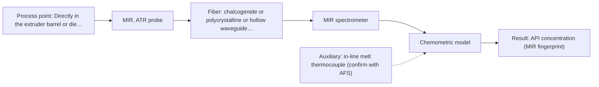

# First technical assessment: API concentration during hot polymer extrusion

## Answer

**Customer request (our summary):** The customer wants an initial evaluation plan and key intake questions to determine if optical spectroscopy can monitor composition changes in-line during a hot polymer extrusion process with an API.

### Brief answer

We recommend testing mid-infrared spectroscopy with a flush-mounted diamond ATR probe as the primary option to monitor API composition changes in the hot polymer melt. Near-infrared reflection should be evaluated alongside as an alternative. Key open questions are the chemical structures and concentration range of the API and polymer, the interface temperature and pressure, and the extruder port dimensions. Offline assays will provide the reference standard.

### Proposal

- **Best current option:** O2 (recommended)
- **Basis:** supplied AFS sources
- **What would change it:** If the melt is severely fouling and rapidly blinds the ATR crystal, or if the formulation exhibits high scattering and strong NIR overtone bands, the choice would shift toward O1.
- **Next step:** Run laboratory feasibility trials on representative static melt samples using diamond ATR and NIR reflection against offline reference assays to confirm band resolution and calibration linearity.

**Secondary evidence (external, not AFS material):** G1: no usable external source found; G2: no usable external source found; G3: no usable external source found; G4: no usable external source found. See Expert detail.

**Decision status:** Provisional feasibility assessment

### Solution options

| ID | Tier | Methods | Confidence | Cost class, S01 Table 1 (p.6) | Ease of use | Maintenance | Performance fit | Sources |
|---|---|---|---|---|---|---|---|---|
| O1 | Simple | M2 NIR, diffuse reflection probe | Low: open question: Q1 (starts at Medium); sample clarity unknown; uncited auxiliary sensor | average cost (row 8) | standard silica fibers, straightforward installation | routine optical window inspection | rapid overtone tracking for scattering melts | [1: S02 p.14] [2: S01 p.5] |
| O2 | Recommended | M1 MIR, ATR probe | Low: open question: Q1, Q2 (starts at Medium); uncited auxiliary sensor | high cost (row 2) | requires flush crystal mounting in melt | crystal cleaning and fouling prevention | high selectivity diamond ATR fingerprint tracking | [3: S02 p.14] [4: S01 p.9] |

*Confidence rates the basis of the advice (how much is known and cited), not a predicted accuracy or probability of success. It starts at High, or at Medium when a key question on the method or the option is open, and drops one level per weakness listed (floor Low).*

*Cost class is the relative rating in S01 Table 1 (p.6) for the in-line method+technique rows named (the highest one for a multi-method option); it is not a price.*

### Setup sketch

*Recommended option O2; drawn by code from the option, a schematic, not a configuration.*

### Key questions

1. What are the chemical identities and expected concentration ranges of the API and the polymer matrix?
2. What are the exact operating temperature and pressure ranges at the extruder measurement interface?
3. What is the optical character of the polymer melt (e.g. optically transparent, turbid, or filled with scattering additives)?

## Expert detail

**Customer enquiry**

> We are developing a hot polymer extrusion process that incorporates an active pharmaceutical ingredient. We want to investigate whether an optical measurement can detect composition changes while the melt is being processed. We have offline assays, but the process interface is hot and may be exposed to material build up. We need an initial comparison plan and the questions required before choosing a probe.

**Decision status:** Provisional feasibility assessment. Direct technical precedent demonstrates diamond-cone MIR ATR spectroscopy and NIR reflection for in-line monitoring of API in hot polymer extrusion. Clarification of process conditions, melt optical regime, and interface geometry is needed to finalize probe configuration.

### Parameters

| ID | Parameter | Kind | Need | Measured by | Why | Sources |
|---|---|---|---|---|---|---|
| P1 | API concentration (MIR fingerprint) | quantitative | required | Spectroscopy: MIR | Primary target of the enquiry to detect composition changes of the active ingredient during extrusion. | [3: S02 p.14] |
| P2 | API concentration (NIR overtones) | quantitative | required | Spectroscopy: NIR | Alternative spectroscopic tracking parameter if NIR reflection is selected over MIR ATR. | [1: S02 p.14] |
| P3 | Melt temperature | quantitative | required | Auxiliary sensor: in-line melt thermocouple (engineering judgement: confirm availability with AFS) | Process temperature directly influences melt density, spectral band shapes, and probe sealing integrity. | *(no verified source: engineering judgement)* |
| P4 | Offline assay reference concentration | quantitative | required | Reference lab method: offline customer laboratory assay (e.g. HPLC) | Provides independent ground-truth analytical data needed to calibrate and validate multivariate models. | *(no verified source: engineering judgement)* |

### Solution option details

- **O1 cost drivers:** NIR spectrometer and diffuse reflection probe
- **O2 cost drivers:** FTIR spectrometer, diamond ATR probe, PIR fibers

### Premise check

- **Precedent only:** Optical spectroscopy can detect API composition changes in-line during a hot polymer extrusion process. Supplied sources document in-line monitoring of API in hot polymer extrusion using PIR-fiber FTIR spectroscopy with a diamond cone ATR probe and NIR reflection, providing strong precedent to test but not proof for this specific formulation. [3: S02 p.14]

### Requirements

**Stated by the customer**

- The process is a hot polymer extrusion incorporating an active pharmaceutical ingredient.
- The material is in a melt state during processing.
- Detect composition changes while the melt is being processed in-line.
- The process interface is hot.
- The process interface may be exposed to material build-up.
- Offline assays are currently available.
- Initial comparison plan and clarification questions required before choosing a probe.

**Key unknowns**

- Chemical identity and structure of the specific polymer matrix and API
- Operating temperature and pressure at the extruder measurement interface
- Optical properties of the melt (turbidity, scattering, absorption, or optical clarity)
- Expected API concentration range and required analytical precision
- Mechanical mounting specifications on the extruder barrel or die adaptor (port type, thread, seal)
- Rate and nature of material build-up and available cleaning or mitigation options

### Clarification questions (most decision-relevant first)

Q1. What are the chemical identities and expected concentration ranges of the API and the polymer matrix? *Why it matters:* Determines whether fundamental or overtone vibrational bands provide sufficient selectivity and sensitivity to separate API signals from the polymer matrix. *(affects: method)*
Q2. What are the exact operating temperature and pressure ranges at the extruder measurement interface? *Why it matters:* Determines optical window material, brazing/sealing technology, and probe mechanical survival in the hot melt flow. *(affects: installation, M1)*
Q3. What is the optical character of the polymer melt (e.g. optically transparent, turbid, or filled with scattering additives)? *Why it matters:* Determines whether diffuse reflection, transmission, or ATR is the viable sampling technique. *(affects: technique)*
Q4. What mechanical port dimensions and mounting options (such as standard pressure transducer ports or flange connections) exist on the extruder barrel or die? *Why it matters:* Dictates probe outer diameter, shaft design, immersion depth, and seal geometry. *(affects: installation)*
Q5. What analytical precision, response time, and accuracy are achieved by the offline reference assays? *Why it matters:* Defines the quantitative target benchmark required for the feasibility decision. *(affects: status)*

### Recommendation

- **M1 · Primary candidate: MIR, ATR probe.** Mid-infrared spectroscopy delivers sharp, fundamental vibrational fingerprint bands capable of distinguishing API from the polymer matrix. Precedent exists using a diamond cone ATR probe with PIR fibers to control API in hot polymer extrusion in-line. *Conditions:* The polymer melt must achieve good optical contact with the ATR crystal at process temperature without forming an unrepresentative baked layer. [3: S02 p.14] [4: S01 p.9]
- **M2 · Conditional candidate: NIR, diffuse reflection probe.** NIR diffuse reflection uses robust silica fiber optics that withstand harsh industrial environments and penetrates deeper than ATR. It serves as an alternative if the melt exhibits sufficient scattering or if ATR crystal fouling is severe. *Conditions:* Applies if the polymer melt exhibits sufficient optical scattering or back-reflection. [1: S02 p.14] [2: S01 p.5]
- **M3 · Comparison candidate: Raman probe.** Raman spectroscopy provides well-defined vibrational bands complementary to infrared and couples easily into silica fibers through optical windows. It provides an effective comparator if the polymer and API do not exhibit strong fluorescence. *Conditions:* Applies if laser-induced fluorescence background from the polymer matrix or API remains low. [5: S01 p.11] [6: S01 p.11]

### Measurement concept

- **Probe and geometry:** Flush-mounted in-line diamond cone ATR probe designed to withstand melt temperatures, pressures, and shear, or a sapphire-windowed diffuse reflection probe.
- **Location:** Directly in the extruder barrel or die adaptor port before the exit die to sample active melt flow.
- **Fiber link:** Polycrystalline infrared (PIR) fiber cable for MIR ATR, or low-OH silica fiber cable for NIR/Raman, allowing the spectrometer to sit safely away from heat and vibration. [3: S02 p.14] [7: S01 p.15]

### Spectral range

- **MIR:** Nominal mid-IR range is 4000-400 cm-1; usable range depends on the spectrometer, infrared fiber, and ATR crystal selection. [4: S01 p.9]
- **NIR:** Nominal NIR range is 780-2500 nm; usable range depends on the instrument detector, optics, and silica fiber type selected. [8: S01 p.10]

### Risks and uncertainty

- Material build-up or stagnant boundary layers on the ATR crystal face can cause signal blindness due to the few-micrometre penetration depth. *(rules: R-MIR-3)* [9: S01 p.13] [10: REF §5]
- Severe process temperature, pressure, and melt shear in the extruder barrel could degrade fiber connections or probe window seals. *(rules: R-GEN-5)* [11: S01 p.7]
- Physical matrix changes or polymer thermal degradation can mimic composition variation and destabilize multivariate calibration models without ongoing re-validation. *(rules: R-CAL-1)* [12: REF §5]
- Laser-induced autofluorescence from the polymer matrix or API could swamp Raman signals if Raman spectroscopy is pursued. *(rules: R-RAM-1)* [6: S01 p.11]

### First feasibility experiment

1. **Collect representative offline samples of pure polymer, pure API, and calibrated gravimetric blends across the target concentration range under controlled thermal conditions.** Establish fundamental baseline spectra and confirm clear peak separation between API and polymer matrix. [13: S01 p.3]
2. **Perform static benchtop MIR-ATR, NIR, and Raman measurements on heated samples in the laboratory.** Compare spectral resolution, sensitivity, calibration linearity, and check for fluorescence background or thermal effects. *(no verified source: engineering judgement)*
3. **Install the selected prototype probe into an extruder test port or heated slipstream under typical operating temperature and pressure.** Evaluate optical signal stability, mechanical sealing, melt contact, and susceptibility to material accumulation. *(no verified source: engineering judgement)*
4. **Execute dynamic extrusion runs with step-change API feed concentrations, logging in-line spectra alongside synchronized offline grab samples.** Train multivariate calibration models and determine tracking response times during active processing. *(no verified source: engineering judgement)*
5. **Validate calibration performance on independent held-out extrusion batches to evaluate prediction error against offline assays.** Establish the empirical basis for the go/no-go implementation decision. *(no verified source: engineering judgement)*

**Reference measurements:** Validated offline analytical assays (such as HPLC or current offline laboratory methods) on grab samples collected synchronously with in-line spectral acquisitions.

**Decision basis:** Go/no-go depends on whether the in-line optical model achieves the customer's required prediction accuracy, detection limit, and response time without baseline drift from material build-up.

### Assumptions

- The API exhibits resolved vibrational spectral features distinct from the polymer matrix.
- The extruder barrel or die adaptor possesses a compatible port where an optical probe can be flush-mounted without disrupting melt flow.
- The offline assays provide reliable, quantitative ground-truth reference values for calibration development.

### Not covered by the supplied sources

- Specific mechanical port dimensions, thread standards, and maximum pressure/temperature ratings for the customer's extruder.
- Achievable PIR optical fiber link distance between the extruder probe and the FTIR spectrometer.

### Further notes

- **Chemometrics:** Multivariate regression (such as PLS) will be necessary to extract quantitative API concentrations from overlapping spectral features and to compensate for temperature-induced baseline variations.
- **Real-time tracking:** Continuous in-line optical acquisition enables near real-time tracking of dynamic composition changes and feed variations directly in the melt before final extrusion.
- **Future direction:** If single-method tracking proves insufficient due to varying melt optical density or layering, evaluating combined MIR ATR and NIR reflection across the extruder barrel could be considered.

### Secondary evidence (external, not AFS material)

*Found by a literature search for gaps the supplied AFS sources leave open. Not AFS material and not proof for this case; every quote below was verified verbatim against the fetched text.*

*Live search unavailable (library only: cache miss (europepmc); cache miss (openalex)); curated library only.*

**G1 · auxiliary sensor:** In-line measurement of Melt temperature with in-line melt thermocouple

- No usable external source found.

**G2 · not in the supplied sources:** Specific mechanical port dimensions, thread standards, and maximum pressure/temperature ratings for the customer's extruder.

- No usable external source found.

**G3 · not in the supplied sources:** Achievable PIR optical fiber link distance between the extruder probe and the FTIR spectrometer.

- No usable external source found.

**G4 · parameter without a source:** Measuring Offline assay reference concentration: Provides independent ground-truth analytical data needed to calibrate and validate multivariate models.

- No usable external source found.

### Evidence (verified quotes)

1. ✓ **S02 p.14** (application precedent): "NIR-Reflex & MIR-ATR-spectroscopy to control polymer extrusion in-line"
2. ✓ **S01 p.5** (general): "NIR spectroscopy, with its relatively large penetration depth (up to several millimetres) even into dense solid samples due to low absorption and strong scattering, allows the use of ordinary glass for optics, as well as standard lamps as light sources, making it ideal for online applications, including remote measurements via fiber optic probes."
3. ✓ **S02 p.14** (application precedent): "Spectra of API in hot polymer obtained with Diamond cone ATR probe coupled to iC10 FTIR (MTAC) NIR-Reflex & MIR-ATR-spectroscopy to control polymer extrusion in-line"
4. ✓ **S01 p.9** (general): "Vibrational spectroscopy in the mid-IR range (4000-400 cm-1) is one of the most informative methods of chemical analysis."
5. ✓ **S01 p.11** (general): "This property makes mid-IR and Raman spectra complementary, that is, they complement each other."
6. ✓ **S01 p.11** (general): "superposition of luminescence (fluorescence), which has a significantly higher intensity."
7. ✓ **S01 p.15** (general): "located safely away from the vibration and dust of the manufacturing floor."
8. ✓ **S01 p.10** (general): "NIR spectra (780-2500 nm) contain predominantly overtones and component bands of fundamental vibrations"
9. ✓ **S01 p.13** (general): "typically at a depth of few microns"
10. ✓ **REF §5** (general): "Usable range limited by fiber and crystal; contact, fouling, compatibility."
11. ✓ **S01 p.7** (general): "Morphological factors, such as sample inhomogeneity (e.g., biological tissue) or process turbulence, must also be considered when selecting a measurement technique."
12. ✓ **REF §5** (general): "physical variation; calibration specific to the matrix."
13. ✓ **S01 p.3** (general): "samples of incompletely known composition, in order to select the most suitable method or combination of methods."

### Verification

- Citations verified: 22 of 22 (exact or whitespace/hyphen-tolerant match on the cited page, scope checked).
- Hard check failures before deterministic corrections: 0; still open: 0; soft warnings: 0; repair rounds: 1.
- External evidence (cache): 0 quote(s) verified verbatim (exact or whitespace/hyphen-tolerant, at most 400 characters and 2 sentences, against the cited paragraph); 0 item(s) dropped.
- External search: 6 query(ies), 0 hit(s), 3 source(s) (3 from the curated library); ⚠ library only: cache miss (europepmc); cache miss (openalex).
- External step: 2 model call(s), 5.0 s extra (cost in the run JSON).

*Run D07-20261018T080635Z-2b68 · models google/gemini-3.8-flash*
