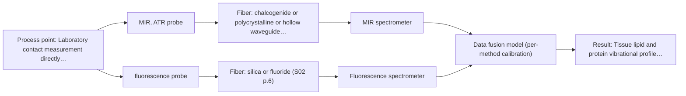

# First technical assessment: Local measurements of heterogeneous model tissues

## Answer

**Customer request (our summary):** The customer wants to design an initial laboratory comparison experiment using MIR ATR and fluorescence to evaluate a spectral measurement interface for classifying heterogeneous model biological tissues.

### Brief answer

Test single-method MIR ATR first on representative chicken muscle, fat, and liver samples, as it provides fundamental lipid and protein discrimination. Compare this against fluorescence spectroscopy, which selectively identifies liver porphyrin emission. Combining both methods into a co-located probe head is the recommended extended path if neither single method separates all three classes, as demonstrated in laboratory precedent. The interface architecture, excitation wavelength, and target accuracy criteria remain open.

### Proposal

- **Best current option:** O2 (recommended)
- **Basis:** supplied AFS sources
- **What would change it:** If single-method MIR ATR fails to separate liver from muscle during initial testing, or if simultaneous co-located acquisition is confirmed feasible, the extended dual-method option O3 becomes preferred.
- **Next step:** Run baseline single-method trials on chicken breast, fat, and liver specimens to establish benchmark separation before evaluating fused dual-method probe acquisitions.

**Secondary evidence (external, not AFS material):** G1: no usable external source found; G2: E03 ¶31, E03 ¶82. See Expert detail.

**Decision status:** Provisional feasibility assessment

### Solution options

| ID | Tier | Methods | Confidence | Cost class, S01 Table 1 (p.6) | Ease of use | Maintenance | Performance fit | Sources |
|---|---|---|---|---|---|---|---|---|
| O1 | Simple | M2 fluorescence probe | Low: open question: Q2 (starts at Medium); fit for soft solid to be tested, fluorescent target unknown | low cost (row 19) | Straightforward setup using standard silica fibers | Routine fiber and probe tip cleaning | Identifies liver but cannot classify fat | [1: S01 p.6] [2: S04 p.3] [3: S04 p.4] |
| O2 | Recommended | M1 MIR, ATR probe | Medium: open question: Q2 (starts at Medium) | high cost (row 2) | Single spectrometer requiring consistent sample contact | Crystal cleaning and ATR facet inspection | Resolves fat and general tissue chemistry | [4: S01 p.10] [5: S04 p.3] [6: S04 p.4] |
| O3 | Extended (multi-method) | M3 MIR, ATR probe + Fluorescence (combination) | Low: open question: Q1, Q2 (starts at Medium); fit for soft solid to be tested, fluorescent target unknown; multi-method, fusion benefit not yet shown | high cost (rows 2, 19) | Requires dual spectrometer control and alignment | Dual optical path cleaning and calibration | Fully separates all three tissue classes | [7: S04 p.2] [8: S04 p.4] [9: S01 p.8] |

*Confidence rates the basis of the advice (how much is known and cited), not a predicted accuracy or probability of success. It starts at High, or at Medium when a key question on the method or the option is open, and drops one level per weakness listed (floor Low).*

*Cost class is the relative rating in S01 Table 1 (p.6) for the in-line method+technique rows named (the highest one for a multi-method option); it is not a price.*

### Setup sketch

*Recommended option O2; drawn by code from the option, a schematic, not a configuration.*

### Key questions

1. Does your proposed measurement interface integrate both MIR ATR and fluorescence channels into a single probe head, or are you comparing separate probes?
2. What excitation wavelength and spectral emission range will be used for the fluorescence channel?
3. What are your specific target classes and quantitative criteria for acceptable classification accuracy?

## Expert detail

**Customer enquiry**

> Our research group is evaluating a spectral measurement interface using model biological tissues such as chicken muscle, fat and liver. We want to compare MIR ATR and fluorescence information, because the material is heterogeneous and sequential measurements may not sample the same location. This is a laboratory classification study. We need a first comparison experiment and a clear statement of what its results would demonstrate.

**Decision status:** Provisional feasibility assessment. A provisional assessment is justified because published laboratory precedent demonstrates the feasibility of combining MIR ATR and fluorescence using a single probe head for classifying chicken muscle, fat, and liver. However, a preliminary feasibility study only establishes proof of concept for the measurement interface and cannot demonstrate diagnostic utility or in vivo performance.

### Parameters

| ID | Parameter | Kind | Need | Measured by | Why | Sources |
|---|---|---|---|---|---|---|
| P1 | Tissue lipid and protein vibrational profile | qualitative | required | Spectroscopy: MIR | Enables distinct chemical identification of fat tissue via ester carbonyl bands and general tissue protein via amide I and II bands. | [5: S04 p.3] |
| P2 | Endogenous fluorophore emission profile | qualitative | required | Spectroscopy: Fluorescence | Provides selective discrimination of liver tissue through metabolic porphyrin and flavin emission bands. | [2: S04 p.3] |
| P3 | Sample temperature | quantitative | optional | Auxiliary sensor: Thermocouple or infrared surface thermometer (engineering judgement: confirm availability with AFS) | Temperature variation can affect lipid physical state, protein hydration, and fluorophore quantum yield. | *(no verified source: engineering judgement)* |

### Solution option details

- **O1 cost drivers:** UV-Vis spectrometer, excitation laser, silica fiber
- **O2 cost drivers:** FTIR spectrometer, CIR fibers, ATR crystal
- **O3 cost drivers:** Dual spectrometers, CIR fibers, combi-probe head
- **O3 combining methods:** MIR ATR and fluorescence data collected from the identical spot through a combined ZrO2 crystal must be synchronised to a common time step. Rescaled spectral blocks are concatenated into a fused matrix, requiring independent instrument calibration diagnostics. The fused model must demonstrate superior classification over the best single method.

*Extended (multi-method) option O3; drawn by code from the option, a schematic, not a configuration.*

### Premise check

- **Supported:** Sequential measurements on heterogeneous tissue with separate probes may fail to sample the same location. Published evaluations confirm that alternating separate probes on heterogeneous biological tissue cannot ensure identical measurement spots, necessitating co-located interfaces. [10: S01 p.8] [11: S04 p.2]
- **Precedent only:** A first laboratory comparison experiment on model tissues will demonstrate definitive classification performance for real-life applications. A laboratory feasibility experiment on model poultry tissues illustrates the technical capability of the interface and proof-of-concept classification, but published literature examples are a reason to test rather than proof of real-life, clinical, or diagnostic readiness. [12: S04 p.4] [13: REF §3]

### Requirements

**Stated by the customer**

- Evaluate a spectral measurement interface using model biological tissues (chicken muscle, fat, and liver)
- Compare MIR ATR and fluorescence information
- Address sample heterogeneity and spatial sampling mismatch from sequential measurements
- Conduct as a laboratory classification study
- Define a first comparison experiment and state what its results demonstrate

**Key unknowns**

- Optical design and geometry of the customer's interface (e.g. combined ATR crystal versus separate probes)
- Excitation wavelength and emission detection range available for the fluorescence channel
- Spectral range, resolution, and crystal material for the MIR ATR spectrometer setup
- Target classification classes, performance criteria, and validation reference method
- Tissue preparation, sample temperature, and post-excision handling protocols

### Clarification questions (most decision-relevant first)

Q1. Does your proposed measurement interface integrate both MIR ATR and fluorescence channels into a single probe head, or are you comparing separate probes? *Why it matters:* A combined probe head is required to ensure co-located sampling on heterogeneous tissue without spatial mismatch. *(affects: technique, M3)*
Q2. What excitation wavelength and spectral emission range will be used for the fluorescence channel? *Why it matters:* Excitation wavelength determines which endogenous fluorophores (such as FAD or porphyrins) can be excited and detected. *(affects: method, M2)*
Q3. What are your specific target classes and quantitative criteria for acceptable classification accuracy? *Why it matters:* Clear acceptance metrics are required to evaluate whether single-method or fused spectral models meet the study objectives. *(affects: status)*
Q4. What spectrometer interfaces and fiber connections are planned for the MIR ATR measurements? *Why it matters:* MIR fiber material and crystal optical properties determine usable wavenumber range and transmission efficiency. *(affects: installation, M1)*

### Recommendation

- **M1 · Primary candidate: MIR, ATR probe.** MIR ATR provides fundamental vibrational fingerprint bands for lipids and proteins, enabling strong discrimination of fat tissue. *Conditions:* Tight contact between the ATR crystal head and the soft tissue sample must be maintained. [5: S04 p.3] [6: S04 p.4]
- **M2 · Comparison candidate: fluorescence probe.** Fluorescence emission captures distinct endogenous fluorophores, demonstrating high specificity for discriminating liver tissue. *Conditions:* The tissue must contain endogenous fluorophores detectable at the chosen excitation wavelength. [2: S04 p.3] [3: S04 p.4]
- **M3 · Conditional candidate: MIR, ATR probe + Fluorescence (combination).** Fusing co-located MIR ATR and fluorescence spectra achieves full unsupervised separation of muscle, fat, and liver classes where individual methods only separate subsets. *Conditions:* Measurements must be acquired simultaneously from the same sampling volume using a combined probe head and normalized across data blocks. [8: S04 p.4] [9: S01 p.8] Later hypothesis, after single-method tests.

### Measurement concept

- **Probe and geometry:** An ATR immersion probe geometry featuring a truncated cone (frustum) crystal, such as ZrO2, allowing three internal reflections for MIR ATR at the facets and orthogonal fluorescence excitation and collection via integrated silica fibers through the flat crystal tip.
- **Location:** Laboratory contact measurement directly placed onto excised tissue samples in petri dishes or sample holders.
- **Fiber link:** Chalcogenide infrared (CIR) fibers for the MIR ATR optical path and UV-Vis transmitting silica fibers for the fluorescence channel. [14: S04 p.2] [15: S04 p.2]

### Spectral range

- **MIR:** Nominal MIR range is 4000-400 cm-1 (2.5-25 µm); usable range depends on the spectrometer, CIR fiber transmission, and ATR crystal cutoff. [16: S01 p.9]
- **Fluorescence:** Fluorescence spectral range depends on the specific fluorophores and excitation wavelength, with selective emission observed at 613 nm in tissue precedent; the usable range is defined by the instrument, optical filters, and probe. [2: S04 p.3] [17: REF §5]

### Risks and uncertainty

- ATR penetration is limited to a few micrometres, creating sensitivity to surface fluid or inadequate mechanical contact with elastic tissue. *(rules: R-MIR-2, R-MIR-3)* [18: S01 p.13] [6: S04 p.4]
- Fluorescence relies on specific endogenous fluorophores whose emission can vary or degrade with tissue freshness and sample handling. *(rules: R-FLU-1, R-FLU-2)* [3: S04 p.4]
- Sequential measurements using separate probes on heterogeneous tissue fail to probe identical sample volumes, confounding multi-method comparison. *(rules: R-CMB-2, R-GEN-5)* [19: S01 p.8]
- Laboratory classification of model animal tissues provides proof of concept but cannot be treated as clinical or in vivo diagnostic validation. *(rules: R-EVI-1, R-EVI-2, R-EVI-3)* [20: REF §3] [13: REF §3]

### First feasibility experiment

1. **Collect multiple fresh, representative specimens of chicken muscle (breast), adipose tissue (fat), and liver, measuring multiple spatial points per specimen.** Capture biological heterogeneity and intra-sample spatial variability. [21: REF §3]
2. **Acquire baseline single-method spectra: record MIR ATR spectra using CIR fiber coupling and fluorescence spectra using silica fiber coupling independently.** Evaluate single-method signal quality, dynamic range, and individual baseline classification ability. [22: REF §5]
3. **Perform simultaneous co-located measurements using the combined interface at identical sample spots.** Eliminate spatial mismatch artifacts caused by tissue heterogeneity during sequential probing. [23: S01 p.8]
4. **Preprocess data (mean centering, SNV, scaling to common range) and evaluate unsupervised clustering (PCA) and supervised classification models using cross-validation.** Determine whether concatenated low-level data fusion separates all three tissue classes better than single-method models. [24: S01 p.8]
5. **Validate classification performance on independent, held-out sample specimens not used in calibration.** Assess model generalisation and verify absence of overfitting. *(no verified source: engineering judgement)*

**Reference measurements:** Anatomical tissue organ origin (breast muscle, liver, adipose tissue) verified visually and histologically as ground truth.

**Decision basis:** Go/no-go is determined by whether the combined interface resolves all target tissue classes with higher classification accuracy than the best single method, evaluated against customer-defined statistical thresholds.

### Assumptions

- Fresh poultry tissue samples retain intact endogenous fluorophores and representative lipid/protein biochemical composition.
- The interface provides sufficient contact pressure for reproducible ATR evanescent wave coupling without damaging the crystal or crushing the tissue.
- Laboratory spectrometer acquisition rates and software support synchronized or time-aligned data acquisition.

### Further notes

- **Chemometrics:** Low-level data fusion concatenating autoscaled or range-normalized MIR and fluorescence spectra into an augmented matrix enables multivariate classification (PCA and PLS-DA) that outperforms individual blocks.
- **Future direction:** Investigate probe miniaturization for endoscopic tissue evaluation or translation to diffuse reflectance Vis-NIR channels.

### Secondary evidence (external, not AFS material)

*Found by a literature search for gaps the supplied AFS sources leave open. Not AFS material and not proof for this case; every quote below was verified verbatim against the fetched text.*

*Live search unavailable (library only: cache miss (europepmc); cache miss (openalex)); curated library only.*

**G1 · auxiliary sensor:** In-line measurement of Sample temperature with Thermocouple or infrared surface thermometer

- No usable external source found.

**G2 · multi-method:** Combining several spectroscopy methods (data fusion) (MIR ATR and fluorescence data collected from the identical spot through a combined ZrO2 crystal must be synchronised to a common time step. Rescaled spectral blocks are concatenated into a fused matrix, requiring independent instrument calibration diagnostics. The fused model must demonstrate superior classification over the best single method.)

- **E03 ¶31** Low-level data fusion is regarded as the most straightforward strategy for merging inputs, where variables from distinct sources are placed sequentially into a single data matrix. *How it applies:* This supports testing whether concatenating rescaled spectral blocks from MIR ATR and fluorescence into a single matrix provides practical gains. The team should evaluate if the added complexity of fusing both modalities actually improves classification over individual methods. *Limits and transfer risks:* The review notes that instrument complementarity does not guarantee improved predictive performance in all analytical setups. Performance will depend heavily on the specific biological tissue matrix and data synchronization rather than general data fusion principles. *(supports O3)*
  > "Low-level data fusion (LLDF) is considered the simplest method to achieve a combination of inputs. In this case, the data is rearranged into a new data matrix, where the variables coming from different sources are placed one after the other."
  > Challenges and Opportunities of Implementing Data Fusion in Process Analytical Technology-A Review. (2022) · Molecules (Basel, Switzerland) · doi:10.3390/molecules27154846 · https://europepmc.org/article/PMC/PMC9369811 · retrieved 2026-10-17, full text, licence: cc by, via curated library
- **E03 ¶82** Prior to combining information from distinct sources, it is crucial to assess how much each individual dataset contributes to the model and verify their complementarity. *How it applies:* The customer should independently validate and benchmark both MIR ATR and fluorescence data to ensure that both provide non-redundant value before proceeding to a fused model. This diagnostic step directly informs whether the combined sensor architecture provides measurable advantage. *Limits and transfer risks:* The cited review covers general process analytical technology applications rather than dual-mode fiber-optic spectroscopy on heterogeneous biological tissues. Methodological suitability must be confirmed experimentally for this interface. *(supports O3)*
  > "Before fusing data from multiple sources, it is essential to evaluate the contribution of each dataset to the model and its complementarity."
  > Challenges and Opportunities of Implementing Data Fusion in Process Analytical Technology-A Review. (2022) · Molecules (Basel, Switzerland) · doi:10.3390/molecules27154846 · https://europepmc.org/article/PMC/PMC9369811 · retrieved 2026-10-17, full text, licence: cc by, via curated library

### Evidence (verified quotes)

1. ✓ **S01 p.6** (general): "fluorimetric probe liquid, solid 1-5 mm"
2. ✓ **S04 p.3** (application precedent): "The most selective peak at 613 nm, which can be assigned to porphyrins, has sufficient specificity to distinguish the liver from other measured samples."
3. ✓ **S04 p.4** (general): "it is limited to the samples containing at least one fluorescent component that often has a biological or natural origin."
4. ✓ **S01 p.10** (general): "ATR fiber probes (Fig.1) enable the analysis of liquids and solid elastic samples"
5. ✓ **S04 p.3** (application precedent): "The discriminative power of mid-IR spectroscopy (Figure 2a and Figure S-4) toward rich in lipids fat samples is related to the stretching vibration band of the ester carbonyl C=O at about 1740 cm-1"
6. ✓ **S04 p.4** (general): "suitability of analyzed samples for ATR measurements, which is true for liquid or soft solid samples and their components, allowing a tight contact with the probe head."
7. ✓ **S04 p.2** (general): "The proposed solution (Figure 1) is based on a precise determination of the optical configuration of the ATR crystal head, which, in this case, plays the role of a common measurement interface for both methods."
8. ✓ **S04 p.4** (application precedent): "At the same time, the PCA model built on the concatenated IR and fluorescence data revealed three distinct groups of samples corresponding to tissue types (Figure 3c)."
9. ✓ **S01 p.8** (general): "It is crucial that the spectral information obtained by different methods-Mid-IR, NIR, Raman, and fluorescence spectra-is collected from the same small, even pinpoint, area of the sample."
10. ✓ **S01 p.8** (general): "It is crucial that the spectral information obtained by different methods-Mid-IR, NIR, Raman, and fluorescence spectra-is collected from the same small, even pinpoint, area of the sample. This is difficult to achieve by using two probes alternately for measurements."
11. ✓ **S04 p.2** (general): "The main challenge of such local multispectral analysis is related to the necessity to perform different spectroscopic measurements at the same point simultaneously."
12. ✓ **S04 p.4** (application precedent): "This simple example illustrates the gain that can be obtained using the proposed multispectral probe in the qualitative analysis of biological tissue."
13. ✓ **REF §3** (general): "a published application is a reason to test a method, not proof that it will work for a new customer."
14. ✓ **S04 p.2** (general): "ZrO2 crystal was chosen due to its high (close to the diamond) refractive index, high transparency in the working spectral regions of both chalcogenide infrared (CIR) and UV silica fibers, as well as small intrinsic fluorescence."
15. ✓ **S04 p.2** (general): "A round platform at the top of the truncated cone simultaneously serves to record fluorescence spectra. Silica fiber end faces are located exactly below it, providing the orthogonal sample illumination and reception of the fluorescence signal emitted back by the sample."
16. ✓ **S01 p.9** (general): "Vibrational spectroscopy in the mid-IR range (4000-400 cm-1) is one of the most informative methods of chemical analysis."
17. ✓ **REF §5** (general): "Only a defined fluorescent species or a justified indicator."
18. ✓ **S01 p.13** (general): "typically at a depth of few microns"
19. ✓ **S01 p.8** (general): "collected from the same small, even pinpoint, area of the sample. This is difficult to achieve by using two probes alternately for measurements."
20. ✓ **REF §3** (general): "stretched beyond their scope, for example a laboratory study cited as proof of process or clinical readiness."
21. ✓ **REF §3** (general): "Representative samples or process states, independent reference measurements, what is compared, and the basis for the go / no-go decision."
22. ✓ **REF §5** (general): "compare with the best single method."
23. ✓ **S01 p.8** (general): "two or more probes, belonging to different methods, can be used for measurements, but the data from each method must be obtained simultaneously."
24. ✓ **S01 p.8** (general): "If the variables have different units of measurement, the data should be normalized in some way, for example, using an autoscaling algorithm."

### Verification

- Citations verified: 31 of 31 (exact or whitespace/hyphen-tolerant match on the cited page, scope checked).
- Hard check failures before deterministic corrections: 0; still open: 0; soft warnings: 1; repair rounds: 1.
- External evidence (cache): 2 quote(s) verified verbatim (exact or whitespace/hyphen-tolerant, at most 400 characters and 2 sentences, against the cited paragraph); 0 item(s) dropped.
- External search: 5 query(ies), 0 hit(s), 3 source(s) (3 from the curated library); ⚠ library only: cache miss (europepmc); cache miss (openalex).
- External step: 2 model call(s), 8.2 s extra (cost in the run JSON).

*Run D08-20261018T080635Z-537d · models google/gemini-3.8-flash*
