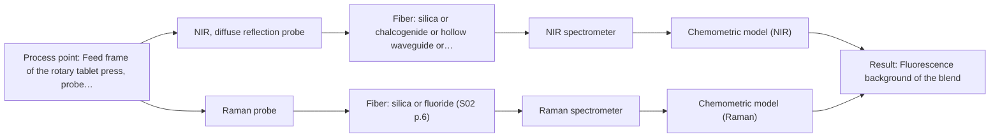
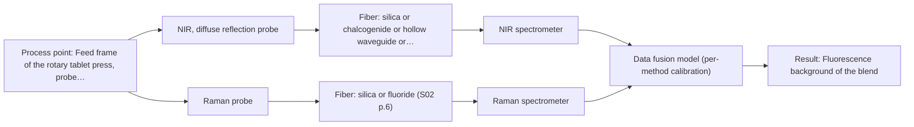

# First technical assessment: Blend potency in a tablet press feed frame

## Answer

**Customer request (our summary):** Tablet manufacturer wants to assess whether a fiber-based measurement in the feed frame could follow API concentration changes in a powder blend; first pilot should compare reasonable measurement options before committing to production equipment.

### Brief answer

Test NIR diffuse reflection first: it is the standard in-line technique for powder blends and has published feed-frame precedent for blend potency. Run a Raman probe in parallel as a comparison, since Raman sees different molecular groups and the two are complementary. Only after the single-method tests, evaluate a fused NIR+Raman model and check it beats the best single method. Open points: API identity and concentration range, required accuracy and response time, and the probe installation point.

### Proposal

- **Best current option:** O2 (recommended)
- **Basis:** supplied AFS sources
- **What would change it:** A trace-level API concentration below what NIR can detect, or a strong fluorescence background, would shift the choice toward Raman; a confirmed installation point with long fiber distance could constrain the probe and fiber selection.
- **Next step:** Run a multi-method lab trial on representative blend samples with NIR diffuse-reflection and Raman probes against the laboratory reference, with go/no-go criteria from the customer's required accuracy and response time.

**Secondary evidence (external, not AFS material):** G1: E02 ¶31, E02 ¶82, E02 ¶36; G2: no usable external source found; G3: no usable external source found; G4: E03 ¶19, E01 ¶20. See Expert detail.

**Decision status:** Provisional feasibility assessment

### Solution options

| ID | Tier | Methods | Confidence | Cost class, S01 Table 1 (p.6) | Ease of use | Maintenance | Performance fit | Sources |
|---|---|---|---|---|---|---|---|---|
| O1 | Simple | M1 NIR, diffuse reflection probe | Low: open question: Q1, Q2 (starts at Medium); precedent only | average cost (row 8) | Simple robust probe, standard glass optics | Low; probe window cleaning in powder flow | Matches opaque powder flow in feed frame | [1: S01 p.14] [2: S01 p.15] [3: S01 p.17] |
| O2 | Recommended | M1 NIR, diffuse reflection probe; M2 Raman probe | Low: open question: Q1, Q2 (starts at Medium); precedent only | high cost (rows 8, 12) | Two probes, two calibrations to run | Moderate; two instruments to maintain | Tests both complementary methods before commitment | [4: S01 p.15] [2: S01 p.15] [3: S01 p.17] [5: S01 p.15] |
| O3 | Extended (multi-method) | M3 NIR, diffuse reflection probe + Raman (combination); M2 Raman probe | Low: open question: Q1, Q2 (starts at Medium); precedent only; multi-method, fusion benefit not yet shown | high cost (rows 8, 12) | Most complex; synchronisation and fusion needed | Highest; two instruments plus fusion model | Only if single methods miss the accuracy target | [6: S01 p.15] [7: S01 p.15] [5: S01 p.15] |

*Confidence rates the basis of the advice (how much is known and cited), not a predicted accuracy or probability of success. It starts at High, or at Medium when a key question on the method or the option is open, and drops one level per weakness listed (floor Low).*

*Cost class is the relative rating in S01 Table 1 (p.6) for the in-line method+technique rows named (the highest one for a multi-method option); it is not a price.*

### Setup sketch

*Recommended option O2; drawn by code from the option, a schematic, not a configuration.*

### Key questions

1. Which API is it, and over what concentration range must changes be followed?
2. What accuracy, detection limit and response time does the feed-frame measurement need?
3. Where exactly in the feed frame can a probe be mounted, and how far is the spectrometer from the process point?

## Expert detail

**Customer enquiry**

> We manufacture tablets from a powder blend containing an active pharmaceutical ingredient and excipients. Laboratory checks tell us whether the blend is on target, but results arrive after the material has moved through the press. We want to assess whether a fiber based measurement in the feed frame could follow API concentration changes. Our first pilot should compare reasonable measurement options before we commit to production equipment.

**Decision status:** Provisional feasibility assessment. A method shortlist can be justified from published feed-frame blend potency work, but the API identity, concentration range and required accuracy are unknown, so the assessment stays provisional with explicit assumptions.

### Parameters

| ID | Parameter | Kind | Need | Measured by | Why | Sources |
|---|---|---|---|---|---|---|
| P1 | API concentration in the blend | quantitative | required | Reference lab method: HPLC or validated blend assay | It is the target variable the in-line measurement must track and the response for the calibration model. | *(no verified source: engineering judgement)* |
| P2 | Excipient composition | qualitative | required | Reference lab method: formulation records | Excipients dominate the spectrum and determine which bands are free for the API signal and how the calibration must be built. | *(no verified source: engineering judgement)* |
| P3 | Blend homogeneity and particle size | quantitative | required | Reference lab method: particle size analysis / blend uniformity test | Reflection signals are sensitive to surface characteristics and particle size, so physical variation must be known to avoid mistaking it for composition change. | *(no verified source: engineering judgement)* |
| P4 | Fluorescence background of the blend | qualitative | optional | Spectroscopy: Raman | It should be checked because fluorescence can swamp weak Raman signals and would decide how usable the Raman comparison is. | [8: S01 p.11] |

### Solution option details

- **O1 cost drivers:** NIR spectrometer, reflection probe, calibration samples and reference analyses
- **O2 cost drivers:** Two spectrometers and probes, doubled calibration effort, reference analyses
- **O3 cost drivers:** Two spectrometers, synchronisation software, fused model development and validation
- **O3 combining methods:** Low-level data fusion: synchronised NIR and Raman spectra merged into one augmented matrix with block scaling so neither method dominates. Both probes must sample the same flowing material at the same time step, with per-method calibration maintained separately. The fused model must beat the best single method on held-out runs, otherwise the extra instrument is dropped.

*Extended (multi-method) option O3; drawn by code from the option, a schematic, not a configuration.*

### Premise check

- **Precedent only:** A fiber-based measurement in the feed frame can follow API concentration changes. The sources describe in-line blend potency monitoring in a tablet press feed frame with fiber-optic NIR and Raman probes as a published example; this is a reason to test, not proof for this customer's blend. [1: S01 p.14]
- **Supported:** The first pilot should compare reasonable measurement options before committing to production equipment. The AFS guided pathway explicitly starts with multi-method lab trials before selecting a custom solution, matching the customer's plan. [9: S02 p.20]
- **Precedent only:** Combining NIR and Raman would improve API potency prediction over either method alone. Published feed-frame work reports higher accuracy from combined NIR and Raman than from single-method models; for this customer's blend the gain remains a hypothesis to test. [7: S01 p.15]

### Requirements

**Stated by the customer**

- "We manufacture tablets from a powder blend containing an active pharmaceutical ingredient and excipients"
- "whether a fiber based measurement in the feed frame could follow API concentration changes"
- *Further statements: see the customer enquiry above.*

**Key unknowns**

- API identity and concentration range
- Required accuracy, detection limit and response time
- Blend homogeneity, particle size and optical scattering behaviour
- Probe installation point and fiber distance in the feed frame
- Reference sampling protocol and its timing relative to the flow

### Clarification questions (most decision-relevant first)

Q1. Which API is it, and over what concentration range must changes be followed? *Why it matters:* The API's spectral signature and concentration level decide whether NIR sensitivity suffices or Raman's molecular specificity is needed. *(affects: method, technique)*
Q2. What accuracy, detection limit and response time does the feed-frame measurement need? *Why it matters:* NIR may lack sensitivity for trace components, so the required accuracy decides between NIR and Raman. *(affects: status, M1, M2)*
Q3. Where exactly in the feed frame can a probe be mounted, and how far is the spectrometer from the process point? *Why it matters:* The installation point and fiber distance constrain the probe geometry and the fiber family that can be used. *(affects: installation)*
Q4. How are the laboratory reference samples taken and timed relative to the feed-frame flow? *Why it matters:* Calibration quality depends on reference measurements that represent the same material the probe sees. *(affects: M1, M2, M3)*
Q5. How variable are the blend's particle size and optical scattering properties across production? *Why it matters:* Reflection signals are sensitive to surface characteristics and particle size, so physical variation can mimic composition change. *(affects: technique)*

### Recommendation

- **M1 · Primary candidate: NIR, diffuse reflection probe.** NIR diffuse reflection is the standard in-line technique for opaque powders and is the workhorse of published feed-frame blend potency monitoring. It penetrates powders and suits remote fiber-probe measurement. *Conditions:* Requires a matrix-specific chemometric calibration against the laboratory reference method. [2: S01 p.15] [3: S01 p.17]
- **M2 · Comparison candidate: Raman probe.** Raman provides molecular information complementary to NIR on the same powder and is reported together with NIR for feed-frame blend potency. Its weak signal and possible fluorescence background must be checked on the actual blend. *Conditions:* Fluorescence background of the blend must be checked on real samples before relying on Raman. [5: S01 p.15]
- **M3 · Conditional candidate: NIR, diffuse reflection probe + Raman (combination).** Published feed-frame work reports fused NIR+Raman models predicting API potency with higher accuracy and robustness than single-method models. The gain is a hypothesis that must be demonstrated against the best single method on this blend. *Conditions:* Applies only if the single-method tests show neither NIR nor Raman alone meets the required accuracy. [7: S01 p.15] Later hypothesis, after single-method tests.
- **M4 · Not recommended: MIR, ATR probe.** ATR requires tight contact and suits liquids, pastes and soft solids, not a flowing powder in a feed frame, and it samples only a surface layer a few micrometres deep. It is therefore not a sensible first option here. [10: S04 p.4]

### Measurement concept

- **Probe and geometry:** NIR diffuse-reflection fiber probe (primary); Raman fiber probe (comparison); both contact probes inserted into the process flow
- **Location:** Feed frame of the rotary tablet press, probe tip in contact with the flowing powder blend
- **Fiber link:** Vis-NIR silica fibers cover the NIR range; for Raman, metal-coated silica fibers avoid polymer-jacket fluorescence. Exact cable length and probe design are to be defined with AFS. [11: S01 p.15]

### Spectral range

- **NIR:** Nominal NIR range 780-2500 nm; the usable range depends on the spectrometer, fiber and probe actually selected. [12: S01 p.10]
- **Raman:** Raman is reported as Raman shift in cm-1 with the laser excitation wavelength stated separately; the published feed-frame example used 785 nm excitation. [13: S01 p.11] [5: S01 p.15]

### Risks and uncertainty

- If the API is present at trace levels, NIR diffuse reflection may lack the sensitivity to follow its concentration changes. *(rules: R-NIR-4)* [14: S01 p.16]
- Physical variation in particle size or surface properties can mimic composition change in reflection spectra and bias the calibration. *(rules: R-GEO-6)* [15: S01 p.17]
- Fluorescence background from the blend or excipients could swamp the weak Raman signal and remove the comparison option. *(rules: R-RAM-1)* [8: S01 p.11]
- The calibration is specific to this blend matrix, so any formulation or supplier change would require re-validation. *(rules: R-CAL-1)* [16: REF §5]

### First feasibility experiment

1. **Collect representative powder blend samples spanning the API concentration range and excipient variability expected in production.** Cover the expected chemical and physical variation of the blend, including off-target API levels and particle-size variation. *(no verified source: engineering judgement)*
2. **Measure each sample with the independent laboratory reference method.** Establish the ground truth for calibration and validation. *(no verified source: engineering judgement)*
3. **Measure all samples with the NIR diffuse-reflection probe and the Raman probe separately, and build a calibration model for each method.** Single methods first, so each method's capability is known before any combination is judged. [4: S01 p.15]
4. **Only after the single-method models are established, test a fused NIR+Raman model and check whether it outperforms the best single method.** The fusion gain is a hypothesis that must be demonstrated, not assumed. [7: S01 p.15]
5. **Validate all models on held-out runs or batches and compare prediction error against the customer's required accuracy and response time.** Provide the go/no-go basis with criteria defined by the customer. *(no verified source: engineering judgement)*

**Reference measurements:** Independent laboratory analysis of each grab sample (the customer's existing blend checks) with a defined sampling protocol aligned to the probe measurement time (Q4).

**Decision basis:** Go/no-go against the customer's own criteria: the required API accuracy, detection limit and response time stated in answer to Q2, evaluated on held-out runs.

### Not covered by the supplied sources

- The customer's specific API identity, concentration range and required accuracy are not in the supplied material
- Achievable fiber link length for the chosen configuration is not stated in the sources and must be confirmed with AFS

### Further notes

- **Chemometrics:** Both NIR and Raman will need matrix-specific calibration models (PLS regression for API potency); the reference laboratory data must be aligned to the same blend states and time points as the spectra, and the fused model must be validated on held-out runs against the best single-method model.
- **Real-time tracking:** The goal is in-line, time-resolved tracking of API concentration in the feed frame; spectra must be acquired fast enough for the blend flow, and any two-method data must be synchronised to a common time step before fusion.
- **Future direction:** If the pilot succeeds, a customized multispectral fiber system or spectral fiber sensor for the feed frame can be developed from the trial results, as described in the AFS guided pathway.

### Secondary evidence (external, not AFS material)

*Found by a literature search for gaps the supplied AFS sources leave open. Not AFS material and not proof for this case; every quote below was verified verbatim against the fetched text.*

*Live search unavailable (library only: cache miss (europepmc); cache miss (openalex)); curated library only.*

**G1 · multi-method:** Combining several spectroscopy methods (data fusion) (Low-level data fusion: synchronised NIR and Raman spectra merged into one augmented matrix with block scaling so neither method dominates. Both probes must sample the same flowing material at the same time step, with per-method calibration maintained separately. The fused model must beat the best single method on held-out runs, otherwise the extra instrument is dropped.)

- **E02 ¶31** Low-level data fusion is described as the simplest combination approach, where variables from different sources are concatenated into a single new data matrix. *How it applies:* This supports the proposed augmented-matrix design for merging synchronised NIR and Raman spectra in the pilot; the pilot should verify that the concatenated matrix can be built from truly synchronised measurements. Treat it as a design pattern to test, not evidence that fusion will improve the blend model here. *Limits and transfer risks:* The review is general and not specific to pharmaceutical powder blends or fiber-linked probes; it does not address block scaling, calibration handling or whether fusion outperforms single methods in this application. *(supports O3)*
  > "Low-level data fusion (LLDF) is considered the simplest method to achieve a combination of inputs. In this case, the data is rearranged into a new data matrix, where the variables coming from different sources are placed one after the other."
  > Challenges and Opportunities of Implementing Data Fusion in Process Analytical Technology-A Review. (2022) · Molecules (Basel, Switzerland) · doi:10.3390/molecules27154846 · https://europepmc.org/article/PMC/PMC9369811 · retrieved 2026-10-17, full text, licence: cc by, via curated library
- **E02 ¶82** The review states that the contribution and complementarity of each dataset should be evaluated before fusing data from multiple sources. *How it applies:* This aligns with the pilot's plan to keep the fused model only if it beats the best single method on held-out runs; the assessment should include a per-method contribution check before committing to the extra instrument. *Limits and transfer risks:* It is a general methodological recommendation, not a demonstrated result for NIR/Raman fusion in a feed frame, so it cannot confirm any performance gain. *(supports O3)*
  > "Before fusing data from multiple sources, it is essential to evaluate the contribution of each dataset to the model and its complementarity."
  > Challenges and Opportunities of Implementing Data Fusion in Process Analytical Technology-A Review. (2022) · Molecules (Basel, Switzerland) · doi:10.3390/molecules27154846 · https://europepmc.org/article/PMC/PMC9369811 · retrieved 2026-10-17, full text, licence: cc by, via curated library
- **E02 ¶36** A cited Raman and FT-IR food study showed that instrument complementarity alone did not always improve predictive performance for several quality attributes. *How it applies:* This is a caution for the pilot: adding a second method does not guarantee better tracking of API concentration, so the held-out comparison against the best single method should be a formal drop/keep criterion. *Limits and transfer risks:* The example is from food analysis with FT-IR rather than NIR, in a different matrix and process, so the outcome may differ for a pharmaceutical powder blend. *(supports O3)*
  > "In some situations, instrument complementarity (not data complementarity) was not sufficient to improve the performance of predictive several CQAs, as shown by a Raman and FT-IR data based food analytical study [73]."
  > Challenges and Opportunities of Implementing Data Fusion in Process Analytical Technology-A Review. (2022) · Molecules (Basel, Switzerland) · doi:10.3390/molecules27154846 · https://europepmc.org/article/PMC/PMC9369811 · retrieved 2026-10-17, full text, licence: cc by, via curated library

**G2 · not in the supplied sources:** The customer's specific API identity, concentration range and required accuracy are not in the supplied material

- No usable external source found.

**G3 · not in the supplied sources:** Achievable fiber link length for the chosen configuration is not stated in the sources and must be confirmed with AFS

- No usable external source found.

**G4 · parameter without a source:** Measuring API concentration in the blend: It is the target variable the in-line measurement must track and the response for the calibration model.

- **E03 ¶19** In one published process application, analyte concentrations and factors such as ionic strength and temperature were deliberately varied during calibration to obtain a robust model. *How it applies:* This suggests the pilot calibration for API concentration should span the expected concentration range and vary likely interferents (e.g. blend temperature or composition) to build robustness. It is a design idea to test, not evidence for this API or blend. *Limits and transfer risks:* The source concerns acids and ionic species in liquid-liquid extraction for lithium recycling, a very different matrix and analyte type from a solid powder blend, so the calibration design may not transfer directly. *(supports O2)*
  > "The concentrations of nitric acid and hydrochloric acid as well as the ionic strength and temperature were varied to obtain a robust model."
  > Process Analytical Technology-Integrated FT-IR and Raman Spectroscopies for Efficient Reactive Liquid-Liquid Extraction Processing in Lithium Recycling. (2025) · ACS omega · doi:10.1021/acsomega.5c05705 · https://europepmc.org/article/PMC/PMC12573149 · retrieved 2026-10-17, full text, licence: cc by, via curated library
- **E01 ¶20** Raman spectroscopy is described as frequently applied in bioprocess settings because of its high selectivity and low water interference, despite relatively long measurement times. *How it applies:* The selectivity argument supports including a Raman probe alongside NIR for tracking a specific API in the blend, but the noted long measurement times mean the pilot should check whether the achievable time resolution is sufficient for following concentration changes in the feed frame. *Limits and transfer risks:* The statement concerns aqueous upstream bioprocessing, not solid powder blends, and measurement times depend on the instrument and configuration, so transfer to a feed-frame application is unproven. *(supports O2)*
  > "Raman spectroscopy is frequently applied in upstream processing in research and industry due to its high selectivity and low water interference [55] despite the relatively long measurement times."
  > A critical review of recent trends, and a future perspective of optical spectroscopy as PAT in biopharmaceutical downstream processing. (2020) · Analytical and bioanalytical chemistry · doi:10.1007/s00216-020-02407-z · https://europepmc.org/article/PMC/PMC7072065 · retrieved 2026-10-17, full text, licence: cc by, via curated library

### Evidence (verified quotes)

1. ✓ **S01 p.14** (application precedent): "The primary objective is to determine "blend potency" - the precise concentration and uniformity of the Active Pharmaceutical Ingredient (API) - directly within the production line, specifically in the feed frame of a rotary tablet press."
2. ✓ **S01 p.15** (application precedent): "The combination of these techniques is particularly effective because it captures complementary chemical information: NIR detects hydrogen bonds and asymmetric polar groups, while Raman provides information on the molecular backbone and symmetrical non-polar groups."
3. ✓ **S01 p.17** (general): "NIR Reflection is primarily used for opaque or highly concentrated dairy products, such as yogurt, butter, or whole milk concentrates."
4. ✓ **S01 p.15** (application precedent): "The equipment used for such task involves next spectral systems: - NIR spectrometer and light source coupled with a NIR reflection probe - Raman spectrometer and Raman fiber probe for contact measurements with 785 nm excitation wavelength"
5. ✓ **S01 p.15** (application precedent): "Raman spectrometer and Raman fiber probe for contact measurements with 785 nm excitation wavelength"
6. ✓ (precedent only) **S01 p.15** (method gain): "Data processing for pharmaceutical tasks relies on "low-level data fusion," where the synchronized NIR and Raman spectra are merged into a single augmented matrix."
7. ✓ (precedent only) **S01 p.15** (method gain): "By combining Raman and NIR, these models can predict API potency or coating thickness with higher accuracy and robustness than single-method models."
8. ✓ **S01 p.11** (general): "superposition of luminescence (fluorescence), which has a significantly higher intensity."
9. ✓ **S02 p.20** (general): "1. Multi-Method Lab Trials AFS tests your process using all key fiber optic spectroscopy methods."
10. ✓ **S04 p.4** (general): "suitability of analyzed samples for ATR measurements, which is true for liquid or soft solid samples and their components, allowing a tight contact with the probe head."
11. ✓ **S01 p.15** (application precedent): "the probes are inserted directly into the process environment, such as the feed frame of a rotary tablet press"
12. ✓ **S01 p.10** (general): "NIR spectra (780-2500 nm) contain predominantly overtones and component bands of fundamental vibrations"
13. ✓ **S01 p.11** (general): "The Raman shift is used as the horizontal (spectral) axis in Raman spectroscopy"
14. ✓ **S01 p.16** (general): "may lack the sensitivity to detect trace compounds below 0.1 percent."
15. ✓ **S01 p.17** (general): "the method is sensitive to the surface characteristics and fat globule size."
16. ✓ **REF §5** (general): "physical variation; calibration specific to the matrix."

### Verification

- Citations verified: 22 of 22 (exact or whitespace/hyphen-tolerant match on the cited page, scope checked).
- Hard check failures before deterministic corrections: 0; still open: 0; soft warnings: 4; repair rounds: 1.
- External evidence (cache): 5 quote(s) verified verbatim (exact or whitespace/hyphen-tolerant, at most 400 characters and 2 sentences, against the cited paragraph); 0 item(s) dropped.
- External search: 4 query(ies), 0 hit(s), 3 source(s) (3 from the curated library); ⚠ library only: cache miss (europepmc); cache miss (openalex).
- External step: 2 model call(s), 47.0 s extra (cost in the run JSON).

*Run D01-20261018T080635Z-8f91 · models z-ai/glm-5.3-flash*
