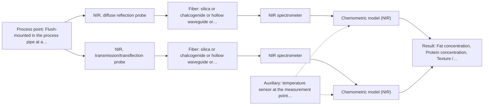
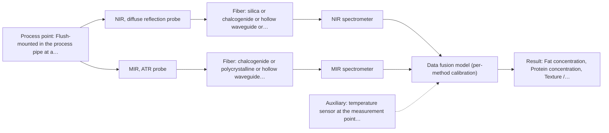

# First technical assessment: Fat and protein monitoring in opaque dairy product

## Answer

**Customer request (our summary):** Opaque, concentrated milk product in a processing line; fat and protein are the targets; temperature and texture vary; customer wants an initial spectroscopy concept and a comparison experiment while keeping lab checks.

### Brief answer

Start with in-line NIR diffuse reflection on the flowing product, calibrated against your existing lab fat and protein results, and test an NIR transflection probe on the same product as a comparison. Mid-IR ATR is a later option if NIR selectivity proves insufficient. Open points: required accuracy and concentration ranges, temperature range and installation point, and the fiber distance to the analyser.

### Proposal

- **Best current option:** O2 (recommended)
- **Basis:** supplied AFS sources
- **What would change it:** If the required accuracy or the concentration ranges turn out to be beyond what NIR reflection delivers on held-out runs, the mid-IR ATR comparison (O3) becomes the focus; a very long fiber link or unsuitable installation point would also change the hardware choice.
- **Next step:** Run the multi-method lab trial on representative product samples with paired laboratory fat and protein reference measurements, testing NIR reflection and transflection side by side.

**Secondary evidence (external, not AFS material):** G1: E02 ¶12, E01 ¶19; G2: no usable external source found; G3: no usable external source found; G4: no usable external source found. See Expert detail.

**Decision status:** Provisional feasibility assessment

### Solution options

| ID | Tier | Methods | Confidence | Cost class, S01 Table 1 (p.6) | Ease of use | Maintenance | Performance fit | Sources |
|---|---|---|---|---|---|---|---|---|
| O1 | Simple | M1 NIR, diffuse reflection probe | Low: open question: Q1 (starts at Medium); uncited auxiliary sensor | average cost (row 8) | straightforward flush-mount probe and standard NIR hardware | window cleaning and periodic calibration checks | fits because reflection is the documented technique for opaque concentrated dairy | [1: S01 p.17] [2: S01 p.5] |
| O2 | Recommended | M1 NIR, diffuse reflection probe; M2 NIR, transmission/transflection probe | Low: open question: Q1 (starts at Medium); suitability for this sample not confirmed; uncited auxiliary sensor | average cost (rows 7, 8) | two probes to swap or install side by side during the trial | window cleaning for both probe heads | fits because it resolves which geometry survives the product's opacity and texture variation | [3: S01 p.18] [1: S01 p.17] [2: S01 p.5] |
| O3 | Extended (multi-method) | M1 NIR, diffuse reflection probe; M3 MIR, ATR probe | Low: open question: Q1 (starts at Medium); uncited auxiliary sensor; multi-method, fusion benefit not yet shown | high cost (rows 2, 8) | two instruments and two calibrations to run and maintain | ATR crystal fouling plus NIR window cleaning, two calibrations | fits only if NIR selectivity alone misses the accuracy target | [4: S01 p.7] [1: S01 p.17] [2: S01 p.5] [5: S01 p.11] [6: S02 p.13] |

*Confidence rates the basis of the advice (how much is known and cited), not a predicted accuracy or probability of success. It starts at High, or at Medium when a key question on the method or the option is open, and drops one level per weakness listed (floor Low).*

*Cost class is the relative rating in S01 Table 1 (p.6) for the in-line method+technique rows named (the highest one for a multi-method option); it is not a price.*

### Setup sketch

*Recommended option O2; drawn by code from the option, a schematic, not a configuration.*

### Key questions

1. What are the fat and protein concentration ranges and the accuracy you need in-line?
2. What is the product temperature range, and where in the line (pipe size, access, cleaning-in-place) could a probe be mounted?
3. How far is the measurement point from a safe location for the spectrometer?

## Expert detail

**Customer enquiry**

> We produce an opaque, concentrated milk product that flows through a processing line. We currently sample it for fat and protein analysis and would like earlier information about composition changes. Product temperature and texture vary during production. We want an initial spectroscopy concept and a practical comparison experiment, while retaining our laboratory checks.

**Decision status:** Provisional feasibility assessment. A method shortlist can be justified from published in-line dairy applications, but the accuracy targets, installation details and product matrix specifics are still open, so the assessment is provisional and the comparison experiment is the deciding step.

### Parameters

| ID | Parameter | Kind | Need | Measured by | Why | Sources |
|---|---|---|---|---|---|---|
| P1 | Fat concentration | quantitative | required | Spectroscopy: NIR | Fat is one of the two stated process targets and the main calibration response. | *(no verified source: engineering judgement)* |
| P2 | Protein concentration | quantitative | required | Spectroscopy: NIR | Protein is the second stated process target and the second calibration response. | *(no verified source: engineering judgement)* |
| P3 | Product temperature | quantitative | required | Auxiliary sensor: temperature sensor at the measurement point (engineering judgement: confirm availability with AFS) | Temperature varies during production and shifts the spectra, so it must be recorded to be included or compensated in the calibration. | *(no verified source: engineering judgement)* |
| P4 | Texture / scattering state of the product | qualitative | required | Spectroscopy: NIR | Texture variation changes the scattering background and can mimic composition change, so it must be characterised and modelled. | [7: S01 p.17] |
| P5 | Laboratory reference fat and protein values | quantitative | required | Reference lab method: laboratory fat and protein analysis (customer's existing method) | The existing lab analysis is the independent reference needed to calibrate and validate the spectral models. | *(no verified source: engineering judgement)* |

### Solution option details

- **O1 cost drivers:** one reflection probe, one NIR spectrometer, calibration samples and lab reference analyses
- **O2 cost drivers:** two NIR probes on one spectrometer, doubled calibration samples, comparison modelling
- **O3 cost drivers:** second spectrometer, mid-IR fiber and ATR probe, per-method calibrations, fusion modelling
- **O3 combining methods:** Fusion level: one PLS model per method first, then low-level fusion of the synchronised NIR and mid-IR spectra into one augmented matrix with block scaling. Both probes must sample the same product at the same pipe location and the data must be normalised to a common time step. The fused model must beat the best single-method model on held-out runs, otherwise the extra instrument is dropped.

*Extended (multi-method) option O3; drawn by code from the option, a schematic, not a configuration.*

### Premise check

- **Precedent only:** Spectroscopy can provide earlier in-line information on fat and protein in an opaque, concentrated dairy product. In-line NIR monitoring of dairy streams for fat and protein is a published application class, which justifies testing it here but is not proof for this specific product. [8: S01 p.17]
- **Precedent only:** A single probe geometry can cover the product across its texture and composition variation. The source shows transflection working for both low-fat and high-fat dairy in some cases; whether it works for this opaque, concentrated product is exactly what the comparison test must show. [3: S01 p.18]
- **Not covered:** The existing laboratory checks remain compatible with an in-line spectroscopy method. No supplied source addresses how the customer's laboratory checks integrate with an in-line method; this is assumed compatible and left to the customer. *(no verified source: engineering judgement)*

### Requirements

**Stated by the customer**

- In-line monitoring of fat and protein in an opaque, concentrated milk product
- An initial spectroscopy concept and a practical comparison experiment
- Retention of the existing laboratory checks

**Key unknowns**

- Fat and protein concentration ranges and required in-line accuracy
- Temperature range and installation point in the line
- Distance between measurement point and analyser location
- Fouling and cleaning behaviour of the optical window
- Whether texture variation causes scattering changes that must be modelled

### Clarification questions (most decision-relevant first)

Q1. What are the fat and protein concentration ranges and the accuracy you need in-line? *Why it matters:* The concentration range and required accuracy decide whether NIR reflection can meet the target or whether a second method is needed. *(affects: M1, M2)*
Q2. What is the product temperature range, and where in the line (pipe size, access, cleaning-in-place) could a probe be mounted? *Why it matters:* Temperature variation and the installation point determine probe style, window material and how temperature must be handled in the calibration. *(affects: installation)*
Q3. How far is the measurement point from a safe location for the spectrometer? *Why it matters:* The achievable fiber cable length depends on the fiber family and must be confirmed before the hardware concept is fixed. *(affects: installation)*
Q4. How often can you take samples for laboratory fat and protein reference analysis during the trial? *Why it matters:* Calibration and validation need enough reference samples spread over the real process variation. *(affects: M1, M2)*
Q5. How does the product behave on optical surfaces (fouling, coating, cleaning)? *Why it matters:* Fouling of the optical window is a main operational risk for any in-line contact probe. *(affects: installation)*

### Recommendation

- **M1 · Primary candidate: NIR, diffuse reflection probe.** NIR diffuse reflection is the documented in-line technique for opaque, concentrated dairy products and suits remote fiber-probe measurement. Its overlapping bands require a chemometric calibration against the lab fat and protein values. [1: S01 p.17] [2: S01 p.5]
- **M2 · Comparison candidate: NIR, transmission/transflection probe.** Transflection is reported to work for both low-fat and high-fat dairy in some cases and samples a defined path, but transmission-style geometries fail when the product is too thick or fat-rich, so it must be tested on the real product. *Conditions:* Applies only if the transflection probe gives usable signal on this opaque, concentrated product in the comparison test. [3: S01 p.18]
- **M3 · Comparison candidate: MIR, ATR probe.** Mid-IR ATR gives well-defined, highly selective absorption bands that complement NIR overtones, and ATR fiber probes are demonstrated for in-line liquid analysis. It requires tight contact and samples only a surface layer a few micrometres deep, so fouling and surface representativeness are risks. *Conditions:* Applies only if the NIR single-method results miss the customer's accuracy targets, and after the MIR fiber link length and probe compatibility are confirmed. [5: S01 p.11] [6: S02 p.13]
- **M5 · Not recommended: fluorescence probe.** Fluorescence only measures species that fluoresce, and no fluorescent species or indicator has been identified in this product; its selectivity for fat and protein is low. [9: S01 p.5]

### Measurement concept

- **Probe and geometry:** NIR diffuse reflection fiber probe in contact with the product through a window; an NIR transflection probe is tested on the same product as a comparison.
- **Location:** Flush-mounted in the process pipe at a representative point of the flowing product.
- **Fiber link:** Vis-NIR silica fiber cable from the probe to the spectrometer; the achievable cable length depends on the selected fiber and must be confirmed with AFS. [10: S01 p.17]

### Spectral range

- **NIR:** Nominal NIR range 780-2500 nm; the usable range depends on the spectrometer, fiber and probe actually selected. [11: S01 p.10]
- **MIR:** Nominal mid-IR range 4000-400 cm-1 (2.5-25 µm); the usable range is limited by the selected fiber and ATR crystal. [12: S01 p.9]

### Risks and uncertainty

- Texture and globule-size variation can change the reflection signal in ways that mimic composition change, so the calibration must cover the real texture range. *(rules: R-GEO-6)* [7: S01 p.17]
- NIR bands are broad and overlapping, so accuracy depends entirely on the quality and spread of the calibration data. *(rules: R-NIR-2)* [13: S01 p.10]
- If the transflection comparison is pursued, the optical pathlength must be controlled for this concentrated, water-rich product. *(rules: R-GEN-4)* [14: S01 p.18]
- If mid-IR ATR is added later, fouling of the crystal and its few-micron sampling depth limit what the surface measurement represents. *(rules: R-MIR-3)* [15: S01 p.13]

### First feasibility experiment

1. **Collect representative samples across the expected fat, protein, temperature and texture variation of the product.** Cover the expected variation in fat, protein, temperature and texture so the calibration sees the real process spread. *(no verified source: engineering judgement)*
2. **Measure each sample with the existing laboratory fat and protein reference methods.** Provide the independent reference values needed for calibration and validation. *(no verified source: engineering judgement)*
3. **Measure the same samples with an NIR diffuse reflection probe and, in parallel, with an NIR transflection probe; compare both against the lab values.** Test the single methods first, on the same samples, before any combination. *(no verified source: engineering judgement)*
4. **Build PLS calibrations with scatter correction and validate on held-out samples or production runs not used for calibration.** Estimate real predictive performance rather than calibration fit. *(no verified source: engineering judgement)*
5. **Only if the best single NIR technique misses the customer's accuracy targets, test a mid-IR ATR probe on the same samples and evaluate whether combining it with NIR improves on the best single method.** Decide whether the single NIR method is sufficient or a second method must be tested. *(no verified source: engineering judgement)*

**Reference measurements:** Every spectrum is paired with the customer's existing laboratory fat and protein analysis on a sample taken at the same time and location.

**Decision basis:** Go/no-go against the customer's own criteria: the in-line prediction error for fat and protein on held-out runs must meet the accuracy the customer specifies in Q1, with stable performance across the temperature and texture range.

### Assumptions

- The product is treated as an opaque, concentrated dairy-type liquid flowing in a pipe, so transmission-style geometries are expected to struggle and reflection-style geometries are the natural starting point.
- Fat and protein are the calibration targets; the existing laboratory fat/protein analysis serves as the reference method.
- No fluorophore or indicator has been identified, so fluorescence is not assumed to be measurable.

### Not covered by the supplied sources

- Achievable in-line accuracy for fat and protein in this specific concentrated product
- Achievable cable length for a mid-IR fiber link in an industrial installation

### Further notes

- **Chemometrics:** Fat and protein in an opaque, scattering dairy matrix will require a PLS calibration with scatter correction (e.g. SNV or MSC) and validation on held-out production runs; the calibration is matrix-specific and must be re-validated when the product formulation or texture changes.
- **Real-time tracking:** The goal is continuous in-line tracking of fat and protein during production; spectra acquisition speed and update rate should be set once the required response time is known, and the data stream synchronised with the lab reference sampling during calibration.
- **Future direction:** If the trial shows NIR reflection alone is marginal, a later extension is a combined NIR reflection and mid-IR ATR measurement at the same point, or a compact LED-based NIR sensor once the informative wavelengths are known.

### Secondary evidence (external, not AFS material)

*Found by a literature search for gaps the supplied AFS sources leave open. Not AFS material and not proof for this case; every quote below was verified verbatim against the fetched text.*

*Live search unavailable (library only: cache miss (europepmc); cache miss (openalex)); curated library only.*

**G1 · auxiliary sensor:** In-line measurement of Product temperature with temperature sensor at the measurement point

- **E02 ¶12** The OH bands in aqueous solutions are temperature-sensitive in both NIR and MIR, which the authors say makes tempered sample holders necessary. *How it applies:* Since milk is an aqueous matrix and the customer reports varying temperature, a temperature sensor at the measurement point (O2) is a plausible way to capture a variable that demonstrably affects NIR and MIR spectra; the concept should include testing whether temperature compensation or control is needed. *Limits and transfer risks:* The source concerns aqueous solutions in tempered sample holders, not an opaque concentrated dairy product in an in-line pipe; the magnitude of the temperature effect on fat and protein predictions is not stated and must be tested here. *(supports O2)*
  > "Additionally, the temperature sensitivity of the OH bands is a severe drawback for measuring aqueous solution in NIR and MIR, which makes tempered sample holders necessary [29]."
  > A critical review of recent trends, and a future perspective of optical spectroscopy as PAT in biopharmaceutical downstream processing. (2020) · Analytical and bioanalytical chemistry · doi:10.1007/s00216-020-02407-z · https://europepmc.org/article/PMC/PMC7072065 · retrieved 2026-10-17, full text, licence: cc by, via curated library
- **E01 ¶19** To obtain a robust model, the authors deliberately varied temperature (along with concentrations and ionic strength) in the calibration design. *How it applies:* This supports building the calibration for the customer's varying-temperature product by deliberately spanning the expected temperature range, with the in-line temperature sensor (O2) as an auxiliary variable to test. *Limits and transfer risks:* The result comes from a liquid-liquid extraction chemistry in lithium recycling, not a concentrated dairy matrix, so the transferable part is only the calibration-design principle, not any performance figure. *(supports O2)*
  > "The concentrations of nitric acid and hydrochloric acid as well as the ionic strength and temperature were varied to obtain a robust model."
  > Process Analytical Technology-Integrated FT-IR and Raman Spectroscopies for Efficient Reactive Liquid-Liquid Extraction Processing in Lithium Recycling. (2025) · ACS omega · doi:10.1021/acsomega.5c05705 · https://europepmc.org/article/PMC/PMC12573149 · retrieved 2026-10-17, full text, licence: cc by, via curated library

**G2 · multi-method:** Combining several spectroscopy methods (data fusion) (Fusion level: one PLS model per method first, then low-level fusion of the synchronised NIR and mid-IR spectra into one augmented matrix with block scaling. Both probes must sample the same product at the same pipe location and the data must be normalised to a common time step. The fused model must beat the best single-method model on held-out runs, otherwise the extra instrument is dropped.)

- No usable external source found.

**G3 · not in the supplied sources:** Achievable in-line accuracy for fat and protein in this specific concentrated product

- No usable external source found.

**G4 · not in the supplied sources:** Achievable cable length for a mid-IR fiber link in an industrial installation

- No usable external source found.

### Evidence (verified quotes)

1. ✓ **S01 p.17** (application precedent): "NIR Reflection is primarily used for opaque or highly concentrated dairy products, such as yogurt, butter, or whole milk concentrates."
2. ✓ **S01 p.5** (general): "making it ideal for online applications, including remote measurements via fiber optic probes."
3. ✓ **S01 p.18** (application precedent): "In some cases, a Transflection probe can already be a combined solution working well for low-fat and high-fat containing milk products."
4. ✓ (precedent only) **S01 p.7** (method gain): "The analysis of such systems may require a combination of two or even more spectral methods."
5. ✓ **S01 p.11** (general): "This property makes mid-IR and Raman spectra complementary, that is, they complement each other."
6. ✓ **S02 p.13** (application precedent): "Application: measurement of water content in petroleum"
7. ✓ **S01 p.17** (general): "the method is sensitive to the surface characteristics and fat globule size."
8. ✓ **S01 p.17** (application precedent): "The use of Near-Infrared (NIR) spectroscopy for the inline monitoring of milk is a cornerstone of modern dairy "Process Analytical Technology" (PAT)."
9. ✓ **S01 p.5** (general): "However, most chemicals do not exhibit this property."
10. ✓ **S01 p.17** (application precedent): "Experimentally, the probe is flush-mounted into a pipe or vat to interact directly with the flowing medium."
11. ✓ **S01 p.10** (general): "NIR spectra (780-2500 nm) contain predominantly overtones and component bands of fundamental vibrations"
12. ✓ **S01 p.9** (general): "Vibrational spectroscopy in the mid-IR range (4000-400 cm-1) is one of the most informative methods of chemical analysis."
13. ✓ **S01 p.10** (general): "The broad absorption bands observed in this region overlap, suggesting the use of chemometrics for quantitative and qualitative analysis of spectral data."
14. ✓ **S01 p.18** (general): "if the pathlength is too wide, the signal is lost to absorption"
15. ✓ **S01 p.13** (general): "typically at a depth of few microns"

### Verification

- Citations verified: 18 of 18 (exact or whitespace/hyphen-tolerant match on the cited page, scope checked).
- Hard check failures before deterministic corrections: 0; still open: 0; soft warnings: 2; repair rounds: 1.
- External evidence (cache): 2 quote(s) verified verbatim (exact or whitespace/hyphen-tolerant, at most 400 characters and 2 sentences, against the cited paragraph); 0 item(s) dropped.
- External search: 6 query(ies), 0 hit(s), 3 source(s) (3 from the curated library); ⚠ library only: cache miss (europepmc); cache miss (openalex).
- External step: 2 model call(s), 16.4 s extra (cost in the run JSON).

*Run D02-20261018T080635Z-7965 · models z-ai/glm-5.3-flash*
