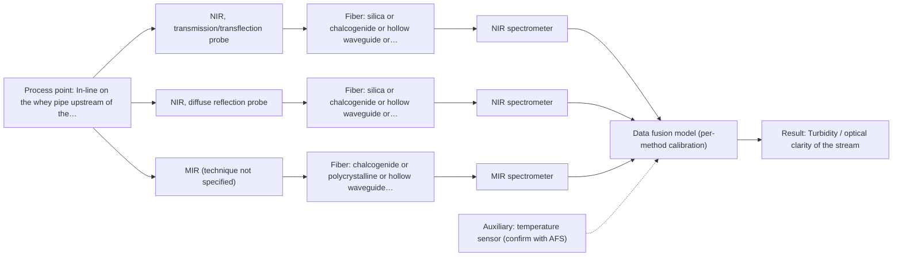

# First technical assessment: A clear whey stream before concentration

## Answer

**Customer request (our summary):** Dairy producer asks whether in-line spectroscopy can track protein concentration in a relatively clear whey stream before a concentration stage, where the stream can become more turbid under some operating conditions, with laboratory results as reference. They want a first measurement concept that handles the clarity change.

### Brief answer

Start with an in-line NIR probe trial on the whey stream: transmission or transflection while the stream is clear, plus a diffuse-reflection geometry for the turbid periods, with laboratory protein results as the calibration reference. The key open points are how turbid the stream actually becomes, the protein range and accuracy needed, and the installation constraints; these decide whether one transflection probe suffices or two geometries are needed.

### Proposal

- **Best current option:** O2 (recommended)
- **Basis:** supplied AFS sources
- **What would change it:** If the turbidity stays low under all operating conditions, a single transmission/transflection probe (O1) may be enough; if the stream becomes opaque, reflection becomes the primary geometry and the trial design shifts accordingly.
- **Next step:** Run the multi-geometry NIR trial on representative clear and turbid whey samples with laboratory protein reference results, after agreeing the accuracy criteria.

**Secondary evidence (external, not AFS material):** G1: E03 ¶19; G2: no usable external source found; G3: no usable external source found; G4: E03 ¶8. See Expert detail.

**Decision status:** Provisional feasibility assessment

### Solution options

| ID | Tier | Methods | Confidence | Cost class, S01 Table 1 (p.6) | Ease of use | Maintenance | Performance fit | Sources |
|---|---|---|---|---|---|---|---|---|
| O1 | Simple | M1 NIR, transmission/transflection probe | Low: open question: Q2 (starts at Medium); uncited auxiliary sensor | average cost (row 7) | straightforward probe installation and operation | window cleaning per CIP regime | fits the clear whey state directly | [1: S01 p.18] [2: S01 p.18] |
| O2 | Recommended | M1 NIR, transmission/transflection probe; M2 NIR, diffuse reflection probe; M3 NIR, transmission/transflection probe + MIR (combination) | Low: open question: Q2 (starts at Medium); uncited auxiliary sensor; multi-method, fusion benefit not yet shown | at least average cost (rows 7, 8); MIR row not identified | two geometries need coordinated operation | cleaning and drift checks per geometry | covers both clarity states as required | [3: S01 p.18] [1: S01 p.18] [2: S01 p.18] [4: S01 p.17] [5: S01 p.17] [6: S01 p.18] |

*Confidence rates the basis of the advice (how much is known and cited), not a predicted accuracy or probability of success. It starts at High, or at Medium when a key question on the method or the option is open, and drops one level per weakness listed (floor Low).*

*Cost class is the relative rating in S01 Table 1 (p.6) for the in-line method+technique rows named (the highest one for a multi-method option); it is not a price.*

### Setup sketch

*Recommended option O2; drawn by code from the option, a schematic, not a configuration.*

### Key questions

1. How turbid can the stream become, what causes the change (e.g. fat or precipitated protein), and can it become effectively opaque?
2. What protein concentration range and accuracy do you need to track, and which protein fraction matters?
3. Where would the probe sit (pipe size, flow, temperature, pressure), how far is the analyzer location, and what CIP/fouling constraints apply?

## Expert detail

**Customer enquiry**

> Our dairy process includes a relatively clear whey stream before a concentration stage. We want to investigate whether spectroscopy can track protein concentration as the stream changes, with laboratory results used as the reference. The stream can become more turbid under some operating conditions. We need a first measurement concept that handles this change rather than assuming the liquid always remains clear.

**Decision status:** Provisional feasibility assessment. A conditional shortlist can be justified from the dairy precedents, but the degree of turbidity, the protein range and the installation constraints are open and could change the recommended geometry.

### Parameters

| ID | Parameter | Kind | Need | Measured by | Why | Sources |
|---|---|---|---|---|---|---|
| P1 | Protein concentration | quantitative | required | Reference lab method: laboratory protein assay (customer's stated reference method) | It is the target variable the spectroscopic model must predict. | *(no verified source: engineering judgement)* |
| P2 | Turbidity / optical clarity of the stream | quantitative | required | Spectroscopy: NIR | The clarity change is the main physical interference and determines which measurement geometry is valid at any time. | [5: S01 p.17] |
| P3 | Sample temperature | quantitative | required | Auxiliary sensor: temperature sensor (engineering judgement: confirm availability with AFS) | Temperature affects NIR spectra of aqueous streams and must be recorded so the calibration can account for it. | *(no verified source: engineering judgement)* |
| P4 | Fat and lactose content | quantitative | optional | Reference lab method: laboratory fat and lactose analysis | These should be available from routine dairy lab work and help identify interfering components in the calibration. | *(no verified source: engineering judgement)* |

### Solution option details

- **O1 cost drivers:** one NIR probe and spectrometer, trial samples, laboratory reference analyses
- **O2 cost drivers:** two probe geometries or a transflection evaluation, wider sample campaign, larger calibration set

### Premise check

- **Precedent only:** A first measurement concept can handle the clear-to-turbid change. The dairy literature shows transmission and reflection geometries covering clear and turbid dairy streams, and notes transflection can in some cases serve both; this is a precedent to test, not proof for this whey stream. [6: S01 p.18]
- **Not covered:** Laboratory results are a suitable reference for calibrating the in-line measurement. No supplied source addresses whey protein reference analysis specifically; the suitability of the laboratory method as calibration reference must be checked in the trial. *(no verified source: engineering judgement)*

### Requirements

**Stated by the customer**

- "Our dairy process includes a relatively clear whey stream before a concentration stage"
- "We want to investigate whether spectroscopy can track protein concentration as the stream changes"
- *Further statements: see the customer enquiry above.*

**Key unknowns**

- Degree and cause of the turbidity change, and whether the stream can become opaque
- Protein concentration range, fraction of interest and required accuracy
- Installation point, pipe geometry, temperature and CIP/fouling constraints
- Laboratory reference method and achievable sampling frequency
- Distance from measurement point to analyzer location

### Clarification questions (most decision-relevant first)

Q1. How turbid can the stream become, what causes the change (e.g. fat or precipitated protein), and can it become effectively opaque? *Why it matters:* The degree of turbidity decides whether transmission/transflection still works or a reflection geometry is required. *(affects: technique)*
Q2. What protein concentration range and accuracy do you need to track, and which protein fraction matters? *Why it matters:* The range and target accuracy determine whether NIR sensitivity is sufficient and how the calibration must be built. *(affects: method, status)*
Q3. Where would the probe sit (pipe size, flow, temperature, pressure), how far is the analyzer location, and what CIP/fouling constraints apply? *Why it matters:* Installation and cleaning constraints determine the probe type, fiber link and whether in-line contact is practical. *(affects: installation)*
Q4. Which laboratory method measures protein, and at what sampling frequency can reference results be collected during the trial? *Why it matters:* The calibration quality depends directly on the accuracy and coverage of the laboratory reference data. *(affects: M1)*
Q5. Does the stream temperature vary between operating states, and is the flow homogeneous at the proposed measurement point? *Why it matters:* Temperature and inhomogeneity are known sources of spectral variation that the calibration must cover. *(affects: installation)*

### Recommendation

- **M1 · Primary candidate: NIR, transmission/transflection probe.** Whey is named in the dairy literature as a typical stream for NIR transmission, and NIR suits remote fiber-probe measurement in-line. The pathlength must be controlled, and the turbid states must be tested rather than assumed away. *Conditions:* Valid while the stream is clear enough for light to pass the chosen pathlength; the turbid states must be tested explicitly. [1: S01 p.18] [2: S01 p.18]
- **M2 · Comparison candidate: NIR, diffuse reflection probe.** NIR diffuse reflection is the dairy geometry for opaque or concentrated products, so it is the natural fallback when the whey turns turbid. Its sensitivity to surface characteristics and particle size means the turbidity change itself must be characterised. *Conditions:* Applies when the stream becomes too turbid for transmission; reflection signals must be checked for sensitivity to surface and particle effects. [4: S01 p.17] [5: S01 p.17]
- **M3 · Conditional candidate: NIR, transmission/transflection probe + MIR (combination).** The dairy source notes a transflection probe can in some cases serve both low-fat and high-fat products, suggesting one probe might handle both clarity states. This is explicitly a hypothesis to test against the two single geometries, not an assumption. *Conditions:* Only if the trial shows neither single geometry covers both the clear and turbid states. [6: S01 p.18] Later hypothesis, after single-method tests.

### Measurement concept

- **Probe and geometry:** NIR transmission/transflection fiber probe for the clear state, with NIR diffuse reflection evaluated for the turbid state; a transflection probe may in some cases cover both states and is a hypothesis to test.
- **Location:** In-line on the whey pipe upstream of the concentration stage, at a point where the flow is representative.
- **Fiber link:** Vis-NIR silica fiber cable from the probe to the analyzer; the required cable length is an open question for the trial configuration. [7: S01 p.18]

### Spectral range

- **NIR:** Nominal NIR range 780-2500 nm; the usable range depends on the spectrometer, fiber and probe actually selected. [8: S01 p.10]

### Risks and uncertainty

- If the turbidity episodes make the stream effectively opaque, transmission/transflection will fail and reflection becomes the primary geometry. *(rules: R-GEO-2)* [9: S01 p.18]
- Reflection signals respond to surface and particle effects, so a turbidity change could mimic or mask a protein change unless the calibration covers both states. *(rules: R-GEO-6)* [5: S01 p.17]
- NIR protein calibration is matrix-specific and must be built and validated on this whey, including its turbid states; it cannot be transferred from literature. *(rules: R-NIR-2, R-CAL-1)* [10: S01 p.10]
- Probe fouling by whey proteins at the optical window could drift the signal and must be checked against the CIP regime. *(no verified source: engineering judgement)*

### First feasibility experiment

1. **Collect representative whey samples across normal operation and the turbid operating conditions.** Cover the expected chemical and physical variation, especially the clear-to-turbid change. *(no verified source: engineering judgement)*
2. **Measure each sample with the laboratory protein reference method.** Provide the reference data the customer has specified. *(no verified source: engineering judgement)*
3. **Record NIR spectra with a transmission/transflection probe at a controlled pathlength on all samples, including the turbid ones.** Test the best single geometry first, on the same samples. [1: S01 p.18]
4. **Record NIR diffuse-reflection spectra on the same samples and compare which geometry tracks protein across both states.** Establish whether a second geometry is needed for the turbid state. [4: S01 p.17]
5. **Build the protein calibration on part of the data and validate it on held-out samples or batches from both clear and turbid states.** Verify the concept handles the clarity change before any in-line installation. *(no verified source: engineering judgement)*

**Reference measurements:** Laboratory protein results (customer's stated reference) for every sample, taken close in time and temperature to the spectral measurement.

**Decision basis:** Go/no-go agreed with the customer beforehand, e.g. a required prediction error for protein on held-out batches and acceptable performance in both clear and turbid states; the numerical criteria come from the customer.

### Not covered by the supplied sources

- Whey protein calibration performance figures for this specific stream
- Achievable fiber cable length for the final installation

### Further notes

- **Chemometrics:** A PLS calibration for protein will need reference samples spanning both the clear and turbid operating states, and scatter correction (e.g. MSC or SNV) is likely needed for reflection data, as in the dairy example on S01 p.17.
- **Real-time tracking:** The goal is continuous in-line tracking of protein as the stream changes; NIR diode-array instruments allow fast whole-spectrum acquisition suited to monitoring, per S01 p.10.
- **Future direction:** If the trial shows one geometry cannot cover both states, a dual-technique NIR probe arrangement, or later a combined probe concept, could be evaluated for permanent installation.

### Secondary evidence (external, not AFS material)

*Found by a literature search for gaps the supplied AFS sources leave open. Not AFS material and not proof for this case; every quote below was verified verbatim against the fetched text.*

*Live search unavailable (library only: cache miss (europepmc); cache miss (openalex)); curated library only.*

**G1 · auxiliary sensor:** In-line measurement of Sample temperature with temperature sensor

- **E03 ¶19** In one published spectroscopic process calibration, temperature was deliberately varied, alongside concentration and ionic strength, in order to obtain a robust model. *How it applies:* This suggests treating temperature variation as a calibration design factor rather than only an auxiliary measurement: the whey calibration could include samples spanning the expected temperature range, and a temperature sensor could still be used to flag conditions outside that range. It gives a reason to test whether temperature variation during turbidity changes affects the whey spectra. *Limits and transfer risks:* The source is a lithium-recycling liquid-liquid extraction study with a different matrix, chemistry and spectroscopy setup, so the magnitude of temperature effects may differ substantially in whey. It describes model design, not the use or placement of a temperature sensor in-line. *(supports O2)*
  > "The concentrations of nitric acid and hydrochloric acid as well as the ionic strength and temperature were varied to obtain a robust model."
  > Process Analytical Technology-Integrated FT-IR and Raman Spectroscopies for Efficient Reactive Liquid-Liquid Extraction Processing in Lithium Recycling. (2025) · ACS omega · doi:10.1021/acsomega.5c05705 · https://europepmc.org/article/PMC/PMC12573149 · retrieved 2026-10-17, full text, licence: cc by, via curated library

**G2 · not in the supplied sources:** Whey protein calibration performance figures for this specific stream

- No usable external source found.

**G3 · not in the supplied sources:** Achievable fiber cable length for the final installation

- No usable external source found.

**G4 · premise not covered:** Laboratory results are a suitable reference for calibrating the in-line measurement

- **E03 ¶8** For a continuous process at a fixed probe location, published guidance is that calibrations can be narrower and centered on the operational envelope, with validation relying on independent steady-state runs and monitoring focused on drift and out-of-specification detection. *How it applies:* This informs how laboratory results could be used as a reference: validation against independent steady-state runs, with lab values anchoring the calibration within the operational envelope, is a published pattern worth testing for the whey stream. It also implies drift monitoring rather than assuming the calibration remains valid. *Limits and transfer risks:* The statement comes from an FT-IR and Raman study in lithium recycling, a different matrix, analyte and spectroscopic method from whey protein NIR. It also assumes a steady-state window, which may not hold when the whey becomes more turbid under some operating conditions. *(supports O1)*
  > "In contrast, a continuous process at a fixed probe location is intended to operate in a steady-state window, which simplifies the model design: calibrations can be narrower and centered on the operational envelope, validation can rely on independent steady-state runs, and online monitoring focuses on drift and out-of-specification detection rather than resolving the rapidly changing composition."
  > Process Analytical Technology-Integrated FT-IR and Raman Spectroscopies for Efficient Reactive Liquid-Liquid Extraction Processing in Lithium Recycling. (2025) · ACS omega · doi:10.1021/acsomega.5c05705 · https://europepmc.org/article/PMC/PMC12573149 · retrieved 2026-10-17, full text, licence: cc by, via curated library

### Evidence (verified quotes)

1. ✓ **S01 p.18** (application precedent): "NIR Transmission is the preferred method for transparent or semi-transparent liquids, such as skim milk, whey, or permeate."
2. ✓ **S01 p.18** (general): "the precise control of the optical pathlength (usually 1 - 10 mm); if the pathlength is too wide, the signal is lost to absorption; if too narrow, the sample represents a negligible volume."
3. ✓ **S01 p.18** (application precedent): "By maintaining both, a lab can calibrate models for every stage of production - from raw milk intake to final evaporation - ensuring that no matter how the physical state of the milk changes during processing, the inline monitoring remains accurate and robust."
4. ✓ **S01 p.17** (application precedent): "NIR Reflection is primarily used for opaque or highly concentrated dairy products, such as yogurt, butter, or whole milk concentrates."
5. ✓ **S01 p.17** (general): "the method is sensitive to the surface characteristics and fat globule size."
6. ✓ **S01 p.18** (application precedent): "In some cases, a Transflection probe can already be a combined solution working well for low-fat and high-fat containing milk products."
7. ✓ **S01 p.18** (application precedent): "The setup typically consists of a transmission / transflection probe, where light passes entirely through a defined layer of the sample to a detector on the opposite side."
8. ✓ **S01 p.10** (general): "NIR spectra (780-2500 nm) contain predominantly overtones and component bands of fundamental vibrations"
9. ✓ **S01 p.18** (general): "it fails when the milk becomes too "thick" or fat-rich, as the light cannot penetrate the sample."
10. ✓ **S01 p.10** (general): "The broad absorption bands observed in this region overlap, suggesting the use of chemometrics for quantitative and qualitative analysis of spectral data."

### Verification

- Citations verified: 16 of 16 (exact or whitespace/hyphen-tolerant match on the cited page, scope checked).
- Hard check failures before deterministic corrections: 0; still open: 0; soft warnings: 0; repair rounds: 0.
- External evidence (cache): 2 quote(s) verified verbatim (exact or whitespace/hyphen-tolerant, at most 400 characters and 2 sentences, against the cited paragraph); 0 item(s) dropped.
- External search: 6 query(ies), 0 hit(s), 3 source(s) (3 from the curated library); ⚠ library only: cache miss (europepmc); cache miss (openalex).
- External step: 2 model call(s), 39.4 s extra (cost in the run JSON).

*Run D03-20261018T080635Z-d795 · models z-ai/glm-5.3-flash*
