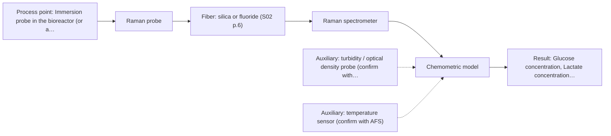
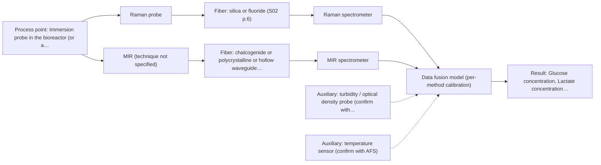

# First technical assessment: Glucose and lactate trends in an aqueous bioprocess

## Answer

**Customer request (our summary):** Customer runs a cell culture process in an aqueous medium; glucose and lactate are measured offline from samples, and the delay makes it hard to see changes promptly. They are exploring an in situ spectroscopy pilot to be checked against the existing laboratory measurements. The medium and cell population change during the run; no probe or calibration strategy has been selected.

### Brief answer

Test Raman first: it tolerates water and has published precedent for direct glucose and lactate detection in bioreactors. Run a bench trial on your own samples across the run, calibrate against your existing laboratory glucose and lactate measurements, then pilot an immersion Raman probe in the bioreactor. Open points: concentration ranges, turbidity over the run, required accuracy and response time, and sterilisation and installation constraints.

### Proposal

- **Best current option:** O2 (recommended)
- **Basis:** supplied AFS sources
- **What would change it:** Very low glucose or lactate concentrations below what Raman can detect, extreme turbidity or a strong fluorescent background could shift the choice toward NIR or a combined approach; the answers to Q1-Q5 will refine the probe and calibration plan.
- **Next step:** Run the bench Raman trial on representative samples from several runs, with paired laboratory glucose and lactate references, and agree the go/no-go accuracy criteria beforehand.

**Secondary evidence (external, not AFS material):** G1: no usable external source found; G2: no usable external source found; G3: E01 ¶31, E01 ¶82, E01 ¶36; G4: no usable external source found. See Expert detail.

**Decision status:** Provisional feasibility assessment

### Solution options

| ID | Tier | Methods | Confidence | Cost class, S01 Table 1 (p.6) | Ease of use | Maintenance | Performance fit | Sources |
|---|---|---|---|---|---|---|---|---|
| O1 | Simple | M2 NIR, transmission/transflection probe | Low: open question: Q1 (starts at Medium); sample clarity unknown | average cost (row 7) | Simple probe, standard glass optics | Low; window cleaning only | Fits as low-effort first trial on real samples | [1: S01 p.10] [2: S01 p.18] |
| O2 | Recommended | M1 Raman probe | Medium: open question: Q1 (starts at Medium) | high cost (row 12) | Immersion probe, no sampling needed | Probe window fouling checks per run | Best water tolerance and metabolite specificity for this aqueous target | [3: S01 p.16] [4: S01 p.16] |
| O3 | Extended (multi-method) | M3 Raman probe + MIR (combination) | Low: precedent only; multi-method, fusion benefit not yet shown | at least high cost (row 12); MIR row not identified | Two instruments to run and align | Two calibrations and two probes to maintain | Fits only if single methods miss accuracy targets | [5: S01 p.7] |

*Confidence rates the basis of the advice (how much is known and cited), not a predicted accuracy or probability of success. It starts at High, or at Medium when a key question on the method or the option is open, and drops one level per weakness listed (floor Low).*

*Cost class is the relative rating in S01 Table 1 (p.6) for the in-line method+technique rows named (the highest one for a multi-method option); it is not a price.*

### Setup sketch

*Recommended option O2; drawn by code from the option, a schematic, not a configuration.*

### Key questions

1. What are the expected concentration ranges of glucose and lactate over the run, and what accuracy and detection limit does the in situ measurement need?
2. How turbid is the medium over the run (cell density / optical density range), and does it change significantly?
3. What are the sterilisation, cleaning and fouling constraints at the measurement point, and how far is the probe location from where the analyser can sit?

## Expert detail

**Customer enquiry**

> We run a cell culture process in an aqueous medium. Glucose and lactate are measured from samples, and the delay makes it difficult to see changes promptly. We are exploring an in situ spectroscopy pilot that can be checked against those existing laboratory measurements. The medium and cell population change during the run; we have not yet selected a probe or a calibration strategy.

**Decision status:** Provisional feasibility assessment. A method shortlist can be justified from published bioprocess precedents, but the concentration ranges, turbidity behaviour and accuracy requirements are unknown, so the assessment is provisional and the deciding questions are listed first.

### Parameters

| ID | Parameter | Kind | Need | Measured by | Why | Sources |
|---|---|---|---|---|---|---|
| P1 | Glucose concentration | quantitative | required | Reference lab method: enzymatic glucose assay | Glucose is the primary target analyte the in situ method must track against the laboratory reference. | *(no verified source: engineering judgement)* |
| P2 | Lactate concentration | quantitative | required | Reference lab method: enzymatic lactate assay | Lactate is the second target analyte and co-varies with glucose consumption, so both are needed for the calibration. | *(no verified source: engineering judgement)* |
| P3 | Turbidity / cell density | quantitative | required | Auxiliary sensor: turbidity / optical density probe (cited; confirm availability with AFS) | Scattering changes with cell growth and strongly affects both NIR and Raman signals, so it must be known to build a robust calibration. | [6: S01 p.16] |
| P4 | Temperature at the measurement point | quantitative | optional | Auxiliary sensor: temperature sensor (engineering judgement: confirm availability with AFS) | Temperature shifts spectral band positions and intensities; it should be available from the bioreactor controls and used as a covariate or at least logged. | *(no verified source: engineering judgement)* |
| P5 | Presence of fluorescing or strongly absorbing medium components | qualitative | optional | Not measurable in-line by spectroscopy; alternative: medium formulation review and lab fluorescence scan | Knowing whether the medium contains fluorophores or strong absorbers decides whether Raman backgrounds or NIR bands are compromised; it should be available from the medium formulation. | [7: S01 p.5] |

### Solution option details

- **O1 cost drivers:** NIR spectrometer, transflection or reflection probe, sample set and reference assays
- **O2 cost drivers:** Raman spectrometer and laser, immersion probe, chemometric model development, reference sampling
- **O3 cost drivers:** Two spectrometers, combined or paired probes, synchronisation software, doubled calibration effort
- **O3 combining methods:** Low-level fusion: one PLS model per method first, then synchronised spectra joined into one augmented matrix with block scaling. Both probes must sample the same bioreactor zone and the data must be normalised to a common time step. The fused model must beat the better single method on held-out runs, otherwise the second instrument is dropped.

*Extended (multi-method) option O3; drawn by code from the option, a schematic, not a configuration.*

### Premise check

- **Precedent only:** In situ spectroscopy can track glucose and lactate in an aqueous cell culture process. The sources show published bioprocess examples of fiber-optic Raman and NIR monitoring of metabolites such as glucose and lactate; this is a reason to test, not proof for this customer's process. [4: S01 p.16]
- **Supported:** The pilot can be validated against the existing laboratory glucose and lactate measurements. Checking a spectral method against independent laboratory reference measurements is exactly what a feasibility plan requires, so this premise is supported as good practice. [8: REF §3]
- **Supported:** A pilot can be planned before a probe or calibration strategy is selected. The sources describe multi-method laboratory trials precisely for cases where the best method is not yet known, so planning a pilot before fixing a probe is consistent with the recommended pathway. [9: S01 p.3]

### Requirements

**Stated by the customer**

- In situ measurement of glucose and lactate in an aqueous cell culture medium
- Results must be checkable against the existing offline laboratory measurements
- Method must cope with a medium and cell population that change during the run

**Key unknowns**

- Glucose and lactate concentration ranges and required accuracy over the run
- Turbidity / cell density range and how the optical properties of the medium change
- Sterilisation, fouling and installation constraints at the measurement point
- Reference sampling frequency available for calibration and validation
- Other absorbing or fluorescing medium components that could interfere
- Required response time for detecting changes

### Clarification questions (most decision-relevant first)

Q1. What are the expected concentration ranges of glucose and lactate over the run, and what accuracy and detection limit does the in situ measurement need? *Why it matters:* Concentration range and required accuracy decide whether NIR sensitivity suffices or Raman is needed, and set the go/no-go criteria. *(affects: technique, M1, M2)*
Q2. How turbid is the medium over the run (cell density / optical density range), and does it change significantly? *Why it matters:* Turbidity decides between transmission, transflection and reflection geometries and drives scattering correction in the calibration. *(affects: technique, installation)*
Q3. What are the sterilisation, cleaning and fouling constraints at the measurement point, and how far is the probe location from where the analyser can sit? *Why it matters:* Sterilisation and probe access determine the probe design, and the link distance constrains which fiber families are practical. *(affects: installation, status)*
Q4. How often can offline samples be taken during the pilot runs, and what is the laboratory reference method for glucose and lactate? *Why it matters:* The number and timing of reference samples determine whether a calibration model can be built and validated at all. *(affects: M1, M2, M3)*
Q5. Which other components are in the medium (amino acids, vitamins, phenol red, antifoam), and do any fluoresce or absorb strongly? *Why it matters:* Interfering absorbers or fluorophores can swamp Raman or NIR signals and change the method choice. *(affects: method)*

### Recommendation

- **M1 · Primary candidate: Raman probe.** Raman works well in water and has published bioprocess precedent for direct detection of metabolites including glucose and lactate. The signal is weak and fluorescence background must be checked on real samples. [3: S01 p.16] [4: S01 p.16]
- **M2 · Comparison candidate: NIR, transmission/transflection probe.** NIR is the most common online fiber-optic method and glucose and lactate have NIR bands, but water absorption demands a controlled pathlength and the bands overlap so chemometrics are required. Its suitability depends on the turbidity of the medium, which is still unknown. *Conditions:* Applies if the medium stays clear enough for a controlled 1-10 mm pathlength; if it becomes too turbid, reflection geometry is the fallback. [1: S01 p.10] [2: S01 p.18]
- **M3 · Conditional candidate: Raman probe + MIR (combination).** For complex, changing process media the sources state that a combination of methods may be needed to solve what one method handles only partially. Any fusion gain is a hypothesis to test against the best single method after the single-method trials. *Conditions:* Only if the single-method trials show that neither Raman nor NIR alone meets the required accuracy across the changing medium. [5: S01 p.7]
- **M4 · Not recommended: fluorescence probe.** Fluorescence only measures species that fluoresce, and glucose and lactate are not fluorophores; no fluorescent indicator has been identified in this medium. It could only serve as an indirect general metabolic indicator, not as the requested measurement. [7: S01 p.5]

### Measurement concept

- **Probe and geometry:** Raman immersion probe as primary; NIR transflection or reflection probe as comparison, chosen after the turbidity question is answered.
- **Location:** Immersion probe in the bioreactor (or a bypass sidestream) during the pilot; bench measurements on withdrawn samples first.
- **Fiber link:** Silica fibers cover the Raman excitation/collection and NIR ranges; the achievable link length depends on the selected configuration and is not stated in the sources for this setup. [10: S01 p.5]

### Spectral range

- **Raman:** Raman is reported as Raman shift in cm-1 with the laser excitation wavelength stated separately; the usable shift range depends on the spectrometer and probe selected. [11: S01 p.11]
- **NIR:** Nominal NIR range is 780-2500 nm; the usable range depends on the spectrometer, fiber and probe actually selected. [12: S01 p.10]

### Risks and uncertainty

- Fluorescence from medium components or cells could swamp the weak Raman signal and make Raman unusable in this specific medium. *(rules: R-RAM-1)* [13: S01 p.11]
- The changing medium and cell population make the calibration matrix-specific, so a model built on early-run samples may fail later in the run. *(rules: R-CAL-1)* [14: REF §5]
- If glucose or lactate concentrations are low, NIR may lack the sensitivity and Raman detection limits in this matrix are unverified. *(rules: R-NIR-4)* [15: S01 p.16]
- Probe fouling by cells or deposits at the measurement point could bias any contact-based measurement over a long run. *(rules: R-MIR-3)* [16: S01 p.13]

### First feasibility experiment

1. **Collect representative spent and fresh medium samples across several runs, spanning the full glucose and lactate ranges and the cell-density range.** Cover the chemical and physical variation of the run: early and late medium, low and high cell density, and the expected glucose and lactate extremes. *(no verified source: engineering judgement)*
2. **Measure each sample with the existing laboratory glucose and lactate methods at matched times.** Provide the independent reference values for calibration and validation. *(no verified source: engineering judgement)*
3. **Record Raman spectra of all samples with a Raman immersion probe; check fluorescence background on real samples.** Test the primary single method first. [3: S01 p.16]
4. **In parallel, record NIR spectra (transflection or reflection, per the turbidity findings) as a second single-method baseline.** Give a second single-method baseline before any combination is considered. [17: S01 p.10]
5. **Build one PLS model per method, validate on held-out runs or batches, and only afterwards test a fused Raman+NIR model against the better single method.** Demonstrate predictive performance before any in situ installation, and only then test whether a combination beats the best single method. *(no verified source: engineering judgement)*

**Reference measurements:** Every spectrum is paired with the customer's existing laboratory glucose and lactate measurement of the same sample, taken at matched times.

**Decision basis:** Go/no-go agreed with the customer before the trial: e.g. a target prediction accuracy for glucose and lactate on held-out runs and a maximum acceptable deviation from the laboratory reference; the numerical criteria come from the customer (Q1).

### Assumptions

- The medium is a liquid cell-culture broth whose turbidity may change as the cell population grows; this is inferred from the enquiry and not yet quantified.
- Glucose and lactate are present at concentrations measurable by vibrational spectroscopy; their actual ranges are unknown and must be confirmed.

### Not covered by the supplied sources

- Achievable fiber link length for this specific bioreactor installation
- Detection limits and accuracy for glucose and lactate in this specific medium
- Sterilisable probe designs for this specific reactor type

### Further notes

- **Chemometrics:** Glucose and lactate quantification will require a PLS calibration per method, built on spectra paired with the existing laboratory measurements and validated on held-out runs; the calibration is matrix-specific and must be re-checked when the medium formulation or cell line changes.
- **Real-time tracking:** The aim is continuous in situ tracking of glucose and lactate to remove the sampling delay; during the pilot, spectra should be time-stamped and aligned with the offline reference measurements so that calibration and validation use matched time points.
- **Future direction:** If the pilot succeeds, a compact LED- or filter-based spectral sensor specialised to the glucose and lactate bands could later replace the full spectrometer for routine process control, following the optical multisensor concept described in the sources.

### Secondary evidence (external, not AFS material)

*Found by a literature search for gaps the supplied AFS sources leave open. Not AFS material and not proof for this case; every quote below was verified verbatim against the fetched text.*

*Live search unavailable (library only: cache miss (europepmc); cache miss (openalex)); curated library only.*

**G1 · auxiliary sensor:** In-line measurement of Turbidity / cell density with turbidity / optical density probe

- No usable external source found.

**G2 · auxiliary sensor:** In-line measurement of Temperature at the measurement point with temperature sensor

- No usable external source found.

**G3 · multi-method:** Combining several spectroscopy methods (data fusion) (Low-level fusion: one PLS model per method first, then synchronised spectra joined into one augmented matrix with block scaling. Both probes must sample the same bioreactor zone and the data must be normalised to a common time step. The fused model must beat the better single method on held-out runs, otherwise the second instrument is dropped.)

- **E01 ¶31** Low-level data fusion is described as the simplest combination approach, where variables from different sources are concatenated into a single new data matrix. *How it applies:* This supports the planned low-level fusion design (one PLS model per method, then joining synchronised spectra into one augmented matrix) as a recognised, simple fusion architecture worth testing in the pilot. *Limits and transfer risks:* The review is general PAT literature, not cell culture spectroscopy; it does not address block scaling, time synchronisation, or bioreactor probe placement, so those design details remain unvalidated for this process. *(supports O3)*
  > "Low-level data fusion (LLDF) is considered the simplest method to achieve a combination of inputs. In this case, the data is rearranged into a new data matrix, where the variables coming from different sources are placed one after the other."
  > Challenges and Opportunities of Implementing Data Fusion in Process Analytical Technology-A Review. (2022) · Molecules (Basel, Switzerland) · doi:10.3390/molecules27154846 · https://europepmc.org/article/PMC/PMC9369811 · retrieved 2026-10-17, full text, licence: cc by, via curated library
- **E01 ¶82** The review states that the contribution and complementarity of each dataset should be evaluated before fusing data from multiple sources. *How it applies:* This aligns with the acceptance rule that the fused model must beat the better single method on held-out runs; the assessment should include a per-method contribution check before committing to the second instrument. *Limits and transfer risks:* The statement is a general recommendation without quantitative criteria or application domain, so it does not define how much improvement is required or how it behaves with drifting, changing cell culture media. *(supports O3)*
  > "Before fusing data from multiple sources, it is essential to evaluate the contribution of each dataset to the model and its complementarity."
  > Challenges and Opportunities of Implementing Data Fusion in Process Analytical Technology-A Review. (2022) · Molecules (Basel, Switzerland) · doi:10.3390/molecules27154846 · https://europepmc.org/article/PMC/PMC9369811 · retrieved 2026-10-17, full text, licence: cc by, via curated library
- **E01 ¶36** A cited Raman and FT-IR food study showed that instrument complementarity alone was sometimes not sufficient to improve prediction of several quality attributes. *How it applies:* This is a reason to treat the second instrument as conditional: the pilot should verify on held-out runs that fusion actually improves glucose/lactate prediction before keeping both probes. *Limits and transfer risks:* The finding comes from a food analytical study, not an aqueous cell culture process, and concerns different analytes and matrices, so the outcome may differ here. *(supports O3)*
  > "In some situations, instrument complementarity (not data complementarity) was not sufficient to improve the performance of predictive several CQAs, as shown by a Raman and FT-IR data based food analytical study [73]."
  > Challenges and Opportunities of Implementing Data Fusion in Process Analytical Technology-A Review. (2022) · Molecules (Basel, Switzerland) · doi:10.3390/molecules27154846 · https://europepmc.org/article/PMC/PMC9369811 · retrieved 2026-10-17, full text, licence: cc by, via curated library

**G4 · not in the supplied sources:** Achievable fiber link length for this specific bioreactor installation

- No usable external source found.

### Evidence (verified quotes)

1. ✓ **S01 p.10** (general): "Near-IR vibrational spectroscopy (NIR) is the most common online analysis method performed using fiber optic probes."
2. ✓ **S01 p.18** (general): "the precise control of the optical pathlength (usually 1 - 10 mm); if the pathlength is too wide, the signal is lost to absorption; if too narrow, the sample represents a negligible volume."
3. ✓ **S01 p.16** (general): "Raman is particularly well-suited for aqueous environments, as it exhibits low absorbance for water molecules compared to infrared methods."
4. ✓ **S01 p.16** (application precedent): "Raman spectroscopy can be used in the same reactor to provide a "molecular fingerprint" for direct detection of specific metabolites like glucose, acetate, or lactate."
5. ✓ (precedent only) **S01 p.7** (method gain): "The analysis of such systems may require a combination of two or even more spectral methods."
6. ✓ **S01 p.16** (general): "cell suspension turbidity correlates well with cell density."
7. ✓ **S01 p.5** (general): "However, most chemicals do not exhibit this property."
8. ✓ **REF §3** (general): "Representative samples or process states, independent reference measurements, what is compared, and the basis for the go / no-go decision."
9. ✓ **S01 p.3** (general): "samples of incompletely known composition, in order to select the most suitable method or combination of methods."
10. ✓ **S01 p.5** (general): "Immersible fiber optic probes operating in various spectral regions from UV to mid-IR are increasingly being used for measuring liquid and soft or powdered solid samples."
11. ✓ **S01 p.11** (general): "The Raman shift is used as the horizontal (spectral) axis in Raman spectroscopy"
12. ✓ **S01 p.10** (general): "NIR spectra (780-2500 nm) contain predominantly overtones and component bands of fundamental vibrations"
13. ✓ **S01 p.11** (general): "superposition of luminescence (fluorescence), which has a significantly higher intensity."
14. ✓ **REF §5** (general): "physical variation; calibration specific to the matrix."
15. ✓ **S01 p.16** (general): "may lack the sensitivity to detect trace compounds below 0.1 percent."
16. ✓ **S01 p.13** (general): "typically at a depth of few microns"
17. ✓ **S01 p.10** (general): "The broad absorption bands observed in this region overlap, suggesting the use of chemometrics for quantitative and qualitative analysis of spectral data."

### Verification

- Citations verified: 23 of 23 (exact or whitespace/hyphen-tolerant match on the cited page, scope checked).
- Hard check failures before deterministic corrections: 0; still open: 0; soft warnings: 2; repair rounds: 1.
- External evidence (cache): 3 quote(s) verified verbatim (exact or whitespace/hyphen-tolerant, at most 400 characters and 2 sentences, against the cited paragraph); 0 item(s) dropped.
- External search: 6 query(ies), 0 hit(s), 3 source(s) (3 from the curated library); ⚠ library only: cache miss (europepmc); cache miss (openalex).
- External step: 2 model call(s), 19.9 s extra (cost in the run JSON).

*Run D04-20261018T080635Z-affa · models z-ai/glm-5.3-flash*
