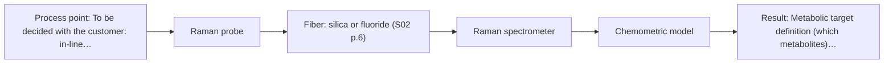
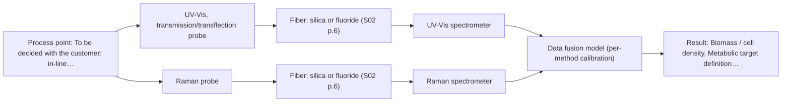

# First technical assessment: Biomass related monitoring during yeast fermentation

## Answer

**Customer request (our summary):** Customer wants an optical measurement during yeast fermentation to follow growth and detect changes earlier. Biomass and metabolic signals are mentioned but not defined as separate targets. Broth becomes more optically dense during the run. They ask for help turning this into an initial feasibility study with reference measurements.

### Brief answer

Start with a UV-Vis transmission/transflection probe as a low-cost biomass (turbidity) trend signal, and test a Raman fiber probe in parallel for the metabolic fingerprint, since Raman tolerates the aqueous, increasingly turbid broth. Whether fluorescence adds value depends on which fluorophores your broth contains. The biomass and metabolic targets still need definition, reference methods and accuracy requirements before any in-line configuration is chosen.

### Proposal

- **Best current option:** O2 (recommended)
- **Basis:** supplied AFS sources
- **What would change it:** A defined metabolic target that fluorescence can see selectively, or a broth that stays fully transmittable, could shift the choice toward O1 or O3; if no metabolite is Raman-visible at the required levels, only the biomass trend remains feasible in-line.
- **Next step:** Answer Q1-Q5, then run the multi-method lab trial on representative broth samples with independent biomass and metabolite references.

**Secondary evidence (external, not AFS material):** G1: E02 ¶31, E02 ¶82, E02 ¶36; G2: E01 ¶20; G3: no usable external source found; G4: no usable external source found. See Expert detail.

**Decision status:** Provisional feasibility assessment

### Solution options

| ID | Tier | Methods | Confidence | Cost class, S01 Table 1 (p.6) | Ease of use | Maintenance | Performance fit | Sources |
|---|---|---|---|---|---|---|---|---|
| O1 | Simple | M1 UV-Vis, transmission/transflection probe | Medium: open question: Q1 (starts at Medium) | low cost (row 16) | simple probe, straightforward daily operation | low; window cleaning mainly | directly tracks growth trend via turbidity | [1: S01 p.16] [2: S01 p.16] |
| O2 | Recommended | M2 Raman probe | Medium: open question: Q1, Q2 (starts at Medium) | high cost (row 12) | fiber probe, no sampling needed | moderate; laser and window checks | molecular fingerprint suits aqueous turbid broth | [3: S01 p.16] [4: S01 p.16] |
| O3 | Extended (multi-method) | M1 UV-Vis, transmission/transflection probe; M2 Raman probe | Low: open question: Q1, Q2 (starts at Medium); multi-method, fusion benefit not yet shown | high cost (rows 12, 16) | two instruments, more complex setup | highest; two calibrations to maintain | covers biomass and metabolic targets together | [5: S01 p.7] [1: S01 p.16] [2: S01 p.16] [3: S01 p.16] [4: S01 p.16] |

*Confidence rates the basis of the advice (how much is known and cited), not a predicted accuracy or probability of success. It starts at High, or at Medium when a key question on the method or the option is open, and drops one level per weakness listed (floor Low).*

*Cost class is the relative rating in S01 Table 1 (p.6) for the in-line method+technique rows named (the highest one for a multi-method option); it is not a price.*

### Setup sketch

*Recommended option O2; drawn by code from the option, a schematic, not a configuration.*

### Key questions

1. How is biomass defined and measured today (optical density, cell dry weight, viable count), and over what range during a run?
2. Which metabolites or metabolic states should the metabolic signal track (e.g. glucose, ethanol, acetate), at what concentrations, and with what reference method?
3. Where would probes be installed (in-line port, bypass, at-line sample), at what distance from the spectrometers, and under which temperature, sterilisation and cleaning constraints?

## Expert detail

**Customer enquiry**

> We would like an optical measurement during yeast fermentation to help us follow growth and notice changes earlier. Our team has mentioned both a biomass signal and a metabolic signal, but these have not been defined as separate targets. The broth becomes more optically dense as the run develops. We need help turning this request into an initial feasibility study with useful reference measurements.

**Decision status:** Provisional feasibility assessment. A method shortlist can be justified for a feasibility study, but the two targets are undefined and the sources indicate no single sensor covers every analyte, so the assessment is provisional pending the clarification answers.

### Parameters

| ID | Parameter | Kind | Need | Measured by | Why | Sources |
|---|---|---|---|---|---|---|
| P1 | Biomass / cell density | quantitative | required | Reference lab method: cell dry weight or OD per customer definition | It is the growth-tracking target and defines what the optical turbidity signal must be calibrated against. | [1: S01 p.16] |
| P2 | Metabolic target definition (which metabolites) | qualitative | required | Reference lab method: defined metabolite list from the customer | The metabolic signal is undefined in the enquiry, and the choice of second method depends on which species must be seen. | *(no verified source: engineering judgement)* |
| P3 | Optical density range over the run | quantitative | required | Reference lab method: laboratory OD measurement | The rising optical density decides whether a transmission pathlength stays usable or a short-path ATR geometry is needed. | *(no verified source: engineering judgement)* |
| P4 | Presence of fluorescent species (e.g. NADH, riboflavin) | qualitative | optional | Reference lab method: laboratory fluorescence scan | Fluorescence is only worth testing if the broth contains fluorophores, which should be available from a simple lab scan. | [6: S01 p.16] |

### Solution option details

- **O1 cost drivers:** one UV-Vis spectrometer, transmission or transflection probe, calibration samples and reference OD measurements
- **O2 cost drivers:** Raman spectrometer and laser, probe, chemometric model development and reference metabolite data
- **O3 cost drivers:** two spectrometers, probe or probes at one point, synchronisation and fused model maintenance
- **O3 combining methods:** Low-level fusion: UV-Vis (or its ATR variant) and Raman spectra from the same sampling spot are synchronised to a common time step and merged into one augmented matrix, with block scaling so neither method dominates. Each method keeps its own calibration and diagnostics, since a fused model breaks when any block drifts. The fused model must beat the best single method on held-out runs, otherwise the extra instrument is dropped.

*Extended (multi-method) option O3; drawn by code from the option, a schematic, not a configuration.*

### Premise check

- **Not covered:** One optical measurement can serve both the biomass and the metabolic signal. The enquiry mentions both signals without defining whether one measurement should serve both; no supplied source states that a single optical measurement can cover both a biomass and a metabolic signal, and the sources indicate different techniques suit different analytes, so the two targets should be defined separately. [7: S01 p.16]
- **Supported:** An optical signal can follow yeast growth in the broth. The sources support turbidity as a biomass proxy for cell suspensions, while noting that optical density is not a viable cell count, so a reference method is still needed. [1: S01 p.16]
- **Supported:** The request can be turned into an initial feasibility study with reference measurements at this stage. Multi-method laboratory trials on the customer's process are the described first step before selecting a method or combination. [8: S02 p.20]

### Requirements

**Stated by the customer**

- Follow growth (biomass signal)
- Notice changes earlier (metabolic signal)
- Initial feasibility study with useful reference measurements

**Key unknowns**

- Definition and range of the biomass target (OD, cell dry weight, viable count) and its reference method
- Definition of the metabolic signal: which metabolites, what ranges, which reference method
- Required accuracy, detection limit and response time
- Installation point, access, distance and sterilisation/cleaning constraints
- Whether the broth stays transmittable at the end of the run or becomes effectively opaque
- Which fluorescent species the broth contains

### Clarification questions (most decision-relevant first)

Q1. How is biomass defined and measured today (optical density, cell dry weight, viable count), and over what range during a run? *Why it matters:* The biomass definition and range decide whether a turbidity-based optical signal is adequate and which probe geometry survives the highest optical density. *(affects: method)*
Q2. Which metabolites or metabolic states should the metabolic signal track (e.g. glucose, ethanol, acetate), at what concentrations, and with what reference method? *Why it matters:* The metabolite list and ranges determine whether Raman, fluorescence or a combination is the right second method and what calibration data are needed. *(affects: technique, M2)*
Q3. Where would probes be installed (in-line port, bypass, at-line sample), at what distance from the spectrometers, and under which temperature, sterilisation and cleaning constraints? *Why it matters:* Installation point, access and sterilisation decide the probe type, fiber family and feasible fiber length. *(affects: installation)*
Q4. What accuracy, detection limit and response time do you need for growth tracking and for noticing metabolic changes earlier? *Why it matters:* The required performance decides whether a simple trend signal suffices or a calibrated quantitative model is needed. *(affects: status)*
Q5. Does the broth remain transmittable at the end of a run, or does it become effectively opaque, and are gas bubbles or fouling expected at the probe position? *Why it matters:* If transmission saturates at high optical density, an ATR-style short-path geometry or a scattering-tolerant method must replace it. *(affects: technique)*

### Recommendation

- **M1 · Primary candidate: UV-Vis, transmission/transflection probe.** Cell suspension turbidity correlates with cell density, so a UV-Vis transmission or transflection probe is a low-cost, robust way to follow growth as a trend signal. As the broth becomes more optically dense, transmission can saturate, so the highest-OD samples must be checked and a UV-ATR variant kept as fallback. *Conditions:* Viable while the broth remains transmittable; if the optical density rises too far, switch to the UV-ATR short-path variant. [1: S01 p.16] [2: S01 p.16]
- **M2 · Comparison candidate: Raman probe.** Raman gives a molecular fingerprint of specific metabolites in aqueous media, where water interferes little, which matches the undefined metabolic signal better than any absorption method. The published bioprocess examples are a reason to test, not proof for this customer's broth, and fluorescence background must be checked on real samples. [3: S01 p.16] [4: S01 p.16]
- **M3 · Conditional candidate: fluorescence probe.** In bioprocesses fluorescence is used for intrinsic fluorophores such as NADH, tryptophan and riboflavin, which could serve as an early metabolic-state indicator. It is conditional because no fluorescent species has been identified in this broth yet, and most chemicals do not fluoresce. *Conditions:* Applies only if the broth is shown to contain relevant fluorophores (e.g. NADH or riboflavin) at useful levels; otherwise drop it. [6: S01 p.16] [9: S01 p.5]
- **M4 · Not recommended: NIR, transmission/transflection probe.** NIR transmission is a common fermentation choice, but in an increasingly optically dense broth the transmission signal saturates because light cannot penetrate the bulk, and NIR may lack sensitivity for trace metabolites. UV-Vis and Raman cover the two stated targets more directly. [2: S01 p.16] [10: S01 p.16]

### Measurement concept

- **Probe and geometry:** UV-Vis transmission or transflection probe for the biomass (turbidity) trend, with a UV-ATR variant as fallback if the broth becomes too optically dense; Raman fiber probe at the same or adjacent sampling point for the metabolic fingerprint.
- **Location:** To be decided with the customer: in-line port, bypass or at-line sampling point on the fermenter (Q3).
- **Fiber link:** Not fixed yet: silica fibers cover the UV-Vis/NIR ranges, but the achievable link length and jacket choice depend on the selected configuration and installation (Q3); no length should be assumed. [1: S01 p.16]

### Spectral range

- **UV-Vis:** Nominal UV-Vis method range with very high sensitivity especially at 190-360 nm; the usable range depends on the selected instrument, fiber and probe. [11: S01 p.5]
- **Raman:** Raman is reported as Raman shift in cm-1 with the laser excitation wavelength stated separately; the excitation wavelength for this application is not yet selected. [12: S01 p.11]

### Risks and uncertainty

- The broth may become so optically dense that the UV-Vis transmission signal saturates, forcing a switch to a short-path ATR geometry mid-study. *(rules: R-UV-2, R-GEN-3)* [2: S01 p.16]
- Fluorescence background from the medium could swamp the weak Raman signal and degrade the metabolic fingerprint. *(rules: R-RAM-1)* [13: S01 p.11]
- Gas bubbles, fouling or turbulence at the probe position could distort the optical signal and mimic or mask real changes. *(rules: R-GEN-5)* [14: S01 p.7]
- Any calibration will be specific to this medium and must be re-validated if the medium or process conditions change. *(rules: R-CAL-1)* [15: REF §5]

### First feasibility experiment

1. **Collect representative broth samples across several runs, spanning early, mid and late fermentation.** Cover the expected chemical and physical variation, especially the full optical-density range from start to end of run. *(no verified source: engineering judgement)*
2. **Measure independent references on each sample: biomass (OD/cell dry weight per customer definition) and metabolite concentrations by a laboratory method.** Provide the calibration and validation targets for both the biomass and metabolic signals. *(no verified source: engineering judgement)*
3. **Record UV-Vis transmission/transflection spectra on all samples and correlate the optical signal with the biomass reference.** Establish the single-method biomass trend signal and its usable OD range before any combination. [1: S01 p.16]
4. **Record Raman probe spectra on the same samples and build a first metabolite model against the reference data.** Test the single-method metabolic fingerprint in the aqueous, turbid matrix and check fluorescence background. [3: S01 p.16]
5. **If fluorophores are confirmed (Q2/P4), record fluorescence spectra; then validate all models, and any fused model, on held-out runs or batches.** Confirm whether the fluorescence option is worth pursuing and whether a combined model beats the best single method. *(no verified source: engineering judgement)*

**Reference measurements:** Independent off-line references per sampling point: the customer's biomass reference (e.g. OD or cell dry weight) and a laboratory metabolite analysis (e.g. HPLC or enzymatic assays) for the defined metabolic targets.

**Decision basis:** Go/no-go per method against the customer's own accuracy and response-time requirements (Q4): the biomass signal must track the reference growth curve within the agreed tolerance across the full OD range, and the metabolic method must predict the reference metabolite concentrations within the agreed tolerance on held-out runs; a combined option is only kept if it beats the best single method.

### Assumptions

- The broth is aqueous and the biomass signal is a turbidity-related optical signal; this is inferred from the enquiry and must be confirmed.
- The metabolic signal means specific metabolites (e.g. glucose, ethanol, organic acids) rather than a single defined species; the customer has not defined it.
- A laboratory feasibility study on representative broth samples precedes any in-line installation.

### Not covered by the supplied sources

- Yeast-fermentation-specific performance figures (accuracy, detection limits, response times) for any of the shortlisted methods
- Achievable in-line fiber length for the selected configuration at the customer's installation distance

### Further notes

- **Chemometrics:** Both the biomass trend and any metabolite model will need calibration against independent reference measurements (cell density, off-line metabolite analysis), with validation on held-out runs; NIR- and Raman-type calibrations are matrix-specific and must be re-validated if the medium changes.
- **Real-time tracking:** The aim is continuous or time-resolved in-line tracking of growth and metabolic changes; acquisition rate and data synchronisation to a common time step must be planned once the method set is fixed.
- **Future direction:** If the feasibility study succeeds, a later step could be a compact customized spectral fiber sensor or multisensor system for routine in-line control, following the multi-method trial to customized-sensor pathway.

### Secondary evidence (external, not AFS material)

*Found by a literature search for gaps the supplied AFS sources leave open. Not AFS material and not proof for this case; every quote below was verified verbatim against the fetched text.*

*Live search unavailable (library only: cache miss (europepmc); cache miss (openalex)); curated library only.*

**G1 · multi-method:** Combining several spectroscopy methods (data fusion) (Low-level fusion: UV-Vis (or its ATR variant) and Raman spectra from the same sampling spot are synchronised to a common time step and merged into one augmented matrix, with block scaling so neither method dominates. Each method keeps its own calibration and diagnostics, since a fused model breaks when any block drifts. The fused model must beat the best single method on held-out runs, otherwise the extra instrument is dropped.)

- **E02 ¶31** Low-level data fusion is described as the simplest combination approach, where variables from different sources are concatenated into a single new data matrix. *How it applies:* This supports the planned augmented-matrix design for O3; the feasibility study should implement the concatenation as described and verify the fused model against the best single method on held-out runs before committing to the second instrument. *Limits and transfer risks:* The review is general PAT literature, not yeast fermentation or UV-Vis/Raman fusion specifically, and it does not state that fusion improves performance in any given case. *(supports O3)*
  > "Low-level data fusion (LLDF) is considered the simplest method to achieve a combination of inputs. In this case, the data is rearranged into a new data matrix, where the variables coming from different sources are placed one after the other."
  > Challenges and Opportunities of Implementing Data Fusion in Process Analytical Technology-A Review. (2022) · Molecules (Basel, Switzerland) · doi:10.3390/molecules27154846 · https://europepmc.org/article/PMC/PMC9369811 · retrieved 2026-10-17, full text, licence: cc by, via curated library
- **E02 ¶82** The review states that the contribution and complementarity of each dataset must be evaluated before fusing data from multiple sources. *How it applies:* This justifies building single-method calibrations with their own diagnostics first, then testing whether the fused model actually beats the best single method; if not, the extra instrument can be dropped. *Limits and transfer risks:* It is a methodological recommendation from a general review, not a demonstrated result for this broth, matrix or instrument pair. *(supports O3)*
  > "Before fusing data from multiple sources, it is essential to evaluate the contribution of each dataset to the model and its complementarity."
  > Challenges and Opportunities of Implementing Data Fusion in Process Analytical Technology-A Review. (2022) · Molecules (Basel, Switzerland) · doi:10.3390/molecules27154846 · https://europepmc.org/article/PMC/PMC9369811 · retrieved 2026-10-17, full text, licence: cc by, via curated library
- **E02 ¶36** A cited Raman and FT-IR food study showed that instrument complementarity alone did not always improve prediction of several quality attributes. *How it applies:* This is a concrete reason to include a drop-the-second-instrument criterion in the feasibility design rather than assuming O3 outperforms O2. *Limits and transfer risks:* The example is a food application with Raman/FT-IR, not UV-Vis/Raman in fermenting broth, so the outcome may differ here. *(supports O3)*
  > "In some situations, instrument complementarity (not data complementarity) was not sufficient to improve the performance of predictive several CQAs, as shown by a Raman and FT-IR data based food analytical study [73]."
  > Challenges and Opportunities of Implementing Data Fusion in Process Analytical Technology-A Review. (2022) · Molecules (Basel, Switzerland) · doi:10.3390/molecules27154846 · https://europepmc.org/article/PMC/PMC9369811 · retrieved 2026-10-17, full text, licence: cc by, via curated library

**G2 · not in the supplied sources:** Yeast-fermentation-specific performance figures (accuracy, detection limits, response times) for any of the shortlisted methods

- **E01 ¶20** Raman spectroscopy is frequently used in upstream processing because of its high selectivity and low water interference, but with relatively long measurement times. *How it applies:* This supports Raman (O2) as a candidate for optically dense aqueous broth, while flagging measurement time as a parameter to quantify in the feasibility study against the customer's need for early change detection. *Limits and transfer risks:* The statement is a general review remark without performance figures for yeast fermentation, and measurement times depend on the specific instrument and probe configuration. *(supports O2)*
  > "Raman spectroscopy is frequently applied in upstream processing in research and industry due to its high selectivity and low water interference [55] despite the relatively long measurement times."
  > A critical review of recent trends, and a future perspective of optical spectroscopy as PAT in biopharmaceutical downstream processing. (2020) · Analytical and bioanalytical chemistry · doi:10.1007/s00216-020-02407-z · https://europepmc.org/article/PMC/PMC7072065 · retrieved 2026-10-17, full text, licence: cc by, via curated library

**G3 · not in the supplied sources:** Achievable in-line fiber length for the selected configuration at the customer's installation distance

- No usable external source found.

**G4 · premise not covered:** One optical measurement can serve both the biomass and the metabolic signal.

- No usable external source found.

### Evidence (verified quotes)

1. ✓ **S01 p.16** (general): "cell suspension turbidity correlates well with cell density."
2. ✓ **S01 p.16** (general): "transmission setup becomes saturated because the light cannot penetrate the bulk of the sample."
3. ✓ **S01 p.16** (general): "Raman is particularly well-suited for aqueous environments, as it exhibits low absorbance for water molecules compared to infrared methods."
4. ✓ **S01 p.16** (application precedent): "Raman spectroscopy can be used in the same reactor to provide a "molecular fingerprint" for direct detection of specific metabolites like glucose, acetate, or lactate."
5. ✓ (precedent only) **S01 p.7** (method gain): "The analysis of such systems may require a combination of two or even more spectral methods."
6. ✓ **S01 p.16** (general): "critical cofactors and amino acids like NADH, tryptophan, and riboflavin."
7. ✓ **S01 p.16** (general): "where no single sensor is universally optimal for every analyte or condition."
8. ✓ **S02 p.20** (general): "1. Multi-Method Lab Trials AFS tests your process using all key fiber optic spectroscopy methods."
9. ✓ **S01 p.5** (general): "However, most chemicals do not exhibit this property."
10. ✓ **S01 p.16** (general): "may lack the sensitivity to detect trace compounds below 0.1 percent."
11. ✓ **S01 p.5** (general): "It has very high sensitivity, especially in the UV region (190-360 nm)"
12. ✓ **S01 p.11** (general): "The Raman shift is used as the horizontal (spectral) axis in Raman spectroscopy"
13. ✓ **S01 p.11** (general): "superposition of luminescence (fluorescence), which has a significantly higher intensity."
14. ✓ **S01 p.7** (general): "Morphological factors, such as sample inhomogeneity (e.g., biological tissue) or process turbulence, must also be considered when selecting a measurement technique."
15. ✓ **REF §5** (general): "calibration specific to the matrix."

### Verification

- Citations verified: 25 of 25 (exact or whitespace/hyphen-tolerant match on the cited page, scope checked).
- Hard check failures before deterministic corrections: 0; still open: 0; soft warnings: 3; repair rounds: 1.
- External evidence (cache): 4 quote(s) verified verbatim (exact or whitespace/hyphen-tolerant, at most 400 characters and 2 sentences, against the cited paragraph); 0 item(s) dropped.
- External search: 6 query(ies), 0 hit(s), 3 source(s) (3 from the curated library); ⚠ library only: cache miss (europepmc); cache miss (openalex).
- External step: 2 model call(s), 24.9 s extra (cost in the run JSON).

*Run D05-20261018T080635Z-cb02 · models z-ai/glm-5.3-flash*
