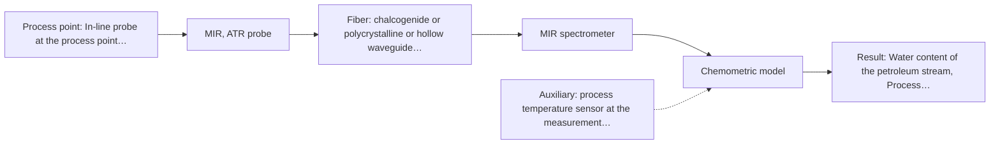

# First technical assessment: Water content in a petroleum stream

## Answer

**Customer request (our summary):** Customer operates a petroleum stream, currently determines water content by sending samples to a laboratory, and wants to investigate a fiber based measurement closer to the process with the analyzer outside the process area. They explicitly ask what to clarify and what a first comparison experiment should establish before selecting equipment.

### Brief answer

Test mid-infrared ATR first: a published ATR-fiber application shows water in petroleum measured directly, and ATR suits liquids in contact with the crystal. Run a laboratory comparison of MIR-ATR and NIR probes on your samples against your laboratory water reference before choosing hardware. Still open: the water range and accuracy you need, how clear or opaque the stream is, the achievable fiber distance to the outside analyzer, and the process conditions at the measurement point.

### Proposal

- **Best current option:** O2 (recommended)
- **Basis:** supplied AFS sources
- **What would change it:** A required fiber distance beyond what a mid-IR link can achieve, or a very clear stream where NIR already meets the accuracy target, would shift the choice to the NIR option.
- **Next step:** Run the laboratory comparison of MIR-ATR and NIR probes on representative samples against the laboratory water reference, while clarifying the fiber distance and process conditions.

**Secondary evidence (external, not AFS material):** G1: E01 ¶19; G2: no usable external source found; G3: no usable external source found; G4: no usable external source found. See Expert detail.

**Decision status:** Provisional feasibility assessment

### Solution options

| ID | Tier | Methods | Confidence | Cost class, S01 Table 1 (p.6) | Ease of use | Maintenance | Performance fit | Sources |
|---|---|---|---|---|---|---|---|---|
| O1 | Simple | M2 NIR, transmission/transflection probe | Low: open question: Q1, Q3 (starts at Medium); sample clarity unknown; a parameter is not measurable in-line | average cost (row 7) | Standard glass optics, robust long silica cables | Low; window or probe cleaning only | Fits if the stream is clear and NIR accuracy suffices | [1: S01 p.18] [2: S02 p.7] |
| O2 | Recommended | M1 MIR, ATR probe | Medium: open question: Q1, Q3 (starts at Medium) | high cost (row 2) | Immersion probe, no sampling, direct contact | ATR crystal fouling and cleaning to manage | Direct precedent for water in petroleum, high selectivity | [3: S02 p.13] [4: S01 p.5] |

*Confidence rates the basis of the advice (how much is known and cited), not a predicted accuracy or probability of success. It starts at High, or at Medium when a key question on the method or the option is open, and drops one level per weakness listed (floor Low).*

*Cost class is the relative rating in S01 Table 1 (p.6) for the in-line method+technique rows named (the highest one for a multi-method option); it is not a price.*

### Setup sketch

*Recommended option O2; drawn by code from the option, a schematic, not a configuration.*

### Key questions

1. What water content range and accuracy or detection limit does the process monitoring need?
2. How optically clear or opaque is the stream (crude, refined product, turbidity), and does it contain dispersed water or emulsions?
3. What fiber distance is needed between the process point and the analyzer outside the process area?

## Expert detail

**Customer enquiry**

> We handle a petroleum stream and currently send samples to a laboratory for water determination. We want to investigate a fiber based measurement closer to the process so that changes can be noticed sooner. The analyzer would be outside the process area. Before selecting equipment, we need to know what to clarify and what a first comparison experiment should establish.

**Decision status:** Provisional feasibility assessment. A method shortlist can be justified from the sources, but the water range, the optical regime of the stream and the achievable fiber distance are open, so the assessment stays provisional with explicit assumptions.

### Parameters

| ID | Parameter | Kind | Need | Measured by | Why | Sources |
|---|---|---|---|---|---|---|
| P1 | Water content of the petroleum stream | quantitative | required | Reference lab method: not named | It is the target variable and the reference for judging any in-line method. | *(no verified source: engineering judgement)* |
| P2 | Optical regime of the stream (clear, turbid or opaque) | qualitative | required | Not measurable in-line by spectroscopy; alternative: visual and laboratory assessment of sample clarity during the feasibility trial | It decides whether NIR transmission/transflection is viable or ATR or diffuse reflection is needed. | *(no verified source: engineering judgement)* |
| P3 | Process temperature at the measurement point | quantitative | optional | Auxiliary sensor: process temperature sensor at the measurement point (engineering judgement: confirm availability with AFS) | Temperature shifts spectral bands and water solubility, so it should be available to correct or interpret the spectra. | *(no verified source: engineering judgement)* |

### Solution option details

- **O1 cost drivers:** NIR spectrometer, transflection probe, silica cable, calibration samples and reference analyses
- **O2 cost drivers:** FTIR spectrometer, ATR fiber probe, mid-IR fiber link, fouling management, calibration effort

### Premise check

- **Precedent only:** A fiber link from the process point to an analyzer outside the process area is feasible. Long remote fiber links are documented for silica (NIR) fibers, but no supplied source states an achievable length for a mid-IR fiber link, so feasibility depends on the method and the actual distance. [2: S02 p.7]
- **Supported:** A measurement closer to the process would notice changes sooner than sending samples to a laboratory. The sources describe in-process fiber-optic analysis as removing sampling delays, which supports the expectation of noticing changes sooner. [5: S01 p.3]

### Requirements

**Stated by the customer**

- "We handle a petroleum stream"
- "currently send samples to a laboratory for water determination"
- "a fiber based measurement closer to the process"
- "The analyzer would be outside the process area"
- *Further statements: see the customer enquiry above.*

**Key unknowns**

- Water content range and required accuracy or detection limit
- Optical regime of the stream (clear, turbid, opaque) and water phase behaviour
- Required fiber distance from process point to the outside analyzer
- Process temperature, pressure and fouling tendency at the measurement point
- Laboratory reference method for water
- Hazardous area classification and safety constraints at the measurement point

### Clarification questions (most decision-relevant first)

Q1. What water content range and accuracy or detection limit does the process monitoring need? *Why it matters:* The range and required accuracy decide whether NIR sensitivity suffices or the stronger, more selective MIR-ATR signal is needed. *(affects: status, method)*
Q2. How optically clear or opaque is the stream (crude, refined product, turbidity), and does it contain dispersed water or emulsions? *Why it matters:* Transmission or transflection only works if light penetrates the sample; opaque or fat-rich streams push the choice toward ATR or diffuse reflection. *(affects: technique)*
Q3. What fiber distance is needed between the process point and the analyzer outside the process area? *Why it matters:* Long silica cables are documented for NIR, but no source states an achievable length for a mid-IR fiber link, so this can decide the method. *(affects: installation, method)*
Q4. What are the temperature, pressure and flow conditions at the intended measurement point, and what access arrangement (in-line probe, bypass) is possible? *Why it matters:* ATR needs tight sample contact and is a surface measurement, so temperature, fouling tendency and probe placement affect feasibility and maintenance. *(affects: installation)*
Q5. Which laboratory method is used for the water determination, and can it serve as the reference for calibration samples? *Why it matters:* The comparison experiment and any future calibration stand or fall with an independent reference measurement. *(affects: status)*

### Recommendation

- **M1 · Primary candidate: MIR, ATR probe.** A published ATR-fiber application shows water in petroleum measured directly with spectra at several water levels, and ATR suits liquids in contact with the crystal. Mid-IR bands are well defined, giving good selectivity for the water band. *Conditions:* The fiber link length to the outside analyzer must be confirmed as achievable for a mid-IR fiber (Q3). [3: S02 p.13] [4: S01 p.5]
- **M2 · Comparison candidate: NIR, transmission/transflection probe.** NIR transmission or transflection is the standard geometry for clear liquids and silica fibers support the long remote cables the installation implies. Its suitability is unconfirmed because the optical regime of the stream is unknown. *Conditions:* Applies only if the stream is transparent or semi-transparent; if it is opaque or fat-rich, diffuse reflection would be the NIR fallback to test instead. [1: S01 p.18] [2: S02 p.7]
- **M3 · Conditional candidate: Raman probe.** Raman tolerates water well and could see the O-H band in a hydrocarbon matrix, but its weak signal can be swamped by fluorescence, which petroleum components often show. *Conditions:* Applies only if the fluorescence background of the petroleum stream proves low enough on real samples. [6: S01 p.16]
- **M4 · Not recommended: fluorescence probe.** Fluorescence only measures species that fluoresce, and no fluorescent species or indicator for water has been identified in this stream. [7: S01 p.5]

### Measurement concept

- **Probe and geometry:** Primary concept: immersion MIR-ATR fiber probe (ZrO2 or diamond ATR tip) in the stream; alternative: NIR transmission/transflection probe if the stream is optically clear.
- **Location:** In-line probe at the process point, spectrometer outside the process area connected by fiber.
- **Fiber link:** For NIR, long low-OH silica cables are documented for remote industrial process-control; for MIR, CIR/PIR fibers exist but no source states an achievable link length, so the distance to the outside analyzer is an open question. [3: S02 p.13]

### Spectral range

- **MIR:** Nominal mid-IR range 4000-400 cm-1 (2.5-25 µm); the usable range depends on the selected fiber (CIR or PIR), crystal and spectrometer. [8: S01 p.9]
- **NIR:** Nominal NIR range 780-2500 nm; the usable range depends on the spectrometer, silica fiber and probe actually selected. [9: S01 p.10]

### Risks and uncertainty

- No source states an achievable mid-IR fiber link length, so the analyzer-outside-the-process-area requirement may not be met with MIR-ATR. *(rules: R-FIB-2)* [10: S02 p.10]
- ATR samples only a surface layer a few micrometres deep, so crystal fouling and poor surface representativeness could bias the water reading in a flowing, possibly heterogeneous stream. *(rules: R-MIR-3, R-GEN-5)* [11: S01 p.13]
- If the stream turns out opaque or fat-rich, the NIR transmission/transflection option fails and only ATR or diffuse reflection remain. *(rules: R-GEO-2)* [12: S01 p.18]
- Fluorescence background from petroleum components could swamp a Raman signal, removing the fallback method. *(rules: R-RAM-1)* [13: S01 p.11]

### First feasibility experiment

1. **Collect representative petroleum samples spanning the expected water content range and stream variation.** Cover the expected chemical and physical variation of the stream (Q2, Q4). *(no verified source: engineering judgement)*
2. **Determine the water content of each sample with the independent laboratory reference method.** Provide the independent reference for all comparisons. *(no verified source: engineering judgement)*
3. **Measure each sample in the laboratory with the MIR-ATR fiber probe and, separately, with an NIR transmission or transflection probe.** Single methods first, before any combination is considered. [14: S01 p.5]
4. **Build a calibration against the laboratory reference for each method separately and validate on held-out samples.** Quantify what each single method can deliver on this matrix. [15: S01 p.10]
5. **Compare prediction error and response behaviour against the accuracy and range criteria the customer specifies.** The go/no-go basis with numerical criteria comes from the customer. *(no verified source: engineering judgement)*

**Reference measurements:** Independent water determination by the customer's laboratory method (Q5) on every calibration and validation sample.

**Decision basis:** Go/no-go against accuracy and response-time criteria set by the customer (Q1), judged on held-out validation samples; if MIR-ATR meets the criteria but the required fiber link length is not achievable, the decision moves to the NIR option or a nearer analyzer location.

### Not covered by the supplied sources

- Achievable fiber link length for a mid-IR (CIR/PIR) probe to a remote analyzer
- Hazardous-area rated probe and cable configurations for petroleum process areas

### Further notes

- **Chemometrics:** Water calibration will be matrix-specific: a PLS model built on your own samples with the laboratory reference values, validated on held-out samples or batches, is the realistic path; a model from a different petroleum matrix cannot be assumed to transfer.
- **Real-time tracking:** The aim is earlier detection of water changes in-line; once a calibrated method exists, continuous spectra allow trend tracking, and the required response time (an open question) sets the acquisition and update interval.
- **Future direction:** If a single method proves insufficient, a combined MIR-ATR plus fluorescence or Raman probe could be tested later as a hypothesis, but only after the single-method comparison shows what is missing.

### Secondary evidence (external, not AFS material)

*Found by a literature search for gaps the supplied AFS sources leave open. Not AFS material and not proof for this case; every quote below was verified verbatim against the fetched text.*

*Live search unavailable (library only: cache miss (europepmc); cache miss (openalex)); curated library only.*

**G1 · auxiliary sensor:** In-line measurement of Process temperature at the measurement point with process temperature sensor at the measurement point

- **E01 ¶19** In one in-line FTIR study, temperature was deliberately varied, alongside concentration and ionic strength, when building the calibration model so that the model would be robust. *How it applies:* This suggests that for the customer's petroleum stream, process temperature at the measurement point should be recorded and deliberately included as a variation in the first comparison experiment, so the calibration can cover the real operating envelope. A process temperature sensor at the measurement point would provide this input. *Limits and transfer risks:* The source concerns aqueous acid systems in lithium recycling, not petroleum, and temperature variation there served model robustness rather than a separate auxiliary sensor requirement. Transfer to hydrocarbon matrices and to the customer's temperature range is untested. *(supports O2)*
  > "The concentrations of nitric acid and hydrochloric acid as well as the ionic strength and temperature were varied to obtain a robust model."
  > Process Analytical Technology-Integrated FT-IR and Raman Spectroscopies for Efficient Reactive Liquid-Liquid Extraction Processing in Lithium Recycling. (2025) · ACS omega · doi:10.1021/acsomega.5c05705 · https://europepmc.org/article/PMC/PMC12573149 · retrieved 2026-10-17, full text, licence: cc by, via curated library

**G2 · not in the supplied sources:** Achievable fiber link length for a mid-IR (CIR/PIR) probe to a remote analyzer

- No usable external source found.

**G3 · not in the supplied sources:** Hazardous-area rated probe and cable configurations for petroleum process areas

- No usable external source found.

**G4 · parameter without a source:** Measuring Water content of the petroleum stream: It is the target variable and the reference for judging any in-line method.

- No usable external source found.

### Evidence (verified quotes)

1. ✓ **S01 p.18** (general): "Transmission is the preferred method for transparent or semi-transparent liquids, such as skim milk, whey, or permeate."
2. ✓ **S02 p.7** (general): "Robust 100-300m cables made with Silica fibers of low OH-content (<0.1ppm OH) enable remote industrial process-control"
3. ✓ **S02 p.13** (application precedent): "Application: measurement of water content in petroleum"
4. ✓ **S01 p.5** (general): "strong absorption in the mid-IR region limits the corresponding spectral method to the analysis of very thin samples (usually less than 50 μm), but it opens up the possibility of using attenuated total reflectance (ATR)"
5. ✓ **S01 p.3** (general): "It allows for in-process analysis, i.e., directly in the process flow or reactor without sampling, eliminating delays and the risk of sample contamination."
6. ✓ **S01 p.16** (general): "Raman is particularly well-suited for aqueous environments, as it exhibits low absorbance for water molecules compared to infrared methods."
7. ✓ **S01 p.5** (general): "However, most chemicals do not exhibit this property."
8. ✓ **S01 p.9** (general): "Vibrational spectroscopy in the mid-IR range (4000-400 cm-1) is one of the most informative methods of chemical analysis."
9. ✓ **S01 p.10** (general): "NIR spectra (780-2500 nm) contain predominantly overtones and component bands of fundamental vibrations"
10. ✓ **S02 p.10** (general): "1.25 Meter Silver Halide - straight run"
11. ✓ **S01 p.13** (general): "typically at a depth of few microns"
12. ✓ **S01 p.18** (general): "it fails when the milk becomes too "thick" or fat-rich, as the light cannot penetrate the sample."
13. ✓ **S01 p.11** (general): "superposition of luminescence (fluorescence), which has a significantly higher intensity."
14. ✓ **S01 p.5** (general): "Immersible fiber optic probes operating in various spectral regions from UV to mid-IR are increasingly being used for measuring liquid and soft or powdered solid samples."
15. ✓ **S01 p.10** (general): "The broad absorption bands observed in this region overlap, suggesting the use of chemometrics for quantitative and qualitative analysis of spectral data."

### Verification

- Citations verified: 20 of 20 (exact or whitespace/hyphen-tolerant match on the cited page, scope checked).
- Hard check failures before deterministic corrections: 0; still open: 0; soft warnings: 1; repair rounds: 1.
- External evidence (cache): 1 quote(s) verified verbatim (exact or whitespace/hyphen-tolerant, at most 400 characters and 2 sentences, against the cited paragraph); 0 item(s) dropped.
- External search: 5 query(ies), 0 hit(s), 3 source(s) (3 from the curated library); ⚠ library only: cache miss (europepmc); cache miss (openalex).
- External step: 2 model call(s), 23.4 s extra (cost in the run JSON).

*Run D06-20261018T080635Z-b55c · models z-ai/glm-5.3-flash*
