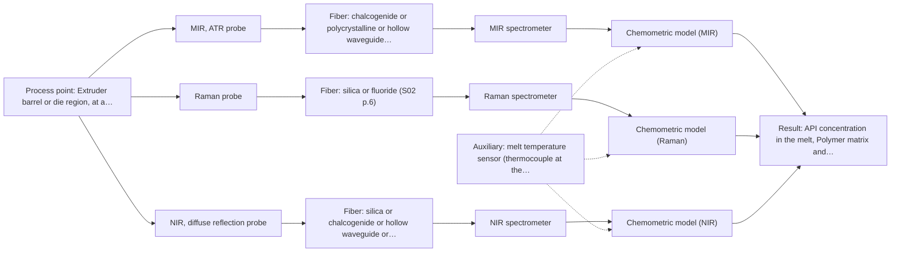
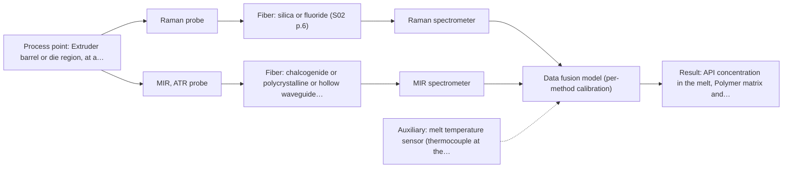

# First technical assessment: API concentration during hot polymer extrusion

## Answer

**Customer request (our summary):** A company developing a hot polymer extrusion process incorporating an active pharmaceutical ingredient wants to investigate whether an optical measurement can detect composition changes in the melt during processing. They have offline assays, note the process interface is hot and may be exposed to material build up, and request an initial comparison plan plus the questions required before choosing a probe.

### Brief answer

Test mid-infrared ATR first: a fiber ATR probe in the hot melt is the closest published precedent for in-line API monitoring in polymer extrusion. Run a multi-method lab trial comparing MIR-ATR, Raman and NIR diffuse reflection on representative melts, using your offline assays as reference. Open points that decide the final choice: which species and concentrations matter, how clear or scattering the melt is, the process temperature, and the probe-to-analyser distance.

### Proposal

- **Best current option:** O2 (recommended)
- **Basis:** supplied AFS sources
- **What would change it:** A clear, low-absorption melt could make NIR transmission viable and reduce the role of ATR; a very high melt temperature or long fiber link could rule out MIR-ATR in-line and shift the choice to Raman or NIR.
- **Next step:** Run a multi-method lab trial on representative polymer/API melts, comparing MIR-ATR, Raman and NIR reflection against the offline assay before selecting the in-line probe.

**Secondary evidence (external, not AFS material):** G1: no usable external source found; G2: E01 ¶8; G3: no usable external source found; G4: no usable external source found. See Expert detail.

**Decision status:** Provisional feasibility assessment

### Solution options

| ID | Tier | Methods | Confidence | Cost class, S01 Table 1 (p.6) | Ease of use | Maintenance | Performance fit | Sources |
|---|---|---|---|---|---|---|---|---|
| O1 | Simple | M1 MIR, ATR probe | Low: open question: Q1 (starts at Medium); uncited auxiliary sensor | high cost (row 2) | Single probe, straightforward immersion measurement | Crystal cleaning needed between melts | Directly matches the published API-in-hot-polymer ATR precedent | [1: S02 p.13] [2: S02 p.14] [3: S01 p.9] |
| O2 | Recommended | M1 MIR, ATR probe; M2 Raman probe; M3 NIR, diffuse reflection probe | Low: open question: Q1, Q2 (starts at Medium); sample clarity unknown; uncited auxiliary sensor | high cost (rows 2, 8, 12) | Lab trial, no process installation yet | Trial equipment only, low burden | Resolves the optical-regime and selectivity unknowns before hardware commitment | [4: S01 p.3] [2: S02 p.14] [3: S01 p.9] [5: S01 p.11] [6: S01 p.5] |
| O3 | Extended (multi-method) | M4 Raman probe + MIR (combination) | Low: open question: Q1 (starts at Medium); precedent only; uncited auxiliary sensor; multi-method, fusion benefit not yet shown | high cost (rows 2, 12) | Two instruments to run and maintain | Two instruments, per-block calibration and drift checks | Complementary MIR and Raman bands if one method alone is insufficient | [7: S01 p.8] [8: S01 p.15] |

*Confidence rates the basis of the advice (how much is known and cited), not a predicted accuracy or probability of success. It starts at High, or at Medium when a key question on the method or the option is open, and drops one level per weakness listed (floor Low).*

*Cost class is the relative rating in S01 Table 1 (p.6) for the in-line method+technique rows named (the highest one for a multi-method option); it is not a price.*

### Setup sketch

*Recommended option O2; drawn by code from the option, a schematic, not a configuration.*

### Key questions

1. Which species and concentration ranges must be tracked (which API, which excipients or degradation products, and what change magnitude matters)?
2. How optically clear or scattering is the melt (can light penetrate millimetres, or is it opaque)?
3. What is the melt temperature and pressure at the candidate measurement point, and where could a probe be mounted (barrel, die, bypass)?

## Expert detail

**Customer enquiry**

> We are developing a hot polymer extrusion process that incorporates an active pharmaceutical ingredient. We want to investigate whether an optical measurement can detect composition changes while the melt is being processed. We have offline assays, but the process interface is hot and may be exposed to material build up. We need an initial comparison plan and the questions required before choosing a probe.

**Decision status:** Provisional feasibility assessment. A method shortlist can be justified from the published polymer-extrusion precedent, but the target species, melt optical behaviour and installation conditions are unknown, so the assessment is provisional and the deciding questions are listed first.

### Parameters

| ID | Parameter | Kind | Need | Measured by | Why | Sources |
|---|---|---|---|---|---|---|
| P1 | API concentration in the melt | quantitative | required | Reference lab method: not named | It is the target variable the spectral calibration must predict and the basis of the go/no-go criterion. | *(no verified source: engineering judgement)* |
| P2 | Polymer matrix and excipient composition | qualitative | required | Reference lab method: not named | The matrix sets the spectral interferences and the calibration is specific to it. | *(no verified source: engineering judgement)* |
| P3 | Melt optical regime (clear vs scattering/opaque) | qualitative | required | Reference lab method: not named | It decides whether transmission/transflection geometries are usable or only ATR and reflection remain. | *(no verified source: engineering judgement)* |
| P4 | Melt temperature at the measurement point | quantitative | required | Auxiliary sensor: melt temperature sensor (thermocouple at the measurement point) (engineering judgement: confirm availability with AFS) | Temperature affects spectra and determines which probe and fiber materials survive the installation. | *(no verified source: engineering judgement)* |

### Solution option details

- **O1 cost drivers:** One MIR-ATR probe and FTIR spectrometer, lab trial time, offline reference analyses
- **O2 cost drivers:** Three spectrometers and probes for the trial, sample preparation, offline assay workload
- **O3 cost drivers:** Two spectrometers plus combined or paired probes, synchronisation software, extended calibration
- **O3 combining methods:** Low-level fusion: MIR-ATR and Raman spectra from the same probe spot are synchronised to a common time step and merged into one augmented matrix with block scaling, one calibration block per method. Each instrument keeps its own calibration and diagnostics, and the fused model must beat the best single method on held-out extrusion runs or the extra instrument is dropped.

*Extended (multi-method) option O3; drawn by code from the option, a schematic, not a configuration.*

### Premise check

- **Precedent only:** An optical measurement can detect composition changes in the hot polymer melt during processing. The sources show a similar demonstrated application (NIR reflection and MIR-ATR on polymer extrusion, API in hot polymer measured with a diamond ATR probe), which is a reason to test, not proof for this customer's process. [9: S02 p.14]
- **Not covered:** Offline assays are a usable reference for validating the process measurement. The supplied sources do not address the customer's specific offline assays or their suitability as calibration reference; this is assumed and should be confirmed (Q4). *(no verified source: engineering judgement)*

### Requirements

**Stated by the customer**

- "We are developing a hot polymer extrusion process that incorporates an active pharmaceutical ingredient."
- "the process interface is hot and may be exposed to material build up"
- "composition changes"
- *Further statements: see the customer enquiry above.*

**Key unknowns**

- Target species and concentration range (which API, which excipients, what change matters)
- Optical regime of the melt (clear, turbid or opaque)
- Process temperature and pressure at the measurement point
- Probe installation point and fouling behaviour
- Probe-to-analyser distance and fiber link feasibility
- Offline assay method and sampling protocol for calibration

### Clarification questions (most decision-relevant first)

Q1. Which species and concentration ranges must be tracked (which API, which excipients or degradation products, and what change magnitude matters)? *Why it matters:* The target bands and required sensitivity decide which spectral region and technique can see the change at all. *(affects: method)*
Q2. How optically clear or scattering is the melt (can light penetrate millimetres, or is it opaque)? *Why it matters:* It decides whether NIR transmission/transflection is viable or only reflection and ATR geometries remain. *(affects: technique, M3)*
Q3. What is the melt temperature and pressure at the candidate measurement point, and where could a probe be mounted (barrel, die, bypass)? *Why it matters:* Temperature and access determine which probe, crystal and sealing materials are feasible and where fouling can be managed. *(affects: installation)*
Q4. What offline assay method will serve as reference, and how will melt samples be taken and time-stamped against spectra? *Why it matters:* Calibration quality depends entirely on representative, correctly synchronised reference values. *(affects: status)*
Q5. What distance is planned between the probe and the analyser location? *Why it matters:* Long links are documented for silica fibers, but no source states an achievable mid-IR fiber link length, so this must be confirmed with AFS before fixing the layout. *(affects: installation, M1)*

### Recommendation

- **M1 · Primary candidate: MIR, ATR probe.** MIR-ATR on a hot polymer melt with an API is the closest published precedent in the supplied material, and mid-IR gives well-resolved, selective bands for molecular composition. ATR suits hot liquids and soft solids in contact with the crystal, which matches a melt. [2: S02 p.14] [3: S01 p.9]
- **M2 · Comparison candidate: Raman probe.** Raman bands sit at the same fundamental frequencies as mid-IR but with different intensities, so it can see API or excipient features that MIR misses, and it tolerates the melt matrix without contact optics constraints of ATR. Fluorescence background from the polymer or API must be checked on real samples. [5: S01 p.11]
- **M3 · Conditional candidate: NIR, diffuse reflection probe.** NIR is the standard online fiber-probe method and penetrates millimetres into scattering media, but its broad overlapping bands need a chemometric calibration specific to the polymer matrix. Its transmission/transflection variant is only viable if the melt is transparent, which is unknown. *Conditions:* Applies only if the melt turns out to be scattering or opaque, making diffuse reflection the workable NIR geometry. [6: S01 p.5]
- **M4 · Comparison candidate: Raman probe + MIR (combination).** If MIR-ATR alone cannot separate the target species from the polymer background, adding Raman at the same spot is the natural second hypothesis, since mid-IR and Raman carry complementary information. The gain must be demonstrated against the best single method on independent runs. *Conditions:* Only after the single-method trials show that no single method meets the customer's accuracy criterion. [8: S01 p.15]
- **M5 · Not recommended: NIR, transmission/transflection probe.** A hot polymer melt is typically thick and strongly absorbing, so a transmission path through it is likely to lose the signal entirely; the same failure mode is documented for thick, non-penetrable liquids. Reconsider only if the melt proves unusually transparent (Q2). [10: S01 p.18]
- **M6 · Not recommended: fluorescence probe.** Fluorescence only measures species that fluoresce, and no fluorescent target or indicator has been identified in this polymer/API system. It could return as a low-cost auxiliary channel only if a suitable fluorophore is identified. [11: S01 p.5]

### Measurement concept

- **Probe and geometry:** Immersion ATR fiber probe (diamond or ZrO2 crystal) for MIR as the first test; Raman fiber probe and NIR diffuse-reflection probe as comparison geometries in the lab trial
- **Location:** Extruder barrel or die region, at a flush-mounted immersion probe tip in contact with the melt
- **Fiber link:** Silica fibers cover NIR and Raman wavelengths; mid-IR requires CIR or PIR fibers. Long remote cables are documented only for low-OH silica fibers; no source states an achievable MIR fiber link length, so the MIR link length is an open question. [9: S02 p.14]

### Spectral range

- **MIR:** Nominal mid-IR range 4000-400 cm-1 (2.5-25 µm); the usable range depends on the ATR crystal and the CIR/PIR fiber actually selected. [12: S01 p.9]
- **NIR:** Nominal NIR range 780-2500 nm; the usable range depends on the spectrometer, fiber and probe selected. [13: S01 p.10]
- **Raman:** Raman is reported as Raman shift in cm-1 with the laser excitation wavelength (e.g. 785 nm in the published pharma example) stated separately; the accessible shift range depends on the spectrometer and probe. [14: S01 p.11] [15: S01 p.15]

### Risks and uncertainty

- ATR samples only a surface layer a few micrometres deep, so polymer build-up on the crystal would block the signal and bias the measurement. *(rules: R-MIR-3)* [16: S01 p.13]
- The melt temperature may exceed the rated operating range of the ATR probe, crystal seal or MIR fiber, which the supplied sources do not specify. *(no verified source: engineering judgement)*
- Raman signals are weak and can be swamped by fluorescence from the polymer, API or additives, so the Raman option may fail on real melts. *(rules: R-RAM-1)* [17: S01 p.11]
- NIR (and Raman) calibrations are specific to the polymer matrix, so any change in formulation or grade requires re-validation of the model. *(rules: R-CAL-1)* [18: S01 p.10]

### First feasibility experiment

1. **Collect representative melts across the expected composition range** Collect representative polymer/API melts spanning the expected composition range, including blank polymer and the extremes of API loading. *(no verified source: engineering judgement)*
2. **Characterise the melts offline and assess their optical transparency** Characterise the melts offline: API and excipient content by the customer's assay, plus optical transparency and melt temperature behaviour. *(no verified source: engineering judgement)*
3. **Measure each melt with MIR-ATR first at the trial temperature** Measure each melt with MIR-ATR first (single method), at the trial temperature, using a diamond or ZrO2 ATR probe. [2: S02 p.14]
4. **Measure the same melts with Raman and, if scattering, NIR diffuse reflection** Then measure the same melts with Raman and, if the melt is scattering, NIR diffuse reflection; keep all methods on the same sample spot or matched spots. *(no verified source: engineering judgement)*
5. **Build one calibration per method and validate on held-out runs** Build one calibration per method against the offline assay and validate on held-out melts or extrusion runs; only then test whether a combined MIR+Raman model beats the best single method. *(no verified source: engineering judgement)*

**Reference measurements:** Every melt sample taken during the trials is analysed by the customer's offline assay (e.g. HPLC for API content), with sampling time matched to the spectral acquisition.

**Decision basis:** Go/no-go per method: the customer defines the minimum acceptable accuracy and detection limit for the API (and any other target species) from the offline assay; a method proceeds only if its validated prediction error on held-out extrusion runs meets that criterion.

### Not covered by the supplied sources

- Maximum operating temperature and pressure ratings of ATR probes and MIR fibers for hot melt extrusion
- Achievable mid-IR fiber link length for an in-line installation
- Fouling and cleaning behaviour of ATR crystals in polymer melts

### Further notes

- **Chemometrics:** Each method will need its own PLS calibration against the offline assay, built on melts spanning the expected API and excipient range; per REF guidance the calibration is matrix-specific and must be validated on held-out extrusion runs before any in-line use.
- **Real-time tracking:** The goal is in-line, time-resolved tracking of composition during extrusion; spectra must be acquired fast enough to follow the process, and any multi-method data must be synchronised to a common time step before fusion.
- **Future direction:** If the lab trial confirms a method, a customised spectral fiber sensor or multisensor system dedicated to this extrusion line is a later extension, following the AFS pathway from lab trials to a tailored in-line system.

### Secondary evidence (external, not AFS material)

*Found by a literature search for gaps the supplied AFS sources leave open. Not AFS material and not proof for this case; every quote below was verified verbatim against the fetched text.*

*Live search unavailable (library only: cache miss (europepmc); cache miss (openalex)); curated library only.*

**G1 · auxiliary sensor:** In-line measurement of Melt temperature at the measurement point with melt temperature sensor (thermocouple at the measurement point)

- No usable external source found.

**G2 · multi-method:** Combining several spectroscopy methods (data fusion) (Low-level fusion: MIR-ATR and Raman spectra from the same probe spot are synchronised to a common time step and merged into one augmented matrix with block scaling, one calibration block per method. Each instrument keeps its own calibration and diagnostics, and the fused model must beat the best single method on held-out extrusion runs or the extra instrument is dropped.)

- **E01 ¶8** For a continuous process at a fixed probe location, the authors state that calibrations can be narrower and centered on the operational envelope, with validation relying on independent steady-state runs and monitoring focused on drift and out-of-specification detection. *How it applies:* This suggests that for a fused MIR-ATR/Raman model on a steady extrusion line, the acceptance test (fused model must beat the best single method on held-out runs) could be run against independent steady-state extrusion runs, with drift monitoring as the ongoing check. It is a design consideration to test, not evidence that fusion will outperform a single method here. *Limits and transfer risks:* The source concerns reactive liquid-liquid extraction in lithium recycling, not hot polymer extrusion with an API, and does not describe low-level data fusion with block scaling or per-method calibration blocks; transfer to a hot melt matrix and to the proposed fusion scheme is untested. *(supports O3)*
  > "In contrast, a continuous process at a fixed probe location is intended to operate in a steady-state window, which simplifies the model design: calibrations can be narrower and centered on the operational envelope, validation can rely on independent steady-state runs, and online monitoring focuses on drift and out-of-specification detection rather than resolving the rapidly changing composition."
  > Process Analytical Technology-Integrated FT-IR and Raman Spectroscopies for Efficient Reactive Liquid-Liquid Extraction Processing in Lithium Recycling. (2025) · ACS omega · doi:10.1021/acsomega.5c05705 · https://europepmc.org/article/PMC/PMC12573149 · retrieved 2026-10-17, full text, licence: cc by, via curated library

**G3 · not in the supplied sources:** Maximum operating temperature and pressure ratings of ATR probes and MIR fibers for hot melt extrusion

- No usable external source found.

**G4 · not in the supplied sources:** Achievable mid-IR fiber link length for an in-line installation

- No usable external source found.

### Evidence (verified quotes)

1. ✓ **S02 p.13** (application precedent): "Application: measurement of water content in petroleum ATR-Probes with ATR-tips from ZrO2 (& Diamond, etc.) sealed in PEEK-shaft and protected by PEEK-tubing"
2. ✓ **S02 p.14** (application precedent): "Spectra of API in hot polymer obtained with Diamond cone ATR probe coupled to iC10 FTIR (MTAC)"
3. ✓ **S01 p.9** (general): "Vibrational spectroscopy in the mid-IR range (4000-400 cm-1) is one of the most informative methods of chemical analysis."
4. ✓ **S01 p.3** (general): "samples of incompletely known composition, in order to select the most suitable method or combination of methods."
5. ✓ **S01 p.11** (general): "This property makes mid-IR and Raman spectra complementary, that is, they complement each other."
6. ✓ **S01 p.5** (general): "NIR spectroscopy, with its relatively large penetration depth (up to several millimetres) even into dense solid samples due to low absorption and strong scattering, allows the use of ordinary glass for optics"
7. ✓ (precedent only) **S01 p.8** (method gain): "It is crucial that the spectral information obtained by different methods-Mid-IR, NIR, Raman, and fluorescence spectra-is collected from the same small, even pinpoint, area of the sample."
8. ✓ (precedent only) **S01 p.15** (method gain): "By combining Raman and NIR, these models can predict API potency or coating thickness with higher accuracy and robustness than single-method models."
9. ✓ **S02 p.14** (application precedent): "NIR-Reflex & MIR-ATR-spectroscopy to control polymer extrusion in-line"
10. ✓ **S01 p.18** (general): "it fails when the milk becomes too "thick" or fat-rich, as the light cannot penetrate the sample."
11. ✓ **S01 p.5** (general): "However, most chemicals do not exhibit this property."
12. ✓ **S01 p.9** (general): "Vibrational spectroscopy in the mid-IR range (4000-400 cm-1)"
13. ✓ **S01 p.10** (general): "NIR spectra (780-2500 nm) contain predominantly overtones and component bands of fundamental vibrations"
14. ✓ **S01 p.11** (general): "The Raman shift is used as the horizontal (spectral) axis in Raman spectroscopy"
15. ✓ **S01 p.15** (application precedent): "Raman spectrometer and Raman fiber probe for contact measurements with 785 nm excitation wavelength"
16. ✓ **S01 p.13** (general): "typically at a depth of few microns"
17. ✓ **S01 p.11** (general): "superposition of luminescence (fluorescence), which has a significantly higher intensity."
18. ✓ **S01 p.10** (general): "The broad absorption bands observed in this region overlap, suggesting the use of chemometrics for quantitative and qualitative analysis of spectral data."

### Verification

- Citations verified: 20 of 20 (exact or whitespace/hyphen-tolerant match on the cited page, scope checked).
- Hard check failures before deterministic corrections: 0; still open: 0; soft warnings: 3; repair rounds: 1.
- External evidence (cache): 1 quote(s) verified verbatim (exact or whitespace/hyphen-tolerant, at most 400 characters and 2 sentences, against the cited paragraph); 0 item(s) dropped.
- External search: 6 query(ies), 0 hit(s), 3 source(s) (3 from the curated library); ⚠ library only: cache miss (europepmc); cache miss (openalex).
- External step: 2 model call(s), 17.2 s extra (cost in the run JSON).

*Run D07-20261018T080635Z-df5a · models z-ai/glm-5.3-flash*
