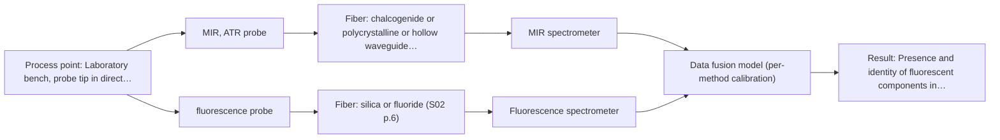

# First technical assessment: Local measurements of heterogeneous model tissues

## Answer

**Customer request (our summary):** A research group wants to compare MIR ATR and fluorescence information on model biological tissues (chicken muscle, fat, liver) in a laboratory classification study, and asks for a first comparison experiment plus a clear statement of what its results would demonstrate.

### Brief answer

Test a combined MIR-ATR + fluorescence fiber probe on chicken muscle, fat and liver, with single-method MIR-ATR and fluorescence runs as baselines. The published precedent (S04) shows neither technique alone fully separated these three tissue classes, while fused IR + fluorescence data did; your experiment would test whether that holds for your samples. Open points: the classes and reference labels, the fluorescent species and excitation wavelength, and your acceptance criteria.

### Proposal

- **Best current option:** O2 (recommended)
- **Basis:** supplied AFS sources
- **What would change it:** If no relevant fluorescent species is present (Q2), the fluorescence channel loses its basis and the assessment reduces to the MIR-ATR single-method option. If the classes or acceptance criteria differ strongly from a three-class tissue-type comparison, the experiment design and possibly the method choice change.
- **Next step:** Answer Q1-Q5, then run the single-method and combined-probe measurements on the chicken tissue set and compare single-method versus fused classification on held-out samples.

**Secondary evidence (external, not AFS material):** G1: E02 ¶31, E02 ¶82, E02 ¶36; G2: no usable external source found; G3: no usable external source found; G4: no usable external source found. See Expert detail.

**Decision status:** Provisional feasibility assessment

### Solution options

| ID | Tier | Methods | Confidence | Cost class, S01 Table 1 (p.6) | Ease of use | Maintenance | Performance fit | Sources |
|---|---|---|---|---|---|---|---|---|
| O1 | Simple | M1 MIR, ATR probe | Medium: open question: Q1 (starts at Medium) | high cost (row 2) | single instrument, straightforward contact measurement | crystal cleaning and contact control | strong single-method baseline for fat discrimination | [1: S01 p.10] [2: S04 p.4] |
| O2 | Recommended | M3 MIR, ATR probe + Fluorescence (combination) | Low: open question: Q1 (starts at Medium); fit for soft solid to be tested, sample clarity unknown, fluorescent target unknown; precedent only; multi-method, fusion benefit not yet shown | high cost (rows 2, 19) | one probe head, two instruments to run | crystal cleaning plus fluorescence channel checks | directly answers the same-spot comparison the customer asks for | [3: S04 p.1] [4: S04 p.4] |
| O3 | Extended (multi-method) | M1 MIR, ATR probe; M2 fluorescence probe; M3 MIR, ATR probe + Fluorescence (combination) | Low: open question: Q1, Q2 (starts at Medium); fit for soft solid to be tested, sample clarity unknown, fluorescent target unknown; multi-method, fusion benefit not yet shown | high cost (rows 2, 19) | most instruments and data handling | each instrument needs its own calibration and diagnostics | tests whether fusion beats single methods, per the published precedent | [4: S04 p.4] [1: S01 p.10] [2: S04 p.4] [5: S01 p.5] [3: S04 p.1] |

*Confidence rates the basis of the advice (how much is known and cited), not a predicted accuracy or probability of success. It starts at High, or at Medium when a key question on the method or the option is open, and drops one level per weakness listed (floor Low).*

*Cost class is the relative rating in S01 Table 1 (p.6) for the in-line method+technique rows named (the highest one for a multi-method option); it is not a price.*

### Setup sketch

*Recommended option O2; drawn by code from the option, a schematic, not a configuration.*

### Key questions

1. What exactly is being classified (tissue type, fresh vs frozen, pathology model) and what reference labels will each sample carry?
2. Which fluorescent species or intrinsic fluorophores do you expect in the tissues, and at which excitation wavelength?
3. Is the interface a bench-top contact probe or does it need a fiber link to a remote spectrometer?

## Expert detail

**Customer enquiry**

> Our research group is evaluating a spectral measurement interface using model biological tissues such as chicken muscle, fat and liver. We want to compare MIR ATR and fluorescence information, because the material is heterogeneous and sequential measurements may not sample the same location. This is a laboratory classification study. We need a first comparison experiment and a clear statement of what its results would demonstrate.

**Decision status:** Provisional feasibility assessment. A method shortlist and a concrete comparison experiment can be justified from the supplied sources, but the class definition, fluorescent species, optical regime and acceptance criteria are still open, so the assessment is provisional with stated assumptions.

### Parameters

| ID | Parameter | Kind | Need | Measured by | Why | Sources |
|---|---|---|---|---|---|---|
| P1 | Tissue class label (muscle, fat, liver) | qualitative | required | Reference lab method: reference_lab | The classification models need independent ground-truth labels for training and validation. | *(no verified source: engineering judgement)* |
| P2 | Presence and identity of fluorescent components in each tissue type | qualitative | required | Spectroscopy: Fluorescence | The fluorescence channel only contributes information if the tissues contain fluorescent species, and the excitation wavelength must match them. | [5: S01 p.5] |

### Solution option details

- **O1 cost drivers:** MIR spectrometer and ATR probe, sample set, chemometric modelling effort
- **O2 cost drivers:** combined probe, two spectrometers, synchronised data handling, larger sample set
- **O2 combining methods:** Low-level fusion: one calibration model per method as baseline, then the rescaled IR and fluorescence spectra concatenated into one matrix, as in the published chicken-tissue study. Both channels must sample the same spot, which the combined probe provides, and the data must be synchronised to a common time step. The fused model must beat the best single-method model on held-out samples, otherwise the extra channel is dropped.
- **O3 cost drivers:** two probes plus combined probe, full fusion workflow, extended validation set
- **O3 combining methods:** Low-level fusion: one calibration model per method as baseline, then the rescaled IR and fluorescence spectra concatenated into one matrix, as in the published chicken-tissue study. Both channels must sample the same spot, which the combined probe provides, and the data must be synchronised to a common time step. The fused model must beat the best single-method model on held-out samples, otherwise the extra channel is dropped.

*Extended (multi-method) option O3; drawn by code from the option, a schematic, not a configuration.*

### Premise check

- **Supported:** Heterogeneity makes sequential measurements with separate probes problematic, so the comparison should sample the same location for both methods. The customer's constraint that sequential measurements may not sample the same location is confirmed by the sources, which state that different methods must collect information from the same pinpoint area and that alternating probes cannot guarantee this. [6: S01 p.8]
- **Precedent only:** A first comparison experiment can be designed now with a clearly stateable expected outcome. A published study on exactly these model tissues (chicken breast, fat, liver) shows what such a comparison can demonstrate, but it is a laboratory precedent, not proof for the customer's own setup. [7: S04 p.4]

### Requirements

**Stated by the customer**

- "Our research group is evaluating a spectral measurement interface"
- "model biological tissues such as chicken muscle, fat and liver"
- "This is a laboratory classification study."
- *Further statements: see the customer enquiry above.*

**Key unknowns**

- Class definition and reference labels for the classification (Q1).
- Fluorescent species and excitation wavelength (Q2).
- Bench-top versus fiber-linked installation (Q3).
- Customer acceptance criteria for the comparison (Q4).
- Optical behaviour (scattering/absorption) of each tissue type at the chosen wavelengths (Q5).

### Clarification questions (most decision-relevant first)

Q1. What exactly is being classified (tissue type, fresh vs frozen, pathology model) and what reference labels will each sample carry? *Why it matters:* The class definition determines which spectral features matter and what reference method validates the models. *(affects: method, status)*
Q2. Which fluorescent species or intrinsic fluorophores do you expect in the tissues, and at which excitation wavelength? *Why it matters:* Fluorescence only works if a fluorescent component is present, and the excitation wavelength must be chosen for it. *(affects: technique, M2)*
Q3. Is the interface a bench-top contact probe or does it need a fiber link to a remote spectrometer? *Why it matters:* It decides the probe and fiber families (silica for fluorescence, CIR/PIR for MIR) and the instrument layout. *(affects: installation)*
Q4. What numerical classification performance must the comparison experiment reach for you to consider the interface worth developing further? *Why it matters:* The go/no-go criteria for the comparison must come from you, not from us. *(affects: status, M3)*
Q5. How do the three tissue types differ optically (scattering and absorption) at the wavelengths you plan to use, and how opaque or turbid is each sample? *Why it matters:* The optical regime decides whether the ATR surface readout and the fluorescence volume readout give usable signals on each tissue type. *(affects: technique, M1, M2)*

### Recommendation

- **M1 · Primary candidate: MIR, ATR probe.** MIR-ATR fiber probes are documented for soft solid biological tissue and the published chicken-tissue study found mid-IR the stronger single technique for fat discrimination. It is the screening-pass method and the natural first baseline. *Conditions:* Tight contact between the ATR crystal and the soft tissue surface must be maintained; the crystal surface must stay clean. [1: S01 p.10] [2: S04 p.4]
- **M2 · Conditional candidate: fluorescence probe.** In the published chicken-tissue study fluorescence was the technique that recognised liver tissue, complementing mid-IR. Its screening status is unknown until the fluorescent species and the soft-solid fit are confirmed. *Conditions:* Applies only if a relevant fluorescent species or intrinsic fluorophore is identified in the tissues (Q2); otherwise the fluorescence channel has no measurement basis. [5: S01 p.5] [2: S04 p.4]
- **M3 · Comparison candidate: MIR, ATR probe + Fluorescence (combination).** A combined probe measures both methods at the same pinpoint spot at the same time, which directly answers the customer's heterogeneity constraint. The published fusion of IR and fluorescence data separated chicken breast, fat and liver where neither single technique fully did, but this gain is a hypothesis to reproduce, not a guarantee. *Conditions:* Tested after the single-method runs; the fusion gain must be confirmed against the best single-method model on held-out samples. [3: S04 p.1] [4: S04 p.4]

### Measurement concept

- **Probe and geometry:** Combined MIR-ATR + fluorescence fiber probe with a truncated ZrO2 ATR crystal as the common measurement interface; ATR samples a surface layer of a few micrometres, fluorescence a larger near-surface volume.
- **Location:** Laboratory bench, probe tip in direct contact with the tissue sample.
- **Fiber link:** CIR fibers carry the MIR-ATR channel and silica fibers the fluorescence channel within one probe head (S04 p.2); whether a remote fiber link or a bench-top contact setup is used depends on Q3. [3: S04 p.1]

### Spectral range

- **MIR:** Nominal MIR range 4000-400 cm-1 (2.5-25 µm); the usable range depends on the selected spectrometer, CIR/PIR fiber and ATR crystal. [8: S01 p.9]
- **Fluorescence:** Excitation in the UV/visible region with emission shifted to longer wavelengths; the actual bands depend on the fluorescent species present, which is not yet identified (Q2). [9: S01 p.12]

### Risks and uncertainty

- ATR reads only a few-micrometre surface layer, so surface condition, contact pressure and crystal fouling can dominate the signal instead of bulk tissue properties. *(rules: R-MIR-3)* [10: S01 p.13]
- If the tissues lack a suitable fluorescent species or the chosen excitation misses it, the fluorescence channel adds little and the comparison loses one arm. *(rules: R-FLU-1)* [5: S01 p.5]
- The combined probe's IR and fluorescence analysis areas only partly overlap, so strong local heterogeneity within a spot can still distort the fused result. *(rules: R-CMB-2, R-GEN-5)* [11: S04 p.2]
- The published separation is a laboratory precedent on model samples; it does not prove the same performance for the customer's samples or any later in-line or clinical use. *(rules: R-EVI-1, R-EVI-2)* [12: S04 p.4]

### First feasibility experiment

1. **Obtain representative fresh chicken breast, fat and liver samples, at least three of each type, and define multiple measurement spots per sample.** Cover the chemical and physical variation of the three tissue types, including heterogeneous regions. *(no verified source: engineering judgement)*
2. **Measure each spot with the MIR-ATR probe alone and with the fluorescence probe alone, keeping geometry and contact constant.** Establish the single-method baselines before any combination is judged. *(no verified source: engineering judgement)*
3. **Repeat the same spots with the combined MIR-ATR + fluorescence probe so both signals come from the same small area.** This is the core of the requested comparison: both methods on the same spot at the same time. [13: S04 p.2]
4. **Build one classification model per method and one on the fused, rescaled data; validate by cross-validation segmented by sample.** Compare single-method and fused classification on the same data. [14: S04 p.3]
5. **Test the models on held-out samples or a new batch and compare single-method vs fused performance against the customer's criteria.** Independent validation rather than fit statistics on the calibration data. *(no verified source: engineering judgement)*

**Reference measurements:** Known tissue-type labels for every sample; if any non-trivial class is added later, an independent reference method for that label.

**Decision basis:** Go/no-go: the fused IR + fluorescence classification must clearly beat the best single-method model on held-out samples, against numerical accuracy criteria set by the customer (Q4).

### Not covered by the supplied sources

- The customer's specific class definitions, reference labelling and required accuracy.
- Any quantitative detection limit, accuracy or response time for this interface on the customer's samples.

### Further notes

- **Chemometrics:** Start with one PCA/PLS-DA model per method (IR block, fluorescence block), then a fused model on the concatenated, rescaled matrix as in S04 p.3-4; validate with cross-validation segmented by sample, not by repeated measurement position, and check that fusion beats the best single-method model before keeping it.
- **Future direction:** If the laboratory comparison succeeds, the same combi-probe concept could later be evaluated for a compact multisensor system or an in-line configuration, as suggested in S04 p.4-5; that step would need its own assessment.

### Secondary evidence (external, not AFS material)

*Found by a literature search for gaps the supplied AFS sources leave open. Not AFS material and not proof for this case; every quote below was verified verbatim against the fetched text.*

*Live search unavailable (library only: cache miss (europepmc); cache miss (openalex)); curated library only.*

**G1 · multi-method:** Combining several spectroscopy methods (data fusion) (Low-level fusion: one calibration model per method as baseline, then the rescaled IR and fluorescence spectra concatenated into one matrix, as in the published chicken-tissue study. Both channels must sample the same spot, which the combined probe provides, and the data must be synchronised to a common time step. The fused model must beat the best single-method model on held-out samples, otherwise the extra channel is dropped.)

- **E02 ¶31** Low-level data fusion is described as the simplest combination approach, where variables from different sources are concatenated one after the other into a single new data matrix. *How it applies:* This supports the planned baseline-plus-concatenation design: build one model per method first, then concatenate the rescaled IR and fluorescence spectra into one matrix. The fused model should then be compared against those single-method baselines on held-out samples. *Limits and transfer risks:* The review is a general PAT treatment, not the chicken-tissue study itself, and does not state that fusion improves performance for any particular system. *(supports O3)*
  > "Low-level data fusion (LLDF) is considered the simplest method to achieve a combination of inputs. In this case, the data is rearranged into a new data matrix, where the variables coming from different sources are placed one after the other."
  > Challenges and Opportunities of Implementing Data Fusion in Process Analytical Technology-A Review. (2022) · Molecules (Basel, Switzerland) · doi:10.3390/molecules27154846 · https://europepmc.org/article/PMC/PMC9369811 · retrieved 2026-10-17, full text, licence: cc by, via curated library
- **E02 ¶82** Before fusing data from multiple sources, the contribution of each dataset and its complementarity should be evaluated. *How it applies:* This justifies the planned step of establishing per-method baseline models before concatenation, so the added value of the fluorescence channel can be judged against the best single method. *Limits and transfer risks:* This is a general methodological recommendation from a PAT review, not evidence that IR and fluorescence are complementary for biological tissue classification. *(supports O3)*
  > "Before fusing data from multiple sources, it is essential to evaluate the contribution of each dataset to the model and its complementarity."
  > Challenges and Opportunities of Implementing Data Fusion in Process Analytical Technology-A Review. (2022) · Molecules (Basel, Switzerland) · doi:10.3390/molecules27154846 · https://europepmc.org/article/PMC/PMC9369811 · retrieved 2026-10-17, full text, licence: cc by, via curated library
- **E02 ¶36** A cited Raman and FT-IR food analytical study showed that instrument complementarity was in some situations not sufficient to improve predictive performance for several quality attributes. *How it applies:* This is a reason to test rather than assume: the fused model must demonstrably beat the best single-method model on held-out samples, otherwise the extra fluorescence channel should be dropped, as the plan already specifies. *Limits and transfer risks:* The cited example concerns Raman and FT-IR on food samples, not MIR ATR and fluorescence on chicken muscle, fat and liver, so the outcome may differ for this system. *(supports O3)*
  > "In some situations, instrument complementarity (not data complementarity) was not sufficient to improve the performance of predictive several CQAs, as shown by a Raman and FT-IR data based food analytical study [73]."
  > Challenges and Opportunities of Implementing Data Fusion in Process Analytical Technology-A Review. (2022) · Molecules (Basel, Switzerland) · doi:10.3390/molecules27154846 · https://europepmc.org/article/PMC/PMC9369811 · retrieved 2026-10-17, full text, licence: cc by, via curated library

**G2 · not in the supplied sources:** The customer's specific class definitions, reference labelling and required accuracy.

- No usable external source found.

**G3 · not in the supplied sources:** Any quantitative detection limit, accuracy or response time for this interface on the customer's samples.

- No usable external source found.

**G4 · parameter without a source:** Measuring Tissue class label (muscle, fat, liver): The classification models need independent ground-truth labels for training and validation.

- No usable external source found.

### Evidence (verified quotes)

1. ✓ **S01 p.10** (general): "ATR fiber probes (Fig.1) enable the analysis of liquids and solid elastic samples, such as biological tissue, using specialized probes utilizing high-transmission fiber optics in the Mid-IR region."
2. ✓ **S04 p.4** (application precedent): "IR spectroscopy works better for the discrimination of fat (Figure 3a), whereas fluorescence is well suited for the recognition of liver tissue (Figure 3b)."
3. ✓ **S04 p.1** (application precedent): "A multispectral fiber optic probe has been developed that enables simultaneous analysis of various liquid and solid samples using attenuated total reflection mid-infrared spectroscopy and fluorimetry."
4. ✓ (precedent only) **S04 p.4** (method gain): "At the same time, the PCA model built on the concatenated IR and fluorescence data revealed three distinct groups of samples corresponding to tissue types"
5. ✓ **S01 p.5** (general): "However, most chemicals do not exhibit this property."
6. ✓ **S01 p.8** (general): "It is crucial that the spectral information obtained by different methods-Mid-IR, NIR, Raman, and fluorescence spectra-is collected from the same small, even pinpoint, area of the sample."
7. ✓ **S04 p.4** (application precedent): "the PCA model built on the concatenated IR and fluorescence data revealed three distinct groups of samples corresponding to tissue types"
8. ✓ **S01 p.9** (general): "Vibrational spectroscopy in the mid-IR range (4000-400 cm-1) is one of the most informative methods of chemical analysis."
9. ✓ **S01 p.12** (general): "Fluorimetry is based on measuring the broad emission signal observed upon irradiation of certain samples in the UV and visible regions."
10. ✓ **S01 p.13** (general): "typically at a depth of few microns"
11. ✓ **S04 p.2** (application precedent): "The incomplete coinci-dence of the areas of analysis on the sample plays no significant role, if the spot under the measuring element is considered homogeneous."
12. ✓ **S04 p.4** (application precedent): "The same effect can potentially be observed in various real-life applications, such as medical diagnostics."
13. ✓ **S04 p.2** (application precedent): "ZrO2 crystal was chosen due to its high (close to the diamond) refractive index, high transparency in the working spectral regions of both chalcogenide infrared (CIR) and UV silica fibers, as well as small intrinsic fluorescence."
14. ✓ **S04 p.3** (application precedent): "For the joint analysis, the IR and fluorescence spectra rescaled to have intensities between 0 and 1 were fused into a single matrix X (45 × 823) with the augmented spectral axis"

### Verification

- Citations verified: 21 of 21 (exact or whitespace/hyphen-tolerant match on the cited page, scope checked).
- Hard check failures before deterministic corrections: 0; still open: 0; soft warnings: 2; repair rounds: 1.
- Corrected deterministically after verification (1):
  - ⚠ recommendations[2].combined_with: combined_with normalised to ['Fluorescence'] (duplicates and the entry's own method removed)
- External evidence (cache): 3 quote(s) verified verbatim (exact or whitespace/hyphen-tolerant, at most 400 characters and 2 sentences, against the cited paragraph); 0 item(s) dropped.
- External search: 5 query(ies), 0 hit(s), 3 source(s) (3 from the curated library); ⚠ library only: cache miss (europepmc); cache miss (openalex).
- External step: 2 model call(s), 21.5 s extra (cost in the run JSON).

*Run D08-20261018T080635Z-b84d · models z-ai/glm-5.3-flash*
