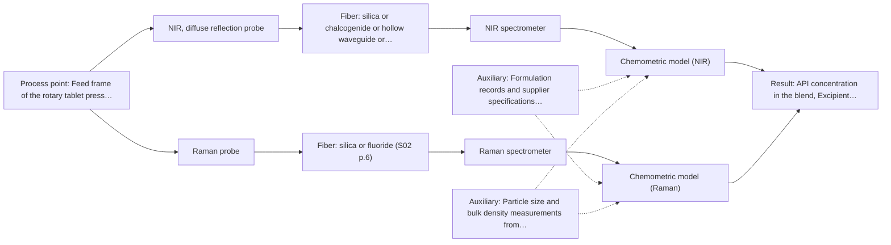
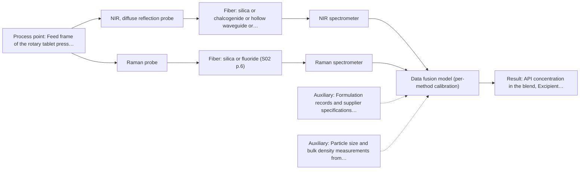

# First technical assessment: Blend potency in a tablet press feed frame

## Answer

**Customer request (our summary):** The customer wants to assess if a fiber-based measurement in the tablet press feed frame can monitor API concentration changes in a powder blend.

### Brief answer

Test NIR diffuse reflection first: it suits opaque powders and is the most common online fiber-probe method, with Raman as the comparison technique in the same pilot, mirroring the published feed-frame example. A fused NIR + Raman model is a later hypothesis only if neither single method meets your accuracy target. Open points: API concentration range and accuracy, excipient composition, required response time, feed-frame installation constraints, and the laboratory reference method.

### Proposal

- **Best current option:** O2 (recommended)
- **Basis:** supplied AFS sources
- **What would change it:** If the API is present at trace levels or the excipients cause severe fluorescence, Raman may drop out and NIR alone (O1) becomes the focus; if a single method already meets the accuracy target, the fused option O3 is unnecessary.
- **Next step:** Answer the clarification questions, then run a multi-method laboratory trial on representative blend samples with independent assay reference values.

**Secondary evidence (external, not AFS material):** G1: no usable external source found; G2: no usable external source found; G3: E03 ¶31; G4: no usable external source found. See Expert detail.

**Decision status:** Provisional feasibility assessment

### Solution options

| ID | Tier | Methods | Confidence | Cost class, S01 Table 1 (p.6) | Ease of use | Maintenance | Performance fit | Sources |
|---|---|---|---|---|---|---|---|---|
| O1 | Simple | M1 NIR, diffuse reflection probe | Medium: open question: Q1, Q3 (starts at Medium) | average cost (row 8) | Single probe and spectrometer, straightforward installation | Low; one calibration to maintain | Fits the pilot question of whether NIR alone can track API changes | [1: S01 p.10] [2: S01 p.17] [3: S01 p.10] |
| O2 | Recommended | M1 NIR, diffuse reflection probe; M2 Raman probe | Medium: open question: Q1, Q2, Q3 (starts at Medium) | high cost (rows 8, 12) | Two instruments in one pilot, moderate setup effort | Two calibrations and two instruments to maintain | Fits the stated aim of comparing options before committing to production equipment | [4: S02 p.20] [1: S01 p.10] [2: S01 p.17] [3: S01 p.10] [5: S01 p.15] [6: S01 p.11] |
| O3 | Extended (multi-method) | M3 NIR, diffuse reflection probe + Raman (combination) | Low: open question: Q1, Q2, Q3 (starts at Medium); multi-method, fusion benefit not yet shown | high cost (rows 8, 12) | Most complex; two synchronised instruments and fused data pipeline | Highest; each block needs its own calibration and diagnostics | Fits only if single methods fall short of the accuracy target | [7: S01 p.15] [8: S01 p.8] [9: S01 p.15] [10: S01 p.8] |

*Confidence rates the basis of the advice (how much is known and cited), not a predicted accuracy or probability of success. It starts at High, or at Medium when a key question on the method or the option is open, and drops one level per weakness listed (floor Low).*

*Cost class is the relative rating in S01 Table 1 (p.6) for the in-line method+technique rows named (the highest one for a multi-method option); it is not a price.*

### Setup sketch

*Recommended option O2; drawn by code from the option, a schematic, not a configuration.*

### Key questions

1. What is the API concentration range, the target level, and the accuracy the pilot must demonstrate?
2. What are the excipients, and do any colorants or fluorescent components occur in the blend?
3. How fast must the API result be available, and what happens on an out-of-specification result?

## Expert detail

**Customer enquiry**

> We manufacture tablets from a powder blend containing an active pharmaceutical ingredient and excipients. Laboratory checks tell us whether the blend is on target, but results arrive after the material has moved through the press. We want to assess whether a fiber based measurement in the feed frame could follow API concentration changes. Our first pilot should compare reasonable measurement options before we commit to production equipment.

**Decision status:** Provisional feasibility assessment. A method shortlist can be justified from the sources: NIR diffuse reflection and Raman both pass screening for an opaque powder in the feed frame, and a published feed-frame example supports testing them. The choice between them, and whether a combination adds value, depends on open questions about the API level, excipients and required response time.

### Parameters

| ID | Parameter | Kind | Need | Measured by | Why | Sources |
|---|---|---|---|---|---|---|
| P1 | API concentration in the blend | quantitative | required | Reference lab method: Laboratory HPLC assay of API content | It is the target variable the in-line measurement must follow and the response for the calibration model. | *(no verified source: engineering judgement)* |
| P2 | Excipient composition and presence of fluorescent or strongly absorbing components | qualitative | required | Auxiliary sensor: Formulation records and supplier specifications (cited; confirm availability with AFS) | It determines the Raman fluorescence background and which spectral regions carry the API signal against the matrix. | [11: S01 p.11] |
| P3 | Powder physical state: particle size, packing density and flow behaviour at the probe | qualitative | optional | Auxiliary sensor: Particle size and bulk density measurements from blend records (cited; confirm availability with AFS) | Physical variation drives scatter effects in reflection measurements and should be characterised to separate it from chemical change; it should be available from existing blend records. | [12: S01 p.17] |

### Solution option details

- **O1 cost drivers:** One NIR spectrometer, one diffuse-reflection probe, calibration samples and reference assays
- **O2 cost drivers:** NIR and Raman spectrometers with probes, trial time on representative blends, reference assays for both methods
- **O3 cost drivers:** Two spectrometers and probes, synchronisation and fusion software, extended calibration and validation campaigns
- **O3 combining methods:** Low-level fusion: synchronised NIR and Raman spectra merged into one augmented matrix, as in the published feed-frame work. Both probes must view the same powder volume at the same feed-frame location, and data must be normalised to a common time step. Each method keeps its own calibration, and the fused model must beat the best single method on held-out batches or it should be dropped.

*Extended (multi-method) option O3; drawn by code from the option, a schematic, not a configuration.*

### Premise check

- **Precedent only:** A fiber-based measurement in the tablet press feed frame can follow API concentration changes. A published feed-frame example shows NIR and Raman probes inserted directly into the process environment tracking blend potency in real time; this is a reason to test, not proof for this customer's blend. [5: S01 p.15]
- **Supported:** NIR diffuse reflection is a reasonable technique for an opaque powder blend. The sources describe NIR diffuse reflection for opaque, concentrated and scattering samples, and NIR probes for powders. [2: S01 p.17] [13: S01 p.6]

### Requirements

**Stated by the customer**

- Follow API concentration changes in the feed frame of a tablet press, in a powder blend of API and excipients.
- Compare reasonable measurement options in a first pilot before committing to production equipment.

**Key unknowns**

- API concentration range, target level and required accuracy
- Excipient composition, including any fluorescent components or colorants
- Required measurement response time to be useful before material leaves the press
- Installation constraints in the feed frame: space, cleaning, dust, probe contact geometry
- Availability of an independent laboratory reference method and sampling procedure

### Clarification questions (most decision-relevant first)

Q1. What is the API concentration range, the target level, and the accuracy the pilot must demonstrate? *Why it matters:* It sets the calibration effort and decides whether NIR sensitivity is sufficient or Raman must carry the quantification. *(affects: method, M1, M2)*
Q2. What are the excipients, and do any colorants or fluorescent components occur in the blend? *Why it matters:* Fluorescent or strongly absorbing excipients can raise the Raman fluorescence background and change which technique performs best. *(affects: technique, M2, M3)*
Q3. How fast must the API result be available, and what happens on an out-of-specification result? *Why it matters:* The required response time determines acquisition speed and whether single-method or fused data are needed. *(affects: method, installation)*
Q4. What space, cleaning and dust constraints exist at the feed frame, and can a probe tip contact the flowing powder or must it view it remotely? *Why it matters:* It decides between a contact reflection probe and a remote diffuse-reflection geometry, and affects fouling risk. *(affects: installation, M1)*
Q5. Which laboratory reference method (e.g. HPLC assay) and sampling point will provide the calibration values? *Why it matters:* Without independent reference values on representative blend states no calibration or go/no-go decision is possible. *(affects: status, M1, M2)*

### Recommendation

- **M1 · Primary candidate: NIR, diffuse reflection probe.** NIR diffuse reflection passes screening for opaque, scattering powders and is described as the most common online method via fiber probes. Quantification will need a chemometric calibration against the laboratory assay. [1: S01 p.10] [2: S01 p.17] [3: S01 p.10]
- **M2 · Comparison candidate: Raman probe.** Raman gives a molecular fingerprint with sharp bands and is tested in the same feed-frame application alongside NIR in the published example, so it is the natural second single method to compare. Its weak signal and possible fluorescence background from excipients must be checked on real blend samples. [5: S01 p.15] [6: S01 p.11]
- **M3 · Conditional candidate: NIR, diffuse reflection probe + Raman (combination).** A combined NIR + Raman option is a later hypothesis: the published feed-frame work reports fused NIR and Raman models predicting API potency with higher accuracy and robustness than single-method models, but this gain must be demonstrated against the best single method on this blend. It should only be tested after the single-method trials. *Conditions:* Test only if neither single method alone meets the accuracy or robustness target set in Q1. [9: S01 p.15] [10: S01 p.8]
- **M4 · Not recommended: NIR, transmission/transflection probe.** Transmission or transflection is designed for transparent or semi-transparent liquids and fails when the sample is too thick or opaque, which a powder blend is; a reader might expect it from NIR's popularity, but the screening rules it out for this sample. [14: S01 p.18]
- **M5 · Not recommended: MIR, ATR probe.** MIR-ATR requires tight contact and suits liquids, pastes and soft solids, not a flowing powder; it also samples only a surface layer a few micrometres deep, so it is not a sensible feed-frame candidate despite MIR's general strength. [15: S01 p.10] [16: S01 p.13]

### Measurement concept

- **Probe and geometry:** NIR diffuse-reflection fiber probe (contact or close-coupled to the flowing powder) and, in comparison, a Raman fiber probe; both mounted at the same feed-frame location.
- **Location:** Feed frame of the rotary tablet press, viewing the powder blend as it passes the probe tip.
- **Fiber link:** Vis-NIR silica fibers cover the NIR range; for Raman, metal-coated low-OH silica fibers avoid polymer-jacket fluorescence. Fiber length limits depend on the selected configuration and are an open question for any MIR option, which is not recommended here. [17: S01 p.15] [18: S02 p.7]

### Spectral range

- **NIR:** Nominal NIR range 780-2500 nm; the usable range depends on the spectrometer, fiber and probe actually selected. [19: S01 p.10]
- **Raman:** Raman is reported as Raman shift in cm-1 with the laser excitation wavelength stated separately; the published feed-frame example used 785 nm excitation. The usable range depends on the selected laser, filters and probe. [20: S01 p.15] [21: S01 p.11]

### Risks and uncertainty

- NIR reflection signals are sensitive to surface characteristics and particle size, so physical variation in the feed frame can mimic composition change and must be handled by scatter correction and calibration design. *(rules: R-GEO-6)* [12: S01 p.17]
- Both NIR and Raman calibrations are specific to the matrix, so any change of API grade or excipient blend requires re-validation of the model. *(rules: R-CAL-1)* [22: REF §5]
- Sample inhomogeneity and process turbulence in the feed frame may make the probed spot unrepresentative of the bulk blend. *(rules: R-GEN-5)* [23: S01 p.7]
- The published feed-frame gain from combining NIR and Raman is a hypothesis from another blend and process; it may not transfer to this customer's product. *(rules: R-EVI-2)* [24: REF §3]

### First feasibility experiment

1. **Collect representative blend samples spanning the expected API concentration range and excipient variation, including deliberately off-target batches.** Cover the chemical and physical variation the in-line model must handle. *(no verified source: engineering judgement)*
2. **Measure each sample with the NIR diffuse-reflection probe and the Raman probe as separate single methods, plus an independent laboratory assay (e.g. HPLC) as reference.** Compare the two single methods against the same reference values before any combination is considered. *(no verified source: engineering judgement)*
3. **Build one chemometric calibration per method and validate each on held-out batches or runs not used in calibration.** Establish which single method meets the accuracy requirement. *(no verified source: engineering judgement)*
4. **Only if no single method meets the target, test a fused NIR + Raman model on the same held-out batches and require it to beat the best single method.** Verify the combination hypothesis under the fusion conditions (same spot, synchronised data, per-method calibration). [7: S01 p.15]
5. **Run a short in-line trial at the feed frame with the winning configuration and agree go/no-go criteria (accuracy and response time) with the customer before any production commitment.** Confirm performance under real flow, dust and packing conditions. *(no verified source: engineering judgement)*

**Reference measurements:** Independent laboratory assay of API content on every calibration and validation sample, taken at defined points in the feed frame or from press samples.

**Decision basis:** Go/no-go criteria (minimum accuracy, precision and response time) must be defined numerically by the customer; the sources do not provide them.

### Assumptions

- The blend is an opaque, scattering powder, inferred from the stated powder form.
- A laboratory assay of API content exists or can be established, since the customer already performs laboratory checks.

### Not covered by the supplied sources

- Achievable fiber link length for the selected probe configuration in the feed frame (no source states a length for this installation).
- Detection limits or accuracy achievable for this specific API and excipient matrix.

### Further notes

- **Chemometrics:** Both NIR and Raman quantification will rely on PLS calibration models against the laboratory assay; the published feed-frame example used PLS on fused spectra. Validation on held-out batches, and permutation or cross-validation checks when data are limited, protect against overfitting.
- **Real-time tracking:** The goal is time-resolved tracking of API concentration as the blend passes the feed frame; acquisition rate must be matched to the required response time (Q3), and diode-array type detectors allow instantaneous recording at all wavelengths, which is relevant for fast processes.
- **Future direction:** If the pilot succeeds, a customised in-line system or spectral fiber sensor for routine feed-frame control could follow, in line with the AFS pathway from multi-method trials to a tailored process solution.

### Secondary evidence (external, not AFS material)

*Found by a literature search for gaps the supplied AFS sources leave open. Not AFS material and not proof for this case; every quote below was verified verbatim against the fetched text.*

*Live search unavailable (library only: cache miss (europepmc); cache miss (openalex)); curated library only.*

**G1 · auxiliary sensor:** In-line measurement of Excipient composition and presence of fluorescent or strongly absorbing components with Formulation records and supplier specifications

- No usable external source found.

**G2 · auxiliary sensor:** In-line measurement of Powder physical state: particle size, packing density and flow behaviour at the probe with Particle size and bulk density measurements from blend records

- No usable external source found.

**G3 · multi-method:** Combining several spectroscopy methods (data fusion) (Low-level fusion: synchronised NIR and Raman spectra merged into one augmented matrix, as in the published feed-frame work. Both probes must view the same powder volume at the same feed-frame location, and data must be normalised to a common time step. Each method keeps its own calibration, and the fused model must beat the best single method on held-out batches or it should be dropped.)

- **E03 ¶31** Low-level data fusion rearranges input data into a new matrix where variables from different sources are placed one after the other. *How it applies:* This approach can be tested when combining NIR and Raman spectra, provided the individual datasets contribute complementarity. *Limits and transfer risks:* The study reviews literature methods and food applications, so transfer to a tablet press feed frame requires re-evaluating dataset complementarity and avoiding drop in performance observed in some studies. *(supports O3)*
  > "Low-level data fusion (LLDF) is considered the simplest method to achieve a combination of inputs. In this case, the data is rearranged into a new data matrix, where the variables coming from different sources are placed one after the other."
  > Challenges and Opportunities of Implementing Data Fusion in Process Analytical Technology-A Review. (2022) · Molecules (Basel, Switzerland) · doi:10.3390/molecules27154846 · https://europepmc.org/article/PMC/PMC9369811 · retrieved 2026-10-17, full text, licence: cc by, via curated library

**G4 · not in the supplied sources:** Achievable fiber link length for the selected probe configuration in the feed frame (no source states a length for this installation).

- No usable external source found.

### Evidence (verified quotes)

1. ✓ **S01 p.10** (general): "Near-IR vibrational spectroscopy (NIR) is the most common online analysis method performed using fiber optic probes."
2. ✓ **S01 p.17** (general): "NIR Reflection is primarily used for opaque or highly concentrated dairy products, such as yogurt, butter, or whole milk concentrates."
3. ✓ **S01 p.10** (general): "The broad absorption bands observed in this region overlap, suggesting the use of chemometrics for quantitative and qualitative analysis of spectral data."
4. ✓ **S02 p.20** (general): "1. Multi-Method Lab Trials AFS tests your process using all key fiber optic spectroscopy methods."
5. ✓ **S01 p.15** (application precedent): "the probes are inserted directly into the process environment, such as the feed frame of a rotary tablet press"
6. ✓ **S01 p.11** (general): "signals, which are several orders of magnitude weaker than IR absorption peaks"
7. ✓ **S01 p.15** (general): "Data processing for pharmaceutical tasks relies on "low-level data fusion," where the synchronized NIR and Raman spectra are merged into a single augmented matrix."
8. ✓ **S01 p.8** (general): "It is crucial that the spectral information obtained by different methods-Mid-IR, NIR, Raman, and fluorescence spectra-is collected from the same small, even pinpoint, area of the sample."
9. ✓ (precedent only) **S01 p.15** (method gain): "By combining Raman and NIR, these models can predict API potency or coating thickness with higher accuracy and robustness than single-method models."
10. ✓ **S01 p.8** (general): "the measurement data must be normalized to a common time step"
11. ✓ **S01 p.11** (general): "superposition of luminescence (fluorescence), which has a significantly higher intensity."
12. ✓ **S01 p.17** (general): "the method is sensitive to the surface characteristics and fat globule size."
13. ✓ **S01 p.6** (general): "Diffuse reflection-probe diffuse reflection Scattering media, powder 0.5-1 mm"
14. ✓ **S01 p.18** (general): "it fails when the milk becomes too "thick" or fat-rich, as the light cannot penetrate the sample."
15. ✓ **S01 p.10** (general): "ATR fiber probes (Fig.1) enable the analysis of liquids and solid elastic samples"
16. ✓ **S01 p.13** (general): "typically at a depth of few microns"
17. ✓ **S01 p.15** (general): "The use of fiber optics is critical here, as it allows the sensitive spectrometers to be located safely away from the vibration and dust of the manufacturing floor."
18. ✓ **S02 p.7** (general): "Free of Polymer jacket fluorescence for Raman and Fluo- Spectroscopy"
19. ✓ **S01 p.10** (general): "NIR spectra (780-2500 nm) contain predominantly overtones and component bands of fundamental vibrations"
20. ✓ **S01 p.15** (general): "Raman spectrometer and Raman fiber probe for contact measurements with 785 nm excitation wavelength"
21. ✓ **S01 p.11** (general): "The Raman shift is used as the horizontal (spectral) axis in Raman spectroscopy"
22. ✓ **REF §5** (general): "Weak signal, fluorescence background; calibration specific to the matrix."
23. ✓ **S01 p.7** (general): "Morphological factors, such as sample inhomogeneity (e.g., biological tissue) or process turbulence, must also be considered when selecting a measurement technique."
24. ✓ **REF §3** (general): "a published application is a reason to test a method, not proof that it will work for a new customer."

### Verification

- Citations verified: 29 of 29 (exact or whitespace/hyphen-tolerant match on the cited page, scope checked).
- Hard check failures before deterministic corrections: 0; still open: 0; soft warnings: 1; repair rounds: 1.
- External evidence (cache): 1 quote(s) verified verbatim (exact or whitespace/hyphen-tolerant, at most 400 characters and 2 sentences, against the cited paragraph); 0 item(s) dropped.
- External search: 3 query(ies), 0 hit(s), 3 source(s) (3 from the curated library); ⚠ library only: cache miss (europepmc); cache miss (openalex).
- External step: 2 model call(s), 2.0 s extra (cost in the run JSON).

*Run D01-20261018T080635Z-4436 · models google/gemini-3.5-flash-lite, google/gemini-3.8-flash, z-ai/glm-5.3-flash*
