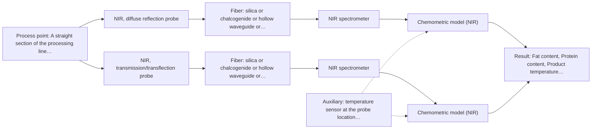
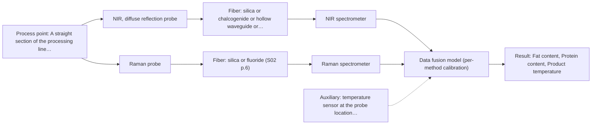

# First technical assessment: Fat and protein monitoring in opaque dairy product

## Answer

**Customer request (our summary):** The customer wants an initial spectroscopy concept and a comparison experiment for in-line fat and protein analysis in a flowing, opaque milk product with varying temperature and texture.

### Brief answer

Test NIR diffuse reflection first: it is the documented inline approach for opaque, concentrated dairy products, with fat and protein quantified by PLS against your laboratory checks. In the same trial, compare a transflection probe, which in some cases handles both low-fat and high-fat dairy streams. Open points: your temperature range, installation point, required accuracy, and the nature of the texture variation.

### Proposal

- **Best current option:** O2 (recommended)
- **Basis:** supplied AFS sources
- **What would change it:** If the transflection signal saturates on this product, the choice falls back to reflection alone (O1); if NIR reflection cannot meet the customer's accuracy targets on held-out runs, the Raman comparison (O3) becomes relevant.
- **Next step:** Run the multi-technique trial on representative production samples with the customer's laboratory fat and protein analysis as reference, after confirming the installation point and temperature range.

**Secondary evidence (external, not AFS material):** G1: no usable external source found; G2: E02 ¶31; G3: no usable external source found; G4: no usable external source found. See Expert detail.

**Decision status:** Provisional feasibility assessment

### Solution options

| ID | Tier | Methods | Confidence | Cost class, S01 Table 1 (p.6) | Ease of use | Maintenance | Performance fit | Sources |
|---|---|---|---|---|---|---|---|---|
| O1 | Simple | M1 NIR, diffuse reflection probe | Low: open question: Q1 (starts at Medium); precedent only; uncited auxiliary sensor | average cost (row 8) | Flush-mounted probe, straightforward operation | Window cleaning and periodic recalibration | Directly targets fat and protein in opaque dairy | [1: S01 p.17] [2: S01 p.17] |
| O2 | Recommended | M1 NIR, diffuse reflection probe; M2 NIR, transmission/transflection probe | Low: open question: Q1 (starts at Medium); suitability for this sample not confirmed; uncited auxiliary sensor | average cost (rows 7, 8) | Two probe geometries in one trial | Standard probe cleaning and recalibration | Fits varying texture by testing both geometries | [3: S01 p.18] [1: S01 p.17] [2: S01 p.17] [4: S01 p.18] |
| O3 | Extended (multi-method) | M1 NIR, diffuse reflection probe; M3 Raman probe + NIR (combination) | Low: open question: Q1 (starts at Medium); uncited auxiliary sensor; multi-method, fusion benefit not yet shown | high cost (rows 8, 12) | Two instruments and two probes to run | Separate calibration and diagnostics per method | Only if NIR alone misses the accuracy target | [5: S01 p.15] [6: S01 p.8] [1: S01 p.17] [2: S01 p.17] [7: S01 p.16] |

*Confidence rates the basis of the advice (how much is known and cited), not a predicted accuracy or probability of success. It starts at High, or at Medium when a key question on the method or the option is open, and drops one level per weakness listed (floor Low).*

*Cost class is the relative rating in S01 Table 1 (p.6) for the in-line method+technique rows named (the highest one for a multi-method option); it is not a price.*

### Setup sketch

*Recommended option O2; drawn by code from the option, a schematic, not a configuration.*

### Key questions

1. What is the operating temperature range of the product at the candidate measuring point, and does temperature vary within a run?
2. Where on the line could a probe be mounted (pipe diameter, flow velocity, access, hygiene requirements)?
3. What accuracy, precision and response time do you need for fat and protein, and what is your laboratory reference method?

## Expert detail

**Customer enquiry**

> We produce an opaque, concentrated milk product that flows through a processing line. We currently sample it for fat and protein analysis and would like earlier information about composition changes. Product temperature and texture vary during production. We want an initial spectroscopy concept and a practical comparison experiment, while retaining our laboratory checks.

**Decision status:** Provisional feasibility assessment. A method shortlist can be justified from the dairy precedents in the supplied material, but the installation point, temperature range and required accuracy are unknown, so the assessment stays provisional.

### Parameters

| ID | Parameter | Kind | Need | Measured by | Why | Sources |
|---|---|---|---|---|---|---|
| P1 | Fat content | quantitative | required | Reference lab method: customer laboratory fat analysis (e.g. existing reference method) | Fat is a stated target and the calibration response variable. | *(no verified source: engineering judgement)* |
| P2 | Protein content | quantitative | required | Reference lab method: customer laboratory protein analysis (e.g. existing reference method) | Protein is a stated target and the second calibration response variable. | *(no verified source: engineering judgement)* |
| P3 | Product temperature | quantitative | required | Auxiliary sensor: temperature sensor at the probe location (engineering judgement: confirm availability with AFS) | Temperature varies during production and shifts the spectra, so it must be recorded to be represented in the calibration. | *(no verified source: engineering judgement)* |
| P4 | Texture / physical state (e.g. viscosity, globule size) | qualitative | optional | Not measurable in-line by spectroscopy; alternative: process records and laboratory texture/viscosity measurements | Texture variation affects reflection spectra and should be characterised so its effect can be separated from composition change; it should be available from process knowledge. | *(no verified source: engineering judgement)* |

### Solution option details

- **O1 cost drivers:** One NIR spectrometer, reflection probe, fiber cable, calibration samples and lab reference analyses
- **O2 cost drivers:** Additional transflection probe and trial samples; same NIR spectrometer
- **O3 cost drivers:** Second spectrometer, Raman probe and laser, fused model development, more reference analyses
- **O3 combining methods:** Fusion level: start with one PLS model per method, then test low-level fusion of the synchronized spectra into one matrix. Both probes must sample the same product volume at the same time step, with data normalized to a common time base. Each method keeps its own calibration, and the fused model must beat the best single method on held-out batches or the extra instrument is dropped.

*Extended (multi-method) option O3; drawn by code from the option, a schematic, not a configuration.*

### Premise check

- **Precedent only:** In-line spectroscopy can give earlier fat and protein information on an opaque, concentrated dairy product. The sources show inline NIR reflection used for opaque dairy products such as yogurt, butter and whole milk concentrates; this is a reason to test, not proof for this customer's product. [1: S01 p.17]
- **Precedent only:** Fat and protein are measurable by NIR in dairy matrices. The sources describe PLS quantification of fat and protein from inline NIR reflection spectra in dairy; transfer to this concentrated product requires a calibration on the customer's own material. [8: S01 p.17]

### Requirements

**Stated by the customer**

- Earlier information about fat and protein composition changes than current sampling
- An initial spectroscopy concept
- A practical comparison experiment
- Retention of existing laboratory checks

**Key unknowns**

- Operating temperature range of the product at the possible measuring point
- Pipe dimensions and the physical installation point on the line
- Required accuracy, precision and response time for fat and protein
- Details of the laboratory reference method used for fat and protein
- Nature of the texture variation (e.g. homogenization state, viscosity, particle/globule size)

### Clarification questions (most decision-relevant first)

Q1. What is the operating temperature range of the product at the candidate measuring point, and does temperature vary within a run? *Why it matters:* Temperature shifts change NIR spectra and must be represented in the calibration, so the range decides how the trial samples are collected. *(affects: method)*
Q2. Where on the line could a probe be mounted (pipe diameter, flow velocity, access, hygiene requirements)? *Why it matters:* The installation point determines the probe form (flush-mounted reflection window vs immersion) and whether the sampling spot is representative. *(affects: installation)*
Q3. What accuracy, precision and response time do you need for fat and protein, and what is your laboratory reference method? *Why it matters:* These set the go/no-go criteria for the trial and how the inline spectra are calibrated against the lab checks. *(affects: status)*
Q4. What causes the texture variation (e.g. fat globule size, homogenization, viscosity)? *Why it matters:* NIR reflection signals are sensitive to surface characteristics and particle size, so texture variation can mimic composition change and must be covered in the calibration. *(affects: M1, M2)*

### Recommendation

- **M1 · Primary candidate: NIR, diffuse reflection probe.** Inline NIR reflection is the documented approach for opaque, concentrated dairy products, with PLS quantification of fat and protein. It suits a flowing line via a flush-mounted fiber probe. *Conditions:* Calibration must cover the customer's temperature and texture variation, since reflection signals are sensitive to surface characteristics and particle size. [1: S01 p.17] [2: S01 p.17]
- **M2 · Comparison candidate: NIR, transmission/transflection probe.** Transmission fails for thick, opaque or fat-rich samples, but a transflection probe is reported in some cases to work for both low-fat and high-fat milk products, so it is worth testing against reflection on the real product. *Conditions:* Only if the transflection signal is not saturated on this concentrated product; the optical pathlength must be controlled. [4: S01 p.18] [3: S01 p.18]
- **M3 · Conditional candidate: Raman probe + NIR (combination).** Raman tolerates water and gives molecular specificity that NIR might miss, and NIR+Raman fusion is a published hypothesis for higher accuracy than single-method models. It is only worth adding if the NIR reflection calibration does not meet the required accuracy. *Conditions:* Only if single-method NIR does not meet the accuracy target; fluorescence background on the real product must be checked first. [7: S01 p.16] [5: S01 p.15] Later hypothesis, after single-method tests.

### Measurement concept

- **Probe and geometry:** NIR diffuse-reflection fiber probe, flush-mounted in the pipe so the backscattered light interacts with the flowing product; a transflection probe is tested in parallel as the comparison geometry.
- **Location:** A straight section of the processing line with representative flow, to be selected with the customer (Q2).
- **Fiber link:** Vis-NIR silica fiber cable from the probe to the spectrometer; the usable NIR range depends on the instrument, fiber and probe actually selected. [9: S01 p.17] [10: S01 p.10]

### Spectral range

- **NIR:** Nominal NIR range 780-2500 nm; the usable range depends on the instrument, fiber and probe actually selected. [10: S01 p.10]
- **Raman:** Raman is reported as Raman shift in cm-1 with the laser excitation wavelength stated separately; the excitation wavelength for this application is not yet selected. [11: S01 p.11]

### Risks and uncertainty

- Texture and temperature variation can mimic composition change in reflection spectra, so a calibration that ignores them will look good in the lab and fail in production. *(rules: R-GEO-6, R-CAL-1)* [2: S01 p.17]
- The transflection comparison may saturate on this concentrated product, as transmission fails when the sample is too thick or fat-rich. *(rules: R-GEO-2)* [4: S01 p.18]
- The dairy precedents are published examples, not proof that the method reaches the customer's required accuracy on this specific product. *(rules: R-EVI-2)* *(no verified source: engineering judgement)*
- Fouling of the optical window by fat-rich deposits could drift the reflection signal and must be checked during the trial. *(rules: R-MIR-3)* *(no verified source: engineering judgement)*

### First feasibility experiment

1. **Collect representative samples across the expected variation in fat, protein, temperature and texture during normal production runs.** Cover the calibration space the inline model must handle. *(no verified source: engineering judgement)*
2. **Measure each sample with the NIR reflection probe and, in parallel, the transflection probe under matched conditions.** Compare the two geometries on the real product. *(no verified source: engineering judgement)*
3. **Run the customer's laboratory reference method for fat and protein on every sample, recording sample temperature.** Provide independent reference values for calibration and validation. *(no verified source: engineering judgement)*
4. **Build PLS calibration models per technique with scatter correction as needed, and validate on held-out runs or batches not used in calibration.** Quantify prediction accuracy per technique and check robustness to temperature and texture. *(no verified source: engineering judgement)*
5. **Go/no-go: the customer defines the required accuracy and precision for fat and protein; a technique passes only if held-out validation meets those numbers, and only then is an in-line installation designed.** Give an objective basis for proceeding to installation. *(no verified source: engineering judgement)*

**Reference measurements:** Customer's existing laboratory fat and protein analysis on every trial sample.

**Decision basis:** Customer-defined accuracy and precision targets on held-out production samples.

### Assumptions

- The product is a liquid dairy-type matrix, as implied by 'milk product' and 'flows through a processing line'.
- The existing laboratory checks can serve as the reference method for calibration and validation.

### Not covered by the supplied sources

- Achievable accuracy, precision or response time for fat and protein in this specific concentrated product
- Suitable installation point and probe form for the customer's line

### Further notes

- **Chemometrics:** Fat and protein quantification will need PLS calibration models per technique, with scatter correction (e.g. MSC or SNV) as appropriate; models must be validated on held-out runs and re-checked whenever the product matrix or texture changes.
- **Real-time tracking:** Once calibrated, the inline probe can track fat and protein continuously during production, giving earlier warning of composition changes than periodic sampling; the laboratory checks remain as reference and validation.
- **Future direction:** If the trial succeeds, a later step could be a compact customized sensor or multiplexed analyzer for several measuring points on the line.

### Secondary evidence (external, not AFS material)

*Found by a literature search for gaps the supplied AFS sources leave open. Not AFS material and not proof for this case; every quote below was verified verbatim against the fetched text.*

*Live search unavailable (library only: cache miss (europepmc); cache miss (openalex)); curated library only.*

**G1 · auxiliary sensor:** In-line measurement of Product temperature with temperature sensor at the probe location

- No usable external source found.

**G2 · multi-method:** Combining several spectroscopy methods (data fusion) (Fusion level: start with one PLS model per method, then test low-level fusion of the synchronized spectra into one matrix. Both probes must sample the same product volume at the same time step, with data normalized to a common time base. Each method keeps its own calibration, and the fused model must beat the best single method on held-out batches or the extra instrument is dropped.)

- **E02 ¶31** Low-level data fusion rearranges input data into a new matrix by placing variables from different sources one after the other. *How it applies:* This describes the mechanism for testing low-level fusion of synchronized spectra as outlined in the option, and one should evaluate each dataset's contribution beforehand. *Limits and transfer risks:* The literature review discusses general process analytical technology applications, so food matrices and specific dairy components may behave differently. *(supports O3)*
  > "Low-level data fusion (LLDF) is considered the simplest method to achieve a combination of inputs. In this case, the data is rearranged into a new data matrix, where the variables coming from different sources are placed one after the other."
  > Challenges and Opportunities of Implementing Data Fusion in Process Analytical Technology-A Review. (2022) · Molecules (Basel, Switzerland) · doi:10.3390/molecules27154846 · https://europepmc.org/article/PMC/PMC9369811 · retrieved 2026-10-17, full text, licence: cc by, via curated library

**G3 · not in the supplied sources:** Achievable accuracy, precision or response time for fat and protein in this specific concentrated product

- No usable external source found.

**G4 · not in the supplied sources:** Suitable installation point and probe form for the customer's line

- No usable external source found.

### Evidence (verified quotes)

1. ✓ **S01 p.17** (application precedent): "Inline NIR Reflection is primarily used for opaque or highly concentrated dairy products, such as yogurt, butter, or whole milk concentrates."
2. ✓ **S01 p.17** (general): "the method is sensitive to the surface characteristics and fat globule size."
3. ✓ **S01 p.18** (application precedent): "In some cases, a Transflection probe can already be a combined solution working well for low-fat and high-fat containing milk products."
4. ✓ **S01 p.18** (general): "it fails when the milk becomes too "thick" or fat-rich, as the light cannot penetrate the sample."
5. ✓ (precedent only) **S01 p.15** (method gain): "By combining Raman and NIR, these models can predict API potency or coating thickness with higher accuracy and robustness than single-method models."
6. ✓ **S01 p.8** (general): "Ultimately, the measurement data must be normalized to a common time step."
7. ✓ **S01 p.16** (general): "Raman is particularly well-suited for aqueous environments, as it exhibits low absorbance for water molecules compared to infrared methods."
8. ✓ **S01 p.17** (application precedent): "before using Partial Least Squares (PLS) regression to quantify fat and protein."
9. ✓ **S01 p.17** (application precedent): "the probe is flush-mounted into a pipe or vat to interact directly with the flowing medium."
10. ✓ **S01 p.10** (general): "NIR spectra (780-2500 nm) contain predominantly overtones and component bands of fundamental vibrations"
11. ✓ **S01 p.11** (general): "The Raman shift is used as the horizontal (spectral) axis in Raman spectroscopy"

### Verification

- Citations verified: 18 of 18 (exact or whitespace/hyphen-tolerant match on the cited page, scope checked).
- Hard check failures before deterministic corrections: 0; still open: 0; soft warnings: 2; repair rounds: 1.
- External evidence (cache): 1 quote(s) verified verbatim (exact or whitespace/hyphen-tolerant, at most 400 characters and 2 sentences, against the cited paragraph); 0 item(s) dropped.
- External search: 5 query(ies), 0 hit(s), 3 source(s) (3 from the curated library); ⚠ library only: cache miss (europepmc); cache miss (openalex).
- External step: 2 model call(s), 2.4 s extra (cost in the run JSON).

*Run D02-20261018T080635Z-c8c7 · models google/gemini-3.5-flash-lite, google/gemini-3.8-flash, z-ai/glm-5.3-flash*
