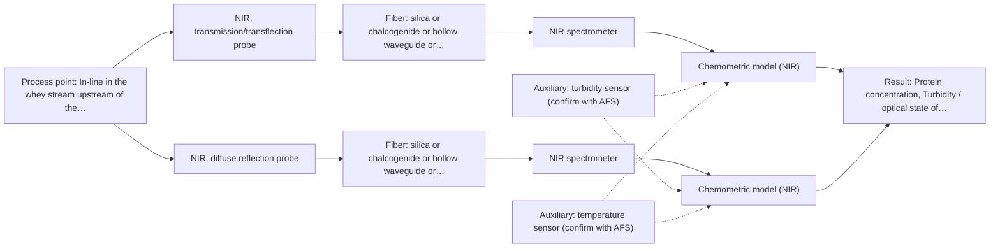

# First technical assessment: A clear whey stream before concentration

## Answer

**Customer request (our summary):** The customer wants a measurement concept to track protein concentration in a dairy whey stream that transitions from clear to turbid, using laboratory results as a reference.

### Brief answer

Test NIR first: a transflection probe on the clear whey, with an NIR reflection channel evaluated in parallel for the turbid state, since both dairy-precedented techniques can share one NIR spectrometer. UV-Vis transmission is not recommended because it saturates when the stream turns turbid. Open points: the protein range and accuracy needed, what causes the turbidity, and the installation conditions decide the final configuration.

### Proposal

- **Best current option:** O2 (recommended)
- **Basis:** supplied AFS sources
- **What would change it:** If the turbidity episodes are rare or mild, O1 alone may suffice; if transflection fails across the turbid state or protein selectivity is poor, the Raman conditional (M3) enters the comparison.
- **Next step:** Run the feasibility trial on representative clear and turbid whey samples with laboratory protein references, testing transflection and reflection with the same NIR spectrometer.

**Secondary evidence (external, not AFS material):** G1: no usable external source found; G2: E02 ¶12; G3: no usable external source found; G4: no usable external source found. See Expert detail.

**Decision status:** Provisional feasibility assessment

### Solution options

| ID | Tier | Methods | Confidence | Cost class, S01 Table 1 (p.6) | Ease of use | Maintenance | Performance fit | Sources |
|---|---|---|---|---|---|---|---|---|
| O1 | Simple | M1 NIR, transmission/transflection probe | Low: open question: Q1, Q2, Q3 (starts at Medium); sample clarity unknown; uncited auxiliary sensor | average cost (row 7) | Single probe, straightforward installation | Low; one optical window to clean | Fits the clear stream but may saturate when turbid | [1: S01 p.18] [2: S01 p.18] [3: S01 p.10] |
| O2 | Recommended | M1 NIR, transmission/transflection probe; M2 NIR, diffuse reflection probe | Low: open question: Q1, Q2, Q3 (starts at Medium); sample clarity unknown; uncited auxiliary sensor | average cost (rows 7, 8) | Two probes, one spectrometer | Moderate; two optical windows and one calibration per technique | Covers both clear and turbid states with one method family | [4: S01 p.18] [1: S01 p.18] [2: S01 p.18] [3: S01 p.10] [5: S01 p.17] [6: S01 p.17] |

*Confidence rates the basis of the advice (how much is known and cited), not a predicted accuracy or probability of success. It starts at High, or at Medium when a key question on the method or the option is open, and drops one level per weakness listed (floor Low).*

*Cost class is the relative rating in S01 Table 1 (p.6) for the in-line method+technique rows named (the highest one for a multi-method option); it is not a price.*

### Setup sketch

*Recommended option O2; drawn by code from the option, a schematic, not a configuration.*

### Key questions

1. What is the protein concentration range to track, and what accuracy or tracking precision does the process need?
2. What causes the turbidity increase (fat, casein fines, precipitate) and how far does the optical state change?
3. At what temperature and installation point would the probe sit, and are there space or cleaning constraints?

## Expert detail

**Customer enquiry**

> Our dairy process includes a relatively clear whey stream before a concentration stage. We want to investigate whether spectroscopy can track protein concentration as the stream changes, with laboratory results used as the reference. The stream can become more turbid under some operating conditions. We need a first measurement concept that handles this change rather than assuming the liquid always remains clear.

**Decision status:** Provisional feasibility assessment. A dairy-precedented NIR concept can be shortlisted, but the turbidity behaviour and protein range are not yet characterised, so the technique split remains conditional.

### Parameters

| ID | Parameter | Kind | Need | Measured by | Why | Sources |
|---|---|---|---|---|---|---|
| P1 | Protein concentration | quantitative | required | Reference lab method: laboratory protein analysis (customer's lab method) | It is the target variable the in-line model must predict. | *(no verified source: engineering judgement)* |
| P2 | Turbidity / optical state of the stream | quantitative | required | Auxiliary sensor: turbidity sensor (engineering judgement: confirm availability with AFS) | The clear-to-turbid transition drives the technique choice and must be spanned by the calibration samples. | *(no verified source: engineering judgement)* |
| P3 | Process temperature | quantitative | optional | Auxiliary sensor: temperature sensor (engineering judgement: confirm availability with AFS) | Temperature affects NIR spectra and should be recorded so its effect can be modelled or controlled; it should be available from the process. | *(no verified source: engineering judgement)* |

### Solution option details

- **O1 cost drivers:** One transflection probe, one NIR spectrometer, calibration samples and lab reference analyses
- **O2 cost drivers:** Second probe head, extended calibration across both optical states, lab reference analyses

### Premise check

- **Precedent only:** A single probe geometry can handle both the clear and the turbid states of the whey stream. In the dairy example a transflection probe is reported to work for both low-fat and high-fat products in some cases; this is a precedent to test, not proof for this stream. [1: S01 p.18]
- **Precedent only:** NIR spectroscopy can track protein in dairy streams in-line. Published dairy examples quantify fat and protein with NIR reflection and transmission plus PLS; this motivates a test on the customer's whey, it does not prove performance there. [7: S01 p.17]

### Requirements

**Stated by the customer**

- Track protein concentration in a relatively clear whey stream before a concentration stage.
- Handle a transition to a more turbid stream under some operating conditions.
- Use laboratory results as the reference.

**Key unknowns**

- Protein concentration range and required accuracy
- Cause and degree of the turbidity change (fat, fines, precipitate) and how often it occurs
- Process temperature and installation point constraints
- Laboratory reference method and its turnaround
- Whether a transflection pathlength can serve both optical states

### Clarification questions (most decision-relevant first)

Q1. What is the protein concentration range to track, and what accuracy or tracking precision does the process need? *Why it matters:* It sets the calibration effort and whether NIR sensitivity is sufficient for the lowest levels. *(affects: method, M1)*
Q2. What causes the turbidity increase (fat, casein fines, precipitate) and how far does the optical state change? *Why it matters:* It decides whether one transflection probe suffices or a reflection channel is needed for the turbid state. *(affects: M1, M2, O2)*
Q3. At what temperature and installation point would the probe sit, and are there space or cleaning constraints? *Why it matters:* Temperature and fouling risk affect probe choice, pathlength and calibration design. *(affects: installation, M1)*
Q4. Which laboratory method measures the reference protein, and how quickly are results available? *Why it matters:* The reference defines the calibration targets and the validation design. *(affects: status)*
Q5. Is the stream truly aqueous whey (low fat) at the measurement point, or can fat content vary widely? *Why it matters:* Fat-rich samples push the choice from transmission toward reflection or transflection. *(affects: technique, M1, M2)*

### Recommendation

- **M1 · Primary candidate: NIR, transmission/transflection probe.** NIR is the standard fiber-optic online method for dairy liquids, and transflection is reported in the dairy example to serve both low-fat and high-fat products in some cases. Pathlength must be controlled because too wide a gap loses signal to water absorption. *Conditions:* Tested across the full clear-to-turbid range seen in operation; if the turbid state saturates the signal, add the reflection route (M2). [1: S01 p.18] [2: S01 p.18] [3: S01 p.10]
- **M2 · Comparison candidate: NIR, diffuse reflection probe.** NIR reflection is the dairy-precedented geometry for opaque or highly concentrated products, so it is the natural fallback for the turbid state. Its signals are sensitive to surface and particle characteristics, so scatter correction and a matrix-specific calibration are needed. *Conditions:* Tested on turbid samples from the same process states used for M1, using the same NIR spectrometer and light source. [5: S01 p.17] [6: S01 p.17] [4: S01 p.18]
- **M3 · Conditional candidate: Raman probe.** Raman tolerates water far better than infrared absorption and gives molecular specificity, so it is a candidate if NIR cannot separate protein from the changing background. Its weak signals and possible fluorescence background must be checked on real whey. *Conditions:* Only if the NIR trials (M1, M2) fail to track protein across the turbidity change. [8: S01 p.16] [9: S01 p.11]
- **M4 · Not recommended: UV-Vis, transmission/transflection probe.** A transmission signal saturates once the liquid becomes turbid or optically dense, which is exactly the condition the concept must handle. UV-Vis mixture signals also overlap strongly, giving low selectivity for protein in a real whey matrix. [10: S01 p.16] [11: S01 p.5]

### Measurement concept

- **Probe and geometry:** Immersion NIR transflection probe at the whey line before the concentration stage, with an NIR reflection probe (or a reflection-capable configuration) evaluated in parallel for the turbid state.
- **Location:** In-line in the whey stream upstream of the concentration stage.
- **Fiber link:** Vis-NIR silica fibers; the usable spectral range depends on the selected spectrometer, fiber and probe, and the nominal NIR range is 780-2500 nm. [12: S01 p.10] [13: S02 p.6]

### Spectral range

- **NIR:** Nominal NIR range 780-2500 nm; the usable range depends on the spectrometer, Vis-NIR silica fiber and probe actually selected. [12: S01 p.10]

### Risks and uncertainty

- Scatter from the turbidity change can mimic or mask composition change in reflection signals, so physical and chemical variation must be separated in the calibration. *(rules: R-GEO-6)* [6: S01 p.17]
- A transflection pathlength that suits the clear stream may lose signal to absorption in the turbid state, so the single-probe premise may fail. *(rules: R-GEN-4)* [14: S01 p.18]
- The calibration is specific to the whey matrix and must be re-validated if the process mix or the concentration stage upstream changes. *(rules: R-CAL-1)* [15: REF §5]
- If protein selectivity in NIR proves insufficient against the changing background, the whole shortlist shifts toward Raman, which carries its own fluorescence-background risk. *(rules: R-RAM-1)* [16: S01 p.11]

### First feasibility experiment

1. **Collect representative whey samples spanning the full clear-to-turbid range and the expected protein variation, including samples from the operating conditions that cause turbidity.** Cover the chemical and physical variation the in-line model must handle. *(no verified source: engineering judgement)*
2. **Measure each sample with the laboratory reference protein method under a defined protocol.** Provide independent reference values for calibration and validation. *(no verified source: engineering judgement)*
3. **Record NIR transflection spectra (M1) on all samples first, then NIR reflection spectra (M2) on the same samples with the same spectrometer and light source.** Compare the single-method candidates on identical samples before any combined use. *(no verified source: engineering judgement)*
4. **Build PLS calibration models per technique with scatter-appropriate preprocessing, and validate on held-out samples or a separate production run not used in calibration.** Estimate real prediction error rather than calibration fit. *(no verified source: engineering judgement)*
5. **Apply the customer-defined go/no-go criteria (e.g. required accuracy across both optical states) to decide whether one technique suffices or the reflection route must be retained.** Give an objective basis for the final technique choice. *(no verified source: engineering judgement)*

**Reference measurements:** Laboratory protein results on every calibration and validation sample, as the customer stated.

**Decision basis:** Customer-defined accuracy across both the clear and turbid states; not met by either technique alone means re-testing with the other technique or reconsidering M3.

### Assumptions

- The stream is aqueous and the turbidity change is physical (particles or fat) rather than a strong absorber.
- Laboratory protein analysis is available for all calibration samples.

### Not covered by the supplied sources

- Whey-specific protein calibration performance figures (no source gives accuracy or detection limits for protein in whey).

### Further notes

- **Chemometrics:** A PLS regression per technique is the starting point; scatter-sensitive preprocessing (e.g. MSC or SNV) should be tested against the turbidity variation, and the model must be validated on held-out runs spanning both optical states.
- **Real-time tracking:** The goal is continuous in-line tracking of protein as the stream changes; acquisition conditions should allow spectra fast enough to follow the concentration dynamics before the concentration stage.
- **Future direction:** If NIR alone cannot separate protein from the turbidity-driven background, a Raman channel (M3) on the same sampling point is the next extension to test.

### Secondary evidence (external, not AFS material)

*Found by a literature search for gaps the supplied AFS sources leave open. Not AFS material and not proof for this case; every quote below was verified verbatim against the fetched text.*

*Live search unavailable (library only: cache miss (europepmc); cache miss (openalex)); curated library only.*

**G1 · auxiliary sensor:** In-line measurement of Turbidity / optical state of the stream with turbidity sensor

- No usable external source found.

**G2 · auxiliary sensor:** In-line measurement of Process temperature with temperature sensor

- **E02 ¶12** The source notes that the temperature sensitivity of OH bands presents a severe drawback for measuring aqueous solutions in the near-infrared and mid-infrared regions, requiring tempered sample holders. *How it applies:* This indicates that temperature compensation or controlled sample temperature should be tested to account for potential spectral variations caused by temperature fluctuations in aqueous streams. *Limits and transfer risks:* The finding pertains to aqueous solutions in general rather than a dairy whey stream specifically, and the reference to tempered sample holders may not directly translate to an in-line industrial setup. *(supports O2)*
  > "Additionally, the temperature sensitivity of the OH bands is a severe drawback for measuring aqueous solution in NIR and MIR, which makes tempered sample holders necessary [29]."
  > A critical review of recent trends, and a future perspective of optical spectroscopy as PAT in biopharmaceutical downstream processing. (2020) · Analytical and bioanalytical chemistry · doi:10.1007/s00216-020-02407-z · https://europepmc.org/article/PMC/PMC7072065 · retrieved 2026-10-17, full text, licence: cc by, via curated library

**G3 · not in the supplied sources:** Whey-specific protein calibration performance figures (no source gives accuracy or detection limits for protein in whey).

- No usable external source found.

**G4 · parameter without a source:** Measuring Protein concentration: It is the target variable the in-line model must predict.

- No usable external source found.

### Evidence (verified quotes)

1. ✓ **S01 p.18** (application precedent): "In some cases, a Transflection probe can already be a combined solution working well for low-fat and high-fat containing milk products."
2. ✓ **S01 p.18** (general): "the precise control of the optical pathlength (usually 1 - 10 mm); if the pathlength is too wide, the signal is lost to absorption; if too narrow, the sample represents a negligible volume."
3. ✓ **S01 p.10** (general): "Near-IR vibrational spectroscopy (NIR) is the most common online analysis method performed using fiber optic probes."
4. ✓ **S01 p.18** (general): "NIR Spectrometer and NIR light source remain the same for both reflection and transmission techniques."
5. ✓ **S01 p.17** (application precedent): "NIR Reflection is primarily used for opaque or highly concentrated dairy products, such as yogurt, butter, or whole milk concentrates."
6. ✓ **S01 p.17** (general): "the method is sensitive to the surface characteristics and fat globule size."
7. ✓ **S01 p.17** (application precedent): "before using Partial Least Squares (PLS) regression to quantify fat and protein."
8. ✓ **S01 p.16** (general): "Raman is particularly well-suited for aqueous environments, as it exhibits low absorbance for water molecules compared to infrared methods."
9. ✓ **S01 p.11** (general): "superposition of luminescence (fluorescence), which has a significantly higher intensity."
10. ✓ **S01 p.16** (general): "transmission setup becomes saturated because the light cannot penetrate the bulk of the sample."
11. ✓ **S01 p.5** (general): "the strong overlap of spectral signals in UV spectra complicates the analysis of real samples"
12. ✓ **S01 p.10** (general): "NIR spectra (780-2500 nm) contain predominantly overtones and component bands of fundamental vibrations"
13. ✓ **S02 p.6** (general): "350 nm Standard VIS-NIR Silica Fibers Al/Cu-coated VIS-NIR Silica Fibers 2400 nm"
14. ✓ **S01 p.18** (general): "if the pathlength is too wide, the signal is lost to absorption; if too narrow, the sample represents a negligible volume."
15. ✓ **REF §5** (general): "physical variation; calibration specific to the matrix."
16. ✓ **S01 p.11** (general): "signals, which are several orders of magnitude weaker than IR absorption peaks"

### Verification

- Citations verified: 20 of 20 (exact or whitespace/hyphen-tolerant match on the cited page, scope checked).
- Hard check failures before deterministic corrections: 0; still open: 0; soft warnings: 3; repair rounds: 0.
- Corrected deterministically after verification (1):
  - ⚠ clarification_questions[3].affects: affects normalised to ['status']; dropped ['P1'] (not method, technique, installation, status, an M id or an O id)
- Removed 1 intake item(s) not quoted verbatim from the enquiry:
  - intake.sample.optical_regime: slot value without a verbatim enquiry quote; reset to unknown
- External evidence (cache): 1 quote(s) verified verbatim (exact or whitespace/hyphen-tolerant, at most 400 characters and 2 sentences, against the cited paragraph); 0 item(s) dropped.
- External search: 4 query(ies), 0 hit(s), 3 source(s) (3 from the curated library); ⚠ library only: cache miss (europepmc); cache miss (openalex).
- External step: 2 model call(s), 2.5 s extra (cost in the run JSON).

*Run D03-20261018T080635Z-73ba · models google/gemini-3.5-flash-lite, z-ai/glm-5.3-flash*
