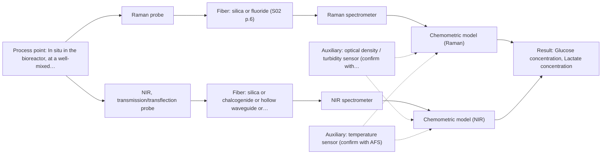
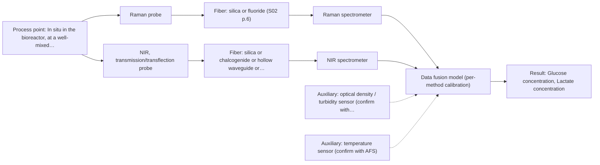

# First technical assessment: Glucose and lactate trends in an aqueous bioprocess

## Answer

**Customer request (our summary):** The customer wants to explore an in situ spectroscopy pilot to monitor glucose and lactate in a cell culture process and avoid laboratory measurement delays.

### Brief answer

Test Raman first: it tolerates water and is shown detecting glucose and lactate directly in bioreactors. Run NIR transmission/transflection alongside as a comparison if the broth stays clear enough. Both need chemometric calibration against your laboratory measurements, validated on held-out runs. Open: concentration ranges, required accuracy, broth turbidity and installation constraints decide the final probe and whether a Raman+NIR fusion is worth testing.

### Proposal

- **Best current option:** O2 (recommended)
- **Basis:** supplied AFS sources
- **What would change it:** If Q1/Q3 show the broth is highly turbid throughout, the NIR transmission branch of O2 would be replaced by a reflection or ATR geometry; if Raman alone meets the Q2 accuracy target, O1 suffices and no fusion is needed.
- **Next step:** Run the multi-method lab trial on representative broth samples with paired laboratory glucose and lactate references, per the feasibility plan.

**Secondary evidence (external, not AFS material):** G1: no usable external source found; G2: E01 ¶12; G3: E02 ¶31; G4: no usable external source found. See Expert detail.

**Decision status:** Provisional feasibility assessment

### Solution options

| ID | Tier | Methods | Confidence | Cost class, S01 Table 1 (p.6) | Ease of use | Maintenance | Performance fit | Sources |
|---|---|---|---|---|---|---|---|---|
| O1 | Simple | M1 Raman probe | Medium: open question: Q1 (starts at Medium) | high cost (row 12) | Single probe and spectrometer, straightforward setup | Low; one probe window to keep clean | Directly targets glucose and lactate in water | [1: S01 p.16] [2: S01 p.16] [3: S01 p.11] |
| O2 | Recommended | M1 Raman probe; M2 NIR, transmission/transflection probe | Low: open question: Q1, Q2, Q3 (starts at Medium); sample clarity unknown | high cost (rows 7, 12) | Two probes tested side by side in the pilot | Moderate; two optical windows and two instruments | Tests both candidate methods so the pilot picks the best fit | [4: S01 p.3] [1: S01 p.16] [2: S01 p.16] [3: S01 p.11] [5: S01 p.16] [6: S01 p.18] [7: S01 p.10] |
| O3 | Extended (multi-method) | M3 Raman probe + NIR (combination) | Low: open question: Q1 (starts at Medium); sample clarity unknown; multi-method, fusion benefit not yet shown | high cost (rows 7, 12) | Two instruments and probes running simultaneously | Higher; each block needs its own calibration and diagnostics | Fusion may add accuracy if single methods fall short | [8: S01 p.15] [9: S01 p.8] [10: S01 p.7] [11: S01 p.8] |

*Confidence rates the basis of the advice (how much is known and cited), not a predicted accuracy or probability of success. It starts at High, or at Medium when a key question on the method or the option is open, and drops one level per weakness listed (floor Low).*

*Cost class is the relative rating in S01 Table 1 (p.6) for the in-line method+technique rows named (the highest one for a multi-method option); it is not a price.*

### Setup sketch

*Recommended option O2; drawn by code from the option, a schematic, not a configuration.*

### Key questions

1. What are the expected glucose and lactate concentration ranges (start, peak, end) during a run?
2. What accuracy and update interval does the pilot need compared with the laboratory measurements?
3. How turbid is the broth during the run (typical cell density or optical density range)?

## Expert detail

**Customer enquiry**

> We run a cell culture process in an aqueous medium. Glucose and lactate are measured from samples, and the delay makes it difficult to see changes promptly. We are exploring an in situ spectroscopy pilot that can be checked against those existing laboratory measurements. The medium and cell population change during the run; we have not yet selected a probe or a calibration strategy.

**Decision status:** Provisional feasibility assessment. A method shortlist can be justified from the sources for aqueous glucose/lactate monitoring, but the optical regime of the broth, the concentration ranges and the required accuracy are unknown, so the assessment is provisional and the first questions decide the final choice.

### Parameters

| ID | Parameter | Kind | Need | Measured by | Why | Sources |
|---|---|---|---|---|---|---|
| P1 | Glucose concentration | quantitative | required | Spectroscopy: Raman | It is a primary target the in-line method must predict and validate against the laboratory measurement. | [2: S01 p.16] |
| P2 | Lactate concentration | quantitative | required | Spectroscopy: Raman | It is the second primary target the in-line method must predict and validate against the laboratory measurement. | [2: S01 p.16] |
| P3 | Cell density / turbidity | quantitative | required | Auxiliary sensor: optical density / turbidity sensor (cited; confirm availability with AFS) | The changing cell population drives scattering and matrix effects, so it must be tracked to build and validate a calibration across the run. | [12: S01 p.16] |
| P4 | Temperature | quantitative | optional | Auxiliary sensor: temperature sensor (engineering judgement: confirm availability with AFS) | Temperature affects spectra and probe behaviour and should be available from the bioreactor to include or correct in the model. | *(no verified source: engineering judgement)* |

### Solution option details

- **O1 cost drivers:** One Raman spectrometer, one immersion probe, calibration samples and reference lab analyses
- **O2 cost drivers:** Raman and NIR spectrometers, two probes, extended calibration set across the run phases
- **O3 cost drivers:** Two spectrometers and probes, synchronisation software, fused-model development and validation
- **O3 combining methods:** Low-level fusion of synchronised Raman and NIR spectra into one augmented matrix, as in the published pharma example. Both probes must sample the same well-mixed spot and the data must be normalised to a common time step, with block scaling so neither method dominates. Each method keeps its own calibration, and the fused model must beat the best single method on independent runs or it is dropped.

*Extended (multi-method) option O3; drawn by code from the option, a schematic, not a configuration.*

### Premise check

- **Precedent only:** Raman spectroscopy can detect glucose and lactate directly in an aqueous cell culture medium. A bioprocess example in the sources describes Raman in the same reactor for metabolites including glucose and lactate; this is a reason to test, not proof for this customer's process. [2: S01 p.16]
- **Precedent only:** NIR spectroscopy can track glucose at the concentrations typical of cell culture. The sources state NIR is effective for major components like glucose in the millimolar range, but sensitivity below about 0.1 percent is limited; whether the customer's ranges fit must be checked. [5: S01 p.16]

### Requirements

**Stated by the customer**

- In situ (in-process) measurement of glucose and lactate in an aqueous cell culture medium
- Results checkable against existing laboratory measurements
- Must cope with medium and cell population changing during the run

**Key unknowns**

- Glucose and lactate concentration ranges over the run
- Required accuracy and update rate for the pilot
- Optical regime of the broth (clear vs. turbid/high cell density)
- Reference laboratory method and its accuracy
- Probe installation constraints (sterilisation, ports, materials)

### Clarification questions (most decision-relevant first)

Q1. What are the expected glucose and lactate concentration ranges (start, peak, end) during a run? *Why it matters:* It decides whether NIR sensitivity in the millimolar range suffices or Raman is needed, and shapes the calibration design. *(affects: method, M2)*
Q2. What accuracy and update interval does the pilot need compared with the laboratory measurements? *Why it matters:* It sets the go/no-go criteria for the feasibility test and whether a single method can meet the target. *(affects: status, O2)*
Q3. How turbid is the broth during the run (typical cell density or optical density range)? *Why it matters:* It decides between transmission/transflection and reflection or ATR geometries, since transmission fails in opaque media. *(affects: technique, M2)*
Q4. Which laboratory method measures glucose and lactate today, and with what accuracy? *Why it matters:* The reference method defines the calibration targets and the validation basis for the spectral models. *(affects: installation, O2)*
Q5. What installation constraints apply at the bioreactor (ports, sterilisation, acceptable probe materials)? *Why it matters:* It determines which probe designs and fiber links are physically possible for the pilot. *(affects: installation)*

### Recommendation

- **M1 · Primary candidate: Raman probe.** Raman tolerates water well and is shown in the sources detecting glucose and lactate directly in a bioreactor, making it the first single method to test. Its weak signal and possible fluorescence background must be checked on real broth. [1: S01 p.16] [2: S01 p.16] [3: S01 p.11]
- **M2 · Conditional candidate: NIR, transmission/transflection probe.** NIR is reported effective for major components like glucose in the millimolar range and is the most common online fiber-probe method, but its fit depends on the broth's optical regime and the concentration ranges. *Conditions:* Applies if the broth stays transparent enough for a controlled path length and glucose/lactate levels are in the millimolar range; otherwise a reflection or ATR geometry would need testing instead. [5: S01 p.16] [6: S01 p.18] [7: S01 p.10]
- **M3 · Comparison candidate: Raman probe + NIR (combination).** If the best single method does not meet the accuracy target across the changing medium, a Raman + NIR fusion is the next hypothesis, since the methods carry complementary information. It must beat the best single method on independent runs to be kept. *Conditions:* Only after the single-method tests, and only if Q2's accuracy target is not met by M1 or M2 alone. [10: S01 p.7] [11: S01 p.8]
- **M4 · Not recommended: fluorescence probe.** Glucose and lactate are not fluorescent species, and most chemicals do not fluoresce, so fluorescence cannot measure these targets directly. It could only serve later as an auxiliary physiological signal. [13: S01 p.5]

### Measurement concept

- **Probe and geometry:** Immersion Raman fiber probe at a representative reactor port for M1; a transmission/transflection NIR probe with a controlled optical path length for M2, geometry to be confirmed against broth turbidity.
- **Location:** In situ in the bioreactor, at a well-mixed location away from addition ports.
- **Fiber link:** Silica fibers suit Raman and NIR; metal-coated low-OH silica avoids polymer-jacket fluorescence for Raman. Exact cable length and spectrometer placement are open installation questions. [14: S02 p.7] [15: S01 p.15]

### Spectral range

- **Raman:** Raman shift in cm-1 with laser excitation stated separately; the usable shift range depends on the selected spectrometer, laser and probe. [16: S01 p.11]
- **NIR:** Nominal NIR range 780-2500 nm; the usable range depends on the spectrometer, fiber and probe actually selected. [17: S01 p.10]

### Risks and uncertainty

- Fluorescence background or reactor-window effects may swamp the weak Raman signal in the real broth, so background must be checked on actual samples. *(rules: R-RAM-1)* [3: S01 p.11]
- The medium and cell population change during the run, so a calibration built on one phase may not hold across the whole process and must be validated on independent runs. *(rules: R-CAL-1, R-GEN-5)* [18: S01 p.7]
- If the broth becomes too turbid, the NIR transmission/transflection option fails and a reflection or ATR geometry would be needed instead. *(rules: R-GEO-2)* [19: S01 p.18]
- Published bioprocess examples are precedents, not proof that the method meets this customer's accuracy on their medium; the pilot must demonstrate it. *(rules: R-EVI-2)* [20: REF §3]

### First feasibility experiment

1. **Collect representative broth samples across the expected variation: early/mid/late phase, different cell densities and medium states.** Cover the chemical and physical variation the calibration must span. *(no verified source: engineering judgement)*
2. **Measure each sample with the Raman probe (M1) and, if the broth is clear enough, the NIR transmission/transflection probe (M2) under controlled conditions.** Test the single methods first before any combination. *(no verified source: engineering judgement)*
3. **Obtain independent laboratory glucose and lactate reference values for every sample, taken close in time to the spectral measurement.** Provide the calibration and validation targets. *(no verified source: engineering judgement)*
4. **Build one chemometric model per method and validate on held-out runs or batches, comparing predicted vs. reference values.** Quantify each single method's accuracy honestly. [21: S01 p.5]
5. **Only if no single method meets the customer's accuracy target, test the Raman + NIR fusion against the best single method on the same held-out runs.** Go/no-go: the fused model must beat the best single method, otherwise drop the extra instrument. *(no verified source: engineering judgement)*

**Reference measurements:** Existing laboratory glucose and lactate measurements, with method and accuracy confirmed (Q4).

**Decision basis:** Customer-defined accuracy and update-interval targets (Q2) applied to held-out validation runs; go if the pilot meets them, no-go or method change otherwise.

### Assumptions

- The broth is a liquid that can be accessed by an immersion probe at a suitable port.
- The existing laboratory measurements can serve as the reference method for calibration and validation.
- Concentrations of glucose and lactate are within ranges detectable by at least one of the shortlisted methods; this is checked by Q1.

### Not covered by the supplied sources

- Achievable in situ accuracy for glucose and lactate in this customer's medium
- Sterilisable probe designs and bioreactor port compatibility

### Further notes

- **Chemometrics:** Quantitative glucose and lactate prediction will need PLS-type calibration models built on the laboratory reference values, validated on held-out runs; the sources note NIR and Raman bands overlap or are weak, making chemometrics a necessary component.
- **Real-time tracking:** The pilot's purpose is time-resolved in-line tracking of glucose and lactate to remove the sampling delay; acquisition rate and synchronisation with reference sampling times should be fixed in the trial design.
- **Future direction:** If the pilot succeeds, a simplified multi-wavelength sensor approach (as shown for other applications in the sources) could later replace full-spectrum instruments for routine control.

### Secondary evidence (external, not AFS material)

*Found by a literature search for gaps the supplied AFS sources leave open. Not AFS material and not proof for this case; every quote below was verified verbatim against the fetched text.*

*Live search unavailable (library only: cache miss (europepmc); cache miss (openalex)); curated library only.*

**G1 · auxiliary sensor:** In-line measurement of Cell density / turbidity with optical density / turbidity sensor

- No usable external source found.

**G2 · auxiliary sensor:** In-line measurement of Temperature with temperature sensor

- **E01 ¶12** The temperature sensitivity of the OH bands presents a severe drawback for measuring aqueous solution in NIR and MIR. *How it applies:* The assessment should consider whether temperature fluctuations in the culture medium could interfere with NIR measurements, potentially requiring strict temperature control or compensation. *Limits and transfer risks:* This finding addresses aqueous solutions in general rather than this specific cell culture matrix or instrument setup. *(supports O2)*
  > "Additionally, the temperature sensitivity of the OH bands is a severe drawback for measuring aqueous solution in NIR and MIR, which makes tempered sample holders necessary [29]."
  > A critical review of recent trends, and a future perspective of optical spectroscopy as PAT in biopharmaceutical downstream processing. (2020) · Analytical and bioanalytical chemistry · doi:10.1007/s00216-020-02407-z · https://europepmc.org/article/PMC/PMC7072065 · retrieved 2026-10-17, full text, licence: cc by, via curated library

**G3 · multi-method:** Combining several spectroscopy methods (data fusion) (Low-level fusion of synchronised Raman and NIR spectra into one augmented matrix, as in the published pharma example. Both probes must sample the same well-mixed spot and the data must be normalised to a common time step, with block scaling so neither method dominates. Each method keeps its own calibration, and the fused model must beat the best single method on independent runs or it is dropped.)

- **E02 ¶31** Low-level data fusion rearranges data into a new matrix where variables from different sources are placed one after the other. *How it applies:* This approach can be tested to combine Raman and NIR spectral data for the cell culture monitoring pilot, provided the data streams are properly aligned. *Limits and transfer risks:* The cited review discusses general analytical techniques rather than the specific combination of Raman and NIR in a cell culture bioreactor. *(supports O3)*
  > "Low-level data fusion (LLDF) is considered the simplest method to achieve a combination of inputs. In this case, the data is rearranged into a new data matrix, where the variables coming from different sources are placed one after the other."
  > Challenges and Opportunities of Implementing Data Fusion in Process Analytical Technology-A Review. (2022) · Molecules (Basel, Switzerland) · doi:10.3390/molecules27154846 · https://europepmc.org/article/PMC/PMC9369811 · retrieved 2026-10-17, full text, licence: cc by, via curated library

**G4 · not in the supplied sources:** Achievable in situ accuracy for glucose and lactate in this customer's medium

- No usable external source found.

### Evidence (verified quotes)

1. ✓ **S01 p.16** (general): "Raman is particularly well-suited for aqueous environments, as it exhibits low absorbance for water molecules compared to infrared methods."
2. ✓ **S01 p.16** (application precedent): "Raman spectroscopy can be used in the same reactor to provide a "molecular fingerprint" for direct detection of specific metabolites like glucose, acetate, or lactate."
3. ✓ **S01 p.11** (general): "superposition of luminescence (fluorescence), which has a significantly higher intensity."
4. ✓ **S01 p.3** (general): "The ability to test various optical spectroscopy approaches is crucial for solving complex analytical problems"
5. ✓ **S01 p.16** (application precedent): "NIR spectroscopy is effective for tracking major components like glucose or glycerol in the millimolar range but may lack the sensitivity to detect trace compounds below 0.1 percent."
6. ✓ **S01 p.18** (general): "the precise control of the optical pathlength (usually 1 - 10 mm); if the pathlength is too wide, the signal is lost to absorption; if too narrow, the sample represents a negligible volume."
7. ✓ **S01 p.10** (general): "The broad absorption bands observed in this region overlap, suggesting the use of chemometrics for quantitative and qualitative analysis of spectral data."
8. ✓ **S01 p.15** (application precedent): "Data processing for pharmaceutical tasks relies on "low-level data fusion," where the synchronized NIR and Raman spectra are merged into a single augmented matrix."
9. ✓ **S01 p.8** (general): "Ultimately, the measurement data must be normalized to a common time step."
10. ✓ (precedent only) **S01 p.7** (method gain): "The analysis of such systems may require a combination of two or even more spectral methods."
11. ✓ **S01 p.8** (general): "It is crucial that the spectral information obtained by different methods-Mid-IR, NIR, Raman, and fluorescence spectra-is collected from the same small, even pinpoint, area of the sample."
12. ✓ **S01 p.16** (general): "cell suspension turbidity correlates well with cell density."
13. ✓ **S01 p.5** (general): "However, most chemicals do not exhibit this property."
14. ✓ **S02 p.7** (general): "Free of Polymer jacket fluorescence for Raman and Fluo- Spectroscopy"
15. ✓ **S01 p.15** (general): "located safely away from the vibration and dust of the manufacturing floor."
16. ✓ **S01 p.11** (general): "The Raman shift is used as the horizontal (spectral) axis in Raman spectroscopy"
17. ✓ **S01 p.10** (general): "NIR spectra (780-2500 nm) contain predominantly overtones and component bands of fundamental vibrations"
18. ✓ **S01 p.7** (general): "Morphological factors, such as sample inhomogeneity (e.g., biological tissue) or process turbulence, must also be considered when selecting a measurement technique."
19. ✓ **S01 p.18** (general): "it fails when the milk becomes too "thick" or fat-rich, as the light cannot penetrate the sample."
20. ✓ **REF §3** (general): "a published application is a reason to test a method, not proof that it will work for a new customer."
21. ✓ **S01 p.5** (general): "Chemometric algorithms are implemented in specialized software that enables preliminary data preparation (preprocessing), construction, validation, and application of predictive models"

### Verification

- Citations verified: 27 of 27 (exact or whitespace/hyphen-tolerant match on the cited page, scope checked).
- Hard check failures before deterministic corrections: 0; still open: 0; soft warnings: 1; repair rounds: 1.
- External evidence (cache): 2 quote(s) verified verbatim (exact or whitespace/hyphen-tolerant, at most 400 characters and 2 sentences, against the cited paragraph); 0 item(s) dropped.
- External search: 4 query(ies), 0 hit(s), 3 source(s) (3 from the curated library); ⚠ library only: cache miss (europepmc); cache miss (openalex).
- External step: 2 model call(s), 2.8 s extra (cost in the run JSON).

*Run D04-20261018T080635Z-cd87 · models google/gemini-3.5-flash-lite, google/gemini-3.8-flash, z-ai/glm-5.3-flash*
