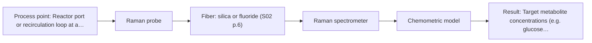
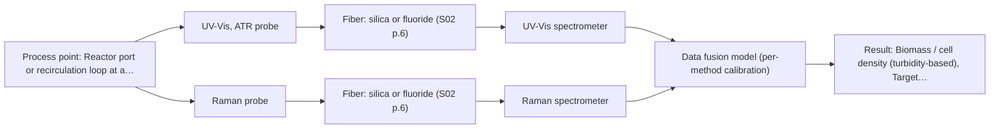

# First technical assessment: Biomass related monitoring during yeast fermentation

## Answer

**Customer request (our summary):** The customer wants an optical measurement system to monitor yeast fermentation growth and metabolism, and requests a feasibility study.

### Brief answer

Test a Raman immersion probe first for the metabolic signal, since Raman suits aqueous broth and published bioprocess work shows direct metabolite detection; add a UV/Vis ATR probe as the simplest biomass/turbidity option. Before any trial, define the biomass and metabolic targets as named analytes and confirm the available reference assays. Whether one method suffices, or a Raman and UV/Vis combination is needed, is decided by the feasibility study.

### Proposal

- **Best current option:** O2 (recommended)
- **Basis:** supplied AFS sources
- **What would change it:** If Q1 shows the metabolic targets are trace-level compounds beyond Raman sensitivity, or if the biomass signal must be an absolute cell count, the method choice or the combination in O3 changes.
- **Next step:** Run the single-method feasibility trials (Raman and UV/Vis ATR) on representative broth samples with off-line cell-density and metabolite references, after the target analytes are defined.

**Secondary evidence (external, not AFS material):** G1: no usable external source found; G2: E03 ¶31; G3: E01 ¶23; G4: no usable external source found. See Expert detail.

**Decision status:** Provisional feasibility assessment

### Solution options

| ID | Tier | Methods | Confidence | Cost class, S01 Table 1 (p.6) | Ease of use | Maintenance | Performance fit | Sources |
|---|---|---|---|---|---|---|---|---|
| O1 | Simple | M2 UV-Vis, ATR probe | Medium: open question: Q1, Q2, Q3 (starts at Medium) | average cost (row 14) | Simple robust turbidity probe, minimal integration | Low; optical window cleaning only | Covers growth tracking but not the metabolic signal | [1: S01 p.16] [2: S01 p.16] |
| O2 | Recommended | M1 Raman probe | Medium: open question: Q1, Q3 (starts at Medium) | high cost (row 12) | Fiber-coupled immersion probe, moderate setup | Moderate; probe window and laser checks | Directly targets the undefined metabolic signal in aqueous broth | [3: S01 p.16] [4: S01 p.16] |
| O3 | Extended (multi-method) | M2 UV-Vis, ATR probe; M4 Raman probe + UV-Vis (combination) | Low: open question: Q1, Q2, Q3 (starts at Medium); multi-method, fusion benefit not yet shown | high cost (rows 12, 14) | Two instruments and probes to install and align | Higher; two calibrations and two probe windows to maintain | Covers both growth and metabolic targets if single methods fall short | [5: S01 p.8] [6: S01 p.8] [1: S01 p.16] [2: S01 p.16] [7: S01 p.16] [8: REF §5] |

*Confidence rates the basis of the advice (how much is known and cited), not a predicted accuracy or probability of success. It starts at High, or at Medium when a key question on the method or the option is open, and drops one level per weakness listed (floor Low).*

*Cost class is the relative rating in S01 Table 1 (p.6) for the in-line method+technique rows named (the highest one for a multi-method option); it is not a price.*

### Setup sketch

*Recommended option O2; drawn by code from the option, a schematic, not a configuration.*

### Key questions

1. Which specific metabolites should the metabolic signal track (for example glucose, ethanol, or acetate), and at what expected concentration ranges?
2. What should the biomass signal represent: a turbidity-based growth trend or a quantitative cell concentration?
3. Does the fermentation broth contain known intrinsic fluorophores (such as NADH, tryptophan, or riboflavin) or fluorescent media components?

## Expert detail

**Customer enquiry**

> We would like an optical measurement during yeast fermentation to help us follow growth and notice changes earlier. Our team has mentioned both a biomass signal and a metabolic signal, but these have not been defined as separate targets. The broth becomes more optically dense as the run develops. We need help turning this request into an initial feasibility study with useful reference measurements.

**Decision status:** Provisional feasibility assessment. A method shortlist for yeast fermentation monitoring can be justified from published bioprocess examples, but the biomass and metabolic targets are still undefined, so the choice of technique and the calibration plan remain provisional.

### Parameters

| ID | Parameter | Kind | Need | Measured by | Why | Sources |
|---|---|---|---|---|---|---|
| P1 | Biomass / cell density (turbidity-based) | quantitative | required | Spectroscopy: UV-Vis | It defines the growth target the customer wants to follow and anchors the UV/Vis calibration. | [9: S01 p.16] |
| P2 | Target metabolite concentrations (e.g. glucose, ethanol, acetate) | quantitative | required | Spectroscopy: Raman | The undefined metabolic signal must be pinned to named analytes before any calibration can be built. | [10: S01 p.16] |
| P3 | Presence of intrinsic fluorophores in the broth | qualitative | required | Reference lab method: off-line fluorimetry screen of broth samples | It decides whether the conditional fluorescence option (M3) is applicable at all. | [11: S01 p.16] |
| P4 | Process temperature | quantitative | optional | Auxiliary sensor: temperature sensor (engineering judgement: confirm availability with AFS) | Temperature shifts spectra and should be recorded so its effect can be separated in the calibration; it should be available from the reactor. | *(no verified source: engineering judgement)* |
| P5 | Off-line reference values (cell density and metabolite concentrations per sample) | quantitative | required | Reference lab method: HPLC or enzymatic assay for metabolites; dry weight or cell count for biomass | Independent laboratory reference data are needed to calibrate and validate the spectral models. | *(no verified source: engineering judgement)* |

### Solution option details

- **O1 cost drivers:** UV/Vis spectrometer, ATR probe, installation port, basic turbidity calibration
- **O2 cost drivers:** Raman spectrometer and laser, immersion probe, chemometric calibration on reference assays
- **O3 cost drivers:** Second spectrometer, synchronised data handling, fused chemometric model, doubled calibration effort
- **O3 combining methods:** Low-level fusion: Raman and UV/Vis spectra synchronised to a common time step and merged into one augmented matrix, with block scaling so neither method dominates. Both probes must sample the same well-mixed broth volume at the same time. Each method keeps its own calibration against its own reference data, and the fused model must beat the best single method on held-out runs or it is dropped.

*Extended (multi-method) option O3; drawn by code from the option, a schematic, not a configuration.*

### Premise check

- **Precedent only:** Optical measurement can follow growth and detect metabolic changes during yeast fermentation. Published bioprocess examples show UV/Vis biomass tracking and Raman metabolite detection in reactors; this is a reason to test, not proof for this customer's process. [1: S01 p.16]
- **Not covered:** A single optical method can cover both the biomass and the metabolic signal. No supplied source shows one method covering both targets in fermentation; the sources present biomass and metabolite monitoring as complementary uses of different techniques. *(no verified source: engineering judgement)*

### Requirements

**Stated by the customer**

- Optical in-line measurement during yeast fermentation to follow growth and notice changes earlier.
- Biomass signal and metabolic signal mentioned but not yet defined as separate targets.
- Broth becomes more optically dense as the run develops.
- An initial feasibility study with useful reference measurements is requested.

**Key unknowns**

- Which metabolites define the metabolic signal (e.g. glucose, ethanol, acetate).
- What the biomass signal should be (turbidity-based proxy or an absolute cell count).
- Whether the broth contains measurable intrinsic fluorophores.
- Which reference laboratory methods are available for calibration.
- Installation point, sterilisation and cleaning constraints at the reactor.

### Clarification questions (most decision-relevant first)

Q1. Which specific metabolites should the metabolic signal track (for example glucose, ethanol, or acetate), and at what expected concentration ranges? *Why it matters:* The specific analytes decide whether Raman alone suffices and which spectral regions the calibration must cover. *(affects: M1, method)*
Q2. What should the biomass signal represent: a turbidity-based growth trend or a quantitative cell concentration? *Why it matters:* A turbidity proxy is simpler, whereas an absolute cell count requires a dedicated calibration against cell reference assays. *(affects: M2, technique)*
Q3. Does the fermentation broth contain known intrinsic fluorophores (such as NADH, tryptophan, or riboflavin) or fluorescent media components? *Why it matters:* Fluorescence requires a defined fluorescent species, so verifying their presence decides whether fluorescence spectroscopy can be considered. *(affects: M3, method)*
Q4. Which off-line reference analyses (such as dry weight, cell count, HPLC, or enzymatic assays) are available during the feasibility runs? *Why it matters:* Independent reference measurements are essential to calibrate and evaluate the quantitative models. *(affects: status)*
Q5. Where can a probe be installed on the fermenter (such as a standard reactor port or a recirculation loop), and what cleaning or sterilisation constraints apply? *Why it matters:* Physical mounting and cleaning requirements dictate probe head mechanical design and ATR crystal robustness. *(affects: installation)*

### Recommendation

- **M1 · Primary candidate: Raman probe.** Raman gives a molecular fingerprint for direct metabolite detection in aqueous broth, where water interferes less than in infrared methods. A published bioprocess example shows Raman used in the same reactor as UV/Vis for metabolites such as glucose, acetate and lactate. *Conditions:* The target metabolites must be defined first (Q1), and fluorescence background must be checked on real broth. [3: S01 p.16] [4: S01 p.16]
- **M2 · Comparison candidate: UV-Vis, ATR probe.** UV/Vis turbidity is a low-cost, robust real-time biomass signal, and the ATR geometry keeps a very short path so the signal does not saturate as the broth becomes optically dense. It addresses the growth target directly. [1: S01 p.16] [2: S01 p.16]
- **M3 · Conditional candidate: fluorescence probe.** Fluorescence can track intrinsic fluorophores such as NADH, tryptophan and riboflavin as an early metabolic-state indicator, but only if the broth contains measurable fluorescent species. *Conditions:* Applies only if an off-line fluorimetry screen confirms suitable fluorophores in the broth (Q3/P3). [11: S01 p.16] [12: S01 p.5]
- **M4 · Comparison candidate: Raman probe + UV-Vis (combination).** If Raman alone cannot separate growth trends from metabolic changes, combining Raman with UV/Vis biomass tracking in the same reactor is a published pattern for covering both chemical structure and physical process trends. The gain is a hypothesis to test against the best single method. *Conditions:* Test only after the single-method trials (M1, M2) show one method alone is insufficient. [7: S01 p.16] [8: REF §5]
- **M5 · Not recommended: NIR, transmission/transflection probe.** NIR transmission is often the first method expected for liquids, but the broth becomes optically dense and transmission fails when the sample is too thick or opaque for light to penetrate. Transflection might still work in some cases, but only as a tested hypothesis, not a starting point. [13: S01 p.18]

### Measurement concept

- **Probe and geometry:** Immersion Raman fiber probe for the metabolic signal; UV/Vis ATR probe for the biomass/turbidity signal in the optically dense broth; fluorescence probe only if fluorophores are confirmed.
- **Location:** Reactor port or recirculation loop at a representative, well-mixed position; to be fixed with the customer (Q5).
- **Fiber link:** Silica fibers serve Raman and UV/Vis; metal-coated silica avoids polymer-jacket fluorescence. MIR fibers are not needed for this shortlist. [14: S02 p.7]

### Spectral range

- **Raman:** Raman shift in cm-1 with the laser excitation wavelength stated separately; the usable shift range depends on the selected spectrometer, laser and probe. [15: S01 p.11]
- **UV-Vis:** UV/Vis nominal sensitivity is highest in the UV region (190-360 nm); the actual working range depends on the selected source, probe and broth optical density. [16: S01 p.5]

### Risks and uncertainty

- The metabolic signal may involve metabolites at concentrations below what Raman can detect in this broth, which would invalidate M1 as the primary method. *(rules: R-NIR-4)* *(no verified source: engineering judgement)*
- Raman signals are weak and can be swamped by fluorescence from the broth or media components, so background must be checked on real samples before committing. *(rules: R-RAM-1)* [17: S01 p.11]
- The UV/Vis turbidity signal reflects scattering and optical density rather than a true cell count, so physical variation (agitation, bubble, clumping) can mimic growth changes. *(rules: R-UV-2)* [18: REF §5]
- Sample inhomogeneity and process turbulence mean the probe position may not represent the whole reactor, biasing both signals. *(rules: R-GEN-5)* [19: S01 p.7]

### First feasibility experiment

1. **Collect representative broth samples across the expected variation: early, mid and late run, covering the full optical-density range and the expected metabolite concentration ranges.** Cover the chemical and physical variation the calibration must handle. *(no verified source: engineering judgement)*
2. **Run independent reference measurements on each sample: off-line cell density (e.g. dry weight or counted cells) and reference metabolite analysis (e.g. HPLC or enzymatic assays).** Provide the reference data the spectral models are calibrated and judged against. *(no verified source: engineering judgement)*
3. **Test each single method separately on the same samples: Raman probe for the metabolites and UV/Vis ATR for the biomass/turbidity signal; check Raman fluorescence background on real broth.** Establish what each single method can and cannot predict before any combination. *(no verified source: engineering judgement)*
4. **Only if a single method is insufficient, test the combined Raman + UV/Vis data against the best single method on the same reference data.** Verify that fusion actually adds value before adding hardware. *(no verified source: engineering judgement)*
5. **Validate the resulting models on held-out runs or batches and agree the go/no-go criteria (e.g. acceptable prediction error for each target) with the customer before the study starts.** Give the feasibility study an objective, customer-agreed success basis. [20: REF §3]

**Reference measurements:** Off-line cell density and reference metabolite concentrations per sample; fluorimetry screen to decide on the fluorescence option.

**Decision basis:** Customer-agreed numerical accuracy targets for the biomass and metabolic signals on held-out runs.

### Assumptions

- The broth is aqueous, as is typical for yeast fermentation.
- The process runs at atmospheric pressure in a stirred reactor with a port or loop available for a probe.
- The metabolic signal refers to dissolved metabolites rather than intracellular compounds.
- Whether the broth contains measurable intrinsic fluorophores (such as NADH or riboflavin) is unknown and assumed to require initial off-line verification.

### Not covered by the supplied sources

- Sterilisation, cleaning-in-place and fouling behaviour of the probes in a fermentation environment are not covered by the supplied material.
- Detection limits for specific metabolites in this yeast broth are not stated in the sources and must come from the feasibility trials.

### Further notes

- **Chemometrics:** Both the biomass and metabolic targets will need calibration models (e.g. PLS regression) built on the off-line reference data; the models are matrix-specific and must be validated on held-out runs, and the calibration should span the full optical-density and metabolite range of a normal run.
- **Real-time tracking:** The goal is continuous in-line tracking across the run, so acquisition conditions should be chosen for stable, time-resolved spectra; if two methods are combined, their data must be synchronised to a common time step.
- **Future direction:** Once the feasibility study defines the informative spectral features, a simplified dedicated fiber sensor (for example an LED-based multi-wavelength probe) could be developed for routine in-line control.

### Secondary evidence (external, not AFS material)

*Found by a literature search for gaps the supplied AFS sources leave open. Not AFS material and not proof for this case; every quote below was verified verbatim against the fetched text.*

*Live search unavailable (library only: cache miss (europepmc); cache miss (openalex)); curated library only.*

**G1 · auxiliary sensor:** In-line measurement of Process temperature with temperature sensor

- No usable external source found.

**G2 · multi-method:** Combining several spectroscopy methods (data fusion) (Low-level fusion: Raman and UV/Vis spectra synchronised to a common time step and merged into one augmented matrix, with block scaling so neither method dominates. Both probes must sample the same well-mixed broth volume at the same time. Each method keeps its own calibration against its own reference data, and the fused model must beat the best single method on held-out runs or it is dropped.)

- **E03 ¶31** Low-level data fusion rearranges data into a new matrix by placing variables from different sources one after the other. *How it applies:* This supports the low-level data fusion approach by showing how the combined matrix can be structured, though model complementarity should be evaluated first. *Limits and transfer risks:* The cited study discusses food analytics rather than yeast fermentation, so the data structure and complementarity might not transfer directly. *(supports O3)*
  > "Low-level data fusion (LLDF) is considered the simplest method to achieve a combination of inputs. In this case, the data is rearranged into a new data matrix, where the variables coming from different sources are placed one after the other."
  > Challenges and Opportunities of Implementing Data Fusion in Process Analytical Technology-A Review. (2022) · Molecules (Basel, Switzerland) · doi:10.3390/molecules27154846 · https://europepmc.org/article/PMC/PMC9369811 · retrieved 2026-10-17, full text, licence: cc by, via curated library

**G3 · not in the supplied sources:** Sterilisation, cleaning-in-place and fouling behaviour of the probes in a fermentation environment are not covered by the supplied material.

- **E01 ¶23** Probe housings must be compatible with the installation environment, process chemistry, and sterilization and cleaning protocols across scales. *How it applies:* This highlights the need to test probe materials against the specific sterilization and cleaning procedures used in the fermentation environment. *Limits and transfer risks:* The source discusses biopharmaceutical manufacturing generally rather than the specific yeast fermentation broth of this enquiry.
  > "The first requirement is that the probe housing needs to be compatible with the installation environment, process chemistry, and sterilization and cleaning protocols across multiple scales."
  > The role of Raman spectroscopy in biopharmaceuticals from development to manufacturing. (2022) · Analytical and bioanalytical chemistry · doi:10.1007/s00216-021-03727-4 · https://europepmc.org/article/PMC/PMC8724084 · retrieved 2026-10-17, full text, licence: cc by, via curated library

**G4 · not in the supplied sources:** Detection limits for specific metabolites in this yeast broth are not stated in the sources and must come from the feasibility trials.

- No usable external source found.

### Evidence (verified quotes)

1. ✓ **S01 p.16** (application precedent): "UV/Vis spectroscopy can be deployed as a low-cost, robust tool for real-time biomass monitoring, as cell suspension turbidity correlates well with cell density."
2. ✓ **S01 p.16** (general): "extremely short path length that enables the measurement of "black" or highly scattering fluids without dilution."
3. ✓ **S01 p.16** (general): "Raman is particularly well-suited for aqueous environments, as it exhibits low absorbance for water molecules compared to infrared methods."
4. ✓ **S01 p.16** (application precedent): "Raman spectroscopy can be used in the same reactor to provide a "molecular fingerprint" for direct detection of specific metabolites like glucose, acetate, or lactate."
5. ✓ **S01 p.8** (general): "the data from each method must be obtained simultaneously."
6. ✓ **S01 p.8** (general): "the measurement data must be normalized to a common time step."
7. ✓ (precedent only) **S01 p.16** (method gain): "While UV/Vis tracks growth, Raman spectroscopy can be used in the same reactor to provide a "molecular fingerprint" for direct detection of specific metabolites like glucose, acetate, or lactate."
8. ✓ **REF §5** (general): "compare with the best single method."
9. ✓ **S01 p.16** (general): "cell suspension turbidity correlates well with cell density."
10. ✓ **S01 p.16** (application precedent): "direct detection of specific metabolites like glucose, acetate, or lactate."
11. ✓ **S01 p.16** (application precedent): "critical cofactors and amino acids like NADH, tryptophan, and riboflavin."
12. ✓ **S01 p.5** (general): "However, most chemicals do not exhibit this property."
13. ✓ **S01 p.18** (general): "it fails when the milk becomes too "thick" or fat-rich, as the light cannot penetrate the sample."
14. ✓ **S02 p.7** (general): "Free of Polymer jacket fluorescence for Raman and Fluo- Spectroscopy"
15. ✓ **S01 p.11** (general): "The Raman shift is used as the horizontal (spectral) axis in Raman spectroscopy"
16. ✓ **S01 p.5** (general): "It has very high sensitivity, especially in the UV region (190-360 nm)"
17. ✓ **S01 p.11** (general): "superposition of luminescence (fluorescence), which has a significantly higher intensity."
18. ✓ **REF §5** (general): "optical density is not a viable cell count."
19. ✓ **S01 p.7** (general): "Morphological factors, such as sample inhomogeneity (e.g., biological tissue) or process turbulence, must also be considered when selecting a measurement technique."
20. ✓ **REF §3** (general): "Representative samples or process states, independent reference measurements, what is compared, and the basis for the go / no-go decision."

### Verification

- Citations verified: 23 of 23 (exact or whitespace/hyphen-tolerant match on the cited page, scope checked).
- Hard check failures before deterministic corrections: 0; still open: 0; soft warnings: 2; repair rounds: 1.
- External evidence (cache): 2 quote(s) verified verbatim (exact or whitespace/hyphen-tolerant, at most 400 characters and 2 sentences, against the cited paragraph); 0 item(s) dropped.
- External search: 3 query(ies), 0 hit(s), 3 source(s) (3 from the curated library); ⚠ library only: cache miss (europepmc); cache miss (openalex).
- External step: 2 model call(s), 2.4 s extra (cost in the run JSON).

*Run D05-20261018T080635Z-779c · models google/gemini-3.5-flash-lite, google/gemini-3.8-flash, z-ai/glm-5.3-flash*
