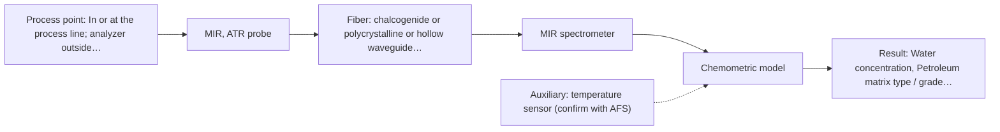
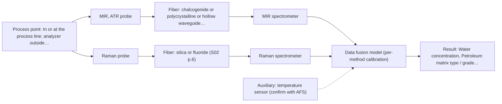

# First technical assessment: Water content in a petroleum stream

## Answer

**Customer request (our summary):** The customer wants to investigate a fiber-based measurement for water determination in a petroleum stream to detect changes faster, with the analyzer located outside the process area.

### Brief answer

Test MIR-ATR first: a published application shows water in petroleum measured with ATR fiber probes, and mid-IR gives well-defined water bands. Run Raman as the comparison and NIR transmission only if the stream is optically clear. Open points: water concentration range, stream clarity, required fiber distance (mid-IR link length is undocumented), and process conditions. Start with a lab trial on representative samples referenced to your laboratory water method.

### Proposal

- **Best current option:** O2 (recommended)
- **Basis:** supplied AFS sources
- **What would change it:** If the required fiber distance exceeds what a mid-IR link can achieve, or the stream is clear enough for NIR transmission with better sensitivity at the target range, the choice moves to M3 or the Raman comparison. If no single method meets the accuracy criteria, the combined MIR-ATR + Raman option (O3) becomes the next hypothesis.
- **Next step:** Run the multi-method laboratory trial on representative samples with laboratory water reference values, per the feasibility plan.

**Secondary evidence (external, not AFS material):** G1: E03 ¶19; G2: no usable external source found; G3: no usable external source found; G4: no usable external source found. See Expert detail.

**Decision status:** Provisional feasibility assessment

### Solution options

| ID | Tier | Methods | Confidence | Cost class, S01 Table 1 (p.6) | Ease of use | Maintenance | Performance fit | Sources |
|---|---|---|---|---|---|---|---|---|
| O1 | Simple | M2 Raman probe | High | high cost (row 12) | Simple probe, no crystal contact | Low; no ATR cleaning | Fits as a low-effort check whether Raman sees water in this matrix | [1: S01 p.16] |
| O2 | Recommended | M1 MIR, ATR probe | Low: open question: Q1, Q3 (starts at Medium); uncited auxiliary sensor | high cost (row 2) | Immersion probe, straightforward in-line fit | ATR crystal needs fouling control | Fits because water-in-petroleum by ATR is a shown application with defined mid-IR water bands | [2: S02 p.13] [3: S01 p.10] [4: S01 p.9] |
| O3 | Extended (multi-method) | M4 MIR, ATR probe + Raman (combination) | Low: uncited auxiliary sensor; multi-method, fusion benefit not yet shown | high cost (rows 2, 12) | Two instruments, combined probe | Each block needs its own calibration and diagnostics | Fits only if one method cannot meet the water target alone | [5: S01 p.8] [6: S01 p.8] [7: S01 p.11] [8: S02 p.16] [9: S01 p.7] |

*Confidence rates the basis of the advice (how much is known and cited), not a predicted accuracy or probability of success. It starts at High, or at Medium when a key question on the method or the option is open, and drops one level per weakness listed (floor Low).*

*Cost class is the relative rating in S01 Table 1 (p.6) for the in-line method+technique rows named (the highest one for a multi-method option); it is not a price.*

### Setup sketch

*Recommended option O2; drawn by code from the option, a schematic, not a configuration.*

### Key questions

1. What water concentration range must be measured, and what detection limit and accuracy are required?
2. Is the stream optically clear or opaque/scattering, and is the water dissolved or present as a separate phase?
3. What distance separates the measurement point from the analyzer outside the process area?

## Expert detail

**Customer enquiry**

> We handle a petroleum stream and currently send samples to a laboratory for water determination. We want to investigate a fiber based measurement closer to the process so that changes can be noticed sooner. The analyzer would be outside the process area. Before selecting equipment, we need to know what to clarify and what a first comparison experiment should establish.

**Decision status:** Provisional feasibility assessment. A method shortlist can be justified from the sources, but the water concentration range, stream clarity and required fiber distance are open, so the choice between MIR-ATR, Raman and NIR stays conditional until the first trial.

### Parameters

| ID | Parameter | Kind | Need | Measured by | Why | Sources |
|---|---|---|---|---|---|---|
| P1 | Water concentration | quantitative | required | Reference lab method: laboratory water determination (e.g. Karl Fischer) | It is the target variable and defines the calibration range and required sensitivity. | *(no verified source: engineering judgement)* |
| P2 | Petroleum matrix type / grade | qualitative | required | Reference lab method: customer product specification | Calibrations are matrix-specific, so the grade variation defines how representative the trial samples must be. | *(no verified source: engineering judgement)* |
| P3 | Process temperature | quantitative | required | Auxiliary sensor: temperature sensor (engineering judgement: confirm availability with AFS) | Temperature shifts spectral bands and water solubility, so it must be tracked during calibration and operation. | *(no verified source: engineering judgement)* |
| P4 | Stream optical clarity / turbidity | qualitative | required | Reference lab method: visual/turbidity assessment of samples | It decides whether NIR or UV transmission is viable or a contact ATR technique is needed. | *(no verified source: engineering judgement)* |

### Solution option details

- **O1 cost drivers:** Raman spectrometer and probe, trial samples, reference analyses
- **O2 cost drivers:** FTIR spectrometer, ATR fiber probe, mid-IR fiber length, calibration effort
- **O3 cost drivers:** Two spectrometers, combined probe, fusion model development and validation
- **O3 combining methods:** Low-level fusion: synchronized MIR-ATR and Raman spectra from the same probe spot merged into one matrix with block scaling. Both channels must sample the same material and be normalized to a common time step. The fused model must beat the best single method on held-out batches, otherwise the extra instrument is dropped.

*Extended (multi-method) option O3; drawn by code from the option, a schematic, not a configuration.*

### Premise check

- **Supported:** A fiber-based measurement closer to the process lets changes be noticed sooner than shipping samples to a laboratory. The sources describe fiber-optic probes integrated into process lines for on-site online analysis with near-real-time results. [10: S01 p.2]
- **Precedent only:** Water in a petroleum stream can be measured optically with a fiber probe. A published ATR-probe application shows water-in-petroleum spectra in the laboratory; this is a reason to test, not proof for this customer's stream. [2: S02 p.13]
- **Not covered:** The analyzer can sit outside the process area connected by fibers for the chosen method. Long cables are stated only for silica fibers; no source gives an achievable length for a mid-IR fiber link, so the required distance is an open question. [11: S02 p.7]

### Requirements

**Stated by the customer**

- Water determination in a petroleum stream
- Measurement closer to the process than the current laboratory route
- Analyzer located outside the process area

**Key unknowns**

- Target water concentration range and required detection limit
- Petroleum matrix type and whether water is dissolved or free (emulsion)
- Optical clarity of the stream (clear vs opaque/scattering)
- Required distance from probe to analyzer outside the process area
- Process temperature and pressure at the measurement point
- Required accuracy and response time

### Clarification questions (most decision-relevant first)

Q1. What water concentration range must be measured, and what detection limit and accuracy are required? *Why it matters:* The concentration range decides whether NIR sensitivity suffices and what calibration effort MIR-ATR or Raman needs. *(affects: M1, M3)*
Q2. Is the stream optically clear or opaque/scattering, and is the water dissolved or present as a separate phase? *Why it matters:* Clarity decides whether NIR/UV transmission is viable or an ATR contact technique is needed. *(affects: technique, M3)*
Q3. What distance separates the measurement point from the analyzer outside the process area? *Why it matters:* Long cables are documented for silica fibers but not for mid-IR fibers, so distance may rule out MIR-ATR in-line. *(affects: installation, M1)*
Q4. What are the process temperature and pressure at the intended measurement point? *Why it matters:* They determine probe and crystal materials and whether an in-line insertion is mechanically feasible. *(affects: installation)*
Q5. How quickly must a water change be noticed, and what go/no-go criteria would you set for the trial? *Why it matters:* The response time and acceptance criteria define the trial design and the go/no-go basis. *(affects: status)*

### Recommendation

- **M1 · Primary candidate: MIR, ATR probe.** ATR fiber probes measure liquids in contact with the crystal, and a published application shows water-in-petroleum spectra measured with ATR probes. Mid-IR spectra have well-defined bands, which helps a targeted water measurement. *Conditions:* Feasible only if the required fiber distance is within what a mid-IR fiber link can achieve, which is currently unknown. [2: S02 p.13] [3: S01 p.10] [4: S01 p.9]
- **M2 · Comparison candidate: Raman probe.** Raman tolerates water-rich and aqueous environments better than infrared absorption methods and works with a non-contact probe geometry. It serves as the single-method comparison against MIR-ATR in the trial. [1: S01 p.16]
- **M3 · Conditional candidate: NIR, transmission/transflection probe.** NIR transmission or transflection is the standard geometry for transparent liquids and uses robust silica fibers for which long cables are documented. Its screening status is unknown because petroleum streams are often too opaque for transmission. *Conditions:* Applies only if the stream is transparent enough for a transmission pathlength at process conditions. [12: S01 p.18] [13: S01 p.18] [11: S02 p.7]
- **M4 · Comparison candidate: MIR, ATR probe + Raman (combination).** If MIR-ATR alone proves insufficient (for example fouling of the crystal or weak water contrast in the matrix), a combined MIR-ATR plus Raman measurement is the later hypothesis to test against the best single method. Mid-IR and Raman spectra are complementary, and combined ATR/Raman fiber systems exist. *Conditions:* Tested only after the single-method trials and only if a single method does not meet the targets. [7: S01 p.11] [8: S02 p.16] [9: S01 p.7]

### Measurement concept

- **Probe and geometry:** Immersion ATR fiber probe (MIR, e.g. ZrO2 or diamond tip) in or at the petroleum stream; comparison options use a Raman fiber probe or an NIR transmission/transflection probe.
- **Location:** In or at the process line; analyzer outside the process area, connected by fiber.
- **Fiber link:** MIR-ATR needs CIR or PIR fibers (silica does not transmit mid-IR); NIR and Raman use silica fibers for which 100-300 m cables are documented. The achievable MIR link length is an open question. [14: S02 p.6] [11: S02 p.7]

### Spectral range

- **MIR:** Nominal mid-IR range is 4000-400 cm-1; the usable range depends on the instrument, fiber and probe actually selected. [15: S01 p.9]
- **Raman:** Raman shift in cm-1 with the laser excitation wavelength (e.g. 785 nm in the published pharma example) stated separately; exact coverage depends on the spectrometer and probe. [16: S01 p.15]

### Risks and uncertainty

- The required analyzer distance may exceed what a mid-IR fiber link can deliver, since no source states an achievable MIR link length. *(rules: R-FIB-2)* *(no verified source: engineering judgement)*
- The ATR crystal samples only a surface layer a few micrometres deep, so fouling and poor representativeness of a heterogeneous or free-water stream could bias the result. *(rules: R-MIR-3)* [17: S01 p.13]
- If the stream is opaque, NIR transmission fails and the NIR option drops out. *(rules: R-GEO-2)* *(no verified source: engineering judgement)*
- Any calibration is specific to the petroleum matrix and must be re-validated when the crude grade or composition changes. *(rules: R-CAL-1)* *(no verified source: engineering judgement)*

### First feasibility experiment

1. **Collect representative petroleum samples spanning the expected water range and the expected variation in matrix grade, temperature and appearance.** Cover the chemical and physical variation the in-line method must handle. *(no verified source: engineering judgement)*
2. **Determine water content of every sample with the existing laboratory reference method.** Provide independent reference values for calibration and validation. *(no verified source: engineering judgement)*
3. **Measure each sample with MIR-ATR and Raman probes separately (single methods first), at representative temperatures.** Establish which single method sees water in this matrix and with what contrast. *(no verified source: engineering judgement)*
4. **Build a calibration per method and validate it on held-out samples or batches not used in calibration.** Quantify prediction accuracy honestly before any hardware decision. *(no verified source: engineering judgement)*
5. **Compare methods against the customer-set go/no-go criteria (accuracy, detection limit, response time); only then test a combined MIR-ATR + Raman configuration if a single method falls short.** Decide the method and whether fusion adds value over the best single method. *(no verified source: engineering judgement)*

**Reference measurements:** The customer's existing laboratory water determination on every trial sample.

**Decision basis:** Go/no-go against accuracy, detection limit and response-time criteria defined by the customer (Q1, Q5).

### Assumptions

- The stream is a liquid at the measurement point.
- The current laboratory water method can serve as the independent reference in the trial.

### Not covered by the supplied sources

- Achievable fiber link length for a mid-IR (CIR/PIR) connection between the process point and an analyzer outside the process area.

### Further notes

- **Chemometrics:** A quantitative water model (e.g. PLS on MIR-ATR or Raman spectra) needs reference values covering the full expected water range and matrix variation; validate on held-out batches before trusting any in-line reading.
- **Real-time tracking:** The aim is faster detection of water changes; once calibrated, the fiber probe gives continuous in-line readings instead of discrete laboratory samples, with the response time set by acquisition and averaging choices.
- **Future direction:** If the trial succeeds, a compact customized sensor or multisensor system for this specific stream could replace the laboratory-scale spectrometer.

### Secondary evidence (external, not AFS material)

*Found by a literature search for gaps the supplied AFS sources leave open. Not AFS material and not proof for this case; every quote below was verified verbatim against the fetched text.*

*Live search unavailable (library only: cache miss (europepmc); cache miss (openalex)); curated library only.*

**G1 · auxiliary sensor:** In-line measurement of Process temperature with temperature sensor

- **E03 ¶19** The concentrations of nitric acid and hydrochloric acid as well as the ionic strength and temperature were varied to obtain a robust model. *How it applies:* This suggests that temperature should be considered as a variable when building calibration models for liquid systems. *Limits and transfer risks:* The source discusses liquid extraction in lithium recycling rather than petroleum streams, so the specific temperature ranges and sensitivities will differ. *(supports O2)*
  > "The concentrations of nitric acid and hydrochloric acid as well as the ionic strength and temperature were varied to obtain a robust model."
  > Process Analytical Technology-Integrated FT-IR and Raman Spectroscopies for Efficient Reactive Liquid-Liquid Extraction Processing in Lithium Recycling. (2025) · ACS omega · doi:10.1021/acsomega.5c05705 · https://europepmc.org/article/PMC/PMC12573149 · retrieved 2026-10-17, full text, licence: cc by, via curated library

**G2 · multi-method:** Combining several spectroscopy methods (data fusion) (Low-level fusion: synchronized MIR-ATR and Raman spectra from the same probe spot merged into one matrix with block scaling. Both channels must sample the same material and be normalized to a common time step. The fused model must beat the best single method on held-out batches, otherwise the extra instrument is dropped.)

- No usable external source found.

**G3 · not in the supplied sources:** Achievable fiber link length for a mid-IR (CIR/PIR) connection between the process point and an analyzer outside the process area.

- No usable external source found.

**G4 · premise not covered:** The analyzer can sit outside the process area connected by fibers for the chosen method.

- No usable external source found.

### Evidence (verified quotes)

1. ✓ **S01 p.16** (general): "Raman is particularly well-suited for aqueous environments, as it exhibits low absorbance for water molecules compared to infrared methods."
2. ✓ **S02 p.13** (application precedent): "Application: measurement of water content in petroleum"
3. ✓ **S01 p.10** (general): "ATR fiber probes (Fig.1) enable the analysis of liquids and solid elastic samples"
4. ✓ **S01 p.9** (general): "Vibrational spectroscopy in the mid-IR range (4000-400 cm-1) is one of the most informative methods of chemical analysis."
5. ✓ **S01 p.8** (general): "It is crucial that the spectral information obtained by different methods-Mid-IR, NIR, Raman, and fluorescence spectra-is collected from the same small, even pinpoint, area of the sample."
6. ✓ **S01 p.8** (general): "Ultimately, the measurement data must be normalized to a common time step."
7. ✓ **S01 p.11** (general): "This property makes mid-IR and Raman spectra complementary, that is, they complement each other."
8. ✓ **S02 p.16** (application precedent): "Combi probe with 2 IR-fibers coupled to FTIR-spectrometer and 2 Silica fibers coupled to Fluo or Raman spectrometers"
9. ✓ (precedent only) **S01 p.7** (method gain): "The analysis of such systems may require a combination of two or even more spectral methods."
10. ✓ **S01 p.2** (general): "Fiber optic probes and cells are being integrated into reactors and production lines of ongoing technological processes, enabling on-site online analysis and obtaining results in near real time."
11. ✓ **S02 p.7** (general): "Robust 100-300m cables made with Silica fibers of low OH-content (<0.1ppm OH) enable remote industrial process-control"
12. ✓ **S01 p.18** (general): "Transmission is the preferred method for transparent or semi-transparent liquids, such as skim milk, whey, or permeate."
13. ✓ **S01 p.18** (general): "it fails when the milk becomes too "thick" or fat-rich, as the light cannot penetrate the sample."
14. ✓ **S02 p.6** (general): "3000 nm Polycrystalline Infrared Fibers 17 μm"
15. ✓ **S01 p.9** (general): "Vibrational spectroscopy in the mid-IR range (4000-400 cm-1)"
16. ✓ **S01 p.15** (general): "Raman spectrometer and Raman fiber probe for contact measurements with 785 nm excitation wavelength"
17. ✓ **S01 p.13** (general): "typically at a depth of few microns"

### Verification

- Citations verified: 22 of 22 (exact or whitespace/hyphen-tolerant match on the cited page, scope checked).
- Hard check failures before deterministic corrections: 0; still open: 0; soft warnings: 2; repair rounds: 1.
- External evidence (cache): 1 quote(s) verified verbatim (exact or whitespace/hyphen-tolerant, at most 400 characters and 2 sentences, against the cited paragraph); 0 item(s) dropped.
- External search: 2 query(ies), 0 hit(s), 3 source(s) (3 from the curated library); ⚠ library only: cache miss (europepmc); cache miss (openalex).
- External step: 2 model call(s), 1.9 s extra (cost in the run JSON).

*Run D06-20261018T080635Z-b210 · models google/gemini-3.5-flash-lite, google/gemini-3.8-flash, z-ai/glm-5.3-flash*
