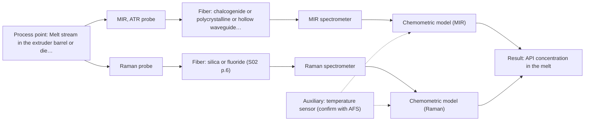
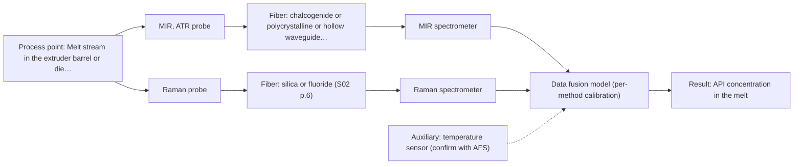

# First technical assessment: API concentration during hot polymer extrusion

## Answer

**Customer request (our summary):** The customer wants to investigate whether optical measurements can detect composition changes in a hot polymer extrusion process containing an active pharmaceutical ingredient, and requests an initial comparison plan and probe selection guidance.

### Brief answer

Test MIR-ATR first: it is the only technique with a published precedent for API spectra in hot polymer during extrusion, with Raman as the parallel comparison and NIR reflection held conditional until the melt's opacity is known. Open points: melt temperature and pressure, opacity, API concentration range and required accuracy, and probe survival against heat and build-up. A combined MIR-ATR + Raman probe is a later hypothesis only if single methods fall short.

### Proposal

- **Best current option:** O2 (recommended)
- **Basis:** supplied AFS sources
- **What would change it:** If the melt proves transparent and the temperature is moderate, NIR transmission could re-enter; if the interface temperature exceeds probe ratings, installation moves to a sampling loop or cooled port.
- **Next step:** Answer the temperature, opacity and concentration questions, then run the single-method MIR-ATR and Raman bench trial on representative melt samples against the offline assays.

**Secondary evidence (external, not AFS material):** G1: no usable external source found; G2: E02 ¶31; G3: no usable external source found; G4: no usable external source found. See Expert detail.

**Decision status:** Provisional feasibility assessment

### Solution options

| ID | Tier | Methods | Confidence | Cost class, S01 Table 1 (p.6) | Ease of use | Maintenance | Performance fit | Sources |
|---|---|---|---|---|---|---|---|---|
| O1 | Simple | M1 MIR, ATR probe | Low: open question: Q3 (starts at Medium); uncited auxiliary sensor | high cost (row 2) | Simple contact probe at one port | Crystal cleaning; fouling risk | Direct precedent for API in hot polymer | [1: S02 p.14] [2: S01 p.10] [3: S01 p.13] |
| O2 | Recommended | M1 MIR, ATR probe; M2 Raman probe | Low: open question: Q3 (starts at Medium); uncited auxiliary sensor | high cost (rows 2, 12) | Two bench trials, moderate setup | Per-instrument calibration and checks | Compares the two strongest methods before committing | [1: S02 p.14] [2: S01 p.10] [3: S01 p.13] [4: S01 p.11] [5: S01 p.11] |
| O3 | Extended (multi-method) | M4 MIR, ATR probe + Raman (combination) | Low: open question: Q3 (starts at Medium); uncited auxiliary sensor; multi-method, fusion benefit not yet shown | high cost (rows 2, 12) | Single combined probe head | Two calibrations, one probe | Complementary spectra if single methods fall short | [6: S01 p.15] [7: S01 p.8] [8: S01 p.11] [9: S02 p.16] [10: S01 p.8] |

*Confidence rates the basis of the advice (how much is known and cited), not a predicted accuracy or probability of success. It starts at High, or at Medium when a key question on the method or the option is open, and drops one level per weakness listed (floor Low).*

*Cost class is the relative rating in S01 Table 1 (p.6) for the in-line method+technique rows named (the highest one for a multi-method option); it is not a price.*

### Setup sketch

*Recommended option O2; drawn by code from the option, a schematic, not a configuration.*

### Key questions

1. What is the melt temperature (and pressure) at the intended measurement point?
2. Is the melt optically clear or scattering/opaque, and what is the polymer matrix?
3. What API concentration range and detection accuracy do you need in-line?

## Expert detail

**Customer enquiry**

> We are developing a hot polymer extrusion process that incorporates an active pharmaceutical ingredient. We want to investigate whether an optical measurement can detect composition changes while the melt is being processed. We have offline assays, but the process interface is hot and may be exposed to material build up. We need an initial comparison plan and the questions required before choosing a probe.

**Decision status:** Provisional feasibility assessment. A published in-line polymer extrusion example using MIR-ATR and NIR reflection supports a test shortlist, but the melt's optical properties, temperature and target concentrations are unknown, so the assessment stays provisional.

### Parameters

| ID | Parameter | Kind | Need | Measured by | Why | Sources |
|---|---|---|---|---|---|---|
| P1 | API concentration in the melt | quantitative | required | Spectroscopy: MIR | It is the target variable the in-line method must track and the basis of the calibration. | [1: S02 p.14] |
| P2 | Polymer matrix identity and formulation | qualitative | required | Reference lab method: customer offline assay / formulation records | Calibrations are matrix-specific, so the matrix defines which spectral model applies. | [11: REF §5] |
| P3 | Melt temperature at the measurement point | quantitative | required | Auxiliary sensor: temperature sensor (engineering judgement: confirm availability with AFS) | It determines probe and fiber suitability and affects the spectra, so it must be logged during trials. | *(no verified source: engineering judgement)* |
| P4 | Melt optical opacity / scattering regime | qualitative | required | Reference lab method: offline optical assessment of melt samples | It decides between ATR, reflection and transmission geometries. | [12: S01 p.18] |
| P5 | Presence of fluorescent components (API or polymer additives) | qualitative | optional | Reference lab method: fluorescence screening of melt samples | It only matters if a fluorescence add-on or Raman background issue arises; it should be available from formulation data. | [13: S01 p.5] |

### Solution option details

- **O1 cost drivers:** One FTIR spectrometer, ATR fiber probe, CIR/PIR fiber link, trial calibration samples
- **O2 cost drivers:** FTIR and Raman spectrometers, two probes, reference assays, chemometric model building
- **O3 cost drivers:** Combi probe, two spectrometers, fused-model development, synchronisation software
- **O3 combining methods:** Low-level fusion: MIR-ATR and Raman spectra from the same probe head merged into one augmented matrix, as in the published pharma example. Both channels must sample the same melt spot and be synchronised to a common time step, with block scaling so neither method dominates. The fused model must beat the best single method on held-out runs, otherwise the extra channel is dropped.

*Extended (multi-method) option O3; drawn by code from the option, a schematic, not a configuration.*

### Premise check

- **Precedent only:** An optical measurement can detect composition changes in their hot polymer melt. A published process example shows NIR reflection and MIR-ATR spectroscopy used to control polymer extrusion in-line, including API spectra in hot polymer; this is a reason to test, not proof for this customer's process. [14: S02 p.14] [1: S02 p.14]
- **Not covered:** A fiber probe can survive the hot interface and material build-up in their extruder. No supplied source states probe temperature limits or fouling behaviour for hot-melt service; this must be checked with AFS for the actual process conditions. *(no verified source: engineering judgement)*

### Requirements

**Stated by the customer**

- Detect composition changes in the melt during processing
- Compare candidate optical methods before choosing a probe
- Cope with a hot interface and possible material build-up
- Use existing offline assays as reference

**Key unknowns**

- Melt temperature and pressure at the measurement point
- Optical opacity and scattering of the polymer melt
- API identity and target concentration range
- Required accuracy, detection limit and response time
- Available access port geometry and probe placement
- Whether the API or polymer has fluorescent components

### Clarification questions (most decision-relevant first)

Q1. What is the melt temperature (and pressure) at the intended measurement point? *Why it matters:* It determines which probe materials, fibers and seals are feasible at the hot interface. *(affects: installation)*
Q2. Is the melt optically clear or scattering/opaque, and what is the polymer matrix? *Why it matters:* It decides between ATR, reflection and transmission geometries, since transmission fails when light cannot penetrate the sample. *(affects: technique, M3)*
Q3. What API concentration range and detection accuracy do you need in-line? *Why it matters:* It sets the go/no-go criteria and whether a single method is sensitive enough. *(affects: method, M1, M2)*
Q4. What access port exists on the extruder (e.g. die adaptor, barrel), and how fast does build-up form? *Why it matters:* It determines probe placement, contact geometry and cleaning strategy. *(affects: installation)*
Q5. How quickly can the offline assays return results, and how many samples can you provide for a trial? *Why it matters:* It defines the calibration data set and validation design for the feasibility test. *(affects: status)*

### Recommendation

- **M1 · Primary candidate: MIR, ATR probe.** MIR-ATR with a fiber probe is the only in-line technique with a published precedent for API spectra in hot polymer during extrusion, and ATR suits liquids and soft solids in contact with the crystal. Its few-micron sampling depth means crystal fouling must be checked early. *Conditions:* Probe materials and fiber must be confirmed for the actual melt temperature. [1: S02 p.14] [2: S01 p.10] [3: S01 p.13]
- **M2 · Comparison candidate: Raman probe.** Raman gives a molecular fingerprint of the API and polymer backbone and can be tested in parallel as the strongest single-method alternative. Weak signals and possible fluorescence background must be checked on the real melt. [4: S01 p.11] [5: S01 p.11]
- **M3 · Conditional candidate: NIR, diffuse reflection probe.** NIR reflection probes are reported for in-line polymer extrusion control and suit scattering samples, but the melt's optical regime is unknown, so this stays conditional until opacity is known. NIR bands overlap, so a chemometric calibration is required. *Conditions:* Applies if the melt proves too opaque or scattering for transmission-style measurement. [14: S02 p.14] [15: S01 p.10]
- **M4 · Comparison candidate: MIR, ATR probe + Raman (combination).** A combined MIR-ATR plus Raman probe is a later hypothesis: the two spectra are complementary, and a published combi probe couples ATR with Raman excitation in one head. It should only be tested against the best single method after the single-method trials. *Conditions:* Only if neither single method alone meets the target accuracy. [8: S01 p.11] [9: S02 p.16] [10: S01 p.8]
- **M5 · Not recommended: NIR, transmission/transflection probe.** Transmission fails when the sample is too thick or opaque because light cannot penetrate it, which is likely for a hot polymer melt, and the pathlength would need tight control. Not worth testing before the melt's opacity is known. [12: S01 p.18]
- **M6 · Not recommended: fluorescence probe.** Fluorescence only measures species that fluoresce, and no fluorescent component of the API or polymer has been identified. It could only return as an add-on if a fluorophore is confirmed. [13: S01 p.5]

### Measurement concept

- **Probe and geometry:** Immersion ATR fiber probe (diamond or ZrO2 crystal) at an extruder access port for MIR; a Raman fiber probe at the same or adjacent port for comparison; NIR reflection probe as a conditional alternative.
- **Location:** Melt stream in the extruder barrel or die adaptor, with the spectrometer remote from heat and vibration via fiber links.
- **Fiber link:** MIR requires CIR or PIR fibers as silica fibers do not transmit mid-IR radiation; Raman and NIR use silica fibers. Achievable MIR link length is an open question for AFS. [16: S02 p.6] [17: S01 p.15]

### Spectral range

- **MIR:** Nominal mid-IR range is 4000-400 cm-1; the usable range depends on the instrument, fiber and probe actually selected. [18: S01 p.9]
- **Raman:** Raman shift in cm-1 with laser excitation stated separately (e.g. 785 nm in the published pharma example); actual coverage depends on the spectrometer and probe. [19: S01 p.15]

### Risks and uncertainty

- The hot interface may exceed the temperature rating of the probe, fibers or seals; no source states these limits. *(no verified source: engineering judgement)*
- Material build-up on an ATR crystal would change the sampled surface layer and mimic or mask composition changes. *(rules: R-MIR-3)* [3: S01 p.13]
- Calibrations are matrix-specific, so a model built on one polymer/API blend must be re-validated after any formulation change. *(rules: R-CAL-1)* [11: REF §5]
- The published extrusion example is a precedent, not proof that the methods meet this customer's accuracy targets. *(rules: R-EVI-2)* [20: REF §3]

### First feasibility experiment

1. **Collect representative melt samples across the expected API concentration range and process temperatures, covering the physical variation of the process.** Represent the chemical and physical variation the in-line method must handle. *(no verified source: engineering judgement)*
2. **Measure each sample with the existing offline assays as independent reference values.** Provide the reference data for calibration and validation. *(no verified source: engineering judgement)*
3. **Run single-method bench trials first: MIR-ATR probe and Raman probe on the same samples at process-relevant temperature; add NIR reflection only if the melt proves opaque.** Compare the strongest single methods before any combination. *(no verified source: engineering judgement)*
4. **Validate predictions on held-out runs or batches against the offline assay, and inspect the ATR crystal for build-up effects.** Test robustness to fouling and matrix variation. *(no verified source: engineering judgement)*
5. **Apply customer-defined go/no-go criteria (accuracy and detection limit in the melt) to decide whether to proceed to an in-line probe and whether a combined MIR-ATR + Raman option is worth testing.** Basis for the next investment decision. *(no verified source: engineering judgement)*

**Reference measurements:** Existing offline assays on all trial samples.

**Decision basis:** Customer-defined accuracy and detection limit for API composition change in the melt.

### Assumptions

- The offline assays can quantify the API in the polymer matrix and can be run on trial samples.
- An access port can be provided at a suitable position in the extruder.
- The melt is likely too opaque for transmission-style measurement, pending confirmation.

### Not covered by the supplied sources

- Probe temperature and pressure ratings for hot-melt extrusion service
- Achievable MIR fiber link length for this installation
- Fouling/cleaning behaviour of ATR crystals under polymer build-up

### Further notes

- **Chemometrics:** A PLS calibration for API concentration will need reference assays spanning the expected concentration and temperature range; validate on held-out runs before any in-line claim.
- **Real-time tracking:** The goal is in-line tracking of composition change during extrusion; acquisition speed and synchronisation matter if two methods are combined.
- **Future direction:** If the trial succeeds, a customised in-line system or spectral fiber sensor for routine process control can be developed from the trial findings.

### Secondary evidence (external, not AFS material)

*Found by a literature search for gaps the supplied AFS sources leave open. Not AFS material and not proof for this case; every quote below was verified verbatim against the fetched text.*

*Live search unavailable (library only: cache miss (europepmc); cache miss (openalex)); curated library only.*

**G1 · auxiliary sensor:** In-line measurement of Melt temperature at the measurement point with temperature sensor

- No usable external source found.

**G2 · multi-method:** Combining several spectroscopy methods (data fusion) (Low-level fusion: MIR-ATR and Raman spectra from the same probe head merged into one augmented matrix, as in the published pharma example. Both channels must sample the same melt spot and be synchronised to a common time step, with block scaling so neither method dominates. The fused model must beat the best single method on held-out runs, otherwise the extra channel is dropped.)

- **E02 ¶31** Low-level data fusion is described as the simplest method to achieve a combination of inputs by rearranging the data into a new data matrix where variables from different sources are placed one after the other. *How it applies:* This supports testing whether combining multiple channels in an augmented matrix is feasible for the extrusion process, provided the individual datasets show sufficient complementarity. *Limits and transfer risks:* This finding comes from a general review rather than a polymer extrusion process, so laboratory or literature fusion workflows may not transfer directly to an in-line hot-melt extrusion setup. *(supports O3)*
  > "Low-level data fusion (LLDF) is considered the simplest method to achieve a combination of inputs. In this case, the data is rearranged into a new data matrix, where the variables coming from different sources are placed one after the other."
  > Challenges and Opportunities of Implementing Data Fusion in Process Analytical Technology-A Review. (2022) · Molecules (Basel, Switzerland) · doi:10.3390/molecules27154846 · https://europepmc.org/article/PMC/PMC9369811 · retrieved 2026-10-17, full text, licence: cc by, via curated library

**G3 · not in the supplied sources:** Probe temperature and pressure ratings for hot-melt extrusion service

- No usable external source found.

**G4 · not in the supplied sources:** Achievable MIR fiber link length for this installation

- No usable external source found.

### Evidence (verified quotes)

1. ✓ **S02 p.14** (application precedent): "Spectra of API in hot polymer obtained with Diamond cone ATR probe coupled to iC10 FTIR (MTAC)"
2. ✓ **S01 p.10** (general): "Probe-based analysis is gaining widespread use in online analysis, such as in-line, in-process (chemical, biotechnological, natural) environments"
3. ✓ **S01 p.13** (general): "typically at a depth of few microns"
4. ✓ **S01 p.11** (general): "The resulting spectra can be used for both qualitative and quantitative analysis of mixtures."
5. ✓ **S01 p.11** (general): "superposition of luminescence (fluorescence), which has a significantly higher intensity."
6. ✓ **S01 p.15** (general): "Data processing for pharmaceutical tasks relies on "low-level data fusion," where the synchronized NIR and Raman spectra are merged into a single augmented matrix."
7. ✓ **S01 p.8** (general): "the measurement data must be normalized to a common time step."
8. ✓ **S01 p.11** (general): "This property makes mid-IR and Raman spectra complementary, that is, they complement each other."
9. ✓ **S02 p.16** (application precedent): "Combi probe with 2 IR-fibers coupled to FTIR-spectrometer and 2 Silica fibers coupled to Fluo or Raman spectrometers"
10. ✓ **S01 p.8** (general): "collected from the same small, even pinpoint, area of the sample."
11. ✓ **REF §5** (general): "Weak signal, fluorescence background; calibration specific to the matrix."
12. ✓ **S01 p.18** (general): "it fails when the milk becomes too "thick" or fat-rich, as the light cannot penetrate the sample."
13. ✓ **S01 p.5** (general): "However, most chemicals do not exhibit this property."
14. ✓ **S02 p.14** (application precedent): "NIR-Reflex & MIR-ATR-spectroscopy to control polymer extrusion in-line"
15. ✓ **S01 p.10** (general): "The broad absorption bands observed in this region overlap, suggesting the use of chemometrics for quantitative and qualitative analysis of spectral data."
16. ✓ **S02 p.6** (general): "1100 nm Chalcogenide As-S IR Fibers 6500 nm"
17. ✓ **S01 p.15** (general): "located safely away from the vibration and dust of the manufacturing floor."
18. ✓ **S01 p.9** (general): "Vibrational spectroscopy in the mid-IR range (4000-400 cm-1) is one of the most informative methods of chemical analysis."
19. ✓ **S01 p.15** (general): "Raman spectrometer and Raman fiber probe for contact measurements with 785 nm excitation wavelength"
20. ✓ **REF §3** (general): "a published application is a reason to test a method, not proof that it will work for a new customer."

### Verification

- Citations verified: 28 of 28 (exact or whitespace/hyphen-tolerant match on the cited page, scope checked).
- Hard check failures before deterministic corrections: 0; still open: 0; soft warnings: 1; repair rounds: 1.
- External evidence (cache): 1 quote(s) verified verbatim (exact or whitespace/hyphen-tolerant, at most 400 characters and 2 sentences, against the cited paragraph); 0 item(s) dropped.
- External search: 2 query(ies), 0 hit(s), 3 source(s) (3 from the curated library); ⚠ library only: cache miss (europepmc); cache miss (openalex).
- External step: 2 model call(s), 2.1 s extra (cost in the run JSON).

*Run D07-20261018T080635Z-4553 · models google/gemini-3.5-flash-lite, google/gemini-3.8-flash, z-ai/glm-5.3-flash*
