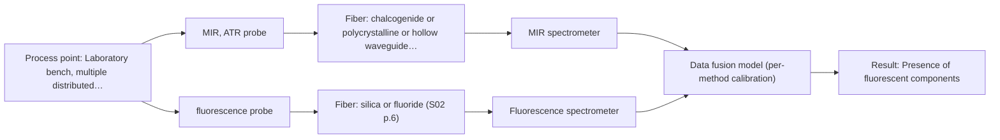

# First technical assessment: Local measurements of heterogeneous model tissues

## Answer

**Customer request (our summary):** The customer wants to compare MIR ATR and fluorescence information for classifying heterogeneous model biological tissues and asks for a first comparison experiment design.

### Brief answer

Test MIR ATR first as the single-method baseline on chicken muscle, fat and liver, then fluorescence alone, and only afterwards the combined same-spot ATR/fluorescence measurement, ideally with a combined probe. A successful first experiment would demonstrate whether each method, and their fused data, can classify the tissues on held-out samples. Open points: which fluorophores are present, your required accuracy and reference method, and probe availability.

### Proposal

- **Best current option:** O2 (recommended)
- **Basis:** supplied AFS sources
- **What would change it:** If the tissues show no usable fluorescence at the available excitation wavelengths, the assessment reduces to the MIR ATR single-method option. If the required accuracy is modest and heterogeneity turns out not to affect single-method results, the combined probe may be unnecessary.
- **Next step:** Run the single-method MIR ATR and fluorescence measurements on representative chicken tissues with independent class verification, then test the combined same-spot measurement against the best single method.

**Secondary evidence (external, not AFS material):** G1: no usable external source found; G2: no usable external source found; G3: no usable external source found. See Expert detail.

**Decision status:** Provisional feasibility assessment

### Solution options

| ID | Tier | Methods | Confidence | Cost class, S01 Table 1 (p.6) | Ease of use | Maintenance | Performance fit | Sources |
|---|---|---|---|---|---|---|---|---|
| O1 | Simple | M1 MIR, ATR probe | High | high cost (row 2) | Single probe, straightforward bench setup | Crystal cleaning and contact checks | Strong single-method baseline for soft tissue classification | [1: S01 p.10] [2: S01 p.5] [3: S01 p.13] |
| O2 | Recommended | M1 MIR, ATR probe; M2 fluorescence probe; M3 MIR, ATR probe + Fluorescence (combination) | Low: open question: Q3 (starts at Medium); fit for soft solid to be tested, fluorescent target unknown; multi-method, fusion benefit not yet shown | high cost (rows 2, 19) | Combined probe, one measurement per spot | Two spectrometer blocks to calibrate and monitor | Same-spot dual information matches the heterogeneity requirement directly | [4: S01 p.8] [5: S01 p.8] [1: S01 p.10] [2: S01 p.5] [3: S01 p.13] [6: S04 p.3] [7: S01 p.5] [8: S04 p.4] [9: S04 p.4] [10: S01 p.8] |

*Confidence rates the basis of the advice (how much is known and cited), not a predicted accuracy or probability of success. It starts at High, or at Medium when a key question on the method or the option is open, and drops one level per weakness listed (floor Low).*

*Cost class is the relative rating in S01 Table 1 (p.6) for the in-line method+technique rows named (the highest one for a multi-method option); it is not a price.*

### Setup sketch

*Recommended option O2; drawn by code from the option, a schematic, not a configuration.*

### Key questions

1. Which fluorescent species do you expect in the tissues (e.g. intrinsic fluorophores such as FAD or porphyrins), and at what excitation wavelength?
2. What classification accuracy do you need, and what reference method (e.g. histology or known tissue origin) will verify the tissue class?
3. How many tissue samples and measurement positions per sample can you provide, and how variable are they?

## Expert detail

**Customer enquiry**

> Our research group is evaluating a spectral measurement interface using model biological tissues such as chicken muscle, fat and liver. We want to compare MIR ATR and fluorescence information, because the material is heterogeneous and sequential measurements may not sample the same location. This is a laboratory classification study. We need a first comparison experiment and a clear statement of what its results would demonstrate.

**Decision status:** Provisional feasibility assessment. A laboratory comparison of MIR ATR and fluorescence on soft biological tissue is well supported as a testable design, but the fluorescence channel depends on unidentified fluorophores and no accuracy target is given, so the assessment stays provisional.

### Parameters

| ID | Parameter | Kind | Need | Measured by | Why | Sources |
|---|---|---|---|---|---|---|
| P1 | Tissue class (muscle / fat / liver) | qualitative | required | Reference lab method: customer-defined tissue verification (e.g. histology or known anatomical origin) | It is the classification target against which all spectral models are validated. | *(no verified source: engineering judgement)* |
| P2 | Presence of fluorescent components | qualitative | required | Spectroscopy: Fluorescence | Fluorescence only works if the samples contain species that fluoresce, so this must be confirmed before the fluorescence channel is trusted. | [11: S04 p.4] |

### Solution option details

- **O1 cost drivers:** One MIR spectrometer, one ATR fiber probe, reference tissue verification
- **O2 cost drivers:** Combined ATR/fluorescence probe, two spectrometers, data fusion software, larger reference set
- **O2 combining methods:** Low-level fusion: MIR ATR and fluorescence spectra from the same spot are synchronised to a common time step and concatenated into one matrix with block scaling so neither method dominates. One calibration model per method is kept as the baseline, and the fused model must beat the best single method on held-out samples before the extra instrument is justified. A combined probe keeps both channels on the same small area, which separate alternating probes cannot guarantee.

### Premise check

- **Supported:** Heterogeneous tissue requires that both methods sample the same location, which sequential separate probes cannot guarantee. The sources state this directly for multispectral tissue measurement. [12: S01 p.8] [13: S01 p.8]
- **Precedent only:** Fluorescence will carry usable class information for chicken muscle, fat and liver. A published laboratory study on the same tissue types showed fluorescence separating liver from other tissues, but this is a reason to test, not proof for the customer's setup. [14: S04 p.4]
- **Precedent only:** A combined MIR-ATR + fluorescence measurement on the same spot is technically feasible. A multispectral fiber probe combining ATR IR and fluorescence has been built and demonstrated on biological tissue in a laboratory study. [15: S04 p.1]

### Requirements

**Stated by the customer**

- Laboratory classification of chicken muscle, fat and liver
- Comparison of MIR ATR and fluorescence information
- Same-location measurement despite heterogeneity
- A first comparison experiment and a statement of what its results would demonstrate

**Key unknowns**

- Which fluorescent components are present or expected in the tissues
- Required classification accuracy and the reference method for tissue class verification
- Number of samples and tissue variability available for the study
- Preferred fluorescence excitation wavelength and available spectrometers
- Whether a combined MIR-ATR/fluorescence probe is available to the group

### Clarification questions (most decision-relevant first)

Q1. Which fluorescent species do you expect in the tissues (e.g. intrinsic fluorophores such as FAD or porphyrins), and at what excitation wavelength? *Why it matters:* Fluorescence only measures species that actually fluoresce, so the answer decides whether the fluorescence channel can work at all and which excitation to use. *(affects: technique)*
Q2. What classification accuracy do you need, and what reference method (e.g. histology or known tissue origin) will verify the tissue class? *Why it matters:* The go/no-go criteria of the comparison experiment must be numerical and come from you, and the reference defines what the spectra are validated against. *(affects: status)*
Q3. How many tissue samples and measurement positions per sample can you provide, and how variable are they? *Why it matters:* With few samples, classification models easily overfit, which changes how the single-method versus combined comparison must be validated. *(affects: M3)*
Q4. Which MIR and fluorescence spectrometers are available, and is a combined ATR/fluorescence fiber probe an option for you? *Why it matters:* The same-spot requirement is best met by a combined probe; two separate probes measured alternately cannot guarantee identical sampling locations. *(affects: installation)*

### Recommendation

- **M1 · Primary candidate: MIR, ATR probe.** MIR ATR suits liquids and soft solids in contact with the crystal and gives well-defined absorption bands with high selectivity, making it the strongest single method to test first. Its surface-layer sampling depth of a few micrometres must be kept in mind for heterogeneous tissue. [1: S01 p.10] [2: S01 p.5] [3: S01 p.13]
- **M2 · Comparison candidate: fluorescence probe.** Fluorescence is highly sensitive and, in a published laboratory study on chicken breast, fat and liver, distinguished liver via a porphyrin band at 613 nm. Its value here depends on fluorescent components actually being present in your samples. *Conditions:* Test only after confirming that the tissues contain measurable fluorophores at the chosen excitation wavelength. [6: S04 p.3] [7: S01 p.5]
- **M3 · Comparison candidate: MIR, ATR probe + Fluorescence (combination).** A combined ATR/fluorescence probe measures both signals from the same small area at the same time, which directly answers the heterogeneity concern, and published work showed the fused data separating tissue classes where each single method could not. The fusion gain remains a hypothesis to test against the best single method. *Conditions:* Test after the single-method runs, using a combined probe or strictly co-located simultaneous measurements, and only if the fluorescence channel shows class-relevant signal. [8: S04 p.4] [9: S04 p.4] [10: S01 p.8]

### Measurement concept

- **Probe and geometry:** MIR ATR fiber probe with a ZrO2 or diamond ATR crystal in contact with the tissue; fluorescence via a fluorescence fiber probe, ideally integrated in a combined ATR/fluorescence probe head so both channels sample the same spot.
- **Location:** Laboratory bench, multiple distributed positions per tissue sample to cover heterogeneity.
- **Fiber link:** Short bench links; MIR channels need CIR or PIR fibers, fluorescence channels silica fibers. [16: S04 p.2] [17: S02 p.6]

### Spectral range

- **MIR:** Nominal mid-IR range 4000-400 cm-1 (2.5-25 um); the usable range depends on the selected ATR crystal, CIR/PIR fiber and spectrometer. [18: S01 p.9]
- **Fluorescence:** Emission range depends on the fluorescent species and the excitation wavelength chosen; not fixed by the sources for these tissues. *(no verified source: engineering judgement)*

### Risks and uncertainty

- The tissues may lack fluorophores at the chosen excitation wavelength, leaving the fluorescence channel uninformative. *(rules: R-FLU-1)* [7: S01 p.5]
- ATR samples only a few micrometres of surface, so a heterogeneous sample can make the ATR spot unrepresentative of the tissue block. *(rules: R-MIR-3, R-GEN-5)* [3: S01 p.13]
- With few samples and many variables, single-method and fused classification models can overfit, so validation design matters more than model complexity. [19: S03 p.6]
- If two separate probes are used alternately instead of a combined probe, the two methods may not sample the same tissue location and the comparison loses its point. *(rules: R-CMB-2)* [13: S01 p.8]

### First feasibility experiment

1. **Select representative samples of chicken muscle, fat and liver covering the expected biological variability, with several distributed measurement positions per sample.** Cover the chemical and physical variation the classification must handle. *(no verified source: engineering judgement)*
2. **Measure each position with MIR ATR alone and fluorescence alone, keeping a record of the exact measurement position for every spectrum.** Establish the single-method baselines before any combination. *(no verified source: engineering judgement)*
3. **Verify tissue class independently for every measured position, e.g. by visual/histological assignment agreed with the customer.** Provide reference labels that do not depend on the spectral data. *(no verified source: engineering judgement)*
4. **Repeat a subset of positions with the combined ATR/fluorescence probe (or strictly co-located simultaneous measurements), synchronise the data to a common time step and fuse per the agreed scheme.** Test whether the fused data beats the best single method on the same spots. [4: S01 p.8]
5. **Build simple classification models per method and fused, validate on held-out samples or positions, and compare against the customer's numerical accuracy target as the go/no-go basis.** Decide whether the combined interface is worth pursuing. [20: REF §3]

**Reference measurements:** Independent tissue-class verification per measured position (customer-defined reference method, e.g. histology or known anatomical origin).

**Decision basis:** Go/no-go against the customer's required classification accuracy, comparing each single method and the fused model on held-out samples or positions.

### Assumptions

- Fresh (not frozen/thawed) tissue is used, or the effect of freezing on spectra is accepted as part of the study scope.
- Bench-top laboratory instruments with short fiber links are sufficient for this study.

### Not covered by the supplied sources

- Required classification accuracy for the study
- The specific reference method the group will use to verify tissue class

### Further notes

- **Chemometrics:** Start with unsupervised PCA per method block and fused, as in the published chicken-tissue study, then move to supervised classification (e.g. PLS-DA) only with enough samples; validate with cross-validation that respects sample identity and, ideally, a held-out set, and use a permutation test to guard against chance correlation.
- **Future direction:** If the laboratory comparison succeeds, the same combined-probe concept could later be evaluated for in-line or in-situ tissue measurements, but that would need its own feasibility work.

### Secondary evidence (external, not AFS material)

*Found by a literature search for gaps the supplied AFS sources leave open. Not AFS material and not proof for this case; every quote below was verified verbatim against the fetched text.*

*Live search unavailable (library only: cache miss (europepmc); cache miss (openalex)); curated library only.*

**G1 · not in the supplied sources:** Required classification accuracy for the study

- No usable external source found.

**G2 · not in the supplied sources:** The specific reference method the group will use to verify tissue class

- No usable external source found.

**G3 · parameter without a source:** Measuring Tissue class (muscle / fat / liver): It is the classification target against which all spectral models are validated.

- No usable external source found.

### Evidence (verified quotes)

1. ✓ **S01 p.10** (general): "ATR fiber probes (Fig.1) enable the analysis of liquids and solid elastic samples"
2. ✓ **S01 p.5** (general): "Mid-IR band spectra contain well-defined peaks (absorption bands), while NIR, UV, and fluorescence spectra contain broad, highly overlapping signals"
3. ✓ **S01 p.13** (general): "typically at a depth of few microns"
4. ✓ **S01 p.8** (general): "Ultimately, the measurement data must be normalized to a common time step."
5. ✓ **S01 p.8** (general): "If the variables have different units of measurement, the data should be normalized in some way, for example, using an autoscaling algorithm."
6. ✓ **S04 p.3** (application precedent): "The most selective peak at 613 nm, which can be assigned to porphyrins, has sufficient specificity to distinguish the liver from other measured samples."
7. ✓ **S01 p.5** (general): "However, most chemicals do not exhibit this property."
8. ✓ **S04 p.4** (application precedent): "none of the individual techniques was sufficient to completely separate the three sample classes on the PCA score plots"
9. ✓ (precedent only) **S04 p.4** (method gain): "the PCA model built on the concatenated IR and fluorescence data revealed three distinct groups of samples corresponding to tissue types"
10. ✓ **S01 p.8** (general): "The use of a combined probe facilitates measurements and allows for the analysis of a smaller sample volume."
11. ✓ **S04 p.4** (general): "it is limited to the samples containing at least one fluorescent component"
12. ✓ **S01 p.8** (general): "It is crucial that the spectral information obtained by different methods-Mid-IR, NIR, Raman, and fluorescence spectra-is collected from the same small, even pinpoint, area of the sample."
13. ✓ **S01 p.8** (general): "This is difficult to achieve by using two probes alternately for measurements."
14. ✓ **S04 p.4** (application precedent): "fluorescence is well suited for the recognition of liver tissue"
15. ✓ **S04 p.1** (application precedent): "A multispectral fiber optic probe has been developed that enables simultaneous analysis of various liquid and solid samples using attenuated total reflection mid-infrared spectroscopy and fluorimetry."
16. ✓ **S04 p.2** (general): "ZrO2 crystal was chosen due to its high (close to the diamond) refractive index, high transparency in the working spectral regions of both chalcogenide infrared (CIR) and UV silica fibers"
17. ✓ **S02 p.6** (general): "1100 nm Chalcogenide As-S IR Fibers 6500 nm"
18. ✓ **S01 p.9** (general): "Vibrational spectroscopy in the mid-IR range (4000-400 cm-1) is one of the most informative methods of chemical analysis."
19. ✓ **S03 p.6** (general): "In order to reduce the risk of overfitting caused by the limited experimental data volume, a thorough validation of the discrimination models was required."
20. ✓ **REF §3** (general): "Representative samples or process states, independent reference measurements, what is compared, and the basis for the go / no-go decision."

### Verification

- Citations verified: 24 of 24 (exact or whitespace/hyphen-tolerant match on the cited page, scope checked).
- Hard check failures before deterministic corrections: 0; still open: 0; soft warnings: 1; repair rounds: 1.
- External evidence (cache): 0 quote(s) verified verbatim (exact or whitespace/hyphen-tolerant, at most 400 characters and 2 sentences, against the cited paragraph); 0 item(s) dropped.
- External search: 2 query(ies), 0 hit(s), 2 source(s) (2 from the curated library); ⚠ library only: cache miss (europepmc); cache miss (openalex).
- External step: 2 model call(s), 1.4 s extra (cost in the run JSON).

*Run D08-20261018T080635Z-1208 · models google/gemini-3.5-flash-lite, google/gemini-3.8-flash, z-ai/glm-5.3-flash*
