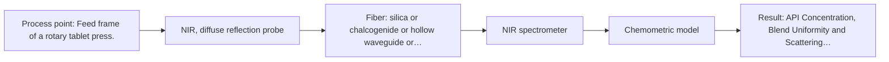
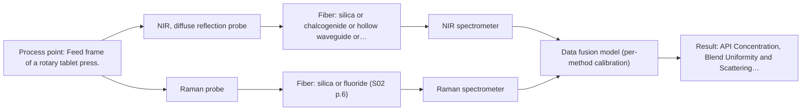

# First technical assessment: Blend potency in a tablet press feed frame

## Answer

**Customer request (our summary):** The customer wants to assess whether a fiber-based measurement in the tablet press feed frame can monitor API concentration changes in a powder blend.

### Brief answer

Fiber-based NIR diffuse reflection spectroscopy in the feed frame is recommended as the primary approach for tracking API concentration changes in powder blends. Non-contact NIR and Raman spectroscopy offer viable comparison options, with dual-method fusion available if single-method accuracy proves insufficient. Initial feasibility testing on representative blends with independent reference assays is recommended before pilot installation.

### Proposal

- **Best current option:** O2 (recommended)
- **Basis:** supplied AFS sources
- **What would change it:** If single-method NIR diffuse reflection cannot resolve the API due to severe excipient band overlap, Raman or dual-method fusion would be evaluated.
- **Next step:** Conduct laboratory feasibility trials with representative powder blend samples to test single-method NIR diffuse reflection against independent reference assays.

**Secondary evidence (external, not AFS material):** G1: E03 ¶31; G2: no usable external source found; G3: no usable external source found; G4: no usable external source found. See Expert detail.

**Decision status:** Provisional feasibility assessment

### Solution options

| ID | Tier | Methods | Confidence | Cost class, S01 Table 1 (p.6) | Ease of use | Maintenance | Performance fit | Sources |
|---|---|---|---|---|---|---|---|---|
| O1 | Simple | M2 NIR, diffuse reflection at a distance | Medium: open question: Q1, Q3 (starts at Medium) | average cost (row 10) | Non-contact measurement through viewport window | Minimal window cleaning without powder contact | Screens blend without probe fouling risk | [1: S01 p.10] |
| O2 | Recommended | M1 NIR, diffuse reflection probe | Medium: open question: Q1, Q3 (starts at Medium) | average cost (row 8) | Immersion probe directly in feed frame | Routine probe tip inspection and cleaning | Direct contact ensures representative blend sampling | [2: S01 p.15] [3: S01 p.10] |
| O3 | Extended (multi-method) | M1 NIR, diffuse reflection probe; M3 Raman probe | Low: open question: Q1, Q3 (starts at Medium); multi-method, fusion benefit not yet shown | high cost (rows 8, 12) | Synchronized dual spectrometers and fused calibration | High maintenance for dual hardware channels | Combines functional group and backbone specificity | [4: S01 p.15] [3: S01 p.10] [5: S01 p.15] |

*Confidence rates the basis of the advice (how much is known and cited), not a predicted accuracy or probability of success. It starts at High, or at Medium when a key question on the method or the option is open, and drops one level per weakness listed (floor Low).*

*Cost class is the relative rating in S01 Table 1 (p.6) for the in-line method+technique rows named (the highest one for a multi-method option); it is not a price.*

### Setup sketch

*Recommended option O2; drawn by code from the option, a schematic, not a configuration.*

### Key questions

1. What are the exact chemical identities of the active pharmaceutical ingredient and excipients, and what is the target API concentration range?
2. What are the specific accuracy, precision, and response time requirements for following API concentration changes?
3. What is the physical geometry and optical access point of the tablet press feed frame for probe installation?

## Expert detail

**Customer enquiry**

> We manufacture tablets from a powder blend containing an active pharmaceutical ingredient and excipients. Laboratory checks tell us whether the blend is on target, but results arrive after the material has moved through the press. We want to assess whether a fiber based measurement in the feed frame could follow API concentration changes. Our first pilot should compare reasonable measurement options before we commit to production equipment.

**Decision status:** Provisional feasibility assessment. Published applications and methodology demonstrate that fiber-based NIR diffuse reflection can monitor active pharmaceutical ingredient blend potency in a tablet press feed frame, but specific chemical identities and performance targets must be confirmed.

### Parameters

| ID | Parameter | Kind | Need | Measured by | Why | Sources |
|---|---|---|---|---|---|---|
| P1 | API Concentration | quantitative | required | Spectroscopy: NIR | It is the primary target variable to monitor blend potency in real-time. | *(no verified source: engineering judgement)* |
| P2 | Blend Uniformity and Scattering Variation | qualitative | required | Spectroscopy: NIR | Physical scattering and particle size variations affect diffuse reflection spectra and must be accounted for in chemometric preprocessing. | [6: S01 p.17] |

### Solution option details

- **O1 cost drivers:** Single NIR spectrometer and remote reflection probe
- **O2 cost drivers:** NIR spectrometer and diffuse reflection immersion probe
- **O3 cost drivers:** NIR and Raman spectrometers, combined probe
- **O3 combining methods:** Combines NIR and Raman spectra collected from the same measurement spot using low-level data fusion with block autoscaling. Data acquisition must be synchronized to a common time step with separate calibration models maintained per instrument block. Fused model must demonstrate superior prediction accuracy over the best single-method model on independent validation batches.

*Extended (multi-method) option O3; drawn by code from the option, a schematic, not a configuration.*

### Premise check

- **Precedent only:** A fiber-based measurement in the feed frame can follow API concentration changes. Published industrial applications demonstrate NIR and Raman spectroscopy for monitoring active pharmaceutical ingredient blend potency in a tablet press feed frame. [7: S01 p.14]

### Requirements

**Stated by the customer**

- Assess fiber-based measurement in the tablet press feed frame to follow API concentration changes.
- Compare reasonable measurement options in a first pilot before committing to production equipment.

**Key unknowns**

- Exact API and excipient chemical identities and target concentration range
- Required measurement accuracy and precision
- Required sampling frequency and response time
- Powder flow rate and feed frame geometry for probe mounting

### Clarification questions (most decision-relevant first)

Q1. What are the exact chemical identities of the active pharmaceutical ingredient and excipients, and what is the target API concentration range? *Why it matters:* It determines specific absorption bands, expected signal levels, and feasibility of NIR versus Raman detection. *(affects: method, M1, M3)*
Q2. What are the specific accuracy, precision, and response time requirements for following API concentration changes? *Why it matters:* It dictates whether a single spectroscopic method suffices or if data fusion or extended calibration is required. *(affects: technique, status)*
Q3. What is the physical geometry and optical access point of the tablet press feed frame for probe installation? *Why it matters:* It determines the mechanical probe design, mounting interface, and whether immersion or remote measurement is preferable. *(affects: installation, M1, M2)*
Q4. Do any of the excipients or the API exhibit strong fluorescence under potential laser excitation? *Why it matters:* Luminescence can swamp weak Raman signals and dictate whether Raman is a viable comparison method. *(affects: method, M3)*

### Recommendation

- **M1 · Primary candidate: NIR, diffuse reflection probe.** NIR diffuse reflection is the most common online fiber-optic analysis method and is widely applied to powder blend monitoring. [3: S01 p.10]
- **M2 · Comparison candidate: NIR, diffuse reflection at a distance.** Non-contact NIR diffuse reflection allows measurement at a distance through a window, avoiding probe immersion into the powder stream. *Conditions:* Applies if feed frame geometry allows optical access at a distance without probe contact. [1: S01 p.10]
- **M3 · Comparison candidate: Raman probe.** Raman spectroscopy provides complementary molecular backbone information and sharp fundamental vibrational bands for solid powder blends. *Conditions:* Applies if fluorescence interference is negligible and higher chemical specificity is needed. [5: S01 p.15]

### Measurement concept

- **Probe and geometry:** NIR diffuse reflection fiber probe with sapphire window contacting or viewing the flowing powder blend in the feed frame.
- **Location:** Feed frame of a rotary tablet press.
- **Fiber link:** Silica fiber optic cables connecting the probe to spectrometers located safely away from vibration and dust. [8: S01 p.15]

### Spectral range

- **NIR:** Nominal method range is 780-2500 nm; usable range depends on the instrument, fiber, and probe selected. [9: S01 p.10]
- **Raman:** Raman shift is expressed in wavenumbers (cm-1) with laser excitation wavelength stated separately. [10: S01 p.11]

### Risks and uncertainty

- Powder physical variations such as particle size distribution or packing density changes can mimic chemical concentration shifts in diffuse reflection. *(rules: R-GEO-6, R-CAL-1)* [6: S01 p.17]
- Raman signals can be swamped by background fluorescence from excipients or impurities. *(rules: R-RAM-1)* [11: S01 p.11]
- Spectrometer calibration is matrix-specific and must be re-validated if excipient grades or powder formulations change. *(rules: R-CAL-1)* [12: REF §5]

### First feasibility experiment

1. **Collect representative powder blend samples across the expected API concentration range and excipient variations.** Provide a calibration and validation set that covers the full range of physical and chemical matrix variation. *(no verified source: engineering judgement)*
2. **Perform independent reference laboratory assays such as HPLC on all collected blend samples.** Establish accurate benchmark API concentrations for multivariate calibration and validation. *(no verified source: engineering judgement)*
3. **Evaluate single-method NIR diffuse reflection probe in static powder samples and simulated feed frame flow.** Test baseline prediction accuracy and spectral signal quality for API concentration tracking. *(no verified source: engineering judgement)*
4. **Evaluate Raman spectroscopy on the same sample set as a single-method comparison.** Determine whether Raman specificity provides equivalent or superior quantification without fluorescence interference. *(no verified source: engineering judgement)*
5. **Validate multivariate chemometric models on held-out test batches against customer accuracy criteria.** Confirm model generalizability and establish the go/no-go decision based on customer targets. *(no verified source: engineering judgement)*

**Reference measurements:** Independent reference laboratory assays (such as HPLC) for API concentration.

**Decision basis:** Go/no-go based on customer-defined prediction error and accuracy criteria achieved during offline and pilot flow testing.

### Assumptions

- The powder blend flows adequately past the probe tip or viewport to maintain representative optical contact without excessive caking or bridging.
- Reference laboratory methods are sufficiently accurate and precise to provide reliable calibration data.

### Not covered by the supplied sources

- Specific API and excipient identities for this customer enquiry.
- Exact mechanical dimensions of the customer's tablet press feed frame.

### Further notes

- **Chemometrics:** Multivariate calibration models such as Partial Least Squares (PLS) combined with scatter correction preprocessing are required to extract quantitative API concentrations from overlapping NIR spectral bands.
- **Real-time tracking:** High-speed spectral acquisition enables real-time tracking of powder blend potency directly inside the tablet press feed frame.
- **Future direction:** Integration of cloud-based IoT sensor transfer or automated feed-forward control based on real-time spectral predictions.

### Secondary evidence (external, not AFS material)

*Found by a literature search for gaps the supplied AFS sources leave open. Not AFS material and not proof for this case; every quote below was verified verbatim against the fetched text.*

*Live search unavailable (library only: cache miss (europepmc); cache miss (openalex)); curated library only.*

**G1 · multi-method:** Combining several spectroscopy methods (data fusion) (Combines NIR and Raman spectra collected from the same measurement spot using low-level data fusion with block autoscaling. Data acquisition must be synchronized to a common time step with separate calibration models maintained per instrument block. Fused model must demonstrate superior prediction accuracy over the best single-method model on independent validation batches.)

- **E03 ¶31** Low-level data fusion rearranges data from different sources into a new data matrix by placing the variables one after the other. *How it applies:* This approach could be tested to combine different spectral inputs for monitoring blend homogeneity, though one should evaluate dataset complementarity first as suggested in literature. *Limits and transfer risks:* This review concept may not directly transfer from laboratory or general industrial setups to a specific powder feed frame without thorough validation. *(supports O3)*
  > "Low-level data fusion (LLDF) is considered the simplest method to achieve a combination of inputs. In this case, the data is rearranged into a new data matrix, where the variables coming from different sources are placed one after the other."
  > Challenges and Opportunities of Implementing Data Fusion in Process Analytical Technology-A Review. (2022) · Molecules (Basel, Switzerland) · doi:10.3390/molecules27154846 · https://europepmc.org/article/PMC/PMC9369811 · retrieved 2026-10-17, full text, licence: cc by, via curated library

**G2 · not in the supplied sources:** Specific API and excipient identities for this customer enquiry.

- No usable external source found.

**G3 · not in the supplied sources:** Exact mechanical dimensions of the customer's tablet press feed frame.

- No usable external source found.

**G4 · parameter without a source:** Measuring API Concentration: It is the primary target variable to monitor blend potency in real-time.

- No usable external source found.

### Evidence (verified quotes)

1. ✓ **S01 p.10** (general): "which enables measurements using diffuse reflectance, including measurements without direct contact with the sample, at a distance."
2. ✓ **S01 p.15** (application precedent): "NIR spectrometer and light source coupled with a NIR reflection probe"
3. ✓ **S01 p.10** (general): "Near-IR vibrational spectroscopy (NIR) is the most common online analysis method performed using fiber optic probes."
4. ✓ (precedent only) **S01 p.15** (method gain): "By combining Raman and NIR, these models can predict API potency or coating thickness with higher accuracy and robustness than single-method models."
5. ✓ **S01 p.15** (general): "NIR detects hydrogen bonds and asymmetric polar groups, while Raman provides information on the molecular backbone and symmetrical non-polar groups."
6. ✓ **S01 p.17** (general): "the method is sensitive to the surface characteristics and fat globule size."
7. ✓ **S01 p.14** (application precedent): "The primary objective is to determine "blend potency" - the precise concentration and uniformity of the Active Pharmaceutical Ingredient (API) - directly within the production line, specifically in the feed frame of a rotary tablet press."
8. ✓ **S01 p.15** (application precedent): "The use of fiber optics is critical here, as it allows the sensitive spectrometers to be located safely away from the vibration and dust of the manufacturing floor."
9. ✓ **S01 p.10** (general): "NIR spectra (780-2500 nm) contain predominantly overtones and component bands of fundamental vibrations of molecules"
10. ✓ **S01 p.11** (general): "The difference between the observed frequencies and the laser frequency is called the Raman shift, expressed in units of frequency-wavenumbers (cm-1)."
11. ✓ **S01 p.11** (general): "superposition of luminescence (fluorescence), which has a significantly higher intensity."
12. ✓ **REF §5** (general): "Weak signal, fluorescence background; calibration specific to the matrix."

### Verification

- Citations verified: 14 of 14 (exact or whitespace/hyphen-tolerant match on the cited page, scope checked).
- Hard check failures before deterministic corrections: 0; still open: 0; soft warnings: 2; repair rounds: 1.
- External evidence (cache): 1 quote(s) verified verbatim (exact or whitespace/hyphen-tolerant, at most 400 characters and 2 sentences, against the cited paragraph); 0 item(s) dropped.
- External search: 3 query(ies), 0 hit(s), 3 source(s) (3 from the curated library); ⚠ library only: cache miss (europepmc); cache miss (openalex).
- External step: 2 model call(s), 2.2 s extra (cost in the run JSON).

*Run D01-20261018T080635Z-5cfa · models google/gemini-3.5-flash-lite, google/gemini-3.8-flash*
