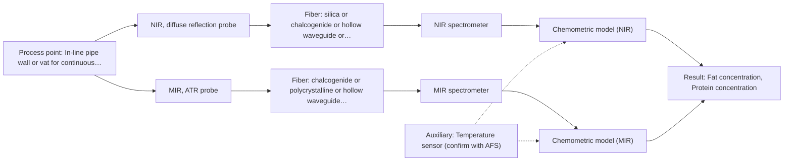

# First technical assessment: Fat and protein monitoring in opaque dairy product

## Answer

**Customer request (our summary):** The customer wants an initial spectroscopy concept and a practical comparison experiment to monitor fat and protein composition changes earlier in their opaque milk product processing line.

### Brief answer

For monitoring fat and protein in your concentrated milk product, NIR diffuse reflection via an in-line probe is recommended as the primary method due to its strong performance in opaque dairy streams. A feasibility experiment using representative samples with laboratory reference data is outlined to validate calibration models against temperature and texture variations.

### Proposal

- **Best current option:** O2 (recommended)
- **Basis:** supplied AFS sources
- **What would change it:** Confirmation of severe surface fouling or extreme temperature swings could shift preference to a bypass sampling cell or MIR ATR.
- **Next step:** Conduct laboratory trial testing NIR diffuse reflection and MIR ATR on representative concentrated milk samples.

**Secondary evidence (external, not AFS material):** G1: no usable external source found; G2: no usable external source found. See Expert detail.

**Decision status:** Provisional feasibility assessment

### Solution options

| ID | Tier | Methods | Confidence | Cost class, S01 Table 1 (p.6) | Ease of use | Maintenance | Performance fit | Sources |
|---|---|---|---|---|---|---|---|---|
| O1 | Simple | M1 NIR, diffuse reflection probe | Low: open question: Q1 (starts at Medium); precedent only | average cost (row 8) | High continuous in-line readout | Periodic optical window cleaning | Fits opaque concentrate via diffuse reflection | [1: S01 p.17] |
| O2 | Recommended | M1 NIR, diffuse reflection probe; M2 MIR, ATR probe | Medium: open question: Q1 (starts at Medium) | high cost (rows 2, 8) | Moderate multi-method evaluation | Regular calibration and optical checks | Combines robust NIR scattering with MIR surface fingerprinting | [2: S01 p.18] [1: S01 p.17] [3: S01 p.10] |

*Confidence rates the basis of the advice (how much is known and cited), not a predicted accuracy or probability of success. It starts at High, or at Medium when a key question on the method or the option is open, and drops one level per weakness listed (floor Low).*

*Cost class is the relative rating in S01 Table 1 (p.6) for the in-line method+technique rows named (the highest one for a multi-method option); it is not a price.*

### Setup sketch

*Recommended option O2; drawn by code from the option, a schematic, not a configuration.*

### Key questions

1. What are the expected concentration ranges for fat and protein in the concentrated milk product?
2. Is a flush-mounted pipe installation or a bypass loop preferred for the probe?
3. What are the operational temperature and flow velocity ranges during production?

## Expert detail

**Customer enquiry**

> We produce an opaque, concentrated milk product that flows through a processing line. We currently sample it for fat and protein analysis and would like earlier information about composition changes. Product temperature and texture vary during production. We want an initial spectroscopy concept and a practical comparison experiment, while retaining our laboratory checks.

**Decision status:** Provisional feasibility assessment. A provisional assessment is justified for monitoring fat and protein in concentrated milk using diffuse reflection NIR or MIR ATR, pending clarification of specific concentration ranges and inline installation constraints.

### Parameters

| ID | Parameter | Kind | Need | Measured by | Why | Sources |
|---|---|---|---|---|---|---|
| P1 | Fat concentration | quantitative | required | Spectroscopy: NIR | Primary target component for dairy processing control. | [4: S01 p.17] |
| P2 | Protein concentration | quantitative | required | Spectroscopy: NIR | Primary target component alongside fat. | [4: S01 p.17] |
| P3 | Product temperature | quantitative | optional | Auxiliary sensor: Temperature sensor (engineering judgement: confirm availability with AFS) | Needed to compensate for temperature-induced spectral shifts during production. | *(no verified source: engineering judgement)* |

### Solution option details

- **O1 cost drivers:** NIR spectrometer and diffuse reflection probe hardware
- **O2 cost drivers:** Dual spectrometer setup and specialized probes

### Premise check

- **Precedent only:** In-line optical spectroscopy can track fat and protein composition changes in opaque concentrated dairy products. S01 illustrates the use of in-line NIR reflection to quantify fat and protein in concentrated dairy products, providing an application precedent rather than proof for this specific product. [1: S01 p.17]

### Requirements

**Stated by the customer**

- Earlier information about composition changes
- Monitor fat and protein
- Handle opaque, concentrated milk product flowing in a processing line
- Accommodate varying temperature and texture
- Retain laboratory checks

**Key unknowns**

- Exact concentration range of fat and protein
- Pipe diameter and installation port availability
- Required measurement frequency and response time
- Presence of natural fluorophores

### Clarification questions (most decision-relevant first)

Q1. What are the expected concentration ranges for fat and protein in the concentrated milk product? *Why it matters:* Determines the required sensitivity and calibration model limits for the spectroscopy methods. *(affects: method, technique, M1, M2)*
Q2. Is a flush-mounted pipe installation or a bypass loop preferred for the probe? *Why it matters:* Affects mechanical integration, flow dynamics, and maintenance accessibility. *(affects: installation, technique)*
Q3. What are the operational temperature and flow velocity ranges during production? *Why it matters:* Influences thermal stability requirements and potential window fouling or turbulence effects. *(affects: installation)*

### Recommendation

- **M1 · Primary candidate: NIR, diffuse reflection probe.** NIR diffuse reflection is the standard in-line method for scattering dairy products like concentrates and yogurts, penetrating up to several millimeters to track major components. [1: S01 p.17]
- **M2 · Comparison candidate: MIR, ATR probe.** MIR ATR provides high-selectivity fingerprint data via surface evanescent waves, bypassing high turbidity challenges in concentrated phases. *Conditions:* if surface fouling and thin boundary penetration are managed [3: S01 p.10]
- **M3 · Conditional candidate: Raman probe.** Raman scattering offers sharp peaks with minimal water interference, suitable for aqueous streams if fluorescence background does not swamp the signal. *Conditions:* if fluorescence interference is absent or manageable [5: S01 p.16]

### Measurement concept

- **Probe and geometry:** NIR diffuse reflection fiber probe flush-mounted in the processing line or pipe wall.
- **Location:** In-line pipe wall or vat for continuous monitoring of flowing concentrated milk.
- **Fiber link:** Vis-NIR silica fiber cable connecting the probe to the spectrometer located safely away from process vibration. [6: S01 p.17] [7: S01 p.15]

### Spectral range

- **NIR:** Nominal range 780-2500 nm; actual usable range depends on the instrument, fiber and probe configuration. [8: S01 p.10]
- **MIR:** Nominal range 4000-400 cm-1; actual usable range depends on the instrument, fiber and probe configuration. [9: S01 p.9]

### Risks and uncertainty

- Physical variations such as fat globule size and texture changes can mimic compositional shifts in NIR reflectance, requiring robust scatter correction. *(rules: R-GEO-6, R-NIR-2)* [10: S01 p.17]
- Temperature fluctuations during production can alter spectral baselines and calibration accuracy if uncompensated. *(rules: R-CAL-1)* [11: REF §5]
- Probe fouling or protein/fat deposition on the optical window can degrade signal quality over time. *(rules: R-MIR-3)* [12: REF §5]

### First feasibility experiment

1. **Collect representative batch samples across the full range of fat, protein, temperature, and texture variations.** Ensure the calibration set covers expected process variability. *(no verified source: engineering judgement)*
2. **Acquire reference laboratory measurements for fat and protein for each sample.** Provide independent reference values for chemometric model training. *(no verified source: engineering judgement)*
3. **Test NIR diffuse reflection and MIR ATR probes on the sample set in a laboratory or pilot rig.** Compare spectral response and signal quality across candidate methods. *(no verified source: engineering judgement)*
4. **Build and cross-validate chemometric calibration models (PLS regression) using scatter correction.** Verify predictive accuracy for fat and protein against reference data. *(no verified source: engineering judgement)*
5. **Validate the model on held-out runs against the defined go/no-go criterion.** Confirm robustness prior to plant installation. *(no verified source: engineering judgement)*

**Reference measurements:** Standard laboratory reference checks for fat and protein from current sampling protocols.

**Decision basis:** Go/no-go decision based on customer-defined prediction error targets for fat and protein compared to current lab methods.

### Assumptions

- Product contains sufficient organic C-H and O-H bonds for NIR/MIR absorption.
- Process pipeline allows flush-mounting of a reflection probe.

### Not covered by the supplied sources

- Exact pipeline dimensions and flow pressures at the customer site.

### Further notes

- **Chemometrics:** Multivariate calibration using Partial Least Squares (PLS) regression combined with scatter correction algorithms (such as SNV or MSC) is required to handle scattering and physical variations in concentrated dairy streams.
- **Real-time tracking:** In-line probe installation enables continuous, real-time monitoring of fat and protein changes directly in the process stream, eliminating sampling delays.
- **Future direction:** Integration of automated temperature compensation and alarm systems for out-of-spec product detection.

### Secondary evidence (external, not AFS material)

*Found by a literature search for gaps the supplied AFS sources leave open. Not AFS material and not proof for this case; every quote below was verified verbatim against the fetched text.*

*Live search unavailable (library only: cache miss (europepmc); cache miss (openalex)); curated library only.*

**G1 · auxiliary sensor:** In-line measurement of Product temperature with Temperature sensor

- No usable external source found.

**G2 · not in the supplied sources:** Exact pipeline dimensions and flow pressures at the customer site.

- No usable external source found.

### Evidence (verified quotes)

1. ✓ **S01 p.17** (application precedent): "NIR Reflection is primarily used for opaque or highly concentrated dairy products, such as yogurt, butter, or whole milk concentrates."
2. ✓ **S01 p.18** (general): "having both fiber optic techniques available in a lab rather than relying on one provides the flexibility needed to monitor the entire production chain."
3. ✓ **S01 p.10** (general): "ATR fiber probes (Fig.1) enable the analysis of liquids and solid elastic samples"
4. ✓ **S01 p.17** (general): "quantify fat and protein"
5. ✓ **S01 p.16** (general): "Raman is particularly well-suited for aqueous environments, as it exhibits low absorbance for water molecules compared to infrared methods."
6. ✓ **S01 p.17** (general): "probe where one set of fibers delivers light to the sample and the other collects the "backscattered" light. Experimentally, the probe is flush-mounted into a pipe or vat to interact directly with the flowing medium."
7. ✓ **S01 p.15** (general): "located safely away from the vibration and dust of the manufacturing floor."
8. ✓ **S01 p.10** (general): "NIR spectra (780-2500 nm) contain predominantly overtones and component bands of fundamental vibrations"
9. ✓ **S01 p.9** (general): "Vibrational spectroscopy in the mid-IR range (4000-400 cm-1) is one of the most informative methods of chemical analysis."
10. ✓ **S01 p.17** (general): "the method is sensitive to the surface characteristics and fat globule size."
11. ✓ **REF §5** (general): "Weak signal, fluorescence background; calibration specific to the matrix."
12. ✓ **REF §5** (general): "Usable range limited by fiber and crystal; contact, fouling, compatibility."

### Verification

- Citations verified: 15 of 15 (exact or whitespace/hyphen-tolerant match on the cited page, scope checked).
- Hard check failures before deterministic corrections: 0; still open: 0; soft warnings: 1; repair rounds: 1.
- External evidence (cache): 0 quote(s) verified verbatim (exact or whitespace/hyphen-tolerant, at most 400 characters and 2 sentences, against the cited paragraph); 0 item(s) dropped.
- External search: 2 query(ies), 0 hit(s), 3 source(s) (3 from the curated library); ⚠ library only: cache miss (europepmc); cache miss (openalex).
- External step: 2 model call(s), 1.8 s extra (cost in the run JSON).

*Run D02-20261018T080635Z-7826 · models google/gemini-3.5-flash-lite, google/gemini-3.8-flash*
