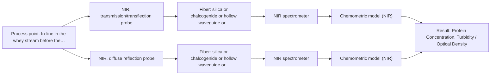

# First technical assessment: A clear whey stream before concentration

## Answer

**Customer request (our summary):** The customer wants a measurement concept using spectroscopy to track protein concentration in a whey stream that changes from relatively clear to turbid.

### Brief answer

To track protein concentration in a whey stream that shifts between clear and turbid conditions, an NIR spectroscopy setup using a transflection probe is recommended. Feasibility testing with representative samples and laboratory reference assays is necessary to validate chemometric models against physical turbidity changes.

### Proposal

- **Best current option:** O2 (recommended)
- **Basis:** supplied AFS sources
- **What would change it:** Clarification that the stream never exceeds a narrow clarity window would simplify the setup to a standard transmission probe.
- **Next step:** Conduct laboratory multi-method trials using representative clear and turbid whey samples with reference laboratory assays.

**Secondary evidence (external, not AFS material):** G1: no usable external source found; G2: no usable external source found; G3: no usable external source found; G4: no usable external source found. See Expert detail.

**Decision status:** Provisional feasibility assessment

### Solution options

| ID | Tier | Methods | Confidence | Cost class, S01 Table 1 (p.6) | Ease of use | Maintenance | Performance fit | Sources |
|---|---|---|---|---|---|---|---|---|
| O1 | Simple | M1 NIR, transmission/transflection probe | Medium: open question: Q1 (starts at Medium) | average cost (row 7) | Single transflection probe insertion | Routine optical window cleaning | Handles moderate turbidity transitions | [1: S01 p.18] |
| O2 | Recommended | M1 NIR, transmission/transflection probe; M2 NIR, diffuse reflection probe | Medium: open question: Q1 (starts at Medium) | average cost (rows 7, 8) | Configurable probe interface | Standard optical maintenance | Robust across wide turbidity shifts | [1: S01 p.18] [2: S01 p.18] |

*Confidence rates the basis of the advice (how much is known and cited), not a predicted accuracy or probability of success. It starts at High, or at Medium when a key question on the method or the option is open, and drops one level per weakness listed (floor Low).*

*Cost class is the relative rating in S01 Table 1 (p.6) for the in-line method+technique rows named (the highest one for a multi-method option); it is not a price.*

### Setup sketch

*Recommended option O2; drawn by code from the option, a schematic, not a configuration.*

### Key questions

1. What is the expected optical density or turbidity range (e.g., in NTU or transmission percentage) between the clear and turbid operating conditions?
2. What process temperature and pressure are expected at the whey stream installation point before the concentration stage?
3. What are the required measurement accuracy and response time for tracking protein concentration?

## Expert detail

**Customer enquiry**

> Our dairy process includes a relatively clear whey stream before a concentration stage. We want to investigate whether spectroscopy can track protein concentration as the stream changes, with laboratory results used as the reference. The stream can become more turbid under some operating conditions. We need a first measurement concept that handles this change rather than assuming the liquid always remains clear.

**Decision status:** Provisional feasibility assessment. The whey stream transitions between clear and turbid operating conditions, which requires an optical measurement concept capable of adapting to varying optical density, such as an NIR transflection probe or dual-technique setup validated against laboratory reference measurements.

### Parameters

| ID | Parameter | Kind | Need | Measured by | Why | Sources |
|---|---|---|---|---|---|---|
| P1 | Protein Concentration | quantitative | required | Spectroscopy: NIR | Main target variable to be tracked in-line. | *(no verified source: engineering judgement)* |
| P2 | Turbidity / Optical Density | quantitative | required | Spectroscopy: NIR | Accounts for physical state variations between clear and turbid conditions affecting light attenuation. | *(no verified source: engineering judgement)* |

### Solution option details

- **O1 cost drivers:** Single NIR spectrometer and transflection probe
- **O2 cost drivers:** NIR spectrometer with adaptable probe optics

### Premise check

- **Supported:** Spectroscopy can track protein concentration as the stream changes between clear and turbid. Supplied sources indicate that NIR spectroscopy combined with appropriate transmission, reflection, or transflection probes is standard for monitoring dairy streams like whey and milk across changing optical properties. [1: S01 p.18]

### Requirements

**Stated by the customer**

- Track protein concentration in a whey stream
- Handle process condition changes from clear to turbid
- Use laboratory results as the reference method

**Key unknowns**

- Exact turbidity range and particle/globule size variation during operating shifts
- Process temperature and pressure at the installation point
- Required measurement accuracy and response time for process control

### Clarification questions (most decision-relevant first)

Q1. What is the expected optical density or turbidity range (e.g., in NTU or transmission percentage) between the clear and turbid operating conditions? *Why it matters:* Determines whether a fixed transflection pathlength or dual transmission-reflection setup is necessary. *(affects: technique, M1, O1)*
Q2. What process temperature and pressure are expected at the whey stream installation point before the concentration stage? *Why it matters:* Defines probe materials, sealing, and pressure rating requirements. *(affects: installation)*
Q3. What are the required measurement accuracy and response time for tracking protein concentration? *Why it matters:* Informs spectrometer resolution, signal-to-noise requirements, and chemometric model complexity. *(affects: status)*

### Recommendation

- **M1 · Primary candidate: NIR, transmission/transflection probe.** NIR transflection probes can accommodate both clear and semi-transparent to moderately turbid liquid streams by controlling the optical path length, making them well-suited for dairy processing streams like whey. *Conditions:* Applicable when optical density changes remain within the dynamic range of the transflection gap. [1: S01 p.18]
- **M2 · Comparison candidate: NIR, diffuse reflection probe.** Diffuse reflection handles highly turbid or scattering states effectively when transmission signals saturate. *Conditions:* To be evaluated if turbidity increases to levels where transflection light throughput is fully attenuated. [2: S01 p.18]

### Measurement concept

- **Probe and geometry:** NIR insertion probe with a fixed transflection gap (or flush-mounted optical interface) allowing interaction with the liquid stream across varying turbidity.
- **Location:** In-line in the whey stream before the concentration stage.
- **Fiber link:** Vis-NIR silica fiber cable (low-OH content) connecting the probe to the spectrometer located safely away from process vibration. [1: S01 p.18] [3: S02 p.7]

### Spectral range

- **NIR:** Nominal method range is 780-2500 nm; usable range depends on the selected spectrometer, fiber, and probe configuration. [4: S01 p.10]

### Risks and uncertainty

- Transition to high turbidity may saturate transmission paths or cause excessive scattering, reducing signal quality. *(rules: R-GEN-4, R-GEO-2)* [5: S01 p.18]
- Physical variation such as fat globule size or particle changes can mimic chemical concentration shifts in scattering regimes. *(rules: R-GEO-6)* [6: S01 p.17]

### First feasibility experiment

1. **Collect representative whey liquid samples across the full expected range of clarity and turbidity.** Ensure the calibration dataset captures all physical and chemical variations. *(no verified source: engineering judgement)*
2. **Perform laboratory reference measurements for protein concentration on all sample states.** Establish independent reference values for chemometric model training. *(no verified source: engineering judgement)*
3. **Acquire NIR spectra using a transflection probe setup across the sample suite.** Evaluate spectral sensitivity to protein changes under varying turbidity. *(no verified source: engineering judgement)*
4. **Build and cross-validate PLS calibration models, applying scatter correction as needed.** Determine prediction accuracy and test model robustness against turbidity fluctuations. *(no verified source: engineering judgement)*

**Reference measurements:** Standard laboratory protein reference analysis (e.g., Kjeldahl or equivalent wet-chemical assay) for collected samples.

**Decision basis:** Go/no-go based on achieving customer-defined prediction error thresholds for protein concentration across both clear and turbid operating conditions.

### Assumptions

- The whey stream temperature and pressure are compatible with standard insertion probe materials.
- Laboratory reference results are representative and timely for calibration development.

### Not covered by the supplied sources

- Specific customer plant pipe dimensions and flow velocity
- Exact numerical turbidity variation limits in NTU

### Further notes

- **Chemometrics:** Preprocessing such as Multiplicative Scatter Correction (MSC) or Standard Normal Variate (SNV) combined with Partial Least Squares (PLS) regression is required to separate chemical protein absorption from physical scattering changes.
- **Real-time tracking:** Continuous in-line spectral acquisition enables real-time tracking of protein concentration changes prior to the concentration stage.
- **Future direction:** Integration of the calibrated sensor into automated process control loops for feed-forward control of the concentration stage.

### Secondary evidence (external, not AFS material)

*Found by a literature search for gaps the supplied AFS sources leave open. Not AFS material and not proof for this case; every quote below was verified verbatim against the fetched text.*

*Live search unavailable (library only: cache miss (europepmc); cache miss (openalex)); curated library only.*

**G1 · not in the supplied sources:** Specific customer plant pipe dimensions and flow velocity

- No usable external source found.

**G2 · not in the supplied sources:** Exact numerical turbidity variation limits in NTU

- No usable external source found.

**G3 · parameter without a source:** Measuring Protein Concentration: Main target variable to be tracked in-line.

- No usable external source found.

**G4 · parameter without a source:** Measuring Turbidity / Optical Density: Accounts for physical state variations between clear and turbid conditions affecting light attenuation.

- No usable external source found.

### Evidence (verified quotes)

1. ✓ **S01 p.18** (general): "In some cases, a Transflection probe can already be a combined solution working well for low-fat and high-fat containing milk products."
2. ✓ **S01 p.18** (general): "reflection can work well in highly scattering environments but can be less representative for clear liquids."
3. ✓ **S02 p.7** (general): "Robust 100-300m cables made with Silica fibers of low OH-content (<0.1ppm OH) enable remote industrial process-control"
4. ✓ **S01 p.10** (general): "NIR spectra (780-2500 nm) contain predominantly overtones and component bands of fundamental vibrations"
5. ✓ **S01 p.18** (general): "if the pathlength is too wide, the signal is lost to absorption; if too narrow, the sample represents a negligible volume."
6. ✓ **S01 p.17** (general): "the method is sensitive to the surface characteristics and fat globule size."

### Verification

- Citations verified: 8 of 8 (exact or whitespace/hyphen-tolerant match on the cited page, scope checked).
- Hard check failures before deterministic corrections: 0; still open: 0; soft warnings: 0; repair rounds: 0.
- External evidence (cache): 0 quote(s) verified verbatim (exact or whitespace/hyphen-tolerant, at most 400 characters and 2 sentences, against the cited paragraph); 0 item(s) dropped.
- External search: 3 query(ies), 0 hit(s), 3 source(s) (3 from the curated library); ⚠ library only: cache miss (europepmc); cache miss (openalex).
- External step: 2 model call(s), 1.7 s extra (cost in the run JSON).

*Run D03-20261018T080635Z-90f2 · models google/gemini-3.5-flash-lite*
