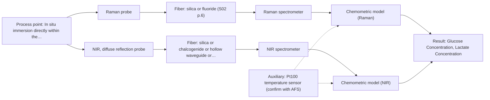

# First technical assessment: Glucose and lactate trends in an aqueous bioprocess

## Answer

**Customer request (our summary):** The customer wants to explore an in situ spectroscopy pilot to measure glucose and lactate in a cell culture process to avoid delays from laboratory measurements.

### Brief answer

For monitoring glucose and lactate in an aqueous cell culture, Raman spectroscopy is recommended as the primary method due to its low water interference in aqueous environments. Initial feasibility testing should acquire in situ spectra across representative runs and build chemometric calibration models against reference laboratory measurements.

### Proposal

- **Best current option:** O2 (recommended)
- **Basis:** engineering judgement
- **What would change it:** Discovery of severe fluorescence interference during initial testing would shift the recommendation toward NIR or multi-method configurations.
- **Next step:** Conduct benchtop laboratory trials using representative cell culture samples to evaluate Raman signal quality and build initial calibration models.

**Secondary evidence (external, not AFS material):** G1: no usable external source found; G2: no usable external source found; G3: no usable external source found; G4: E02 ¶20. See Expert detail.

**Decision status:** Provisional feasibility assessment

### Solution options

| ID | Tier | Methods | Confidence | Cost class, S01 Table 1 (p.6) | Ease of use | Maintenance | Performance fit | Sources |
|---|---|---|---|---|---|---|---|---|
| O1 | Simple | M1 Raman probe | Medium: open question: Q1, Q2 (starts at Medium) | high cost (row 12) | Single immersible Raman probe setup | Periodic optical check and probe cleaning | Directly tracks aqueous metabolites with minimal water interference | [1: S01 p.16] |
| O2 | Recommended | M1 Raman probe; M2 NIR, diffuse reflection probe | Low: open question: Q1, Q2 (starts at Medium); sample clarity unknown | high cost (rows 8, 12) | Raman probe with auxiliary temperature monitoring | Regular calibration maintenance and cleaning | Robust metabolite tracking with temperature compensation for changing media | [1: S01 p.16] [2: S01 p.10] |

*Confidence rates the basis of the advice (how much is known and cited), not a predicted accuracy or probability of success. It starts at High, or at Medium when a key question on the method or the option is open, and drops one level per weakness listed (floor Low).*

*Cost class is the relative rating in S01 Table 1 (p.6) for the in-line method+technique rows named (the highest one for a multi-method option); it is not a price.*

### Setup sketch

*Recommended option O2; drawn by code from the option, a schematic, not a configuration.*

### Key questions

1. What are the exact concentration ranges and required accuracy for glucose and lactate during the cell culture run?
2. Are there fluorescent components or media ingredients present that could generate luminescence background interference?
3. What is the physical access configuration of the bioreactor (e.g., port size, immersion depth, sterilization requirements)?

## Expert detail

**Customer enquiry**

> We run a cell culture process in an aqueous medium. Glucose and lactate are measured from samples, and the delay makes it difficult to see changes promptly. We are exploring an in situ spectroscopy pilot that can be checked against those existing laboratory measurements. The medium and cell population change during the run; we have not yet selected a probe or a calibration strategy.

**Decision status:** Provisional feasibility assessment. The targets (glucose and lactate) and process environment (aqueous cell culture with changing medium and cell population) are specified, allowing a provisional method selection centered on Raman spectroscopy for aqueous metabolite tracking, pending experimental calibration and probe selection.

### Parameters

| ID | Parameter | Kind | Need | Measured by | Why | Sources |
|---|---|---|---|---|---|---|
| P1 | Glucose Concentration | quantitative | required | Spectroscopy: Raman | Core target parameter to monitor nutrient consumption and avoid process delays. | *(no verified source: engineering judgement)* |
| P2 | Lactate Concentration | quantitative | required | Spectroscopy: Raman | Core target parameter to monitor metabolic byproducts and cell culture health. | *(no verified source: engineering judgement)* |
| P3 | Process Temperature | quantitative | optional | Auxiliary sensor: Pt100 temperature sensor (engineering judgement: confirm availability with AFS) | Temperature variations can influence spectral baselines and biological reaction rates. | *(no verified source: engineering judgement)* |

### Solution option details

- **O1 cost drivers:** Standard Raman spectrometer, laser source, and immersion probe hardware
- **O2 cost drivers:** Raman spectrometer system plus chemometric calibration software development

### Premise check

- **Precedent only:** In situ spectroscopy can directly monitor specific metabolites such as glucose and lactate in an aqueous cell culture. Bioprocess literature reports direct detection of metabolites including glucose and lactate in reactors using Raman spectroscopy, providing a reason to test rather than proven capability for this specific process. [3: S01 p.16]

### Requirements

**Stated by the customer**

- In situ monitoring of glucose and lactate in an aqueous cell culture process
- Overcoming sample delays to observe process changes promptly
- Accommodating changes in medium and cell population during the run
- Checking spectroscopy pilot against existing laboratory measurements

**Key unknowns**

- Required concentration ranges and target accuracy for glucose and lactate
- Process temperature, pressure, and reactor port compatibility
- Presence of background fluorescence or turbidity affecting optical measurements
- Preferred chemometric calibration and cross-validation strategy

### Clarification questions (most decision-relevant first)

Q1. What are the exact concentration ranges and required accuracy for glucose and lactate during the cell culture run? *Why it matters:* Defines sensitivity requirements and determines whether single-method spectroscopy or multi-method fusion is necessary. *(affects: method, technique)*
Q2. Are there fluorescent components or media ingredients present that could generate luminescence background interference? *Why it matters:* High fluorescence background can swamp weak Raman signals and dictate optical filtering or alternative methods. *(affects: method, M1, technique)*
Q3. What is the physical access configuration of the bioreactor (e.g., port size, immersion depth, sterilization requirements)? *Why it matters:* Governs probe mechanical design, material compatibility, and in situ installation constraints. *(affects: installation, technique)*
Q4. What reference analytical method and sampling frequency are currently used for laboratory glucose and lactate measurements? *Why it matters:* Establishes the ground-truth baseline required for building and validating chemometric calibration models. *(affects: status, installation)*

### Recommendation

- **M1 · Primary candidate: Raman probe.** Raman spectroscopy is well suited for aqueous environments because water exhibits low absorbance compared to infrared methods, and it provides direct molecular detection of specific metabolites like glucose and lactate. [1: S01 p.16]
- **M2 · Comparison candidate: NIR, diffuse reflection probe.** Near-infrared spectroscopy is a widely established online method for monitoring major components and bioprocess trends, serving as a comparison method to evaluate bulk matrix variations. *Conditions:* Applicable if scattering from cell populations provides sufficient optical response and models are calibrated against reference data. [2: S01 p.10]

### Measurement concept

- **Probe and geometry:** Immersible Raman probe with laser excitation and filtered collection optics for contact measurement inside the aqueous reactor medium.
- **Location:** In situ immersion directly within the bioreactor vessel or process flow loop.
- **Fiber link:** Fiber optic cable connecting the immersion probe to the spectrometer and laser source located safely away from the process environment. [4: S01 p.5] [5: S01 p.15]

### Spectral range

- **Raman:** Raman spectroscopy records Raman shifts expressed in units of frequency-wavenumbers (cm-1) relative to the laser excitation frequency; usable range depends on the instrument, fiber, and probe selected. [6: S01 p.11]
- **NIR:** Nominal near-infrared range is 780-2500 nm; actual usable range depends on the instrument, fiber, and probe configuration. [7: S01 p.10]

### Risks and uncertainty

- Raman scattering signals are inherently weak and can be swamped by fluorescence background from media components. *(rules: R-RAM-1)* [8: S01 p.11]
- Changes in cell population and medium composition during the run can alter scattering and background properties, requiring robust calibration maintenance. *(rules: R-CAL-1)* [9: REF §5]

### First feasibility experiment

1. **Sample collection across expected chemical and physical variation** Capture representative states of changing cell populations and metabolite concentrations during bioreactor runs. *(no verified source: engineering judgement)*
2. **Independent reference measurements** Obtain accurate offline reference values for glucose and lactate for all test samples. *(no verified source: engineering judgement)*
3. **Single-method spectral acquisition** Record Raman spectra in situ across test runs to identify stable spectral features for metabolites. *(no verified source: engineering judgement)*
4. **Chemometric model building and cross-validation** Develop partial least squares (PLS) calibration models linking spectra to reference concentrations. *(no verified source: engineering judgement)*
5. **Validation on held-out runs** Test model predictive accuracy on independent batches against customer-defined error criteria. *(no verified source: engineering judgement)*

**Reference measurements:** Offline laboratory measurements of glucose and lactate corresponding in time to in situ spectral acquisitions.

**Decision basis:** Go/no-go is determined by whether the prediction error of the spectroscopic model meets the customer's required accuracy threshold compared to reference lab results.

### Assumptions

- The cell culture medium is liquid and compatible with immersible probe placement.
- Reference laboratory measurements for glucose and lactate are available for model calibration.

### Not covered by the supplied sources

- Specific bioreactor vessel geometry and operating temperature/pressure bounds
- Customer's exact target concentration limits and accuracy specifications

### Further notes

- **Chemometrics:** A chemometric calibration model (such as PLS) linking Raman spectra to reference glucose and lactate concentrations is required to translate spectral variations into real-time concentration values.
- **Real-time tracking:** In-line immersion probes enable continuous, real-time tracking of metabolite dynamics, eliminating sample collection delays.
- **Future direction:** Integration of supplementary fluorescence or NIR sensing channels if multi-variable data fusion is required for complex media states.

### Secondary evidence (external, not AFS material)

*Found by a literature search for gaps the supplied AFS sources leave open. Not AFS material and not proof for this case; every quote below was verified verbatim against the fetched text.*

*Live search unavailable (library only: cache miss (europepmc); cache miss (openalex)); curated library only.*

**G1 · auxiliary sensor:** In-line measurement of Process Temperature with Pt100 temperature sensor

- No usable external source found.

**G2 · not in the supplied sources:** Specific bioreactor vessel geometry and operating temperature/pressure bounds

- No usable external source found.

**G3 · not in the supplied sources:** Customer's exact target concentration limits and accuracy specifications

- No usable external source found.

**G4 · parameter without a source:** Measuring Glucose Concentration: Core target parameter to monitor nutrient consumption and avoid process delays.

- **E02 ¶20** The source notes that Raman spectroscopy is often used in upstream processing because of its high selectivity and low water interference despite relatively long measurement times. *How it applies:* This finding could support evaluating Raman probes for monitoring glucose concentration, though measurement times must be tested against process dynamics. *Limits and transfer risks:* The literature finding comes from general upstream processing reviews and may not directly translate to the customer's specific cell culture matrix, scale, or instrument configuration. *(supports O2)*
  > "Raman spectroscopy is frequently applied in upstream processing in research and industry due to its high selectivity and low water interference [55] despite the relatively long measurement times."
  > A critical review of recent trends, and a future perspective of optical spectroscopy as PAT in biopharmaceutical downstream processing. (2020) · Analytical and bioanalytical chemistry · doi:10.1007/s00216-020-02407-z · https://europepmc.org/article/PMC/PMC7072065 · retrieved 2026-10-17, full text, licence: cc by, via curated library

### Evidence (verified quotes)

1. ✓ **S01 p.16** (general): "While UV/Vis tracks growth, Raman spectroscopy can be used in the same reactor to provide a "molecular fingerprint" for direct detection of specific metabolites like glucose, acetate, or lactate. This combination is practical because Raman is particularly well-suited for aqueous environments, as it exhibits low absorbance for water molecules compared to infrared methods."
2. ✓ **S01 p.10** (general): "Near-IR vibrational spectroscopy (NIR) is the most common online analysis method performed using fiber optic probes."
3. ✓ **S01 p.16** (application precedent): "While UV/Vis tracks growth, Raman spectroscopy can be used in the same reactor to provide a "molecular fingerprint" for direct detection of specific metabolites like glucose, acetate, or lactate."
4. ✓ **S01 p.5** (general): "Immersible fiber optic probes operating in various spectral regions from UV to mid-IR are increasingly being used for measuring liquid and soft or powdered solid samples."
5. ✓ **S01 p.15** (general): "The use of fiber optics is critical here, as it allows the sensitive spectrometers to be located safely away from the vibration and dust of the manufacturing floor."
6. ✓ **S01 p.11** (general): "The difference between the observed frequencies and the laser frequency is called the Raman shift, expressed in units of frequency-wavenumbers (cm-1)."
7. ✓ **S01 p.10** (general): "NIR spectra (780-2500 nm) contain predominantly overtones and component bands of fundamental vibrations of molecules and atomic groups"
8. ✓ **S01 p.11** (general): "Furthermore, observing Raman bands is often complicated by light scattering from the illuminating laser, and for many organic compounds, by the superposition of luminescence (fluorescence), which has a significantly higher intensity."
9. ✓ **REF §5** (general): "Weak signal, fluorescence background; calibration specific to the matrix."

### Verification

- Citations verified: 9 of 9 (exact or whitespace/hyphen-tolerant match on the cited page, scope checked).
- Hard check failures before deterministic corrections: 0; still open: 0; soft warnings: 0; repair rounds: 1.
- External evidence (cache): 1 quote(s) verified verbatim (exact or whitespace/hyphen-tolerant, at most 400 characters and 2 sentences, against the cited paragraph); 0 item(s) dropped.
- External search: 3 query(ies), 0 hit(s), 3 source(s) (3 from the curated library); ⚠ library only: cache miss (europepmc); cache miss (openalex).
- External step: 2 model call(s), 2.1 s extra (cost in the run JSON).

*Run D04-20261018T080635Z-c65e · models google/gemini-3.5-flash-lite, google/gemini-3.8-flash*
