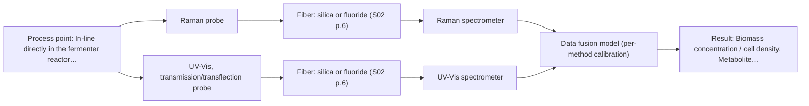

# First technical assessment: Biomass related monitoring during yeast fermentation

## Answer

**Customer request (our summary):** The customer wants an optical measurement to monitor yeast fermentation growth and metabolic changes, and requests an initial feasibility study.

### Brief answer

To monitor both yeast growth and metabolic changes across increasing optical density, we recommend testing Raman spectroscopy for metabolite fingerprinting and UV-Vis for biomass turbidity. Because the broth density changes and targets span both physical scattering and chemical composition, a multi-method feasibility study with independent reference measurements is recommended to establish optimal calibration models.

### Proposal

- **Best current option:** O2 (recommended)
- **Basis:** engineering judgement
- **What would change it:** Clarification that only biomass or only metabolite tracking is needed, which would reduce the solution to a single method.
- **Next step:** Conduct multi-method laboratory trials on representative fermentation broth samples with independent reference measurements.

**Secondary evidence (external, not AFS material):** G1: E03 ¶20; G2: no usable external source found; G3: no usable external source found. See Expert detail.

**Decision status:** Insufficient information for a method choice

### Solution options

| ID | Tier | Methods | Confidence | Cost class, S01 Table 1 (p.6) | Ease of use | Maintenance | Performance fit | Sources |
|---|---|---|---|---|---|---|---|---|
| O1 | Simple | M1 Raman probe | Low: open question: Q1 (starts at Medium); status: insufficient information | high cost (row 12) | Moderate setup with single Raman probe. | Standard probe cleaning and laser check. | Provides direct molecular fingerprinting for metabolites in aqueous broth. | [1: S01 p.16] |
| O2 | Recommended | M1 Raman probe; M2 UV-Vis, transmission/transflection probe + Raman (combination) | Low: open question: Q1 (starts at Medium); status: insufficient information; multi-method, fusion benefit not yet shown | high cost (rows 12, 16) | Dual measurement setup requiring synchronization. | Maintains independent diagnostics for both optical channels. | Combines UV-Vis turbidity tracking for biomass with Raman metabolite fingerprinting for comprehensive monitoring. | [2: S01 p.8] [1: S01 p.16] [3: S01 p.16] |

*Confidence rates the basis of the advice (how much is known and cited), not a predicted accuracy or probability of success. It starts at High, or at Medium when a key question on the method or the option is open, and drops one level per weakness listed (floor Low).*

*Cost class is the relative rating in S01 Table 1 (p.6) for the in-line method+technique rows named (the highest one for a multi-method option); it is not a price.*

### Setup sketch

*Recommended option O2; drawn by code from the option, a schematic, not a configuration.*

### Key questions

1. What are the specific target analytes for the metabolic signal (e.g., specific carbon sources, organic acids, or cofactors) and the desired quantification limits?
2. What is the expected optical density or turbidity range (OD units or attenuation) at the end of the fermentation run?
3. What is the physical access configuration of the fermenter (e.g., standard flange size, port orientation)?

## Expert detail

**Customer enquiry**

> We would like an optical measurement during yeast fermentation to help us follow growth and notice changes earlier. Our team has mentioned both a biomass signal and a metabolic signal, but these have not been defined as separate targets. The broth becomes more optically dense as the run develops. We need help turning this request into an initial feasibility study with useful reference measurements.

**Decision status:** Insufficient information for a method choice. The targets for biomass and metabolic signals are broadly stated without specific analyte definitions, and the increasing optical density presents variable turbidity challenges that require experimental screening.

### Parameters

| ID | Parameter | Kind | Need | Measured by | Why | Sources |
|---|---|---|---|---|---|---|
| P1 | Biomass concentration / cell density | quantitative | required | Spectroscopy: UV-Vis | Needed to track growth and follow fermentation progress. | [3: S01 p.16] |
| P2 | Metabolite concentration | quantitative | required | Spectroscopy: Raman | Needed to monitor metabolic changes and nutrient consumption. | [4: S01 p.16] |

### Solution option details

- **O1 cost drivers:** Single spectrometer and Raman probe hardware.
- **O2 cost drivers:** Multiple spectrometers and combined or dual probe hardware.
- **O2 combining methods:** Combines UV-Vis and Raman data to track both biomass and metabolites simultaneously. Requires spatial alignment at the same measurement spot and synchronization of acquisition rates to a common time step before fusion.

### Premise check

- **Not covered:** A single optical measurement can simultaneously track biomass and metabolic signals across a changing optical density without specific sensor tuning. The supplied materials indicate that bioprocess monitoring often requires combining complementary techniques rather than assuming a single unadjusted measurement suffices for all targets. *(no verified source: engineering judgement)*

### Requirements

**Stated by the customer**

- Optical measurement during yeast fermentation
- Follow growth and notice changes earlier
- Track biomass and metabolic signals
- Account for increasing optical density during the run
- Initial feasibility study with useful reference measurements

**Key unknowns**

- Specific target species and exact definitions of biomass and metabolic signals
- Exact optical density range and turbidity changes of the fermentation broth
- Reactor port geometry and operating temperature/pressure

### Clarification questions (most decision-relevant first)

Q1. What are the specific target analytes for the metabolic signal (e.g., specific carbon sources, organic acids, or cofactors) and the desired quantification limits? *Why it matters:* Determines whether vibrational spectroscopy (Raman/NIR) or molecular fluorescence is required for metabolite tracking. *(affects: method, technique)*
Q2. What is the expected optical density or turbidity range (OD units or attenuation) at the end of the fermentation run? *Why it matters:* Governs whether transmission/transflection probes or ATR probes are needed to avoid signal saturation in high-turbidity media. *(affects: technique)*
Q3. What is the physical access configuration of the fermenter (e.g., standard flange size, port orientation)? *Why it matters:* Defines the mechanical installation and probe insertion requirements. *(affects: installation)*

### Recommendation

- **M1 · Primary candidate: Raman probe.** Raman spectroscopy provides a molecular fingerprint suitable for tracking specific metabolites in aqueous environments due to low water absorbance. [1: S01 p.16]
- **M2 · Comparison candidate: UV-Vis, transmission/transflection probe + Raman (combination).** UV-Vis turbidity correlates well with cell density for biomass monitoring, and can be combined with Raman in an extended setup. *Conditions:* Applies if biomass turbidity tracking needs to be combined with metabolite fingerprinting. [3: S01 p.16] Later hypothesis, after single-method tests.

### Measurement concept

- **Probe and geometry:** Immersion probe (Raman probe or UV-Vis transflection/ATR probe depending on optical density)
- **Location:** In-line directly in the fermenter reactor flow or vessel port
- **Fiber link:** Low-OH silica fiber cables connecting remote spectrometers to the probe [5: S01 p.2]

### Spectral range

- **Raman:** Raman shift expressed in cm-1 with laser excitation wavelength stated separately; usable range depends on the specific spectrometer and probe configuration. [6: S01 p.11]
- **UV-Vis:** Nominal UV-Vis range covers electronic transitions (high sensitivity in 190-360 nm); usable range depends on instrument and optical configuration. [7: S01 p.5]

### Risks and uncertainty

- Increasing broth turbidity and optical density can cause optical signal saturation in transmission geometries. *(rules: R-GEN-4)* [8: S01 p.16]
- Fluorescence background interference can swamp weak Raman signals if proper optical filtering is not applied. *(rules: R-RAM-1)* [9: S01 p.11]

### First feasibility experiment

1. **Collect representative broth samples across the expected growth curve and varying optical density states.** Ensure chemical and physical variation of the fermentation process is captured. *(no verified source: engineering judgement)*
2. **Perform reference lab measurements for each sample.** Provide independent reference values for calibration. *(no verified source: engineering judgement)*
3. **Test single methods independently against reference data.** Establish baseline single-method performance before attempting data fusion. *(no verified source: engineering judgement)*
4. **Validate calibration models on independent fermentation runs.** Test robustness against process variability. *(no verified source: engineering judgement)*

**Reference measurements:** Independent laboratory reference assays (e.g., dry cell weight for biomass and HPLC for specific metabolites).

**Decision basis:** Go/no-go criteria based on customer-defined prediction error thresholds and required detection limits for biomass and metabolic targets.

### Assumptions

- Fermentation broth is primarily aqueous
- Sample temperature and pressure fall within standard fiber probe operating limits

### Not covered by the supplied sources

- Exact growth kinetics and specific metabolic byproduct profiles of the customer's particular yeast strain

### Further notes

- **Chemometrics:** Multivariate calibration is required to correlate spectral variations with biomass and metabolite reference values.
- **Real-time tracking:** In-line probe integration enables continuous real-time tracking of fermentation dynamics as optical density increases.
- **Future direction:** Integration into an automated process control system or optical multisensor system.

### Secondary evidence (external, not AFS material)

*Found by a literature search for gaps the supplied AFS sources leave open. Not AFS material and not proof for this case; every quote below was verified verbatim against the fetched text.*

*Live search unavailable (library only: cache miss (europepmc); cache miss (openalex)); curated library only.*

**G1 · decision status:** insufficient information: The targets for biomass and metabolic signals are broadly stated without specific analyte definitions, and the increasing optical density presents variable turbidity challenges that require experimental screening.

- **E03 ¶20** Raman spectroscopy is frequently applied in upstream processing due to its high selectivity and low water interference. *How it applies:* This suggests testing Raman spectroscopy for monitoring fermentation processes, while watching for selectivity and water interference limits. *Limits and transfer risks:* The literature finding comes from general biopharmaceutical processing and may not transfer directly to the specific yeast strain matrix without experimental screening. *(supports O1)*
  > "Raman spectroscopy is frequently applied in upstream processing in research and industry due to its high selectivity and low water interference [55] despite the relatively long measurement times."
  > A critical review of recent trends, and a future perspective of optical spectroscopy as PAT in biopharmaceutical downstream processing. (2020) · Analytical and bioanalytical chemistry · doi:10.1007/s00216-020-02407-z · https://europepmc.org/article/PMC/PMC7072065 · retrieved 2026-10-17, full text, licence: cc by, via curated library

**G2 · not in the supplied sources:** Exact growth kinetics and specific metabolic byproduct profiles of the customer's particular yeast strain

- No usable external source found.

**G3 · premise not covered:** A single optical measurement can simultaneously track biomass and metabolic signals across a changing optical density without specific sensor tuning.

- No usable external source found.

### Evidence (verified quotes)

1. ✓ **S01 p.16** (general): "Raman spectroscopy can be used in the same reactor to provide a "molecular fingerprint" for direct detection of specific metabolites like glucose, acetate, or lactate. This combination is practical because Raman is particularly well-suited for aqueous environments, as it exhibits low absorbance for water molecules compared to infrared methods."
2. ✓ **S01 p.8** (general): "It is crucial that the spectral information obtained by different methods-Mid-IR, NIR, Raman, and fluorescence spectra-is collected from the same small, even pinpoint, area of the sample."
3. ✓ **S01 p.16** (general): "UV/Vis spectroscopy can be deployed as a low-cost, robust tool for real-time biomass monitoring, as cell suspension turbidity correlates well with cell density."
4. ✓ **S01 p.16** (general): "Raman spectroscopy can be used in the same reactor to provide a "molecular fingerprint" for direct detection of specific metabolites like glucose, acetate, or lactate."
5. ✓ **S01 p.2** (general): "Fiber optic probes and cells are being integrated into reactors and production lines of ongoing technological processes, enabling on-site online analysis"
6. ✓ **S01 p.11** (general): "The Raman shift is used as the horizontal (spectral) axis in Raman spectroscopy, while the vertical axis shows the absolute intensity of the recorded signals"
7. ✓ **S01 p.5** (general): "UV-visible spectroscopy is based on electronic transitions between molecular energy levels. It has very high sensitivity, especially in the UV region (190-360 nm)"
8. ✓ **S01 p.16** (general): "transmission setup becomes saturated because the light cannot penetrate the bulk of the sample."
9. ✓ **S01 p.11** (general): "Furthermore, observing Raman bands is often complicated by light scattering from the illuminating laser, and for many organic compounds, by the superposition of luminescence (fluorescence), which has a significantly higher intensity."

### Verification

- Citations verified: 10 of 10 (exact or whitespace/hyphen-tolerant match on the cited page, scope checked).
- Hard check failures before deterministic corrections: 0; still open: 0; soft warnings: 0; repair rounds: 1.
- External evidence (cache): 1 quote(s) verified verbatim (exact or whitespace/hyphen-tolerant, at most 400 characters and 2 sentences, against the cited paragraph); 0 item(s) dropped.
- External search: 2 query(ies), 0 hit(s), 3 source(s) (3 from the curated library); ⚠ library only: cache miss (europepmc); cache miss (openalex).
- External step: 2 model call(s), 3.0 s extra (cost in the run JSON).

*Run D05-20261018T080635Z-feef · models google/gemini-3.5-flash-lite, google/gemini-3.8-flash*
