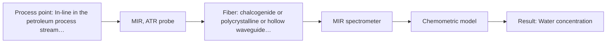

# First technical assessment: Water content in a petroleum stream

## Answer

**Customer request (our summary):** The customer wants to investigate a fiber-based measurement for water determination in a petroleum stream with the analyzer located outside the process area.

### Brief answer

To determine water in a petroleum stream with a remote analyzer, Mid-IR ATR spectroscopy using specialized infrared fibers is recommended as the primary approach, supported by literature precedent. Key unknowns regarding concentration range, process conditions, and exact remote distance must be clarified. A first feasibility experiment should test representative petroleum samples against standard laboratory reference measurements.

### Proposal

- **Best current option:** O2 (recommended)
- **Basis:** supplied AFS sources
- **What would change it:** If the remote distance exceeds mid-infrared fiber transmission limits or if scattering dominates, NIR transmission/reflection would be evaluated.
- **Next step:** Conduct multi-method laboratory trials with representative petroleum samples containing known water concentrations.

**Secondary evidence (external, not AFS material):** G1: E03 ¶4. See Expert detail.

**Decision status:** Provisional feasibility assessment

### Solution options

| ID | Tier | Methods | Confidence | Cost class, S01 Table 1 (p.6) | Ease of use | Maintenance | Performance fit | Sources |
|---|---|---|---|---|---|---|---|---|
| O1 | Simple | M2 NIR, transmission/transflection probe | Low: open question: Q1 (starts at Medium); sample clarity unknown | average cost (row 7) | Standard silica fiber transmission setup | Periodic optical path inspection and cleaning | Evaluates NIR water overtone absorption bands | [1: S01 p.10] |
| O2 | Recommended | M1 MIR, ATR probe | Low: open question: Q1 (starts at Medium); precedent only | high cost (row 2) | Remote FTIR with robust ATR probe | Regular optical check and background verification | Optimal balance of sensitivity for water in petroleum | [2: S02 p.13] |

*Confidence rates the basis of the advice (how much is known and cited), not a predicted accuracy or probability of success. It starts at High, or at Medium when a key question on the method or the option is open, and drops one level per weakness listed (floor Low).*

*Cost class is the relative rating in S01 Table 1 (p.6) for the in-line method+technique rows named (the highest one for a multi-method option); it is not a price.*

### Setup sketch

*Recommended option O2; drawn by code from the option, a schematic, not a configuration.*

### Key questions

1. What is the expected concentration range of water in the petroleum stream?
2. What are the operating temperature, pressure, and flow velocity at the measurement point?
3. What is the exact physical distance between the in-line measurement point and the location of the remote analyzer outside the process area?

## Expert detail

**Customer enquiry**

> We handle a petroleum stream and currently send samples to a laboratory for water determination. We want to investigate a fiber based measurement closer to the process so that changes can be noticed sooner. The analyzer would be outside the process area. Before selecting equipment, we need to know what to clarify and what a first comparison experiment should establish.

**Decision status:** Provisional feasibility assessment. A provisional assessment is supported by literature precedent for water determination in petroleum using Mid-IR ATR spectroscopy, but operating conditions and remote fiber link requirements must be clarified.

### Parameters

| ID | Parameter | Kind | Need | Measured by | Why | Sources |
|---|---|---|---|---|---|---|
| P1 | Water concentration | quantitative | required | Spectroscopy: MIR | Primary target variable for process monitoring. | *(no verified source: engineering judgement)* |

### Solution option details

- **O1 cost drivers:** Standard NIR spectrometer and silica fibers
- **O2 cost drivers:** Specialized IR fiber cables and spectrometer hardware

### Premise check

- **Precedent only:** A fiber-based measurement can determine water in a petroleum stream closer to the process with the analyzer outside the process area. Source S02 p.13 illustrates water content measurement in petroleum using ATR probes, but specific fiber routing and remote distances require verification. [2: S02 p.13]

### Requirements

**Stated by the customer**

- Petroleum stream water determination
- Fiber-based measurement closer to the process
- Analyzer outside the process area

**Key unknowns**

- Expected water concentration range
- Process temperature and pressure
- Exact distance from the measurement point to the remote analyzer
- Potential for optical fouling or window coating

### Clarification questions (most decision-relevant first)

Q1. What is the expected concentration range of water in the petroleum stream? *Why it matters:* It determines the required sensitivity and dynamic range of the spectroscopic method. *(affects: method, M1)*
Q2. What are the operating temperature, pressure, and flow velocity at the measurement point? *Why it matters:* It dictates probe mechanical design and material compatibility. *(affects: installation)*
Q3. What is the exact physical distance between the in-line measurement point and the location of the remote analyzer outside the process area? *Why it matters:* Infrared fiber transmission distances are more limited than low-OH silica fibers. *(affects: installation)*
Q4. Is there a risk of fouling, suspended solids, or heavy petroleum residues coating the probe optical interface? *Why it matters:* Surface fouling on ATR crystals directly impacts signal stability and measurement reliability. *(affects: technique, M1)*

### Recommendation

- **M1 · Primary candidate: MIR, ATR probe.** Mid-IR ATR spectroscopy with specialized IR fibers is established for measuring water content in petroleum streams. *Conditions:* Must verify that the remote distance is compatible with infrared fiber transmission limits. [2: S02 p.13]
- **M2 · Comparison candidate: NIR, transmission/transflection probe.** Near-infrared spectroscopy offers robust fiber coupling over longer distances using standard silica fibers if scattering permits. *Conditions:* Applicable if water overtone absorption bands provide sufficient sensitivity for the concentration range. [1: S01 p.10]

### Measurement concept

- **Probe and geometry:** Mid-IR ATR probe with a Zirconium dioxide (ZrO2) or diamond crystal tip mounted directly in the petroleum stream.
- **Location:** In-line in the petroleum process stream; analyzer located outside the process area.
- **Fiber link:** Chalcogenide (CIR) or polycrystalline infrared (PIR) fiber cables connecting the remote spectrometer to the ATR probe. [2: S02 p.13]

### Spectral range

- **MIR:** The nominal mid-IR range is 4000-400 cm-1 (2.5-25 µm), but the usable range depends on the instrument, fiber and probe configuration. [3: S01 p.9]

### Risks and uncertainty

- Infrared absorption by water in petroleum requires short optical path interaction via ATR, making crystal fouling or film persistence a risk for calibration stability. *(rules: R-MIR-3)* [4: S01 p.13]
- Long fiber runs for mid-infrared radiation are technically more constrained than silica fibers, so the remote distance must be verified against infrared fiber transmission capabilities. *(rules: R-FIB-2)* [5: S02 p.7]

### First feasibility experiment

1. **Collect representative petroleum sample lots spanning the expected water concentration range.** Ensure calibration covers expected process variation. *(no verified source: engineering judgement)*
2. **Perform reference water determinations in the laboratory using standard methods.** Establish independent baseline reference values for chemometric calibration. *(no verified source: engineering judgement)*
3. **Acquire Mid-IR ATR spectra across sample lots and test single-method PLS calibration.** Determine prediction accuracy for water in petroleum. *(no verified source: engineering judgement)*

**Reference measurements:** Standard laboratory reference measurements for water content.

**Decision basis:** Go/no-go based on customer-defined prediction error and accuracy criteria.

### Assumptions

- The petroleum stream is compatible with ATR crystal materials such as ZrO2 or diamond and PEEK probe housings.
- Infrared fiber cables can bridge the distance to the analyzer outside the process area.

### Further notes

- **Chemometrics:** Partial Least Squares (PLS) calibration models will be required to correlate Mid-IR ATR spectral variations with water concentration.
- **Real-time tracking:** In-line continuous measurement allows tracking water concentration changes in real time.

### Secondary evidence (external, not AFS material)

*Found by a literature search for gaps the supplied AFS sources leave open. Not AFS material and not proof for this case; every quote below was verified verbatim against the fetched text.*

*Live search unavailable (library only: cache miss (europepmc); cache miss (openalex)); curated library only.*

**G1 · parameter without a source:** Measuring Water concentration: Primary target variable for process monitoring.

- **E03 ¶4** The source notes that attenuated total reflection probes allow in-line measurements in demanding environments and reaction mixtures. *How it applies:* This suggests testing whether ATR probes can withstand the petroleum stream conditions while monitoring water concentration. *Limits and transfer risks:* The cited study discusses chlorosilanes or strong acids and bases rather than petroleum streams, so matrix effects and chemical compatibility must be verified. *(supports O2)*
  > "Attenuated total reflection probes (ATR) allow in-line measurements even in demanding measurement environments and reaction mixtures with highly oxidative and corrosive substances, such as chlorosilanes or strong acids and bases."
  > A Process Analytical Concept for In-Line FTIR Monitoring of Polysiloxane Formation. (2020) · Polymers · doi:10.3390/polym12112473 · https://europepmc.org/article/PMC/PMC7693933 · retrieved 2026-10-17, full text, licence: cc by, via curated library

### Evidence (verified quotes)

1. ✓ **S01 p.10** (general): "Near-IR vibrational spectroscopy (NIR) is the most common online analysis method performed using fiber optic probes."
2. ✓ **S02 p.13** (application precedent): "Application: measurement of water content in petroleum ATR-Probes with ATR-tips from ZrO2 (& Diamond, etc.) sealed in PEEK-shaft and protected by PEEK-tubing can be used in microwave furnaces"
3. ✓ **S01 p.9** (general): "Vibrational spectroscopy in the mid-IR range (4000-400 cm-1) is one of the most informative methods of chemical analysis."
4. ✓ **S01 p.13** (general): "typically at a depth of few microns"
5. ✓ **S02 p.7** (general): "Robust 100-300m cables made with Silica fibers of low OH-content (<0.1ppm OH) enable remote industrial process-control"

### Verification

- Citations verified: 7 of 7 (exact or whitespace/hyphen-tolerant match on the cited page, scope checked).
- Hard check failures before deterministic corrections: 0; still open: 0; soft warnings: 2; repair rounds: 1.
- Removed 1 intake item(s) not quoted verbatim from the enquiry:
  - intake.process[0]: enquiry_quote not found verbatim in the enquiry
- External evidence (cache): 1 quote(s) verified verbatim (exact or whitespace/hyphen-tolerant, at most 400 characters and 2 sentences, against the cited paragraph); 0 item(s) dropped.
- External search: 2 query(ies), 0 hit(s), 3 source(s) (3 from the curated library); ⚠ library only: cache miss (europepmc); cache miss (openalex).
- External step: 2 model call(s), 2.0 s extra (cost in the run JSON).

*Run D06-20261018T080635Z-15d9 · models google/gemini-3.5-flash-lite, google/gemini-3.8-flash*
