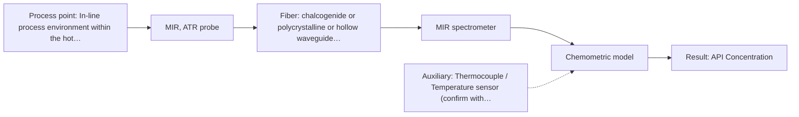
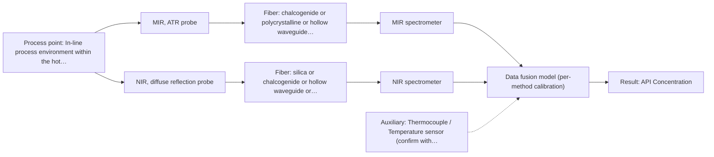

# First technical assessment: API concentration during hot polymer extrusion

## Answer

**Customer request (our summary):** The customer wants to know if an optical measurement can detect composition changes in a hot polymer extrusion process incorporating an active pharmaceutical ingredient.

### Brief answer

For monitoring active pharmaceutical ingredients during hot polymer extrusion, MIR spectroscopy with an ATR probe is recommended as the primary approach due to its high chemical specificity. NIR reflection serves as a viable alternative comparison. Initial feasibility trials using representative samples and offline assay references are required to validate calibration models and address potential interface fouling.

### Proposal

- **Best current option:** O2 (recommended)
- **Basis:** supplied AFS sources
- **What would change it:** Evidence of severe fouling or incompatibility with the hot extrusion interface favoring NIR reflection.
- **Next step:** Perform initial laboratory feasibility trials using representative polymer-API samples with an MIR-ATR probe and offline reference assays.

**Secondary evidence (external, not AFS material):** G1: no usable external source found; G2: E01 ¶31; G3: no usable external source found; G4: no usable external source found. See Expert detail.

**Decision status:** Provisional feasibility assessment

### Solution options

| ID | Tier | Methods | Confidence | Cost class, S01 Table 1 (p.6) | Ease of use | Maintenance | Performance fit | Sources |
|---|---|---|---|---|---|---|---|---|
| O1 | Simple | M2 NIR, diffuse reflection probe | Low: open question: Q1 (starts at Medium); sample clarity unknown; precedent only; uncited auxiliary sensor | average cost (row 8) | Standard probe installation | Periodic optical cleaning | Suitable for bulk polymer matrix monitoring | [1: S02 p.14] |
| O2 | Recommended | M1 MIR, ATR probe | Low: open question: Q1 (starts at Medium); precedent only; uncited auxiliary sensor | high cost (row 2) | Direct melt contact probe | Regular cleaning for potential build-up | High chemical specificity for API in hot polymer melt | [2: S02 p.14] |
| O3 | Extended (multi-method) | M1 MIR, ATR probe; M2 NIR, diffuse reflection probe | Low: open question: Q1 (starts at Medium); sample clarity unknown; uncited auxiliary sensor; multi-method, fusion benefit not yet shown | high cost (rows 2, 8) | Complex dual-instrument setup | High maintenance for multi-probe hardware | Maximum chemical and physical insight by combining surface ATR and bulk reflection | [3: S01 p.7] [4: S01 p.8] [2: S02 p.14] [1: S02 p.14] |

*Confidence rates the basis of the advice (how much is known and cited), not a predicted accuracy or probability of success. It starts at High, or at Medium when a key question on the method or the option is open, and drops one level per weakness listed (floor Low).*

*Cost class is the relative rating in S01 Table 1 (p.6) for the in-line method+technique rows named (the highest one for a multi-method option); it is not a price.*

### Setup sketch

*Recommended option O2; drawn by code from the option, a schematic, not a configuration.*

### Key questions

1. What is the specific polymer type and the chemical identity and concentration range of the active pharmaceutical ingredient?
2. What are the exact operating temperature and pressure conditions of the extrusion process?
3. Is the polymer melt optically clear, translucent, or heavily scattering?

## Expert detail

**Customer enquiry**

> We are developing a hot polymer extrusion process that incorporates an active pharmaceutical ingredient. We want to investigate whether an optical measurement can detect composition changes while the melt is being processed. We have offline assays, but the process interface is hot and may be exposed to material build up. We need an initial comparison plan and the questions required before choosing a probe.

**Decision status:** Provisional feasibility assessment. The customer provided clear facts regarding hot polymer extrusion and API incorporation, but key unknowns such as polymer type, API concentration range, and optical properties require a provisional assessment with defined single-method options and feasibility steps.

### Parameters

| ID | Parameter | Kind | Need | Measured by | Why | Sources |
|---|---|---|---|---|---|---|
| P1 | API Concentration | quantitative | required | Spectroscopy: MIR | Primary target for tracking composition changes during extrusion. | [2: S02 p.14] |
| P2 | Process Temperature | quantitative | required | Auxiliary sensor: Thermocouple / Temperature sensor (engineering judgement: confirm availability with AFS) | Required to ensure thermal compatibility of the probe and fiber optics in the hot extrusion environment. | *(no verified source: engineering judgement)* |

### Solution option details

- **O1 cost drivers:** Standard NIR spectrometer and reflection probe
- **O2 cost drivers:** FTIR spectrometer and diamond/ZrO2 ATR probe
- **O3 cost drivers:** Dual spectrometers and multispectral probe hardware
- **O3 combining methods:** Combines NIR bulk penetration with MIR surface specificity at the same measurement spot. Data from both methods must be synchronised to a common time step, normalized with block scaling, and validated against independent reference runs to prove it beats the best single method.

*Extended (multi-method) option O3; drawn by code from the option, a schematic, not a configuration.*

### Premise check

- **Supported:** An optical measurement can detect composition changes in their process. Sources demonstrate that NIR reflection and MIR-ATR spectroscopy are successfully used to control polymer extrusion in-line and monitor API production. [1: S02 p.14]

### Requirements

**Stated by the customer**

- Detect composition changes during hot polymer extrusion incorporating an active pharmaceutical ingredient
- Handle a hot process interface potentially exposed to material build-up
- Provide an initial comparison plan and clarification questions

**Key unknowns**

- Specific polymer type and grade
- Active pharmaceutical ingredient identity and concentration range
- Exact process temperature and pressure values
- Optical properties of the melt (clear vs scattering)
- Required measurement accuracy and response time

### Clarification questions (most decision-relevant first)

Q1. What is the specific polymer type and the chemical identity and concentration range of the active pharmaceutical ingredient? *Why it matters:* Determines the characteristic absorption bands and required sensitivity of the spectroscopic method. *(affects: method)*
Q2. What are the exact operating temperature and pressure conditions of the extrusion process? *Why it matters:* Dictates the thermal and mechanical tolerances required for the fiber probe optics and window materials. *(affects: installation)*
Q3. Is the polymer melt optically clear, translucent, or heavily scattering? *Why it matters:* Drives the choice between transmission, transflection, diffuse reflection, or ATR measurement geometries. *(affects: technique)*
Q4. What are the required measurement accuracy and response time for detecting composition changes? *Why it matters:* Informs whether standard scanning spectrometers or high-speed diode array/LED configurations are necessary. *(affects: status)*

### Recommendation

- **M1 · Primary candidate: MIR, ATR probe.** Mid-IR ATR spectroscopy provides high chemical specificity for monitoring active pharmaceutical ingredients directly in polymer melts. *Conditions:* Requires direct contact with the melt and stable probe sealing against hot conditions. [2: S02 p.14]
- **M2 · Comparison candidate: NIR, diffuse reflection probe.** NIR diffuse reflection is widely used for polymer extrusion monitoring and offers robust fiber transmission through standard silica cables. *Conditions:* Requires chemometric calibration for broad overlapping absorption bands. [1: S02 p.14]
- **M3 · Conditional candidate: Raman probe.** Raman spectroscopy provides complementary molecular backbone information and is well-suited for chemical blending. *Conditions:* Applies if fluorescence background interference is sufficiently low in the polymer matrix. [5: S01 p.11]

### Measurement concept

- **Probe and geometry:** Immersion ATR probe with a Diamond or Zirconia crystal tip flush-mounted or inserted into the extruder die adaptor or barrel.
- **Location:** In-line process environment within the hot melt extruder barrel or die adaptor.
- **Fiber link:** Infrared transmitting fibers (such as PIR or CIR fibers for MIR, or low-OH silica fibers for NIR) connecting the probe to the spectrometer located safely away from process vibration and heat. [6: S01 p.10] [2: S02 p.14]

### Spectral range

- **MIR:** Nominal range 4000-400 cm-1; usable range depends on the selected fiber and crystal materials. [7: S01 p.9]
- **NIR:** Nominal range 780-2500 nm; usable range depends on the instrument, fiber, and probe configuration. [8: S01 p.10]

### Risks and uncertainty

- Material build-up or fouling on the ATR crystal or probe tip can obscure the optical measurement and distort calibration models. *(rules: R-MIR-3)* [9: S01 p.13]
- High extrusion temperatures may exceed the thermal limits of standard probe seals or fiber coatings if not properly specified. *(rules: R-GEN-1)* [10: REF §5]
- Broad overlapping absorption bands in NIR spectroscopy may limit sensitivity to minor API concentration changes without robust chemometrics. *(rules: R-NIR-2)* [11: S01 p.10]

### First feasibility experiment

1. **Prepare representative calibration mixtures** Cover expected polymer and API concentration variations across production limits. *(no verified source: engineering judgement)*
2. **Collect independent reference assay data** Establish benchmark offline values for API content across all test mixtures. *(no verified source: engineering judgement)*
3. **Perform single-method optical screening** Evaluate MIR-ATR and NIR reflection separately under simulated or pilot extrusion conditions. *(no verified source: engineering judgement)*
4. **Validate chemometric calibration models** Test model accuracy and robustness on independent held-out extrusion batches. *(no verified source: engineering judgement)*
5. **Determine go/no-go outcome** Compare performance against customer-defined detection limits and accuracy thresholds. *(no verified source: engineering judgement)*

**Reference measurements:** Independent laboratory assays provided by the customer for offline verification.

**Decision basis:** Customer-defined accuracy and repeatability thresholds for API concentration detection.

### Assumptions

- The polymer melt can be brought into adequate contact with an ATR probe or interrogated via diffuse reflection.
- Offline assay results are sufficiently accurate to serve as primary reference data for chemometric calibration.

### Not covered by the supplied sources

- Exact customer extrusion temperatures and pressures
- Specific chemical identity and concentration limits of the active pharmaceutical ingredient

### Further notes

- **Chemometrics:** Multivariate calibration models (such as PLS) are necessary to relate spectral variations to API concentration changes and handle background scatter.
- **Real-time tracking:** In-line continuous monitoring allows real-time tracking of composition changes directly in the extruder barrel or die adaptor.
- **Future direction:** Transition from laboratory spectrometer systems to dedicated optical multisensor systems (OMS) or IoT fiber sensors for dedicated production line integration.

### Secondary evidence (external, not AFS material)

*Found by a literature search for gaps the supplied AFS sources leave open. Not AFS material and not proof for this case; every quote below was verified verbatim against the fetched text.*

*Live search unavailable (library only: cache miss (europepmc); cache miss (openalex)); curated library only.*

**G1 · auxiliary sensor:** In-line measurement of Process Temperature with Thermocouple / Temperature sensor

- No usable external source found.

**G2 · multi-method:** Combining several spectroscopy methods (data fusion) (Combines NIR bulk penetration with MIR surface specificity at the same measurement spot. Data from both methods must be synchronised to a common time step, normalized with block scaling, and validated against independent reference runs to prove it beats the best single method.)

- **E01 ¶31** Low-level data fusion rearranges data into a new matrix by placing variables from different sources one after the other. *How it applies:* This approach could be evaluated to combine multiple optical methods if single methods prove insufficient, though instrument complementarity must be carefully checked. *Limits and transfer risks:* The cited study discusses general data fusion principles rather than polymer extrusion, so matrix and scale differences apply. *(supports O3)*
  > "Low-level data fusion (LLDF) is considered the simplest method to achieve a combination of inputs. In this case, the data is rearranged into a new data matrix, where the variables coming from different sources are placed one after the other."
  > Challenges and Opportunities of Implementing Data Fusion in Process Analytical Technology-A Review. (2022) · Molecules (Basel, Switzerland) · doi:10.3390/molecules27154846 · https://europepmc.org/article/PMC/PMC9369811 · retrieved 2026-10-17, full text, licence: cc by, via curated library

**G3 · not in the supplied sources:** Exact customer extrusion temperatures and pressures

- No usable external source found.

**G4 · not in the supplied sources:** Specific chemical identity and concentration limits of the active pharmaceutical ingredient

- No usable external source found.

### Evidence (verified quotes)

1. ✓ **S02 p.14** (application precedent): "NIR-Reflex & MIR-ATR-spectroscopy to control polymer extrusion in-line"
2. ✓ **S02 p.14** (application precedent): "Spectra of API in hot polymer obtained with Diamond cone ATR probe coupled to iC10 FTIR (MTAC)"
3. ✓ **S01 p.7** (general): "The analysis of such systems may require a combination of two or even more spectral methods."
4. ✓ **S01 p.8** (general): "It is crucial that the spectral information obtained by different methods-Mid-IR, NIR, Raman, and fluorescence spectra-is collected from the same small, even pinpoint, area of the sample."
5. ✓ **S01 p.11** (general): "This property makes mid-IR and Raman spectra complementary, that is, they complement each other."
6. ✓ **S01 p.10** (general): "allow analysis at a significant distance from the spectrometer, without the need for sampling."
7. ✓ **S01 p.9** (general): "Vibrational spectroscopy in the mid-IR range (4000-400 cm-1) is one of the most informative methods of chemical analysis."
8. ✓ **S01 p.10** (general): "NIR spectra (780-2500 nm) contain predominantly overtones and component bands of fundamental vibrations"
9. ✓ **S01 p.13** (general): "typically at a depth of few microns"
10. ✓ **REF §5** (general): "It is not a product specification: actual spectral coverage, fiber length, component ratings, detection limits and accuracy depend on the configuration and the sample."
11. ✓ **S01 p.10** (general): "The broad absorption bands observed in this region overlap, suggesting the use of chemometrics for quantitative and qualitative analysis of spectral data."

### Verification

- Citations verified: 16 of 16 (exact or whitespace/hyphen-tolerant match on the cited page, scope checked).
- Hard check failures before deterministic corrections: 0; still open: 0; soft warnings: 3; repair rounds: 1.
- Removed 1 intake item(s) not quoted verbatim from the enquiry:
  - intake.process[0]: enquiry_quote not found verbatim in the enquiry
- External evidence (cache): 1 quote(s) verified verbatim (exact or whitespace/hyphen-tolerant, at most 400 characters and 2 sentences, against the cited paragraph); 0 item(s) dropped.
- External search: 4 query(ies), 0 hit(s), 3 source(s) (3 from the curated library); ⚠ library only: cache miss (europepmc); cache miss (openalex).
- External step: 2 model call(s), 2.0 s extra (cost in the run JSON).

*Run D07-20261018T080635Z-abbc · models google/gemini-3.5-flash-lite, google/gemini-3.8-flash*
