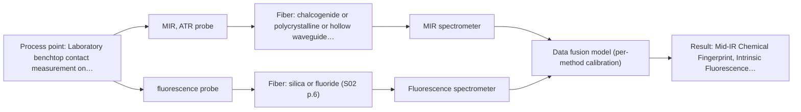

# First technical assessment: Local measurements of heterogeneous model tissues

## Answer

**Customer request (our summary):** The customer wants to compare MIR ATR and fluorescence information using model biological tissues for a laboratory classification study and requests a first comparison experiment.

### Brief answer

To compare MIR ATR and fluorescence information for heterogeneous biological tissues, we recommend a feasibility experiment using chicken muscle, fat, and liver samples. Testing both methods individually and via a combined multispectral probe will demonstrate whether data fusion improves tissue classification over single-method approaches by ensuring identical sampling locations.

### Proposal

- **Best current option:** O2 (recommended)
- **Basis:** supplied AFS sources
- **What would change it:** If single-method MIR ATR achieves sufficient classification performance without fluorescence, the extended setup can be simplified to O1.
- **Next step:** Perform the multi-method comparison experiment using chicken tissue samples and evaluate the PCA clustering results as outlined in the feasibility plan.

**Secondary evidence (external, not AFS material):** G1: no usable external source found. See Expert detail.

**Decision status:** Provisional feasibility assessment

### Solution options

| ID | Tier | Methods | Confidence | Cost class, S01 Table 1 (p.6) | Ease of use | Maintenance | Performance fit | Sources |
|---|---|---|---|---|---|---|---|---|
| O1 | Simple | M1 MIR, ATR probe | Medium: open question: Q1 (starts at Medium) | high cost (row 2) | Standard laboratory benchtop setup | Routine ATR crystal cleaning | Provides single-method mid-IR chemical fingerprinting for tissue classification. | [1: S01 p.6] [2: S04 p.3] |
| O2 | Recommended | M1 MIR, ATR probe; M2 fluorescence probe + MIR (combination) | Low: open question: Q1 (starts at Medium); fit for soft solid to be tested, sample clarity unknown, fluorescent target unknown; multi-method, fusion benefit not yet shown | high cost (rows 2, 19) | Advanced dual-instrument laboratory setup | Maintenance of dual spectrometers and combined probe | Combines MIR ATR and fluorescence via a shared probe tip, resolving location mismatch in heterogeneous tissue. | [3: S04 p.4] [1: S01 p.6] [2: S04 p.3] |

*Confidence rates the basis of the advice (how much is known and cited), not a predicted accuracy or probability of success. It starts at High, or at Medium when a key question on the method or the option is open, and drops one level per weakness listed (floor Low).*

*Cost class is the relative rating in S01 Table 1 (p.6) for the in-line method+technique rows named (the highest one for a multi-method option); it is not a price.*

### Setup sketch

*Recommended option O2; drawn by code from the option, a schematic, not a configuration.*

### Key questions

1. What are the target classification accuracy thresholds (sensitivity and specificity) for distinguishing between chicken muscle, fat, and liver?
2. Will the study utilize a specially designed combined multispectral probe or separate probes for MIR ATR and fluorescence?

## Expert detail

**Customer enquiry**

> Our research group is evaluating a spectral measurement interface using model biological tissues such as chicken muscle, fat and liver. We want to compare MIR ATR and fluorescence information, because the material is heterogeneous and sequential measurements may not sample the same location. This is a laboratory classification study. We need a first comparison experiment and a clear statement of what its results would demonstrate.

**Decision status:** Provisional feasibility assessment. The supplied sources directly support combining MIR ATR and fluorescence measurements using a shared multispectral probe tip to classify heterogeneous biological tissues such as muscle, fat, and liver. A provisional assessment and feasibility plan can be established based on these documented methods.

### Parameters

| ID | Parameter | Kind | Need | Measured by | Why | Sources |
|---|---|---|---|---|---|---|
| P1 | Tissue Classification Category | qualitative | required | Reference lab method: Histological classification | Defines the target classes (muscle, fat, liver) for the classification study. | *(no verified source: engineering judgement)* |
| P2 | Mid-IR Chemical Fingerprint | quantitative | required | Spectroscopy: MIR | Provides vibrational absorption bands for protein and lipid composition. | [4: S01 p.9] |
| P3 | Intrinsic Fluorescence Emission | quantitative | required | Spectroscopy: Fluorescence | Provides complementary optical emission data for tissue differentiation. | [5: S01 p.12] |

### Solution option details

- **O1 cost drivers:** Single spectrometer and ATR fiber probe.
- **O2 cost drivers:** Two spectrometers and combined multispectral fiber probe.
- **O2 combining methods:** Combines mid-IR ATR and fluorescence data collected from the exact same spot using data concatenation or low-level data fusion. Requires synchronized acquisition and must outperform single-method classification.

### Premise check

- **Supported:** Simultaneous MIR ATR and fluorescence can classify heterogeneous biological tissues using a combined probe. Sources demonstrate that combining MIR ATR and fluorescence spectra via a multispectral probe successfully classifies biological tissue types like muscle, fat, and liver. [6: S04 p.3]
- **Supported:** Sequential measurements on heterogeneous material may fail to sample the same location. Sources note that collecting data with separate probes alternately cannot guarantee identical sampling spots on heterogeneous samples. [7: S01 p.8]

### Requirements

**Stated by the customer**

- Compare MIR ATR and fluorescence information using model biological tissues (chicken muscle, fat, and liver)
- Address tissue heterogeneity and location alignment for sequential vs. simultaneous measurements
- Provide a first comparison experiment and state what its results demonstrate

**Key unknowns**

- Target classification accuracy thresholds (sensitivity and specificity)
- Availability of a combined multispectral probe versus separate probes
- Specific preprocessing and chemometric algorithms preferred for the classification model

### Clarification questions (most decision-relevant first)

Q1. What are the target classification accuracy thresholds (sensitivity and specificity) for distinguishing between chicken muscle, fat, and liver? *Why it matters:* Defines the success criteria for the feasibility experiment and determines whether single-method MIR ATR is sufficient or multi-method fusion is required. *(affects: method, O1, O2)*
Q2. Will the study utilize a specially designed combined multispectral probe or separate probes for MIR ATR and fluorescence? *Why it matters:* Directly impacts the sampling location consistency on heterogeneous tissue and the hardware setup. *(affects: technique, installation)*

### Recommendation

- **M1 · Primary candidate: MIR, ATR probe.** Mid-IR ATR provides surface chemical fingerprinting sensitive to lipid carbonyl bands and protein amide bands, making it effective for tissue differentiation. [1: S01 p.6] [2: S04 p.3]
- **M2 · Comparison candidate: fluorescence probe + MIR (combination).** Fluorescence provides complementary optical emission data sensitive to intrinsic fluorophores and porphyrins, enhancing tissue classification when fused with MIR ATR. *Conditions:* Evaluated as a combined method using a dual-modality probe to ensure identical sampling spots on heterogeneous tissue. [3: S04 p.4] Later hypothesis, after single-method tests.

### Measurement concept

- **Probe and geometry:** Combined multispectral fiber optic probe utilizing a truncated cone (frustum) ZrO2 ATR crystal for Mid-IR and orthogonal silica fibers for fluorescence.
- **Location:** Laboratory benchtop contact measurement on model biological tissue samples (chicken muscle, fat, and liver).
- **Fiber link:** Chalcogenide As-S IR fibers (CIR) for MIR and UV-Vis silica fibers for fluorescence. [8: S04 p.2]

### Spectral range

- **MIR:** Nominal method range is 4000-400 cm-1 (2.5-25 µm); usable range depends on the instrument, fiber, and crystal selected. [4: S01 p.9]
- **Fluorescence:** Emission spectra in the UV-Vis range excited by a laser or source; usable range depends on the instrument, optical filters, and probe configuration. [5: S01 p.12]

### Risks and uncertainty

- Variable contact pressure or surface fouling on soft tissue can alter ATR path length and signal intensity. *(rules: R-MIR-3)* [9: S01 p.13]
- Fluorescence background or overlapping signals can obscure weak spectral features unless properly preprocessed. *(rules: R-FLU-2)* [10: REF §5]

### First feasibility experiment

1. **Preparation of representative tissue samples** Prepare representative samples of chicken muscle, fat, and liver with multiple distributed measurement points to reflect tissue heterogeneity. [11: S04 p.3]
2. **Single-method baseline acquisition** Collect individual MIR ATR and fluorescence spectra across all sample points to evaluate independent classification performance. *(no verified source: engineering judgement)*
3. **Simultaneous multi-method acquisition** Collect synchronized MIR ATR and fluorescence spectra from the exact same measurement spot using a combined probe. *(no verified source: engineering judgement)*
4. **Data preprocessing and modeling** Apply preprocessing (e.g., standard normal variate) and build PCA/PLS-DA classification models for individual and concatenated data matrices. *(no verified source: engineering judgement)*
5. **Cross-validation of classification models** Validate classification models using cross-validation to assess separation between tissue types. *(no verified source: engineering judgement)*

**Reference measurements:** Histological identification of chicken tissue types (muscle, breast, fat, and liver).

**Decision basis:** Successful clustering and separation of tissue types on PCA score plots and cross-validation accuracy matching customer requirements.

### Assumptions

- The optical regime of the model soft tissue is opaque and highly scattering, suitable for contact ATR and surface fluorescence measurements.
- Model biological tissues (chicken) adequately represent soft tissue heterogeneity for the laboratory classification study.
- Standard laboratory spectrometers are available for coupling CIR and silica fibers.

### Further notes

- **Chemometrics:** Multivariate data analysis using PCA on preprocessed (SNV) individual and concatenated spectral matrices to evaluate unsupervised clustering of tissue types.
- **Future direction:** Extension of the dual-modality probe to incorporate additional spectral ranges such as NIR or Raman for broader biomedical diagnostics.

### Secondary evidence (external, not AFS material)

*Found by a literature search for gaps the supplied AFS sources leave open. Not AFS material and not proof for this case; every quote below was verified verbatim against the fetched text.*

*Live search unavailable (library only: cache miss (europepmc); cache miss (openalex)); curated library only.*

**G1 · parameter without a source:** Measuring Tissue Classification Category: Defines the target classes (muscle, fat, liver) for the classification study.

- No usable external source found.

### Evidence (verified quotes)

1. ✓ **S01 p.6** (general): "ATR-platform absorption liquid,paste, soft 1-6 mu average high high"
2. ✓ **S04 p.3** (general): "toward rich in lipids fat samples is related to the stretching vibration band of the ester carbonyl C=O at about 1740 cm-1"
3. ✓ (precedent only) **S04 p.4** (method gain): "At the same time, the PCA model built on the concatenated IR and fluorescence data revealed three distinct groups of samples corresponding to tissue types"
4. ✓ **S01 p.9** (general): "Vibrational spectroscopy in the mid-IR range (4000-400 cm-1) is one of the most informative methods of chemical analysis."
5. ✓ **S01 p.12** (general): "Fluorimetry is based on measuring the broad emission signal observed upon irradiation of certain samples in the UV and visible regions."
6. ✓ **S04 p.3** (application precedent): "The developed multispectral probe was tested in the practical analysis of biological tissue samples using different organs and parts of the chicken: breast, fat, and liver."
7. ✓ **S01 p.8** (general): "It is crucial that the spectral information obtained by different methods-Mid-IR, NIR, Raman, and fluorescence spectra-is collected from the same small, even pinpoint, area of the sample. This is difficult to achieve by using two probes alternately for measurements."
8. ✓ **S04 p.2** (general): "The proposed solution (Figure 1) is based on a precise determination of the optical configuration of the ATR crystal head, which, in this case, plays the role of a common measurement interface for both methods."
9. ✓ **S01 p.13** (general): "typically at a depth of few microns"
10. ✓ **REF §5** (general): "High sensitivity, low selectivity; not a direct measurement of every analyte."
11. ✓ **S04 p.3** (general): "To provide the necessary statistical representativeness of the data, three samples of each tissue type were prepared. The samples were large enough to reflect the possible heterogeneity of the tissue. Each sample was represented by five distributed points."

### Verification

- Citations verified: 14 of 14 (exact or whitespace/hyphen-tolerant match on the cited page, scope checked).
- Hard check failures before deterministic corrections: 0; still open: 0; soft warnings: 2; repair rounds: 1.
- External evidence (cache): 0 quote(s) verified verbatim (exact or whitespace/hyphen-tolerant, at most 400 characters and 2 sentences, against the cited paragraph); 0 item(s) dropped.
- External search: 2 query(ies), 0 hit(s), 3 source(s) (3 from the curated library); ⚠ library only: cache miss (europepmc); cache miss (openalex).
- External step: 2 model call(s), 1.5 s extra (cost in the run JSON).

*Run D08-20261018T080635Z-1338 · models google/gemini-3.5-flash-lite, google/gemini-3.8-flash*
