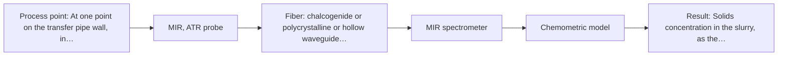

# First technical assessment: Pressure, flow and blockage of a slurry pipe

## Answer

**Customer request (our summary):** Customer asks whether fiber optic products can measure line pressure and flow rate of a slurry in a transfer pipe and give an early warning of pipe blockage. The enquiry states no measurand values, no slurry properties, no pipe details and no performance targets, so no method choice can be made yet.

### Brief answer

The supplied material covers optical spectra of chemical composition, not line pressure or flow rate, so those two targets need conventional in-line sensors. The only optical route is indirect: whether the slurry's spectrum at a probe changes as solids build up, which no source shows. Test one contact method on your own slurry in the laboratory first; the open points are the required ranges, what a blockage precursor looks like, and the slurry's optical behaviour.

### Proposal

- **Best current option:** O2 (recommended)
- **Basis:** engineering judgement, with secondary external support E01 ¶4, E01 ¶34 (not AFS material)
- **What would change it:** Answers on what counts as the start of a blockage, on the slurry's optical behaviour and solids content, and on whether pressure and flow are already handled by conventional sensors. If no spectral change can be tied to a blockage precursor, the optical options drop out and the enquiry stays with conventional instrumentation.
- **Next step:** Run the laboratory trial in the feasibility plan on the customer's own slurry, single method first, before any in-line installation is considered.

**Secondary evidence (external, not AFS material):** G1: E01 ¶4, E01 ¶34; G2: no usable external source found; G3: no usable external source found; G4: no usable external source found. See Expert detail.

**Decision status:** Outside the supported scope

### Solution options

| ID | Tier | Methods | Confidence | Cost class, S01 Table 1 (p.6) | Ease of use | Maintenance | Performance fit | Sources |
|---|---|---|---|---|---|---|---|---|
| O1 | Simple | M2 Raman probe | Medium: status: outside supported scope | high cost (row 12) | single probe, no contact crystal | window cleaning; laser safety rules | cheap first check of spectral change | [1: S01 p.16] [2: S01 p.11] |
| O2 | Recommended | M1 MIR, ATR probe | Medium: status: outside supported scope | high cost (row 2) | contact probe; needs a pipe port | crystal cleaning, wear and replacement | best chance to see wall-layer change | [3: S01 p.10] [4: S01 p.5] |

*Confidence rates the basis of the advice (how much is known and cited), not a predicted accuracy or probability of success. It starts at High, or at Medium when a key question on the method or the option is open, and drops one level per weakness listed (floor Low).*

*Cost class is the relative rating in S01 Table 1 (p.6) for the in-line method+technique rows named (the highest one for a multi-method option); it is not a price.*

### Setup sketch

*Recommended option O2; drawn by code from the option, a schematic, not a configuration.*

### Key questions

1. For each of the three targets, what exactly must be measured: static line pressure, differential pressure across the line, volumetric or mass flow rate, and what observable change would count as the start of a blockage?
2. What are the measurement ranges, units and required accuracy for line pressure and flow rate, and what warning lead time would make a blockage alarm useful?
3. What is the slurry's composition, solids concentration and particle size, and is it optically transparent, turbid or opaque?

## Expert detail

**Customer enquiry**

> We need to know the line pressure and the flow rate of a slurry in our transfer pipe, and we want an early warning when the pipe starts to block. Could your fiber optic products help with this?

**Decision status:** Outside the supported scope. The supplied pages cover optical spectra of chemical composition and morphology; none of them addresses line pressure or flow rate, which are hydraulic quantities, so the request as asked goes beyond that material. The only optically addressable part - an early warning of blockage from a change in the slurry at the probe - has no source support and would have to be tested first on representative samples.

### Parameters

| ID | Parameter | Kind | Need | Measured by | Why | Sources |
|---|---|---|---|---|---|---|
| P1 | Line pressure | quantitative | required | Not measurable in-line by spectroscopy; alternative: a conventional in-line pressure transmitter or pressure tap | The customer asks for line pressure, and the supplied material contains no optical method for pressure, so it must come from a conventional sensor. | *(no verified source: engineering judgement)* |
| P2 | Flow rate | quantitative | required | Not measurable in-line by spectroscopy; alternative: a conventional in-line flow meter | Flow rate is a hydraulic quantity; the supplied material contains no optical method for it, so a conventional flow meter is needed. | *(no verified source: engineering judgement)* |
| P3 | Solids concentration in the slurry, as the candidate precursor of a blockage | quantitative | required | Spectroscopy: MIR | An early warning can only come indirectly from a change in the material at the probe, so a measurable spectral proxy has to be found; whether the ATR spectrum tracks solids concentration is unproven and is what the trial tests. | *(no verified source: engineering judgement)* |

### Solution option details

- **O1 cost drivers:** Raman spectrometer and laser, probe, laboratory time, reference analyses
- **O2 cost drivers:** FTIR spectrometer, ATR probe and crystal, laboratory time, reference analyses

### Premise check

- **Not covered:** That fiber-optic products can measure line pressure and flow rate of a slurry in a pipe. No supplied page describes pressure or flow measurement by optical spectroscopy; the pages describe chemical and morphological information obtained from spectra. *(no verified source: engineering judgement)*
- **Not covered:** That a usable early warning of incipient pipe blockage is achievable. No supplied page describes blockage, deposit or wall build-up detection in a pipe; the closest pages show in-line tracking of other process changes. *(no verified source: engineering judgement)*
- **Not covered:** That one fiber-optic product line can serve pressure, flow and blockage warning together. The sources describe single spectroscopic techniques and some of their combinations, but never these three measurands together. *(no verified source: engineering judgement)*

### Requirements

**Stated by the customer**

- "the line pressure"
- "the flow rate of a slurry in our transfer pipe"
- "an early warning when the pipe starts to block"
- *Further statements: see the customer enquiry above.*

**Key unknowns**

- Which quantity, range and accuracy the customer means by line pressure and by flow rate.
- What measurable change counts as the start of a blockage, and how much warning time is needed.
- Whether the slurry's spectrum changes detectably with its state (solids concentration, deposition) - unproven in the supplied material.
- The slurry's composition, solids concentration, particle size, abrasiveness and optical behaviour (transparent, turbid or opaque).
- How a probe could be fitted to the pipe: material, internal diameter, available port, line temperature and pressure.

### Clarification questions (most decision-relevant first)

Q1. For each of the three targets, what exactly must be measured: static line pressure, differential pressure across the line, volumetric or mass flow rate, and what observable change would count as the start of a blockage? *Why it matters:* This decides whether any optical method is applicable at all, or whether pressure and flow stay with conventional sensors. *(affects: status)*
Q2. What are the measurement ranges, units and required accuracy for line pressure and flow rate, and what warning lead time would make a blockage alarm useful? *Why it matters:* Without ranges, accuracy and lead time no method or technique can be judged fit or unfit. *(affects: status)*
Q3. What is the slurry's composition, solids concentration and particle size, and is it optically transparent, turbid or opaque? *Why it matters:* The optical behaviour decides whether a contact ATR geometry or a backscatter geometry is even possible. *(affects: technique)*
Q4. Can a measurement port be fitted to the existing pipe, and what are the pipe material and internal diameter, the line temperature and pressure, and the distance from the intended instrument position? *Why it matters:* Installation and fiber-link feasibility depend on the port, the line conditions and the distance. *(affects: installation)*
Q5. What is used today to measure pressure, flow and blockage on this line, and must the new solution be fiber-optic, or is any suitable technology acceptable? *Why it matters:* The existing reference method and the technology constraint change which route is worth testing at all. *(affects: method)*

### Recommendation

- **M1 · Primary candidate: MIR, ATR probe.** ATR is the in-line route that suits a liquid or paste stream in contact with a probe and avoids the very thin transmission path that strong mid-IR absorption would otherwise demand. Whether the ATR spectrum changes before a pipe blockage is a hypothesis, not a result in the supplied material. *Conditions:* Only if the slurry can make tight contact with the crystal and is not so abrasive or fouling that the probe head cannot survive. [3: S01 p.10] [4: S01 p.5]
- **M2 · Comparison candidate: Raman probe.** Raman is well suited to aqueous media and needs no crystal in contact with the slurry, so it is worth comparing on the same samples. Its weak signal and any fluorescence background from the slurry must be checked on real samples. *Conditions:* Compare on the same samples and the same solids levels as the primary method. [1: S01 p.16] [2: S01 p.11]
- **M3 · Conditional candidate: NIR, diffuse reflection probe.** Backscatter geometry is the usual NIR route for opaque or highly concentrated streams and is sensitive to particle and surface scattering, one candidate precursor of a blockage. It applies only if the slurry turns out to be opaque or strongly scattering. *Conditions:* Applies only if the answer to the optical-behaviour question is that the slurry is opaque or strongly scattering. [5: S01 p.17] [6: S01 p.17]

### Measurement concept

- **Probe and geometry:** Not settled: the geometry depends on the slurry's optical behaviour. Candidate geometries are a contact ATR probe head (M1) or a backscatter probe (M3); a Raman probe (M2) would sit behind a window.
- **Location:** At one point on the transfer pipe wall, in contact with the flowing slurry; the exact point and port are open.
- **Fiber link:** Open question; the link length achievable for a mid-IR fiber is not stated in the supplied pages. *(no verified source: engineering judgement)*

### Spectral range

- **MIR:** Nominal mid-IR range 4000-400 cm-1 (2.5-25 µm); the usable range depends on the instrument, fiber, crystal and probe actually selected. [7: S01 p.9] [8: REF §3]
- **Raman:** Raman is reported as a Raman shift in cm-1, with the laser excitation wavelength stated separately; no excitation wavelength is fixed for this case. [9: S01 p.11]

### Risks and uncertainty

- An ATR probe samples only the few micrometres in contact with the crystal, so a spectrum may report a fouling or deposit layer rather than the flowing slurry, and the result could be misread as a process change. [10: S01 p.13]
- An abrasive or scaling slurry can wear or foul the crystal or the probe window, so cleaning, material compatibility and probe lifetime are unresolved. [11: REF §5]
- The optical behaviour of the slurry is unknown; if it is opaque or highly concentrated, transmission geometries fail and only contact or backscatter geometries remain. [12: S01 p.16]
- No supplied page shows a spectral precursor of pipe blockage or a warning time, so the early-warning target may not be achievable optically at all. *(no verified source: engineering judgement)*

### First feasibility experiment

1. **Collect representative slurry samples across the expected variation (different solids concentrations and particle sizes) and, if it can be obtained, a sample of the deposit that forms in the pipe; record the process temperature range.** Representative samples are the basis of any method comparison. *(no verified source: engineering judgement)*
2. **Measure each sample in the laboratory with the single method first (M1), and repeat with the comparison method (M2) on the same samples at the same solids levels; build a controlled deposit layer on the probe head to mimic the onset of blockage.** Tests whether any spectrum tracks the slurry state at all, single methods before any combination. *(no verified source: engineering judgement)*
3. **Have the customer's laboratory provide independent reference values for each sample (solids concentration and particle-size distribution) so the spectra are compared with a known state.** Reference values are needed to judge any spectral change. [13: REF §3]
4. **Build any calibration or classification model on one set of samples and test it on held-out samples or runs; with few reference samples, overfitting is the main risk.** Held-out validation is required before any in-line claim. [14: S03 p.14]
5. **Set the go/no-go basis with the customer's own numbers: the smallest solids or deposit change that must be detected and the warning time needed. If the held-out samples cannot be separated at that level, the optical route stops and pressure and flow stay with conventional sensors.** The go/no-go threshold must come from the customer, not from the assessment. [15: REF §3]

**Reference measurements:** Gravimetric solids concentration and particle-size distribution of each sample, from the customer's own laboratory method, measured independently of the spectra.

**Decision basis:** Go/no-go on the customer's own numbers for the smallest detectable change and the required warning time, tested on held-out samples.

### Assumptions

- The slurry is a liquid or paste-like stream that can contact a probe head; this is stated only as 'slurry' in the enquiry.
- The pipe is accessible for a measurement port; this has not been stated.
- Pressure and flow will be provided by conventional sensors, since no optical route to them is in the supplied material.

### Not covered by the supplied sources

- Measurement of line pressure with fiber-optic or spectroscopic products.
- Measurement of slurry flow rate with fiber-optic or spectroscopic products.
- Detection or early warning of pipe blockage, and any warning time.

### Further notes

- **Chemometrics:** Turning any spectral change into an early warning needs a calibration or classification model built on reference measurements of the slurry (for example solids concentration) and validated on held-out runs or batches; with few reference samples, overfitting is the main risk.
- **Real-time tracking:** The request is for an early warning, so the measurement would have to run in-line and be time-resolved; the required response time is not stated and is one of the open questions.

### Secondary evidence (external, not AFS material)

*Found by a literature search for gaps the supplied AFS sources leave open. Not AFS material and not proof for this case; every quote below was verified verbatim against the fetched text.*

*Live search unavailable (library only: cache miss (europepmc); cache miss (openalex)); curated library only.*

**G1 · decision status:** outside supported scope: The supplied pages cover optical spectra of chemical composition and morphology; none of them addresses line pressure or flow rate, which are hydraulic quantities, so the request as asked goes beyond that material. The only optically addressable part - an early warning of blockage from a change in the slurry at the probe - has no source support and would have to be tested first on representative samples.

- **E01 ¶4** ATR probes can be used for in-line measurements in demanding environments and in reaction mixtures containing highly oxidative or corrosive substances. *How it applies:* This could support testing an ATR-based probe (O2) on a slurry transfer line, but it does not show that line pressure, flow rate or blockage can be measured. *Limits and transfer risks:* The source concerns reaction mixtures and corrosive chemicals, not a slurry in a transfer pipe; transfer to slurry solids, pipe geometry and blockage warning is unproven. *(supports O2)*
  > "Attenuated total reflection probes (ATR) allow in-line measurements even in demanding measurement environments and reaction mixtures with highly oxidative and corrosive substances, such as chlorosilanes or strong acids and bases."
  > A Process Analytical Concept for In-Line FTIR Monitoring of Polysiloxane Formation. (2020) · Polymers · doi:10.3390/polym12112473 · https://europepmc.org/article/PMC/PMC7693933 · retrieved 2026-10-17, full text, licence: cc by, via curated library
- **E01 ¶34** ATR-FTIR combined with PCA was reported as valuable for real-time reaction monitoring and identifying faulty batches. *How it applies:* This suggests testing whether ATR-FTIR spectra plus a multivariate model can flag abnormal changes in the slurry at the probe, as a possible early-warning concept, but not as proof of blockage detection. *Limits and transfer risks:* The source is about reaction monitoring and batch fault identification, not slurry flow, pipe blockage or warning time; the PCA model and sample matrix differ. *(supports O2)*
  > "The combination of ATR-FTIR measurements and PCA proved to be a valuable tool for real-time reaction monitoring and identifying faulty batches."
  > A Process Analytical Concept for In-Line FTIR Monitoring of Polysiloxane Formation. (2020) · Polymers · doi:10.3390/polym12112473 · https://europepmc.org/article/PMC/PMC7693933 · retrieved 2026-10-17, full text, licence: cc by, via curated library

**G2 · not in the supplied sources:** Measurement of line pressure with fiber-optic or spectroscopic products.

- No usable external source found.

**G3 · not in the supplied sources:** Measurement of slurry flow rate with fiber-optic or spectroscopic products.

- No usable external source found.

**G4 · not in the supplied sources:** Detection or early warning of pipe blockage, and any warning time.

- No usable external source found.

### Evidence (verified quotes)

1. ✓ **S01 p.16** (general): "Raman is particularly well-suited for aqueous environments, as it exhibits low absorbance for water molecules compared to infrared methods."
2. ✓ **S01 p.11** (general): "superposition of luminescence (fluorescence), which has a significantly higher intensity."
3. ✓ **S01 p.10** (general): "ATR fiber probes (Fig.1) enable the analysis of liquids and solid elastic samples"
4. ✓ **S01 p.5** (general): "strong absorption in the mid-IR region limits the corresponding spectral method to the analysis of very thin samples (usually less than 50 μm), but it opens up the possibility of using attenuated total reflectance (ATR)"
5. ✓ **S01 p.17** (application precedent): "Inline NIR Reflection is primarily used for opaque or highly concentrated dairy products"
6. ✓ **S01 p.17** (general): "the method is sensitive to the surface characteristics and fat globule size."
7. ✓ **S01 p.9** (general): "Vibrational spectroscopy in the mid-IR range (4000-400 cm-1) is one of the most informative methods of chemical analysis."
8. ✓ **REF §3** (general): "A nominal method range is not the range of a specific instrument, fiber or probe."
9. ✓ **S01 p.11** (general): "The Raman shift is used as the horizontal (spectral) axis in Raman spectroscopy"
10. ✓ **S01 p.13** (general): "typically at a depth of few microns"
11. ✓ **REF §5** (general): "Usable range limited by fiber and crystal; contact, fouling, compatibility."
12. ✓ **S01 p.16** (general): "the signal in a standard transmission setup becomes saturated because the light cannot penetrate the bulk of the sample."
13. ✓ **REF §3** (general): "independent reference measurements"
14. ✓ **S03 p.14** (general): "A thorough validation, including full, segmented and random-subset CVs, as well as randomization tests, are recommended"
15. ✓ **REF §3** (general): "the basis for the go / no-go decision"

### Verification

- Citations verified: 16 of 16 (exact or whitespace/hyphen-tolerant match on the cited page, scope checked).
- Hard check failures before deterministic corrections: 0; still open: 0; soft warnings: 1; repair rounds: 1.
- Removed 1 intake item(s) not quoted verbatim from the enquiry:
  - intake.sample.fluorophore: slot value without a verbatim enquiry quote; reset to unknown
- External evidence (cache): 2 quote(s) verified verbatim (exact or whitespace/hyphen-tolerant, at most 400 characters and 2 sentences, against the cited paragraph); 0 item(s) dropped.
- External search: 6 query(ies), 0 hit(s), 3 source(s) (3 from the curated library); ⚠ library only: cache miss (europepmc); cache miss (openalex).
- External step: 2 model call(s), 80.5 s extra (cost in the run JSON).

*Run A05-20261018T072334Z-0cc1 · models deepseek/deepseek-v4.1-flash*
