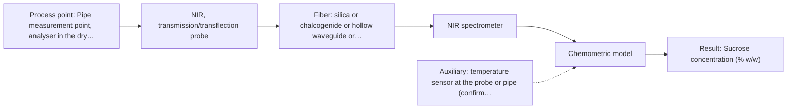
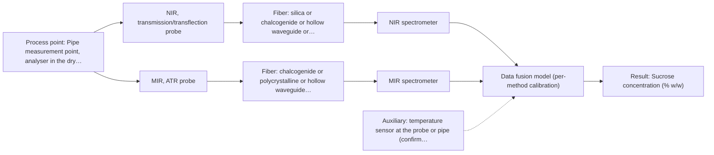

# First technical assessment: Complete enquiry for sugar concentration in a clear solution

## Answer

**Customer request (our summary):** Customer wants in-line monitoring of sucrose concentration in a clear, colourless aqueous solution flowing through a 50 mm stainless steel pipe at 20–30 °C and normal pressure. Expected range 5–15 % w/w, quality limit ±0.3 % w/w, one reading per minute, lab refractometer retained as reference. Analyzer can be 10 m from pipe in dry safe room; line CIP with hot caustic once daily. They request a method and probe for a first trial.

### Brief answer

Test NIR transmission or transflection through a probe in the pipe first, with a chemometric calibration against your lab refractometer; MIR-ATR is the second single method to compare. A fused NIR + MIR model is only worth testing if a single method cannot reach your plus or minus 0.3 % w/w limit. Still open: the rest of the matrix and any bubbles, how the plus or minus 0.3 % w/w limit will be demonstrated, and whether the probe port and hot-caustic cleaning suit the probe.

### Proposal

- **Best current option:** O2 (recommended)
- **Basis:** supplied AFS sources
- **What would change it:** A mid-IR trial that reaches the plus or minus 0.3 % w/w limit with a workable 10 m link, or a NIR trial that fails it, would move the choice to the ATR method or to the fused NIR + MIR option. A matrix that turns out to contain other absorbers or scatterers would also reopen the method choice.
- **Next step:** Run the feasibility plan on representative sucrose solutions and process samples, with the lab refractometer as reference.

**Secondary evidence (external, not AFS material):** G1: E01 ¶12; G2: E02 ¶31, E02 ¶36; G3: no usable external source found; G4: no usable external source found. See Expert detail.

**Decision status:** Provisional feasibility assessment

### Solution options

| ID | Tier | Methods | Confidence | Cost class, S01 Table 1 (p.6) | Ease of use | Maintenance | Performance fit | Sources |
|---|---|---|---|---|---|---|---|---|
| O1 | Simple | M2 MIR, ATR probe | Medium: open question: Q1, Q2 (starts at Medium) | high cost (row 2) | one contact probe, fixed short measuring path | crystal cleaning; caustic compatibility to verify | sharp mid-IR bands, selective for sucrose | [1: S01 p.10] [2: S01 p.9] [3: S01 p.5] |
| O2 | Recommended | M1 NIR, transmission/transflection probe | Medium: open question: Q1, Q2 (starts at Medium) | average cost (row 7) | silica-fibre probe, standard 10 m link | probe window cleaning after daily CIP | clear liquid suits transmission; one reading per minute | [4: S01 p.18] [5: S02 p.7] [6: S01 p.5] [7: S01 p.10] |
| O3 | Extended (multi-method) | M3 NIR, transmission/transflection probe + MIR (combination) | Low: open question: Q1, Q2 (starts at Medium); precedent only; multi-method, fusion benefit not yet shown | high cost (rows 2, 7) | two instruments, one synchronised data stream | two calibrations and two sets of diagnostics | adds mid-IR selectivity if NIR alone falls short | [8: S01 p.8] [9: S01 p.8] [10: S01 p.9] [11: REF §5] [12: S01 p.7] [13: REF §5] [14: S01 p.8] [15: S02 p.14] |

*Confidence rates the basis of the advice (how much is known and cited), not a predicted accuracy or probability of success. It starts at High, or at Medium when a key question on the method or the option is open, and drops one level per weakness listed (floor Low).*

*Cost class is the relative rating in S01 Table 1 (p.6) for the in-line method+technique rows named (the highest one for a multi-method option); it is not a price.*

### Setup sketch

*Recommended option O2; drawn by code from the option, a schematic, not a configuration.*

### Key questions

1. How will the plus or minus 0.3 % w/w limit be demonstrated, and what is the measurement uncertainty of the lab refractometer used as reference?
2. Is the stream only sucrose and water, or are other dissolved components or scatterers such as bubbles and particles present?
3. What exactly does the daily CIP cycle involve (caustic concentration, temperature, duration, rinse), and which probe and crystal materials would be exposed?

## Expert detail

**Customer enquiry**

> We produce a clear, colourless aqueous sucrose solution and want to monitor its sucrose concentration in-line. The solution flows through a 50 mm stainless steel pipe at 20 to 30 °C and normal pressure; the expected range is 5 to 15 % w/w and our quality limit is plus or minus 0.3 % w/w. Our laboratory refractometer is the reference method and stays in use. The analyser can stand in a dry, safe room 10 m from the pipe, and the line is cleaned in place with hot caustic once a day. A reading every minute is enough. Please propose a method and probe for a first trial.

**Decision status:** Provisional feasibility assessment. A shortlist of single methods can be justified for a clear, low-scattering aqueous liquid, but no supplied source states an achievable in-line precision for sucrose or probe compatibility with hot caustic. The choice therefore rests on the stated assumptions and on the questions below.

### Parameters

| ID | Parameter | Kind | Need | Measured by | Why | Sources |
|---|---|---|---|---|---|---|
| P1 | Sucrose concentration (% w/w) | quantitative | required | Spectroscopy: NIR | It is the variable the customer wants to monitor in-line. | *(no verified source: engineering judgement)* |
| P2 | Temperature at the measurement point (°C) | quantitative | optional | Auxiliary sensor: temperature sensor at the probe or pipe (engineering judgement: confirm availability with AFS) | A temperature signal should be available from the process; it lets the sucrose model compensate the temperature sensitivity of the water bands over the stated 20-30 °C. | *(no verified source: engineering judgement)* |

### Solution option details

- **O1 cost drivers:** one FTIR, one ATR probe, mid-IR fibre link
- **O2 cost drivers:** one NIR spectrometer, probe, silica fibres, calibration effort
- **O3 cost drivers:** two spectrometers, two probes, fusion software
- **O3 combining methods:** Fusion level: join the scaled NIR and MIR-ATR blocks into one model, with one calibration per block. Both probes must look at the same small spot in the flowing stream, and their data must be synchronised to a common time step. The fused model must beat the best single method on held-out runs, otherwise the extra instrument is not kept.

*Extended (multi-method) option O3; drawn by code from the option, a schematic, not a configuration.*

### Premise check

- **Not covered:** The stated quality limit of plus or minus 0.3 % w/w is achievable by an in-line method. No supplied page gives an accuracy or detection limit for sucrose measured in-line by NIR or MIR; the achievable precision has to be established in the trial. *(no verified source: engineering judgement)*
- **Precedent only:** The analyser can be located 10 m from the pipe while still performing the required measurement. A source states that silica cables of 100-300 m enable remote industrial process-control, which supports a 10 m silica link for a NIR or UV-Vis method. No source states an achievable length for a mid-IR link, so the distance is a reason to test, not proof. [5: S02 p.7]
- **Not covered:** The probe can withstand hot caustic clean-in-place once a day. No supplied page addresses probe or crystal chemical compatibility with hot caustic CIP; this has to be checked before installation. *(no verified source: engineering judgement)*

### Requirements

**Stated by the customer**

- Customer facts and open questions are listed in the intake and in key_unknowns.

**Key unknowns**

- How the plus or minus 0.3 % w/w limit is to be demonstrated, and the uncertainty of the lab refractometer used as reference.
- The rest of the matrix beyond sucrose and water, and whether bubbles or particles are present.
- The exact CIP cycle (caustic concentration, temperature, duration, rinse) and the probe materials exposed to it.
- Availability of a probe port at a representative, non-stagnant position in the 50 mm pipe.
- Whether the temperature at the measurement point is controlled or measured, and whether that signal can reach the analyser.
- An achievable mid-IR fibre length for the 10 m run to the analyser room.

### Clarification questions (most decision-relevant first)

Q1. How will the plus or minus 0.3 % w/w limit be demonstrated, and what is the measurement uncertainty of the lab refractometer used as reference? *Why it matters:* The achievable precision decides whether one method is enough or whether a fused model has to be tested. *(affects: method)*
Q2. Is the stream only sucrose and water, or are other dissolved components or scatterers such as bubbles and particles present? *Why it matters:* Additional absorbers or scatterers change the calibration strategy and the choice of measurement geometry. *(affects: method)*
Q3. What exactly does the daily CIP cycle involve (caustic concentration, temperature, duration, rinse), and which probe and crystal materials would be exposed? *Why it matters:* Compatibility with hot caustic decides the probe type, its seal and its maintenance interval. *(affects: installation)*
Q4. Can a probe port be fitted in the 50 mm pipe at a representative, non-stagnant position? *Why it matters:* The measurement needs a defined insertion point with contact to the flowing liquid. *(affects: installation)*
Q5. Is the temperature at the measurement point controlled or measured, and can that signal be made available to the analyser? *Why it matters:* A temperature input supports compensation of the water bands over the stated 20-30 °C range. *(affects: technique)*

### Recommendation

- **M1 · Primary candidate: NIR, transmission/transflection probe.** The solution is clear and low-scattering, and transmission or transflection is the preferred geometry for transparent liquids. Silica fibres carry the 10 m link to the analyser room, and NIR is the common in-line fibre-probe method. *Conditions:* Applies while the solution stays clear and low-scattering and the analyser stays about 10 m from the pipe. [4: S01 p.18] [6: S01 p.5] [5: S02 p.7] [7: S01 p.10]
- **M2 · Comparison candidate: MIR, ATR probe.** Mid-IR gives sharp, well-defined fundamental bands with high selectivity, and ATR is the standard contact route for a liquid, with a very short effective path that tolerates water. It is the second single method to compare with NIR. *Conditions:* Applies if an ATR probe can be installed in the pipe and a mid-IR fibre link to the 10 m analyser position can be provided. [2: S01 p.9] [1: S01 p.10] [3: S01 p.5]
- **M3 · Conditional candidate: NIR, transmission/transflection probe + MIR (combination).** If one method cannot reach the plus or minus 0.3 % w/w limit, combining methods can add complementary information, but any gain is a hypothesis to be tested. Both methods must look at the same spot, with synchronised data and one calibration per method. *Conditions:* Only if the NIR single-method calibration does not reach the customer's plus or minus 0.3 % w/w limit on held-out runs. [12: S01 p.7] [13: REF §5] [11: REF §5] [14: S01 p.8] [15: S02 p.14] Later hypothesis, after single-method tests.
- **M4 · Not recommended: UV-Vis, transmission/transflection probe.** A colourless sucrose solution has no chromophore, so a UV-Vis absorption measurement would not give a direct sucrose signal. The geometry fits a clear liquid, but the chemistry does not. *Conditions:* None. [16: S01 p.5]

### Measurement concept

- **Probe and geometry:** Insertion probe in the 50 mm pipe: a transmission or transflection probe for the NIR route; an ATR probe as the comparison route. Contact with the flowing liquid at a representative position.
- **Location:** Pipe measurement point, analyser in the dry room about 10 m away.
- **Fiber link:** Silica fibres for the NIR route (10 m is well inside the stated silica cable range); the mid-IR link length for the ATR route is an open question. [17: S01 p.18] [18: S04 p.4]

### Spectral range

- **NIR:** Nominal NIR range 780-2500 nm; the usable range depends on the instrument, fibre and probe actually selected. [7: S01 p.10] [19: REF §3]
- **MIR:** Nominal mid-IR range 4000-400 cm-1; the usable range depends on the instrument, fibre and crystal actually selected. [2: S01 p.9]

### Risks and uncertainty

- No source states an in-line precision for sucrose, so the trial may not reach the stated plus or minus 0.3 % w/w. *(no verified source: engineering judgement)*
- Temperature changes over 20-30 °C shift the water absorption bands and can bias the calibration if no temperature input is used. *(no verified source: engineering judgement)*
- No source states an achievable mid-IR fibre length, so the 10 m link for the ATR comparison may not be feasible. *(no verified source: engineering judgement)*
- Probe fouling and hot caustic CIP compatibility are not covered by the sources and could damage the probe or shift the calibration. *(no verified source: engineering judgement)*

### First feasibility experiment

1. **Prepare representative samples: sucrose solutions spanning 5-15 % w/w in process water, held at several temperatures across 20-30 °C, plus samples of the real stream at different states, including after a CIP rinse.** Cover the expected chemical and physical variation. [20: REF §3]
2. **Measure every sample with the customer's lab refractometer (and a second independent check if available) and split runs or batches into a calibration set and a held-out validation set.** Obtain independent reference values and keep validation data separate. *(no verified source: engineering judgement)*
3. **Run the single methods first: NIR transmission or transflection (M1), then MIR-ATR (M2), each with its own calibration, and compare predicted against reference values on the held-out runs.** Single methods first, before any combination. *(no verified source: engineering judgement)*
4. **On the same set-up, test the practical points: temperature input and compensation, repeatability, and a repeat measurement after a simulated CIP cycle to see whether the probe recovers.** Check installation and maintenance assumptions. *(no verified source: engineering judgement)*
5. **Go / no-go: the customer's plus or minus 0.3 % w/w limit on held-out runs decides. Only if no single method meets it, test the fused NIR + MIR model (M3) and check that it beats the best single method.** Define the decision criterion and the fallback. [13: REF §5]

**Reference measurements:** Customer's laboratory refractometer, retained as reference.

**Decision basis:** Customer-provided plus or minus 0.3 % w/w on held-out validation runs.

### Assumptions

- The solution stays clear and low-scattering in the line.
- The analyser room stays dry and safe as stated, about 10 m from the pipe.
- The lab refractometer is available as reference during the trial.

### Not covered by the supplied sources

- An in-line accuracy or detection limit for sucrose at the stated plus or minus 0.3 % w/w.
- Probe and crystal compatibility with hot caustic clean-in-place.
- An achievable mid-IR fibre length for the 10 m distance to the analyser room.

### Further notes

- **Chemometrics:** NIR bands are broad and overlapping, so the sucrose reading will come from a chemometric calibration against the refractometer reference. The calibration is specific to the matrix and must be re-validated if the recipe or the temperature window changes.
- **Real-time tracking:** The measurement is in-line and continuous at one reading per minute, which is undemanding; faster acquisition is available if needed, because diode-array NIR detectors record all wavelengths simultaneously.
- **Future direction:** Once the informative wavelengths are known from the trial, a compact multi-wavelength or LED-based fibre sensor could be considered for the same measurement point.

### Secondary evidence (external, not AFS material)

*Found by a literature search for gaps the supplied AFS sources leave open. Not AFS material and not proof for this case; every quote below was verified verbatim against the fetched text.*

*Live search unavailable (library only: cache miss (europepmc); cache miss (openalex)); curated library only.*

**G1 · auxiliary sensor:** In-line measurement of Temperature at the measurement point (°C) with temperature sensor at the probe or pipe

- **E01 ¶12** The review notes that temperature sensitivity of OH bands is a severe drawback for aqueous NIR and MIR measurement, making tempered sample holders necessary. *How it applies:* This could inform O2 by treating temperature at the measurement point as a critical variable to measure or control, and by testing whether a tempered or temperature-stabilised probe arrangement is needed. *Limits and transfer risks:* The statement is a general review point, not a sucrose-specific or in-line pipe/probe study; it does not specify a sensor location or temperature range. *(supports O2)*
  > "Additionally, the temperature sensitivity of the OH bands is a severe drawback for measuring aqueous solution in NIR and MIR, which makes tempered sample holders necessary [29]."
  > A critical review of recent trends, and a future perspective of optical spectroscopy as PAT in biopharmaceutical downstream processing. (2020) · Analytical and bioanalytical chemistry · doi:10.1007/s00216-020-02407-z · https://europepmc.org/article/PMC/PMC7072065 · retrieved 2026-10-17, full text, licence: cc by, via curated library

**G2 · multi-method:** Combining several spectroscopy methods (data fusion) (Fusion level: join the scaled NIR and MIR-ATR blocks into one model, with one calibration per block. Both probes must look at the same small spot in the flowing stream, and their data must be synchronised to a common time step. The fused model must beat the best single method on held-out runs, otherwise the extra instrument is not kept.)

- **E02 ¶31** Low-level data fusion is described as the simplest way to combine inputs by rearranging variables from different sources into one new data matrix. *How it applies:* This could inform the proposed block-joining fusion by testing a low-level concatenation of the NIR and MIR-ATR blocks, while treating same-spot alignment and time synchronisation as separate engineering checks. *Limits and transfer risks:* The source is a general data-fusion review, not a sucrose NIR/MIR-ATR trial; it does not establish that concatenation will improve prediction or that the probes can share a spot. *(supports O3)*
  > "Low-level data fusion (LLDF) is considered the simplest method to achieve a combination of inputs. In this case, the data is rearranged into a new data matrix, where the variables coming from different sources are placed one after the other."
  > Challenges and Opportunities of Implementing Data Fusion in Process Analytical Technology-A Review. (2022) · Molecules (Basel, Switzerland) · doi:10.3390/molecules27154846 · https://europepmc.org/article/PMC/PMC9369811 · retrieved 2026-10-17, full text, licence: cc by, via curated library
- **E02 ¶36** A food analytical study using Raman and FT-IR data found that instrument complementarity was not sufficient to improve performance for several CQAs. *How it applies:* This supports requiring the fused model to beat the best single method on held-out runs before keeping the extra instrument. *Limits and transfer risks:* The cited study is food analysis with Raman and FT-IR, not NIR/MIR-ATR sucrose in a stainless pipe; the result may not transfer to this matrix, process or scale. *(supports O3)*
  > "In some situations, instrument complementarity (not data complementarity) was not sufficient to improve the performance of predictive several CQAs, as shown by a Raman and FT-IR data based food analytical study [73]."
  > Challenges and Opportunities of Implementing Data Fusion in Process Analytical Technology-A Review. (2022) · Molecules (Basel, Switzerland) · doi:10.3390/molecules27154846 · https://europepmc.org/article/PMC/PMC9369811 · retrieved 2026-10-17, full text, licence: cc by, via curated library

**G3 · not in the supplied sources:** An in-line accuracy or detection limit for sucrose at the stated plus or minus 0.3 % w/w.

- No usable external source found.

**G4 · not in the supplied sources:** Probe and crystal compatibility with hot caustic clean-in-place.

- No usable external source found.

### Evidence (verified quotes)

1. ✓ **S01 p.10** (general): "ATR fiber probes (Fig.1) enable the analysis of liquids and solid elastic samples"
2. ✓ **S01 p.9** (general): "Vibrational spectroscopy in the mid-IR range (4000-400 cm-1) is one of the most informative methods of chemical analysis."
3. ✓ **S01 p.5** (general): "strong absorption in the mid-IR region limits the corresponding spectral method to the analysis of very thin samples (usually less than 50 μm), but it opens up the possibility of using attenuated total reflectance (ATR)"
4. ✓ **S01 p.18** (general): "Transmission is the preferred method for transparent or semi-transparent liquids, such as skim milk, whey, or permeate."
5. ✓ **S02 p.7** (performance figure): "Robust 100-300m cables made with Silica fibers of low OH-content (<0.1ppm OH) enable remote industrial process-control"
6. ✓ **S01 p.5** (general): "making it ideal for online applications, including remote measurements via fiber optic probes."
7. ✓ **S01 p.10** (general): "NIR spectra (780-2500 nm) contain predominantly overtones and component bands of fundamental vibrations"
8. ✓ (precedent only) **S01 p.8** (method gain): "the data from each method must be obtained simultaneously."
9. ✓ (precedent only) **S01 p.8** (method gain): "Ultimately, the measurement data must be normalized to a common time step."
10. ✓ (precedent only) **S01 p.9** (method gain): "One of the challenges of multispectral analysis is the need to simultaneously connect at least two independently operating measuring instruments."
11. ✓ (precedent only) **REF §5** (method gain): "Sampling location and timing must be aligned; a gain is a hypothesis to test."
12. ✓ (precedent only) **S01 p.7** (method gain): "The analysis of such systems may require a combination of two or even more spectral methods."
13. ✓ (precedent only) **REF §5** (method gain): "compare with the best single method."
14. ✓ (precedent only) **S01 p.8** (method gain): "It is crucial that the spectral information obtained by different methods-Mid-IR, NIR, Raman, and fluorescence spectra-is collected from the same small, even pinpoint, area of the sample."
15. ✓ **S02 p.14** (application precedent): "NIR-Reflex & MIR-ATR-spectroscopy to control polymer extrusion in-line"
16. ✓ **S01 p.5** (general): "UV-visible spectroscopy is based on electronic transitions between molecular energy levels."
17. ✓ **S01 p.18** (general): "the precise control of the optical pathlength (usually 1 - 10 mm)"
18. ✓ **S04 p.4** (general): "suitability of analyzed samples for ATR measurements, which is true for liquid or soft solid samples and their components, allowing a tight contact with the probe head."
19. ✓ **REF §3** (general): "A nominal method range is not the range of a specific instrument, fiber or probe."
20. ✓ **REF §3** (general): "Representative samples or process states, independent reference measurements, what is compared, and the basis for the go / no-go decision."

### Verification

- Citations verified: 28 of 28 (exact or whitespace/hyphen-tolerant match on the cited page, scope checked).
- Hard check failures before deterministic corrections: 0; still open: 0; soft warnings: 11; repair rounds: 0.
- Corrected deterministically after verification (1):
  - ⚠ recommendations[2].combined_with: combined_with normalised to ['MIR'] (duplicates and the entry's own method removed)
- External evidence (cache): 3 quote(s) verified verbatim (exact or whitespace/hyphen-tolerant, at most 400 characters and 2 sentences, against the cited paragraph); 0 item(s) dropped.
- External search: 6 query(ies), 0 hit(s), 3 source(s) (3 from the curated library); ⚠ library only: cache miss (europepmc); cache miss (openalex).
- External step: 2 model call(s), 49.8 s extra (cost in the run JSON).

*Run A07-20261018T072334Z-22bc · models deepseek/deepseek-v4.1-flash*
