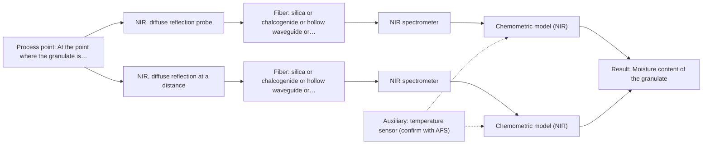
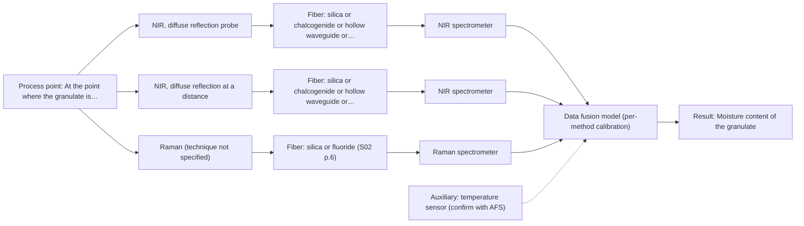

# First technical assessment: Accuracy guarantee, regulatory approval and price

## Answer

**Customer request:** Before we order, please confirm in writing that your NIR system will measure the moisture of our granulate to plus or minus 0.1 % and guarantee that our regulator will approve it for release testing. Please also include the price of the complete system.

### Brief answer

Moisture in a granulate is a sensible first target for NIR diffuse reflection, and that is the method to test first. The ±0.1 % figure cannot be confirmed before a trial on your samples against your release reference method, and no supplied source supports a regulatory acceptance commitment. Please tell us your moisture range, your reference method, and where the probe would be installed.

### Proposal

- **Best current option:** O2 (recommended)
- **Basis:** supplied AFS sources
- **What would change it:** If the trial shows NIR cannot reach the customer's target on held-out batches, the choice would move to the NIR + Raman option (O3); if the process point cannot take a contact probe, only the non-contact reflection geometry remains. A reference method whose precision is coarser than the target would also change the scope.
- **Next step:** Agree the moisture range, the release reference method and the installation point, then run the feasibility experiment on representative granulate samples before any system configuration or price is discussed.

**Secondary evidence (external, not AFS material):** G1: E03 ¶12, E02 ¶19; G2: no usable external source found; G3: no usable external source found; G4: no usable external source found. See Expert detail.

**Decision status:** Premise not supported by the sources

### Solution options

| ID | Tier | Methods | Confidence | Cost class, S01 Table 1 (p.6) | Ease of use | Maintenance | Performance fit | Sources |
|---|---|---|---|---|---|---|---|---|
| O1 | Simple | M1 NIR, diffuse reflection probe | Low: open question: Q1 (starts at Medium); a customer premise is contradicted, status: premise not supported | average cost (row 8) | simple probe handling, chemometric model needed | probe window cleaning, periodic recalibration | least effort that answers the moisture question | [1: S01 p.6] [2: S01 p.10] [3: S01 p.10] |
| O2 | Recommended | M1 NIR, diffuse reflection probe; M2 NIR, diffuse reflection at a distance | Low: open question: Q1 (starts at Medium); a customer premise is contradicted, status: premise not supported | average cost (rows 8, 10) | moderate; two probe geometries to compare | probe or window cleaning, scheduled recalibration | covers both possible installation points for the target | [1: S01 p.6] [4: S01 p.6] [2: S01 p.10] [3: S01 p.10] [5: S01 p.5] |
| O3 | Extended (multi-method) | M1 NIR, diffuse reflection probe; M2 NIR, diffuse reflection at a distance; M3 NIR, diffuse reflection probe + Raman (combination) | Low: open question: Q1 (starts at Medium); a customer premise is contradicted, status: premise not supported; multi-method, fusion benefit not yet shown | at least average cost (rows 8, 10); Raman row not identified | two instruments and a fusion workflow to run | two calibrations and two sets of diagnostics | strongest option, held back until single methods fall short | [6: S01 p.8] [7: S01 p.8] [8: S01 p.8] [9: S01 p.9] [10: REF §5] [1: S01 p.6] [2: S01 p.10] [3: S01 p.10] [4: S01 p.6] [5: S01 p.5] [11: S01 p.15] [12: S01 p.15] |

*Confidence rates the basis of the advice (how much is known and cited), not a predicted accuracy or probability of success. It starts at High, or at Medium when a key question on the method or the option is open, and drops one level per weakness listed (floor Low).*

*Cost class is the relative rating in S01 Table 1 (p.6) for the in-line method+technique rows named (the highest one for a multi-method option); it is not a price.*

### Setup sketch

*Recommended option O2; drawn by code from the option, a schematic, not a configuration.*

### Key questions

1. What moisture range must the measurement cover, and which reference method does your release testing use, with what repeatability?
2. What is the granulate composition and particle-size distribution, and how is the material presented at the measurement point (flowing stream, bed, batch)?
3. Where would the probe be installed, in contact with the granulate or non-contact through a window, and what are the temperature, pressure and cleaning conditions there?

## Expert detail

**Customer enquiry**

> Before we order, please confirm in writing that your NIR system will measure the moisture of our granulate to plus or minus 0.1 % and guarantee that our regulator will approve it for release testing. Please also include the price of the complete system.

**Decision status:** Premise not supported by the sources. The enquiry asks for a written accuracy confirmation and a regulatory acceptance commitment that the supplied material cannot support: accuracy is configuration- and sample-dependent in the sources, and no supplied source addresses regulator acceptance or release testing. NIR diffuse reflection is a defensible first method to test for moisture in a granulate, but the target must be demonstrated on the customer's material before any confirmation, configuration or price is meaningful.

### Parameters

| ID | Parameter | Kind | Need | Measured by | Why | Sources |
|---|---|---|---|---|---|---|
| P1 | Moisture content of the granulate | quantitative | required | Spectroscopy: NIR | It is the target of the enquiry and the quantity the NIR model must predict. | [2: S01 p.10] |
| P2 | Granulate temperature at the measurement point | quantitative | optional | Auxiliary sensor: temperature sensor (engineering judgement: confirm availability with AFS) | It should be available because a temperature change shifts the water band and can be mistaken for a moisture change; the process temperature has not been stated. | *(no verified source: engineering judgement)* |
| P3 | Particle-size distribution and bulk density of the granulate | qualitative | optional | Not measurable in-line by spectroscopy; alternative: off-line particle-size analysis (sieve or laser diffraction) or the material specification | It should be available because reflection is sensitive to surface character and particle size, so this physical variation can be read as moisture and may need to be part of the model. | [13: S01 p.17] |
| P4 | Reference moisture value of the same samples | quantitative | required | Reference lab method: the customer's release reference method for moisture (to be confirmed) | The calibration and any comparison with release testing need independent reference values measured on the same samples. | [14: REF §3] |

### Solution option details

- **O1 cost drivers:** one spectrometer, one reflection probe, sample set and reference analyses
- **O2 cost drivers:** one spectrometer, two probe geometries, calibration and validation effort
- **O3 cost drivers:** two spectrometers, two probes, synchronisation and fused-model work
- **O3 combining methods:** Both probes must look at the same granulate volume, and the data must be synchronised to a common time step before fusion; a combined probe helps to keep the measurement spot small. The starting point is low-level concatenation of the two spectra with block scaling so that neither method dominates, and each instrument keeps its own calibration and diagnostics. The fused model must beat the best single-method NIR model on independent batches or runs, otherwise the extra instrument is dropped.

*Extended (multi-method) option O3; drawn by code from the option, a schematic, not a configuration.*

### Premise check

- **Contradicted:** A NIR system can be confirmed in writing, before any measurement, to measure granulate moisture to ±0.1 %. The sources state that accuracy depends on the configuration and the sample, and that a published application is a reason to test a method, not proof for a new customer. A written ±0.1 % confirmation before a trial on the customer's material is therefore not supported. [15: REF §5] [16: REF §3]
- **Not covered:** The supplier can commit in writing that the customer's regulator will accept the system for release testing. No supplied source addresses regulatory acceptance, release testing or validation criteria for a customer's regulator. *(no verified source: engineering judgement)*
- **Not covered:** A price for the complete system can be given before measurement feasibility is established. No supplied source contains prices, product codes or cost classes; the relative cost class of a configuration is not stated in the sources. *(no verified source: engineering judgement)*

### Requirements

**Stated by the customer**

- Measure moisture in granulate.
- Target accuracy ±0.1 % (stated by the customer, not yet demonstrated).
- Use for release testing.
- NIR named as the expected method.

**Key unknowns**

- Moisture range and the precision of the customer's release reference method.
- Granulate composition, particle-size distribution, bulk density and colour.
- Fluorescence background and other spectral interferences in the granulate.
- Installation point: contact or non-contact, temperature, pressure, cleaning and fouling.
- Required response time and measurement frequency; at-line or in-line.
- Which regulator and framework must accept the method, and what release testing requires.

### Clarification questions (most decision-relevant first)

Q1. What moisture range must the measurement cover, and which reference method does your release testing use, with what repeatability? *Why it matters:* The moisture range and the reference method's own precision decide whether the ±0.1 % target can be compared with release testing at all. *(affects: M1)*
Q2. What is the granulate composition and particle-size distribution, and how is the material presented at the measurement point (flowing stream, bed, batch)? *Why it matters:* Composition, particle size and presentation determine which reflection geometry is workable and how much physical variation the model must tolerate. *(affects: technique)*
Q3. Where would the probe be installed, in contact with the granulate or non-contact through a window, and what are the temperature, pressure and cleaning conditions there? *Why it matters:* The installation point decides between contact and non-contact reflection and sets requirements on the probe and window that are not yet known. *(affects: installation)*
Q4. Does the granulate contain components that fluoresce or absorb strongly, which could disturb a reflection measurement? *Why it matters:* A strong fluorescence or absorption background would weaken a single-method NIR result and decide whether a second method needs testing. *(affects: M3)*
Q5. Which regulator and framework must accept the method, and what does release testing require in terms of validation and documentation? *Why it matters:* The acceptance framework decides what evidence the trial must produce, and no supplied source covers it. *(affects: status)*

### Recommendation

- **M1 · Primary candidate: NIR, diffuse reflection probe.** For a scattering powder, diffuse reflection is the reflection geometry the source table lists for scattering media and powder, and NIR carries the -OH overtone bands of water. NIR bands are broad and overlap, so a chemometric moisture model against reference values is required. *Conditions:* Applies as the first test for any granulate that can be presented to a reflection probe. [1: S01 p.6] [2: S01 p.10] [3: S01 p.10]
- **M2 · Comparison candidate: NIR, diffuse reflection at a distance.** The same method in a non-contact geometry, which the source table lists for powder measured at a distance and which the source describes as suited to remote fiber-probe measurement. It is worth comparing only because the installation point is not yet known. *Conditions:* Applies only if the process point cannot take a contact reflection probe or if window fouling makes contact impractical. [4: S01 p.6] [5: S01 p.5]
- **M3 · Conditional candidate: NIR, diffuse reflection probe + Raman (combination).** Raman adds the molecular backbone and non-polar groups that NIR reflection sees poorly, and a fused NIR + Raman model has been reported to predict blend potency and coating thickness better than single-method models. Here the gain is a hypothesis and is tested only after the single-method NIR result is known. *Conditions:* Applies only if the single-method NIR test cannot reach the customer's target on held-out batches. [11: S01 p.15] [12: S01 p.15]
- **M4 · Not recommended: MIR, ATR probe.** ATR requires tight contact and suits liquids, pastes and soft solids, which a granulate bed cannot provide; an ATR probe also sees only a few micrometres of surface. [17: S04 p.4] [18: S01 p.13]

### Measurement concept

- **Probe and geometry:** NIR reflection probe; contact diffuse reflection in the granulate flow or bed, non-contact reflection through a window as the alternative if the process point allows no contact.
- **Location:** At the point where the granulate is presented for release or process measurement; to be fixed after the installation question is answered.
- **Fiber link:** The usable fiber link and probe are part of the configuration and are not stated for this case; the sources give 100-300 m only for low-OH silica cables in general, not for this granulate. [19: S02 p.7]

### Spectral range

- **NIR:** Nominal NIR range 780-2500 nm; the usable range depends on the spectrometer, fiber and probe actually selected, and the informative water regions must be confirmed on the customer's granulate. [2: S01 p.10] [15: REF §5]

### Risks and uncertainty

- The ±0.1 % target is not demonstrated for this granulate; accuracy depends on the configuration and the sample, so NIR alone may not reach it. [15: REF §5]
- Physical variation of the granulate (particle size, bulk density, surface state) changes the reflection signal and can be read as a moisture change, biasing the calibration. *(rules: R-GEO-6)* [13: S01 p.17]
- If the release reference method is less precise than ±0.1 % or differs from the method used in the trial, the model cannot be compared with release testing. *(no verified source: engineering judgement)*
- The installation point is unknown; if the process cannot present the granulate to a reflection probe, the assumed geometry may not apply. *(rules: R-GEN-5)* [20: S01 p.7]

### First feasibility experiment

1. **Collect representative granulate samples across the expected moisture range and the expected physical variation (particle size, bulk density, several batches or process states).** Collect representative granulate samples covering the expected moisture range and the expected physical variation (particle size, bulk density, temperature, several batches or process states). [14: REF §3]
2. **Measure the samples with the NIR reflection probe at the intended measurement spot, record the sample temperature, and run the contact and, if relevant, the non-contact geometry on the same samples.** Measure the samples with the NIR reflection probe at the intended measurement spot, record the sample temperature, and run the contact and, if relevant, the non-contact geometry on the same samples. *(no verified source: engineering judgement)*
3. **Have the same samples measured by the customer's release reference method, independently of the spectra, and record that method's own repeatability.** Have the same samples measured by the customer's release reference method, independently of the spectra, and record that method's own repeatability. [14: REF §3]
4. **Build and validate a chemometric moisture model with held-out batches or runs, and report the prediction error against the customer's ±0.1 % criterion.** Build and validate a chemometric moisture model with held-out batches or runs, and report the prediction error against the customer's ±0.1 % criterion. [3: S01 p.10]
5. **Only if NIR alone misses the target on held-out batches: add the Raman measurement and test a fused NIR + Raman model against the best single-method model, then drop the extra instrument if it does not win.** Only if NIR alone misses the target on held-out batches: add the Raman measurement and test a fused NIR + Raman model against the best single-method model, then drop the extra instrument if it does not win. [10: REF §5] [12: S01 p.15]

**Reference measurements:** The customer's release reference method for moisture, applied to the same samples as the spectra.

**Decision basis:** Go / no-go against the customer's own numerical criterion (±0.1 % moisture) on held-out batches or runs; the customer sets that number.

### Assumptions

- Granulate can be presented to a reflection probe, in contact or through a window.
- Moisture is present as water whose O-H overtone bands are accessible in the NIR region.
- A reference method exists that gives moisture values on the same samples.
- The process temperature and pressure at the measurement point are within what a standard fiber probe can handle; this is not yet known.

### Not covered by the supplied sources

- A written confirmation of ±0.1 % accuracy for this granulate before measurement.
- A regulatory acceptance commitment for release testing.
- A price for the complete system.

### Further notes

- **Chemometrics:** A moisture model must be built and validated against the customer's reference values: NIR bands are broad and overlapping, so chemometrics is required for quantitative analysis, and the calibration is specific to the granulate matrix and must be re-validated if the material or process changes.
- **Future direction:** Once the trial shows which NIR regions carry the moisture information, a compact spectral fiber sensor for continuous in-line control could be considered as a later extension (S02 p.20, Path C).

### Secondary evidence (external, not AFS material)

*Found by a literature search for gaps the supplied AFS sources leave open. Not AFS material and not proof for this case; every quote below was verified verbatim against the fetched text.*

*Live search unavailable (library only: cache miss (europepmc); cache miss (openalex)); curated library only.*

**G1 · auxiliary sensor:** In-line measurement of Granulate temperature at the measurement point with temperature sensor

- **E03 ¶12** The source says that temperature sensitivity of OH bands is a severe drawback for measuring aqueous solution in NIR and MIR, which makes tempered sample holders necessary. *How it applies:* For in-line NIR moisture measurement, this could justify testing whether granulate temperature at the measurement point needs to be measured or controlled, and whether a temperature sensor or tempered setup is needed. *Limits and transfer risks:* The quote concerns aqueous solution and tempered sample holders, not granulate or an in-line granulate probe; transfer to a solid granulate matrix and different instrument geometry is uncertain. *(supports O2)*
  > "Additionally, the temperature sensitivity of the OH bands is a severe drawback for measuring aqueous solution in NIR and MIR, which makes tempered sample holders necessary [29]."
  > A critical review of recent trends, and a future perspective of optical spectroscopy as PAT in biopharmaceutical downstream processing. (2020) · Analytical and bioanalytical chemistry · doi:10.1007/s00216-020-02407-z · https://europepmc.org/article/PMC/PMC7072065 · retrieved 2026-10-17, full text, licence: cc by, via curated library
- **E02 ¶19** The source varied temperature together with acid concentrations and ionic strength to obtain a robust model. *How it applies:* This could inform the assessment by suggesting that temperature be included as a monitored or varied factor when building or testing the NIR calibration for the granulate. *Limits and transfer risks:* The work is on reactive liquid-liquid extraction with acids, not granulate; the temperature variation is in a different matrix and process, so the need for and placement of an in-line temperature sensor cannot be directly transferred. *(supports O2)*
  > "The concentrations of nitric acid and hydrochloric acid as well as the ionic strength and temperature were varied to obtain a robust model."
  > Process Analytical Technology-Integrated FT-IR and Raman Spectroscopies for Efficient Reactive Liquid-Liquid Extraction Processing in Lithium Recycling. (2025) · ACS omega · doi:10.1021/acsomega.5c05705 · https://europepmc.org/article/PMC/PMC12573149 · retrieved 2026-10-17, full text, licence: cc by, via curated library

**G2 · multi-method:** Combining several spectroscopy methods (data fusion) (Both probes must look at the same granulate volume, and the data must be synchronised to a common time step before fusion; a combined probe helps to keep the measurement spot small. The starting point is low-level concatenation of the two spectra with block scaling so that neither method dominates, and each instrument keeps its own calibration and diagnostics. The fused model must beat the best single-method NIR model on independent batches or runs, otherwise the extra instrument is dropped.)

- No usable external source found.

**G3 · not in the supplied sources:** A written confirmation of ±0.1 % accuracy for this granulate before measurement.

- No usable external source found.

**G4 · not in the supplied sources:** A regulatory acceptance commitment for release testing.

- No usable external source found.

### Evidence (verified quotes)

1. ✓ **S01 p.6** (general): "Scattering media, powder 0.5-1 mm"
2. ✓ **S01 p.10** (general): "NIR spectra (780-2500 nm) contain predominantly overtones and component bands of fundamental vibrations of molecules and atomic groups"
3. ✓ **S01 p.10** (general): "The broad absorption bands observed in this region overlap, suggesting the use of chemometrics for quantitative and qualitative analysis of spectral data."
4. ✓ **S01 p.6** (general): "surface at a distance solid, powder 2-5 mm"
5. ✓ **S01 p.5** (general): "making it ideal for online applications, including remote measurements via fiber optic probes."
6. ✓ **S01 p.8** (general): "The use of a combined probe facilitates measurements and allows for the analysis of a smaller sample volume."
7. ✓ **S01 p.8** (general): "Ultimately, the measurement data must be normalized to a common time step."
8. ✓ **S01 p.8** (general): "Variables obtained from different spectral methods are not equivalent."
9. ✓ **S01 p.9** (general): "One of the challenges of multispectral analysis is the need to simultaneously connect at least two independently operating measuring instruments."
10. ✓ **REF §5** (general): "compare with the best single method."
11. ✓ **S01 p.15** (general): "The combination of these techniques is particularly effective because it captures complementary chemical information: NIR detects hydrogen bonds and asymmetric polar groups, while Raman provides information on the molecular backbone and symmetrical non-polar groups."
12. ✓ (precedent only) **S01 p.15** (method gain): "By combining Raman and NIR, these models can predict API potency or coating thickness with higher accuracy and robustness than single-method models."
13. ✓ **S01 p.17** (general): "the method is sensitive to the surface characteristics and fat globule size."
14. ✓ **REF §3** (general): "Representative samples or process states, independent reference measurements, what is compared, and the basis for the go / no-go decision."
15. ✓ **REF §5** (general): "It is not a product specification: actual spectral coverage, fiber length, component ratings, detection limits and accuracy depend on the configuration and the sample."
16. ✓ **REF §3** (general): "a published application is a reason to test a method, not proof that it will work for a new customer."
17. ✓ **S04 p.4** (general): "suitability of analyzed samples for ATR measurements, which is true for liquid or soft solid samples and their components, allowing a tight contact with the probe head."
18. ✓ **S01 p.13** (general): "typically at a depth of few microns"
19. ✓ **S02 p.7** (general): "Robust 100-300m cables made with Silica fibers of low OH-content (<0.1ppm OH) enable remote industrial process-control"
20. ✓ **S01 p.7** (general): "Morphological factors, such as sample inhomogeneity (e.g., biological tissue) or process turbulence, must also be considered when selecting a measurement technique."

### Verification

- Citations verified: 32 of 32 (exact or whitespace/hyphen-tolerant match on the cited page, scope checked).
- Hard check failures before deterministic corrections: 0; still open: 0; soft warnings: 3; repair rounds: 1.
- External evidence (cache): 2 quote(s) verified verbatim (exact or whitespace/hyphen-tolerant, at most 400 characters and 2 sentences, against the cited paragraph); 0 item(s) dropped.
- External search: 5 query(ies), 0 hit(s), 3 source(s) (3 from the curated library); ⚠ library only: cache miss (europepmc); cache miss (openalex).
- External step: 2 model call(s), 49.0 s extra (cost in the run JSON).

*Run A08-20261018T072334Z-bac4 · models deepseek/deepseek-v4.1-flash*
