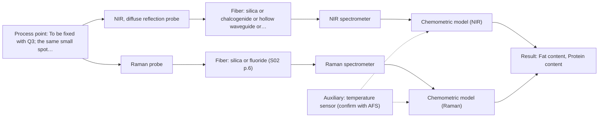
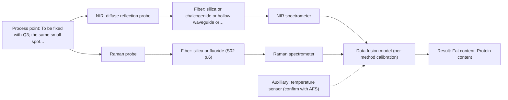

# First technical assessment: Fat and protein monitoring in opaque dairy product

## Answer

**Customer request (our summary):** Customer produces an opaque, concentrated milk product on a processing line; currently samples for fat and protein; wants earlier composition-change information via an initial spectroscopy concept and practical comparison experiment while retaining lab checks.

### Brief answer

Test NIR diffuse reflection first: it suits opaque, concentrated dairy and is documented for fat and protein. Run Raman beside it as the comparison you asked for, and keep your laboratory fat and protein checks as the reference. The measurement point, temperature and texture ranges and required precision are still open, so this is a provisional concept.

### Proposal

- **Best current option:** O2 (recommended)
- **Basis:** engineering judgement
- **What would change it:** If NIR reflection alone meets the required precision, O1 is sufficient; if one method is clearly better, or the fused model clearly wins on independent batches, the choice moves accordingly.
- **Next step:** Run the comparison on representative line samples against the retained laboratory fat and protein reference.

**Secondary evidence (external, not AFS material):** G1: E01 ¶12; G2: E02 ¶31, E02 ¶82; G3: no usable external source found; G4: no usable external source found. See Expert detail.

**Decision status:** Provisional feasibility assessment

### Solution options

| ID | Tier | Methods | Confidence | Cost class, S01 Table 1 (p.6) | Ease of use | Maintenance | Performance fit | Sources |
|---|---|---|---|---|---|---|---|---|
| O1 | Simple | M1 NIR, diffuse reflection probe | Low: open question: Q1 (starts at Medium); precedent only; uncited auxiliary sensor | average cost (row 8) | one probe, single instrument, simplest setup | probe window cleaning, periodic recalibration | answers the fat and protein question directly | [1: S01 p.17] [2: S01 p.17] |
| O2 | Recommended | M1 NIR, diffuse reflection probe; M2 Raman probe | Low: open question: Q1 (starts at Medium); uncited auxiliary sensor | high cost (rows 8, 12) | two instruments, more setup and alignment | two probes, separate calibration and cleaning | comparison shows which method tracks change best | [3: S01 p.15] [1: S01 p.17] [2: S01 p.17] [4: S01 p.16] |
| O3 | Extended (multi-method) | M3 NIR, diffuse reflection probe + Raman (combination) | Low: open question: Q1 (starts at Medium); uncited auxiliary sensor; multi-method, fusion benefit not yet shown | high cost (rows 8, 12) | highest effort, synchronised fusion workflow | per-block calibration, drift control on both | may beat single methods on complex matrix | [5: S01 p.8] [6: S01 p.9] [3: S01 p.15] [7: S01 p.7] |

*Confidence rates the basis of the advice (how much is known and cited), not a predicted accuracy or probability of success. It starts at High, or at Medium when a key question on the method or the option is open, and drops one level per weakness listed (floor Low).*

*Cost class is the relative rating in S01 Table 1 (p.6) for the in-line method+technique rows named (the highest one for a multi-method option); it is not a price.*

### Setup sketch

*Recommended option O2; drawn by code from the option, a schematic, not a configuration.*

### Key questions

1. What fat and protein concentration ranges must be covered, and what measurement precision is required?
2. What response time counts as 'earlier information' for your control decisions?
3. Where on the line should the measurement sit, and can a probe contact the product or is a bypass needed?

## Expert detail

**Customer enquiry**

> We produce an opaque, concentrated milk product that flows through a processing line. We currently sample it for fat and protein analysis and would like earlier information about composition changes. Product temperature and texture vary during production. We want an initial spectroscopy concept and a practical comparison experiment, while retaining our laboratory checks.

**Decision status:** Provisional feasibility assessment. The opaque, concentrated dairy matrix fits NIR diffuse reflection, so a method shortlist can be justified. Several deciding facts (required precision, response time, installation point, temperature and texture ranges) are still open, so this remains provisional.

### Parameters

| ID | Parameter | Kind | Need | Measured by | Why | Sources |
|---|---|---|---|---|---|---|
| P1 | Fat content | quantitative | required | Spectroscopy: NIR | Fat is one of the two composition targets the customer already measures. | [2: S01 p.17] |
| P2 | Protein content | quantitative | required | Spectroscopy: NIR | Protein is the other composition target the customer already measures. | [2: S01 p.17] |
| P3 | Product temperature | quantitative | required | Auxiliary sensor: temperature sensor (engineering judgement: confirm availability with AFS) | Temperature varies during production and shifts NIR absorption bands, so it must be recorded alongside the spectra. | *(no verified source: engineering judgement)* |
| P4 | Texture / viscosity | qualitative | optional | Not measurable in-line by spectroscopy; alternative: offline rheology / viscometry | Texture varies during production and changes light scattering, which can be mistaken for a composition change; it should be available to interpret the spectra. | [8: S01 p.17] |

### Solution option details

- **O1 cost drivers:** one spectrometer, one reflection probe, calibration samples
- **O2 cost drivers:** two spectrometers, two probes, wider calibration set
- **O3 cost drivers:** two instruments, synchronisation, fusion modelling effort
- **O3 combining methods:** Fusion joins NIR and Raman into one model, beginning with block scaling of the concatenated spectra so neither method dominates. Both probes must look at the same small spot on the flowing product, and the two acquisition rates must be aligned to a common time step. The fused model is only worth keeping if it beats the best single method on independent batches, with each instrument calibrated and maintained separately.

*Extended (multi-method) option O3; drawn by code from the option, a schematic, not a configuration.*

### Premise check

- **Supported:** The product's opaque, concentrated nature is compatible with the intended spectroscopic measurement. A supplied source states that NIR reflection is the technique used for opaque or highly concentrated dairy products. [1: S01 p.17]
- **Precedent only:** Earlier information about composition changes can be obtained by spectroscopy. Inline NIR monitoring of milk is a published example; it is a reason to test the method here, not proof for this product. [9: S01 p.17]
- **Not covered:** Current laboratory sampling for fat and protein is an adequate reference for comparison. No supplied source addresses whether the customer's specific laboratory method is an adequate reference for an in-line comparison. *(no verified source: engineering judgement)*

### Requirements

**Stated by the customer**

- Fat and protein composition of an opaque, concentrated milk product on a processing line.
- Earlier information about composition changes than current sampling.
- An initial spectroscopy concept and a practical comparison experiment.
- Retain existing laboratory checks.

**Key unknowns**

- Fat and protein concentration ranges and the required measurement precision.
- Required response time for 'earlier information' and the control action it feeds.
- Measurement location and interface (in-line contact, bypass or non-contact).
- Temperature range and rate of change at the measurement point.
- Texture/viscosity range, particulates and air content of the product.
- Details of the retained laboratory reference method and its sampling frequency.

### Clarification questions (most decision-relevant first)

Q1. What fat and protein concentration ranges must be covered, and what measurement precision is required? *Why it matters:* This decides whether NIR reflection alone meets the target or a second method is needed. *(affects: method)*
Q2. What response time counts as 'earlier information' for your control decisions? *Why it matters:* It sets the acquisition speed and therefore the technique and detector. *(affects: technique)*
Q3. Where on the line should the measurement sit, and can a probe contact the product or is a bypass needed? *Why it matters:* It fixes the probe interface, cleaning and hygiene concept. *(affects: installation)*
Q4. What are the temperature range and the rate of temperature change at that point? *Why it matters:* Temperature shifts NIR absorption bands and must be handled in the calibration. *(affects: M1)*
Q5. What are the texture and viscosity range, and do particulates or air enter the product? *Why it matters:* Physical variation drives scattering and may rule out some measurement geometries. *(affects: technique)*

### Recommendation

- **M1 · Primary candidate: NIR, diffuse reflection probe.** NIR diffuse reflection is the documented route for opaque, concentrated dairy products and for fat and protein. It is the single method to test first. *Conditions:* Applies if the product is optically accessible at the probe and a chemometric calibration is built on representative samples. [1: S01 p.17] [2: S01 p.17]
- **M2 · Comparison candidate: Raman probe.** Raman gives a molecular fingerprint and tolerates water, so it is worth testing beside NIR. It is the second method in the comparison the customer asked for. *Conditions:* Applies if a complementary vibrational method is wanted and the fluorescence background is checked on the real product. [4: S01 p.16]
- **M3 · Comparison candidate: NIR, diffuse reflection probe + Raman (combination).** Combining NIR and Raman is a documented hypothesis for complex samples and adds complementary information. It must beat the best single method before it is adopted. *Conditions:* Applies only if a single method does not meet the targets after the single-method tests. [3: S01 p.15] [7: S01 p.7]

### Measurement concept

- **Probe and geometry:** Contact diffuse-reflection probe flush-mounted at the line, with a Raman probe at the same point for the comparison; temperature recorded at the same location.
- **Location:** To be fixed with Q3; the same small spot must be used by both methods if the fused model is later tested.
- **Fiber link:** Not stated for this product; link length depends on the instrument, fiber family and probe actually selected. [10: S01 p.8]

### Spectral range

- **NIR:** Nominal NIR range 780-2500 nm; the usable range depends on the instrument, fiber and probe actually selected. [11: S01 p.10]
- **Raman:** Raman is reported as Raman shift in cm-1; the laser excitation wavelength is stated separately. [12: S01 p.11]

### Risks and uncertainty

- NIR reflection is sensitive to surface texture and fat globule size, so physical variation could be read as a composition change. *(rules: R-GEO-6)* [8: S01 p.17]
- The product is opaque and concentrated, so light may not penetrate the bulk and transmission geometries are unlikely to work. *(rules: R-GEO-2)* [13: S01 p.18]
- NIR bands are broad and overlapping and the calibration is matrix-specific, so a model built at one texture or temperature state may not transfer. *(rules: R-NIR-2, R-CAL-1)* [14: S01 p.10] [15: REF §5]
- A fused NIR+Raman model may not beat the best single method and adds synchronisation and a second instrument to run. *(rules: R-CMB-3)* [16: S01 p.9]

### First feasibility experiment

1. **Collect representative samples across the expected fat and protein range and across the texture and temperature states seen in production, taken from the line.** Cover the chemical and physical variation the model must handle. [17: REF §3]
2. **Measure every sample by NIR diffuse reflection and, in the same session, by Raman, recording the product temperature at each measurement.** Single methods first, on identical samples. *(no verified source: engineering judgement)*
3. **Measure fat and protein on the same samples with the retained laboratory method as the independent reference.** Provide the reference data for calibration and for the comparison. [17: REF §3]
4. **Build per-method calibration models, compare each method's prediction error against the reference, and only then test a fused NIR+Raman model against the best single method.** Show whether the second method adds value; any gain is a hypothesis. [18: S01 p.15] [19: REF §5]
5. **Validate the chosen model on held-out runs or batches and set the go/no-go criteria (accuracy, repeatability) with the customer.** Test transfer to unseen production states. [17: REF §3]

**Reference measurements:** Retained laboratory fat and protein analysis on the same samples (Q5, reference method details open).

**Decision basis:** Numerical accuracy and repeatability targets to be set by the customer (Q1); the extra method is kept only if it beats the best single method on independent batches.

### Assumptions

- The line product is water-based and contains fat and protein as the two tracked components.
- A contact probe can be placed at a representative point of the line.
- The existing laboratory fat and protein method is precise enough to serve as reference (not verified; see premise check).

### Not covered by the supplied sources

- In-line accuracy, detection limit and response-time figures for fat and protein in this concentrated milk matrix are not covered by the supplied sources.
- No supplied source states an achievable fiber-link length for the specific configuration at this process point.

### Further notes

- **Chemometrics:** Fat and protein are read from broad, overlapping NIR bands, so a chemometric calibration model built on reference data is needed. The model is specific to the matrix and must be re-validated after a change of texture or temperature regime.
- **Real-time tracking:** The aim is in-line, continuous tracking of composition change, which requires fast spectral acquisition at the process point.
- **Future direction:** A later extension could be a compact sensor built on selected wavelengths or an IoT-style spectral fiber sensor sending data for remote monitoring.

### Secondary evidence (external, not AFS material)

*Found by a literature search for gaps the supplied AFS sources leave open. Not AFS material and not proof for this case; every quote below was verified verbatim against the fetched text.*

*Live search unavailable (library only: cache miss (europepmc); cache miss (openalex)); curated library only.*

**G1 · auxiliary sensor:** In-line measurement of Product temperature with temperature sensor

- **E01 ¶12** The source notes that temperature sensitivity of OH bands is a severe drawback for measuring aqueous solution in NIR and MIR, making tempered sample holders necessary. *How it applies:* This could inform whether product temperature needs to be monitored or controlled during in-line NIR/MIR measurement, and whether temperature effects should be tested in the comparison experiment. *Limits and transfer risks:* The statement concerns aqueous solutions and tempered sample holders, not an in-line product temperature sensor; transfer to a concentrated milk matrix on a process line is uncertain. *(supports O2)*
  > "Additionally, the temperature sensitivity of the OH bands is a severe drawback for measuring aqueous solution in NIR and MIR, which makes tempered sample holders necessary [29]."
  > A critical review of recent trends, and a future perspective of optical spectroscopy as PAT in biopharmaceutical downstream processing. (2020) · Analytical and bioanalytical chemistry · doi:10.1007/s00216-020-02407-z · https://europepmc.org/article/PMC/PMC7072065 · retrieved 2026-10-17, full text, licence: cc by, via curated library

**G2 · multi-method:** Combining several spectroscopy methods (data fusion) (Fusion joins NIR and Raman into one model, beginning with block scaling of the concatenated spectra so neither method dominates. Both probes must look at the same small spot on the flowing product, and the two acquisition rates must be aligned to a common time step. The fused model is only worth keeping if it beats the best single method on independent batches, with each instrument calibrated and maintained separately.)

- **E02 ¶31** The source describes low-level data fusion as the simplest way to combine inputs by rearranging variables from different sources into a new data matrix. *How it applies:* This could inform a practical comparison experiment that starts with concatenated NIR and Raman variables, then checks whether the fused model outperforms the best single method on independent batches. *Limits and transfer risks:* The source is a general PAT data-fusion review, not a concentrated milk or in-line NIR/Raman study; block scaling, spot alignment, and time-step alignment are not addressed here. *(supports O3)*
  > "Low-level data fusion (LLDF) is considered the simplest method to achieve a combination of inputs. In this case, the data is rearranged into a new data matrix, where the variables coming from different sources are placed one after the other."
  > Challenges and Opportunities of Implementing Data Fusion in Process Analytical Technology-A Review. (2022) · Molecules (Basel, Switzerland) · doi:10.3390/molecules27154846 · https://europepmc.org/article/PMC/PMC9369811 · retrieved 2026-10-17, full text, licence: cc by, via curated library
- **E02 ¶82** The source states that before fusing data from multiple sources, it is essential to evaluate each dataset's contribution to the model and its complementarity. *How it applies:* This supports a staged assessment: first evaluate NIR and Raman separately, then fuse only if each method adds complementary information for the composition changes of interest. *Limits and transfer risks:* This is a general data-fusion recommendation, not specific to concentrated milk or in-line probes; complementarity may differ with matrix, process conditions, and instrument setup. *(supports O3)*
  > "Before fusing data from multiple sources, it is essential to evaluate the contribution of each dataset to the model and its complementarity."
  > Challenges and Opportunities of Implementing Data Fusion in Process Analytical Technology-A Review. (2022) · Molecules (Basel, Switzerland) · doi:10.3390/molecules27154846 · https://europepmc.org/article/PMC/PMC9369811 · retrieved 2026-10-17, full text, licence: cc by, via curated library

**G3 · not in the supplied sources:** In-line accuracy, detection limit and response-time figures for fat and protein in this concentrated milk matrix are not covered by the supplied sources.

- No usable external source found.

**G4 · not in the supplied sources:** No supplied source states an achievable fiber-link length for the specific configuration at this process point.

- No usable external source found.

### Evidence (verified quotes)

1. ✓ **S01 p.17** (general): "NIR Reflection is primarily used for opaque or highly concentrated dairy products, such as yogurt, butter, or whole milk concentrates."
2. ✓ **S01 p.17** (general): "using Partial Least Squares (PLS) regression to quantify fat and protein."
3. ✓ **S01 p.15** (general): "NIR detects hydrogen bonds and asymmetric polar groups, while Raman provides information on the molecular backbone and symmetrical non-polar groups."
4. ✓ **S01 p.16** (general): "Raman is particularly well-suited for aqueous environments, as it exhibits low absorbance for water molecules compared to infrared methods."
5. ✓ **S01 p.8** (general): "Variables obtained from different spectral methods are not equivalent."
6. ✓ **S01 p.9** (general): "methods containing a larger number of variables have a greater impact on the model."
7. ✓ **S01 p.7** (general): "The analysis of such systems may require a combination of two or even more spectral methods."
8. ✓ **S01 p.17** (general): "the method is sensitive to the surface characteristics and fat globule size."
9. ✓ **S01 p.17** (application precedent): "The use of Near-Infrared (NIR) spectroscopy for the inline monitoring of milk is a cornerstone of modern dairy "Process Analytical Technology" (PAT)."
10. ✓ **S01 p.8** (general): "It is crucial that the spectral information obtained by different methods-Mid-IR, NIR, Raman, and fluorescence spectra-is collected from the same small, even pinpoint, area of the sample."
11. ✓ **S01 p.10** (general): "NIR spectra (780-2500 nm) contain predominantly overtones and component bands of fundamental vibrations"
12. ✓ **S01 p.11** (general): "The Raman shift is used as the horizontal (spectral) axis in Raman spectroscopy"
13. ✓ **S01 p.18** (general): "the light cannot penetrate the sample."
14. ✓ **S01 p.10** (general): "The broad absorption bands observed in this region overlap, suggesting the use of chemometrics for quantitative and qualitative analysis of spectral data."
15. ✓ **REF §5** (general): "calibration specific to the matrix."
16. ✓ **S01 p.9** (general): "One of the challenges of multispectral analysis is the need to simultaneously connect at least two independently operating measuring instruments."
17. ✓ **REF §3** (general): "Representative samples or process states, independent reference measurements, what is compared, and the basis for the go / no-go decision."
18. ✓ (precedent only) **S01 p.15** (method gain): "these models can predict API potency or coating thickness with higher accuracy and robustness than single-method models."
19. ✓ **REF §5** (general): "compare with the best single method."

### Verification

- Citations verified: 26 of 26 (exact or whitespace/hyphen-tolerant match on the cited page, scope checked).
- Hard check failures before deterministic corrections: 0; still open: 0; soft warnings: 8; repair rounds: 1.
- Removed 7 intake item(s) not quoted verbatim from the enquiry:
  - intake.targets[0]: enquiry_quote not found verbatim in the enquiry
  - intake.process[0]: enquiry_quote not found verbatim in the enquiry
  - intake.process[1]: enquiry_quote not found verbatim in the enquiry
  - intake.process[2]: enquiry_quote not found verbatim in the enquiry
  - intake.process[3]: enquiry_quote not found verbatim in the enquiry
  - intake.process[4]: enquiry_quote not found verbatim in the enquiry
  - intake.process[5]: enquiry_quote not found verbatim in the enquiry
- External evidence (cache): 3 quote(s) verified verbatim (exact or whitespace/hyphen-tolerant, at most 400 characters and 2 sentences, against the cited paragraph); 0 item(s) dropped.
- External search: 6 query(ies), 0 hit(s), 3 source(s) (3 from the curated library); ⚠ library only: cache miss (europepmc); cache miss (openalex).
- External step: 2 model call(s), 58.5 s extra (cost in the run JSON).

*Run D02-20261018T072334Z-dab6 · models deepseek/deepseek-v4.1-flash*
