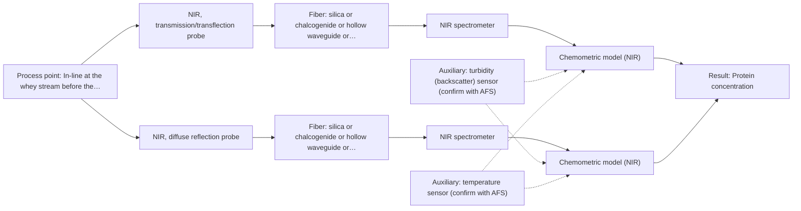

# First technical assessment: A clear whey stream before concentration

## Answer

**Customer request (our summary):** Customer wants to investigate in-line spectroscopy for tracking protein concentration in a dairy whey stream before concentration, using laboratory results as reference. The stream is relatively clear but can become more turbid under some operating conditions.

### Brief answer

Start with NIR transmission/transflection on the whey before the concentration stage, using your laboratory protein results as the reference. Because the stream can become turbid, test NIR diffuse reflection alongside it so the concept covers both states rather than assuming a clear liquid. A mid-IR ATR method is a fallback if NIR accuracy proves insufficient. The protein range, required accuracy, turbidity range and installation point are still open.

### Proposal

- **Best current option:** O2 (recommended)
- **Basis:** supplied AFS sources
- **What would change it:** If the trials show that one NIR technique already covers both stream states, or that neither reaches the required protein accuracy, the choice moves to O1 or to the mid-IR ATR fallback (M3). A turbidity range that never blocks transmission would also favour the single-technique option.
- **Next step:** Run the feasibility experiment with NIR transmission/transflection and NIR diffuse reflection on representative clear and turbid whey samples, using the laboratory protein values as reference.

**Secondary evidence (external, not AFS material):** G1: no usable external source found; G2: E02 ¶19; G3: no usable external source found; G4: no usable external source found. See Expert detail.

**Decision status:** Provisional feasibility assessment

### Solution options

| ID | Tier | Methods | Confidence | Cost class, S01 Table 1 (p.6) | Ease of use | Maintenance | Performance fit | Sources |
|---|---|---|---|---|---|---|---|---|
| O1 | Simple | M1 NIR, transmission/transflection probe | Medium: open question: Q1 (starts at Medium) | average cost (row 7) | standard dairy NIR transmission setup | routine probe cleaning and model re-validation | answers protein tracking while the stream is clear | [1: S01 p.18] [2: S01 p.18] [3: S01 p.10] |
| O2 | Recommended | M1 NIR, transmission/transflection probe; M2 NIR, diffuse reflection probe | Medium: open question: Q1 (starts at Medium) | average cost (rows 7, 8) | two NIR probes on one spectrometer | two probe interfaces to clean and check | covers both the clear and the turbid stream states | [4: S01 p.18] [5: S01 p.18] [1: S01 p.18] [3: S01 p.10] [6: S01 p.17] [7: S01 p.18] |

*Confidence rates the basis of the advice (how much is known and cited), not a predicted accuracy or probability of success. It starts at High, or at Medium when a key question on the method or the option is open, and drops one level per weakness listed (floor Low).*

*Cost class is the relative rating in S01 Table 1 (p.6) for the in-line method+technique rows named (the highest one for a multi-method option); it is not a price.*

### Setup sketch

*Recommended option O2; drawn by code from the option, a schematic, not a configuration.*

### Key questions

1. What is the expected protein concentration range in the whey before the concentration stage, and what accuracy and response time does the application need?
2. How turbid does the stream become under the operating conditions that change it, and how fast do the clear-to-turbid changes occur?
3. How often does the laboratory protein method report a value, and with what uncertainty and delay relative to sampling?

## Expert detail

**Customer enquiry**

> Our dairy process includes a relatively clear whey stream before a concentration stage. We want to investigate whether spectroscopy can track protein concentration as the stream changes, with laboratory results used as the reference. The stream can become more turbid under some operating conditions. We need a first measurement concept that handles this change rather than assuming the liquid always remains clear.

**Decision status:** Provisional feasibility assessment. A shortlist can be justified from the dairy NIR precedent and from the dual-technique approach for clear and turbid states, but the protein range, the required accuracy, the turbidity range and the installation conditions are not known. The assessment therefore rests on the stated assumptions and on the customer's laboratory reference values.

### Parameters

| ID | Parameter | Kind | Need | Measured by | Why | Sources |
|---|---|---|---|---|---|---|
| P1 | Protein concentration | quantitative | required | Spectroscopy: NIR | This is the variable the customer wants to track in-line before the concentration stage. | [8: S01 p.17] |
| P2 | Stream turbidity (scattering state) | quantitative | required | Auxiliary sensor: turbidity (backscatter) sensor (cited; confirm availability with AFS) | It decides which NIR technique applies and must be recorded so that scattering changes are not read as protein changes. | [9: S01 p.17] |
| P3 | Temperature at the measurement point | quantitative | optional | Auxiliary sensor: temperature sensor (engineering judgement: confirm availability with AFS) | It should be available from the process; temperature shifts the water and protein bands and is needed to interpret and calibrate the spectra. | *(no verified source: engineering judgement)* |

### Solution option details

- **O1 cost drivers:** one probe and flow interface, calibration on representative samples
- **O2 cost drivers:** second probe and flow interface, dual calibration and switching logic

### Premise check

- **Precedent only:** Spectroscopy can track protein concentration as the stream changes. Dairy NIR examples quantify protein from spectra with chemometrics and name whey as a transmission case; this is a reason to test, not proof for this stream. [10: S01 p.17] [1: S01 p.18]
- **Precedent only:** A first measurement concept can handle the change to turbidity rather than assuming the liquid always remains clear. The dairy example describes keeping both NIR techniques available for exactly this reason, and notes a transflection probe as a possible combined solution; whether that holds for this whey stream must be tested. [4: S01 p.18] [2: S01 p.18]
- **Not covered:** Laboratory results used as the reference are adequate for validating the spectroscopy method. The sources require independent reference measurements in a feasibility plan but say nothing about the adequacy, uncertainty, sampling delay or frequency of the customer's laboratory method. *(no verified source: engineering judgement)*

### Requirements

**Stated by the customer**

- "Our dairy process"
- "before a concentration stage"
- "relatively clear whey stream"
- "as the stream changes"
- "can become more turbid under some operating conditions"
- "track protein concentration"
- *Further statements: see the customer enquiry above.*

**Key unknowns**

- Protein concentration range and the accuracy required
- Turbidity range and how fast the stream changes
- Required response time
- Reference laboratory method, its uncertainty and delay
- Installation point, fiber distance, temperature and pressure
- Cleaning and fouling behaviour at the probe

### Clarification questions (most decision-relevant first)

Q1. What is the expected protein concentration range in the whey before the concentration stage, and what accuracy and response time does the application need? *Why it matters:* These figures are the go/no-go criteria and decide whether one NIR technique can meet them or whether a fallback is needed. *(affects: method)*
Q2. How turbid does the stream become under the operating conditions that change it, and how fast do the clear-to-turbid changes occur? *Why it matters:* It decides whether transmission/transflection alone can cover the range or whether a diffuse-reflection probe is needed as well. *(affects: technique)*
Q3. How often does the laboratory protein method report a value, and with what uncertainty and delay relative to sampling? *Why it matters:* The reference data quality and rate limit what a calibration can be validated against and whether tracking the change can be tested. *(affects: status)*
Q4. Where will the probe sit, what is the distance to the spectrometer, and what are the temperature, pressure and cleaning conditions at that point? *Why it matters:* It fixes the probe geometry, the fiber link and the cleaning regime, which the sources leave dependent on the configuration chosen. *(affects: installation)*
Q5. Does the whey contain a fluorescent species, or is a fluorescent indicator planned? *Why it matters:* Fluorescence only applies where a fluorescent component is present, so this decides whether it stays an open conditional option beside NIR. *(affects: technique)*

### Recommendation

- **M1 · Primary candidate: NIR, transmission/transflection probe.** Whey is named among the transparent or semi-transparent liquids for which NIR transmission is the preferred geometry. NIR is also described as the most common online method with fiber probes, and the dairy example quantifies protein from such spectra with chemometrics. *Conditions:* Applies while the stream stays clear enough for light to pass through the controlled pathlength. [1: S01 p.18] [3: S01 p.10]
- **M2 · Conditional candidate: NIR, diffuse reflection probe.** Reflection is the technique the dairy example uses for opaque or highly concentrated streams, so it is the candidate for the turbid state. It can be less representative for clear liquids, which is why it is tested beside transmission rather than instead of it. *Conditions:* Applies only when the stream becomes turbid enough that the transmission signal is lost. [6: S01 p.17] [7: S01 p.18]
- **M3 · Conditional candidate: MIR, ATR probe.** Mid-IR spectra show well-defined bands rather than the broad, overlapping NIR signals, and ATR is the route for liquids; the protein amide I and II bands lie in this region. It is a fallback if the NIR trials cannot deliver the required protein accuracy. *Conditions:* Applies only if the NIR trials do not reach the accuracy required for protein. [11: S01 p.5] [12: S01 p.5] [13: S04 p.3]

### Measurement concept

- **Probe and geometry:** Contact NIR probe at the line before the concentration stage; transmission or transflection through a controlled pathlength for the clear state, with a diffuse-reflection probe as the alternative for the turbid state.
- **Location:** In-line at the whey stream before the concentration stage; exact point, distance from the spectrometer and cleaning regime still open.
- **Fiber link:** Vis-NIR silica fibers cover the NIR range; the achievable link length for a mid-IR fallback is not stated in the sources and must be confirmed by AFS. [5: S01 p.18]

### Spectral range

- **NIR:** Nominal NIR range 780-2500 nm; the usable range depends on the instrument, fiber and probe actually selected. [14: S01 p.10]

### Risks and uncertainty

- If the stream becomes turbid enough, the light cannot penetrate the sample and the transmission signal is lost, so a transmission-only setup would not cover the whole operating range. *(rules: R-GEO-2)* [15: S01 p.18]
- In reflection the signal is sensitive to surface characteristics and particle size, so a physical change of the stream can be read as a change in protein unless scatter is corrected and turbidity is recorded. *(rules: R-GEO-6)* [9: S01 p.17]
- The calibration is specific to the matrix, so a change in whey composition or in the upstream process would require the model to be re-validated or rebuilt. *(rules: R-CAL-1)* [16: REF §5]
- The laboratory reference may be too slow, too uncertain or too infrequent for the protein changes the customer wants to follow. *(rules: R-GEN-2)* *(no verified source: engineering judgement)*

### First feasibility experiment

1. **Collect representative whey samples from the line before the concentration stage across the expected protein range, the clear-to-turbid range and the usual temperature and flow conditions, including the operating states that make the stream turbid.** Cover the expected chemical and physical variation. [17: REF §3]
2. **Measure protein in every sample with the existing laboratory method, independently of the spectra, and record its uncertainty and delay.** Independent reference values for the calibration. [18: REF §3]
3. **Run the single-method NIR tests first: acquire transmission/transflection and diffuse reflection spectra on the same samples, applying scatter correction such as MSC or SNV to the reflection data.** Single methods first, before any combination. [19: S01 p.17]
4. **Build one calibration per technique and test it on held-out runs or batches, not on the calibration samples, checking that it still holds when turbidity changes.** Validation on held-out runs or batches. [16: REF §5]
5. **Decide go/no-go by comparing each technique with the customer's numerical criteria for protein range, accuracy and response time, and with the better single technique; add MIR ATR (M3) only if neither NIR technique meets them.** Go/no-go basis supplied by the customer. [20: REF §3] [21: REF §5]

**Reference measurements:** Protein by the existing laboratory method, measured independently of the spectra, on the same samples and process states.

**Decision basis:** Customer's numerical criteria for protein range, accuracy and response time; no such figures are given in the enquiry.

### Assumptions

- The stream is a liquid whey stream before the concentration stage and is aqueous.
- The protein content is a major component, not a trace compound.
- A laboratory protein method exists and can be run on the collected samples.

### Not covered by the supplied sources

- No source gives an achievable accuracy, detection limit or response time for protein in a whey stream.
- No source states an achievable fiber length for a mid-IR (ATR) link, so a mid-IR installation distance cannot be taken from the material.

### Further notes

- **Chemometrics:** NIR bands are broad and overlapping, so protein tracking needs a chemometric calibration built on reference values that cover the composition and turbidity range the model is meant for.
- **Real-time tracking:** The enquiry is about in-line tracking of a stream that changes, so acquisition rate and the switch between the two NIR techniques must be fast enough that both see the same stream state.
- **Future direction:** Once the information-rich wavelengths for this stream are identified, a compact LED-based NIR sensor could be considered for routine monitoring.

### Secondary evidence (external, not AFS material)

*Found by a literature search for gaps the supplied AFS sources leave open. Not AFS material and not proof for this case; every quote below was verified verbatim against the fetched text.*

*Live search unavailable (library only: cache miss (europepmc); cache miss (openalex)); curated library only.*

**G1 · auxiliary sensor:** In-line measurement of Stream turbidity (scattering state) with turbidity (backscatter) sensor

- No usable external source found.

**G2 · auxiliary sensor:** In-line measurement of Temperature at the measurement point with temperature sensor

- **E02 ¶19** The source reports that temperature was varied together with acid concentrations and ionic strength to obtain a robust model. *How it applies:* This could support treating temperature as a variable to record or control at the measurement point when developing a calibration for the in-line measurement. *Limits and transfer risks:* The work is on acidic lithium-recycling liquid-liquid extraction, not dairy whey; it does not test an in-line temperature sensor or dairy matrix. *(supports O2)*
  > "The concentrations of nitric acid and hydrochloric acid as well as the ionic strength and temperature were varied to obtain a robust model."
  > Process Analytical Technology-Integrated FT-IR and Raman Spectroscopies for Efficient Reactive Liquid-Liquid Extraction Processing in Lithium Recycling. (2025) · ACS omega · doi:10.1021/acsomega.5c05705 · https://europepmc.org/article/PMC/PMC12573149 · retrieved 2026-10-17, full text, licence: cc by, via curated library

**G3 · not in the supplied sources:** No source gives an achievable accuracy, detection limit or response time for protein in a whey stream.

- No usable external source found.

**G4 · not in the supplied sources:** No source states an achievable fiber length for a mid-IR (ATR) link, so a mid-IR installation distance cannot be taken from the material.

- No usable external source found.

### Evidence (verified quotes)

1. ✓ **S01 p.18** (general): "Transmission is the preferred method for transparent or semi-transparent liquids, such as skim milk, whey, or permeate."
2. ✓ **S01 p.18** (application precedent): "In some cases, a Transflection probe can already be a combined solution working well for low-fat and high-fat containing milk products."
3. ✓ **S01 p.10** (general): "Near-IR vibrational spectroscopy (NIR) is the most common online analysis method performed using fiber optic probes."
4. ✓ **S01 p.18** (general): "having both fiber optic techniques available in a lab rather than relying on one provides the flexibility needed to monitor the entire production chain."
5. ✓ **S01 p.18** (general): "NIR Spectrometer and NIR light source remain the same for both reflection and transmission techniques."
6. ✓ **S01 p.17** (general): "NIR Reflection is primarily used for opaque or highly concentrated dairy products, such as yogurt, butter, or whole milk concentrates."
7. ✓ **S01 p.18** (general): "reflection can work well in highly scattering environments but can be less representative for clear liquids."
8. ✓ **S01 p.17** (application precedent): "using Partial Least Squares (PLS) regression to quantify fat and protein."
9. ✓ **S01 p.17** (general): "the method is sensitive to the surface characteristics and fat globule size."
10. ✓ **S01 p.17** (application precedent): "before using Partial Least Squares (PLS) regression to quantify fat and protein."
11. ✓ **S01 p.5** (general): "Mid-IR band spectra contain well-defined peaks (absorption bands), while NIR, UV, and fluorescence spectra contain broad, highly overlapping signals"
12. ✓ **S01 p.5** (general): "strong absorption in the mid-IR region limits the corresponding spectral method to the analysis of very thin samples (usually less than 50 μm), but it opens up the possibility of using attenuated total reflectance (ATR)"
13. ✓ **S04 p.3** (general): "These are, respectively, the amide I and II bands, two major absorption peaks of the protein peptide group in the infrared region."
14. ✓ **S01 p.10** (general): "NIR spectra (780-2500 nm) contain predominantly overtones and component bands of fundamental vibrations"
15. ✓ **S01 p.18** (general): "as the light cannot penetrate the sample."
16. ✓ **REF §5** (general): "calibration specific to the matrix."
17. ✓ **REF §3** (general): "Representative samples or process states"
18. ✓ **REF §3** (general): "independent reference measurements"
19. ✓ **S01 p.17** (general): "Multiplicative Scatter Correction (MSC) or Standard Normal Variate (SNV)"
20. ✓ **REF §3** (general): "the basis for the go / no-go decision"
21. ✓ **REF §5** (general): "compare with the best single method."

### Verification

- Citations verified: 29 of 29 (exact or whitespace/hyphen-tolerant match on the cited page, scope checked).
- Hard check failures before deterministic corrections: 0; still open: 0; soft warnings: 2; repair rounds: 1.
- Removed 2 intake item(s) not quoted verbatim from the enquiry:
  - intake.process[0]: enquiry_quote not found verbatim in the enquiry
  - intake.process[1]: enquiry_quote not found verbatim in the enquiry
- External evidence (cache): 1 quote(s) verified verbatim (exact or whitespace/hyphen-tolerant, at most 400 characters and 2 sentences, against the cited paragraph); 0 item(s) dropped.
- External search: 6 query(ies), 0 hit(s), 3 source(s) (3 from the curated library); ⚠ library only: cache miss (europepmc); cache miss (openalex).
- External step: 2 model call(s), 56.3 s extra (cost in the run JSON).

*Run D03-20261018T072334Z-6a9e · models deepseek/deepseek-v4.1-flash*
