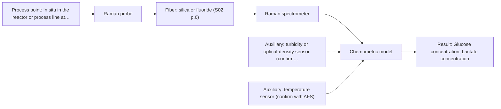
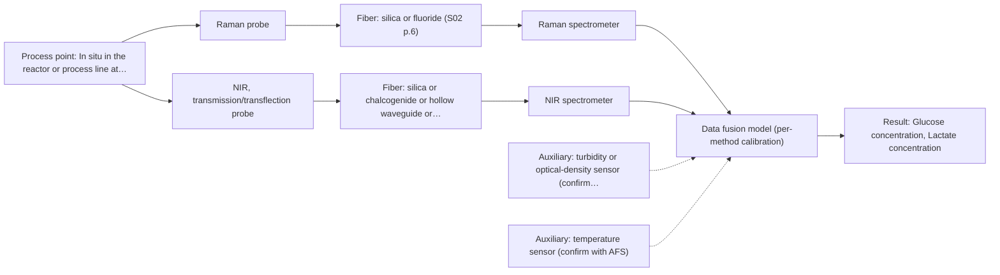

# First technical assessment: Glucose and lactate trends in an aqueous bioprocess

## Answer

**Customer request (our summary):** Customer runs a cell culture process in aqueous medium, currently measuring glucose and lactate from samples with a delay. They are exploring an in situ spectroscopy pilot to be checked against existing laboratory measurements, but have not selected a probe or calibration strategy.

### Brief answer

Test in situ Raman spectroscopy first: it can report glucose and lactate directly in an aqueous reactor medium, where infrared methods struggle with water. NIR transmission is a cheaper comparison if the medium is optically clear. Still open are the concentration ranges, the accuracy and response time you need, and the medium's turbidity and fluorescence background, which decide the probe and calibration.

### Proposal

- **Best current option:** O2 (recommended)
- **Basis:** supplied AFS sources
- **What would change it:** Answers on the concentration ranges, required accuracy and response time, and the medium's turbidity and fluorescence background, could move the choice to NIR or add a second method. A demonstrated Raman performance shortfall would trigger the combined option.
- **Next step:** Run the first feasibility experiment on representative samples, comparing in situ Raman spectra with the existing laboratory glucose and lactate values.

**Secondary evidence (external, not AFS material):** G1: E03 ¶7; G2: E02 ¶12; G3: E01 ¶31, E01 ¶36; G4: no usable external source found. See Expert detail.

**Decision status:** Provisional feasibility assessment

### Solution options

| ID | Tier | Methods | Confidence | Cost class, S01 Table 1 (p.6) | Ease of use | Maintenance | Performance fit | Sources |
|---|---|---|---|---|---|---|---|---|
| O1 | Simple | M2 NIR, transmission/transflection probe | Low: open question: Q1 (starts at Medium); sample clarity unknown | average cost (row 7) | Common online method, compact analyzers | Standard lamps and optics, modest upkeep | Least effort for clear-medium glucose tracking | [1: S01 p.16] [2: S01 p.18] [3: S01 p.18] |
| O2 | Recommended | M1 Raman probe | Medium: open question: Q1 (starts at Medium) | high cost (row 12) | Fiber Raman probe with laser | Laser and probe care, recalibration | Covers glucose and lactate in water | [4: S01 p.16] [5: S01 p.16] |
| O3 | Extended (multi-method) | M3 Raman probe + NIR (combination) | Low: open question: Q1 (starts at Medium); sample clarity unknown; multi-method, fusion benefit not yet shown | high cost (rows 7, 12) | Two instruments, synchronised data handling | Two calibrations and two instrument diagnostics | Adds orthogonal NIR block for robustness | [6: S01 p.8] [7: S01 p.8] [8: S01 p.8] [9: S01 p.15] [10: S01 p.7] |

*Confidence rates the basis of the advice (how much is known and cited), not a predicted accuracy or probability of success. It starts at High, or at Medium when a key question on the method or the option is open, and drops one level per weakness listed (floor Low).*

*Cost class is the relative rating in S01 Table 1 (p.6) for the in-line method+technique rows named (the highest one for a multi-method option); it is not a price.*

### Setup sketch

*Recommended option O2; drawn by code from the option, a schematic, not a configuration.*

### Key questions

1. What are the expected glucose and lactate concentration ranges, and what accuracy, precision and response time must the in situ measurement reach?
2. What are the optical properties of the medium (clear, turbid, scattering, fluorescence background), and how do they change during the run?
3. Where would the probe be installed, and what cleaning, sterilisation and fouling conditions must it withstand?

## Expert detail

**Customer enquiry**

> We run a cell culture process in an aqueous medium. Glucose and lactate are measured from samples, and the delay makes it difficult to see changes promptly. We are exploring an in situ spectroscopy pilot that can be checked against those existing laboratory measurements. The medium and cell population change during the run; we have not yet selected a probe or a calibration strategy.

**Decision status:** Provisional feasibility assessment. A single method can be shortlisted from the sources for glucose and lactate in an aqueous medium, and the customer's laboratory values can act as the reference. The concentration ranges, required accuracy and the medium's optical behaviour are still open, so the shortlist rests on stated assumptions.

### Parameters

| ID | Parameter | Kind | Need | Measured by | Why | Sources |
|---|---|---|---|---|---|---|
| P1 | Glucose concentration | quantitative | required | Spectroscopy: Raman | Glucose is one of the two analytes the customer wants to follow in situ. | [4: S01 p.16] |
| P2 | Lactate concentration | quantitative | required | Spectroscopy: Raman | Lactate is the second target analyte and tracks cell metabolism. | [4: S01 p.16] |
| P3 | Medium turbidity (optical density) | quantitative | required | Auxiliary sensor: turbidity or optical-density sensor (cited; confirm availability with AFS) | It reflects the changing cell population and decides whether transmission or a scattering-tolerant geometry can be used. | [11: S01 p.16] |
| P4 | Temperature | quantitative | optional | Auxiliary sensor: temperature sensor (engineering judgement: confirm availability with AFS) | Temperature shifts vibrational spectra and should already be available on a cell culture process; it supports calibration stability. | *(no verified source: engineering judgement)* |

### Solution option details

- **O1 cost drivers:** one NIR spectrometer, lamp, transmission probe
- **O2 cost drivers:** one Raman spectrometer, laser, fiber probe
- **O3 cost drivers:** two spectrometers, two probes, data fusion
- **O3 combining methods:** Start from one model per method, then fuse the joined spectra with scaling so neither method dominates. Both probes must view the same small area and their data must be aligned to a common time step. The fused model must beat the best single method on independent runs, otherwise the extra instrument is dropped.

*Extended (multi-method) option O3; drawn by code from the option, a schematic, not a configuration.*

### Premise check

- **Precedent only:** An in situ spectroscopy pilot is an appropriate approach for this cell culture process. A published study shows Raman in a reactor for glucose and lactate, which is a reason to test the method here, not proof it will work for this process. [4: S01 p.16]
- **Supported:** The proposed in situ spectroscopy pilot can be checked against the existing laboratory measurements. Independent reference measurements are named as a required part of a feasibility plan. [12: REF §3]
- **Supported:** The delay from sample-based measurement is the reason changes are not seen promptly. The source states that in-process analysis removes sampling and the associated delays. [13: S01 p.3]

### Requirements

**Stated by the customer**

- "cell culture process in an aqueous medium"
- "Glucose and lactate are measured from samples"
- "the delay makes it difficult to see changes promptly"
- "exploring an in situ spectroscopy pilot"
- *Further statements: see the customer enquiry above.*

**Key unknowns**

- Glucose and lactate concentration ranges over the run.
- Required accuracy, precision and response time for the in situ measurement.
- Optical properties of the medium (turbidity, scattering, fluorescence background) and how they change.
- The existing laboratory method for glucose and lactate and its accuracy and sampling frequency.
- Probe installation point and cleaning, sterilisation and fouling requirements.
- Whether the medium or cells fluoresce at the chosen Raman excitation wavelength.

### Clarification questions (most decision-relevant first)

Q1. What are the expected glucose and lactate concentration ranges, and what accuracy, precision and response time must the in situ measurement reach? *Why it matters:* These set whether a method can meet the targets and define the numerical go/no-go criteria. *(affects: method)*
Q2. What are the optical properties of the medium (clear, turbid, scattering, fluorescence background), and how do they change during the run? *Why it matters:* They decide whether transmission or a scattering-tolerant geometry and which technique can be used. *(affects: technique)*
Q3. Where would the probe be installed, and what cleaning, sterilisation and fouling conditions must it withstand? *Why it matters:* The installation point and cleaning regime constrain the probe type, contact and maintenance. *(affects: installation)*
Q4. What is the existing laboratory method for glucose and lactate, and what are its accuracy and sampling frequency? *Why it matters:* The reference method sets the achievable validation and the comparison for the go/no-go decision. *(affects: status)*
Q5. How do temperature, pH and dissolved oxygen vary during the run? *Why it matters:* These process conditions shift the spectra and affect calibration stability. *(affects: method)*

### Recommendation

- **M1 · Primary candidate: Raman probe.** Raman can provide a molecular fingerprint for glucose and lactate directly in the reactor. It is also well-suited to aqueous media because it absorbs little water compared with infrared methods. *Conditions:* Applies if the medium does not show an overwhelming fluorescence background at the chosen excitation wavelength. [4: S01 p.16] [5: S01 p.16]
- **M2 · Comparison candidate: NIR, transmission/transflection probe.** NIR tracks major components such as glucose in the millimolar range and is a common online method with fiber probes. Transmission is preferred for transparent or semi-transparent liquids. *Conditions:* Applies only if the medium is clear enough for transmission; a turbid or strongly scattering medium can lose the signal. [1: S01 p.16] [2: S01 p.18] [3: S01 p.18]
- **M3 · Conditional candidate: Raman probe + NIR (combination).** NIR and Raman carry complementary chemical information, so a combined model is a later hypothesis. Any gain must be shown against the best single method. *Conditions:* Applies only if the single-method Raman and NIR tests do not meet the stated targets across the changing matrix. [9: S01 p.15] [10: S01 p.7]
- **M4 · Not recommended: fluorescence probe.** Fluorescence needs a fluorescent species or a justified indicator, and most chemicals do not fluoresce. It is not a direct measurement of every analyte, so it cannot directly quantify glucose or lactate. [14: S01 p.5] [15: REF §5]

### Measurement concept

- **Probe and geometry:** In-line Raman fiber probe for the primary test; NIR transmission or transflection probe as comparison where the medium is clear.
- **Location:** In situ in the reactor or process line at the point to be agreed with the customer (Q3).
- **Fiber link:** The usable fiber length and probe type depend on the method and the configuration chosen; no length is assumed here. [16: S01 p.2]

### Spectral range

- **Raman:** Raman is reported as a Raman shift in cm-1, with the laser excitation wavelength stated separately; the supplied sources give the Raman spectrometer's spectral region as 400-1100 nm (visible and shortwave NIR). No numerical Raman shift range is given in the supplied sources. [17: S01 p.11] [18: S01 p.11]
- **NIR:** Nominal NIR range 780-2500 nm; the usable range depends on the instrument, fiber and probe actually selected. [19: S01 p.10] [20: REF §5]

### Risks and uncertainty

- Strong fluorescence from the medium or cells could mask the weak Raman bands at the chosen excitation wavelength. *(rules: R-RAM-1)* [21: S01 p.11]
- The Raman calibration is specific to the matrix, so the changing medium and cell population could invalidate it during a run. *(rules: R-CAL-1)* [22: REF §5]
- If the medium is turbid, the simple NIR transmission option may lose the signal and fail. *(rules: R-GEO-2)* [3: S01 p.18]
- Concentration ranges and required accuracy are unknown, so the targets may lie outside what either method can reach. *(no verified source: engineering judgement)*

### First feasibility experiment

1. **Collect representative samples or process states across the expected variation: medium composition, cell density, glucose and lactate levels, and temperature.** Cover the chemical and physical variation the model must handle. [12: REF §3]
2. **Measure in situ Raman spectra and, in parallel, obtain glucose and lactate by the existing laboratory method as independent reference values.** Provide an independent reference for comparison. [12: REF §3]
3. **Build and validate calibration models on held-out runs or batches, not on the calibration samples.** Test whether the model generalises across runs and the changing matrix. *(no verified source: engineering judgement)*
4. **If Raman alone misses the targets, repeat with NIR transmission as a single method, then test a Raman plus NIR combination with both probes at the same spot and time-aligned data.** Check the cheaper single method and only then a combination. [6: S01 p.8]
5. **Apply the customer's numerical go/no-go criteria (accuracy, precision, response time) against the laboratory reference.** Define a clear pass or fail against the customer's own criteria. [12: REF §3]

**Reference measurements:** The customer's existing laboratory glucose and lactate values serve as the independent reference (Q4).

**Decision basis:** The customer's stated accuracy, precision and response-time targets (Q1).

### Not covered by the supplied sources

- No supplied source gives validated accuracy, detection limits or response times for glucose and lactate in cell culture medium; those figures can only come from the pilot.

### Further notes

- **Chemometrics:** Glucose and lactate need chemometric calibration models built on the reference values. NIR and Raman calibrations are specific to the matrix, so they must be re-validated when the medium or cell population changes.
- **Real-time tracking:** The aim is continuous, near-real-time tracking in the reactor to remove the sampling delay. Acquisition rates of the chosen method and the process time constant should be checked during the pilot.
- **Future direction:** If the pilot succeeds, the same methods could be reduced to a compact in-line optical multisensor system for routine process control.

### Secondary evidence (external, not AFS material)

*Found by a literature search for gaps the supplied AFS sources leave open. Not AFS material and not proof for this case; every quote below was verified verbatim against the fetched text.*

*Live search unavailable (library only: cache miss (europepmc); cache miss (openalex)); curated library only.*

**G1 · auxiliary sensor:** In-line measurement of Medium turbidity (optical density) with turbidity or optical-density sensor

- **E03 ¶7** Selecting a fiber-optic probe for turbid media or solids requires considering the desired sampling volume where optical scattering is significant. *How it applies:* For in-line medium turbidity or optical-density measurement, this suggests checking how the sensor's sampling volume and scattering behavior are specified, and testing whether turbidity changes affect the signal. *Limits and transfer risks:* The statement is about Raman fiber-optic probe selection in turbid media or solids, not a dedicated turbidity or optical-density sensor, and it is not specific to cell culture medium. *(supports O2)*
  > "An important question when selecting a fiber-optic probe for measurements in turbid media or solids is the desired sampling volume where optical scattering is significant."
  > Raman spectroscopy as a process analytical technology for pharmaceutical manufacturing and bioprocessing. (2017) · Analytical and bioanalytical chemistry · doi:10.1007/s00216-016-9824-1 · https://europepmc.org/article/PMC/PMC5233728 · retrieved 2026-10-17, full text, licence: cc by, via curated library

**G2 · auxiliary sensor:** In-line measurement of Temperature with temperature sensor

- **E02 ¶12** Temperature sensitivity of OH bands is a severe drawback for measuring aqueous solutions in NIR and MIR, making tempered sample holders necessary. *How it applies:* For in-line temperature measurement, this suggests monitoring and controlling temperature to reduce OH-band variation in aqueous medium, and testing temperature effects during the pilot. *Limits and transfer risks:* The statement concerns NIR and MIR aqueous measurements with tempered sample holders, not an in-line temperature sensor or Raman spectroscopy, and may not transfer to cell culture medium. *(supports O2)*
  > "Additionally, the temperature sensitivity of the OH bands is a severe drawback for measuring aqueous solution in NIR and MIR, which makes tempered sample holders necessary [29]."
  > A critical review of recent trends, and a future perspective of optical spectroscopy as PAT in biopharmaceutical downstream processing. (2020) · Analytical and bioanalytical chemistry · doi:10.1007/s00216-020-02407-z · https://europepmc.org/article/PMC/PMC7072065 · retrieved 2026-10-17, full text, licence: cc by, via curated library

**G3 · multi-method:** Combining several spectroscopy methods (data fusion) (Start from one model per method, then fuse the joined spectra with scaling so neither method dominates. Both probes must view the same small area and their data must be aligned to a common time step. The fused model must beat the best single method on independent runs, otherwise the extra instrument is dropped.)

- **E01 ¶31** Low-level data fusion is described as the simplest way to combine inputs by rearranging data into a new matrix with variables from different sources placed one after the other. *How it applies:* For O3, this supports starting with a joined-spectra approach, but the source does not cover scaling to prevent one method dominating, so that step should be tested. *Limits and transfer risks:* This is a review statement about data fusion in process analytical technology, not a cell culture study, and it does not address probe alignment or time-step alignment. *(supports O3)*
  > "Low-level data fusion (LLDF) is considered the simplest method to achieve a combination of inputs. In this case, the data is rearranged into a new data matrix, where the variables coming from different sources are placed one after the other."
  > Challenges and Opportunities of Implementing Data Fusion in Process Analytical Technology-A Review. (2022) · Molecules (Basel, Switzerland) · doi:10.3390/molecules27154846 · https://europepmc.org/article/PMC/PMC9369811 · retrieved 2026-10-17, full text, licence: cc by, via curated library
- **E01 ¶36** In some cases, instrument complementarity was not sufficient to improve performance for several CQAs, as shown by a Raman and FT-IR food analytical study. *How it applies:* For O3, this supports requiring independent runs to show the fused model beats the best single method, and dropping the extra instrument if it does not. *Limits and transfer risks:* The cited study is food analytical with Raman and FT-IR, not cell culture medium or the proposed probes, so the outcome may not transfer. *(supports O3)*
  > "In some situations, instrument complementarity (not data complementarity) was not sufficient to improve the performance of predictive several CQAs, as shown by a Raman and FT-IR data based food analytical study [73]."
  > Challenges and Opportunities of Implementing Data Fusion in Process Analytical Technology-A Review. (2022) · Molecules (Basel, Switzerland) · doi:10.3390/molecules27154846 · https://europepmc.org/article/PMC/PMC9369811 · retrieved 2026-10-17, full text, licence: cc by, via curated library

**G4 · not in the supplied sources:** No supplied source gives validated accuracy, detection limits or response times for glucose and lactate in cell culture medium; those figures can only come from the pilot.

- No usable external source found.

### Evidence (verified quotes)

1. ✓ **S01 p.16** (general): "NIR spectroscopy is effective for tracking major components like glucose or glycerol in the millimolar range"
2. ✓ **S01 p.18** (general): "Transmission is the preferred method for transparent or semi-transparent liquids, such as skim milk, whey, or permeate."
3. ✓ **S01 p.18** (general): "it fails when the milk becomes too "thick" or fat-rich, as the light cannot penetrate the sample."
4. ✓ **S01 p.16** (application precedent): "Raman spectroscopy can be used in the same reactor to provide a "molecular fingerprint" for direct detection of specific metabolites like glucose, acetate, or lactate."
5. ✓ **S01 p.16** (general): "Raman is particularly well-suited for aqueous environments, as it exhibits low absorbance for water molecules compared to infrared methods."
6. ✓ **S01 p.8** (general): "It is crucial that the spectral information obtained by different methods-Mid-IR, NIR, Raman, and fluorescence spectra-is collected from the same small, even pinpoint, area of the sample."
7. ✓ **S01 p.8** (general): "Ultimately, the measurement data must be normalized to a common time step."
8. ✓ **S01 p.8** (general): "If the variables have different units of measurement, the data should be normalized in some way, for example, using an autoscaling algorithm."
9. ✓ (precedent only) **S01 p.15** (method gain): "NIR detects hydrogen bonds and asymmetric polar groups, while Raman provides information on the molecular backbone and symmetrical non-polar groups."
10. ✓ **S01 p.7** (application precedent): "Online analysis of the pellet coating process in a fluidized bed showed the best results with the simultaneous use of NIR and Raman spectroscopy."
11. ✓ **S01 p.16** (general): "cell suspension turbidity correlates well with cell density."
12. ✓ **REF §3** (general): "Representative samples or process states, independent reference measurements, what is compared, and the basis for the go / no-go decision."
13. ✓ **S01 p.3** (general): "eliminating delays and the risk of sample contamination"
14. ✓ **S01 p.5** (general): "However, most chemicals do not exhibit this property."
15. ✓ **REF §5** (general): "High sensitivity, low selectivity; not a direct measurement of every analyte."
16. ✓ **S01 p.2** (general): "Fiber optic probes and cells are being integrated into reactors and production lines of ongoing technological processes, enabling on-site online analysis and obtaining results in near real time."
17. ✓ **S01 p.11** (general): "The Raman shift is used as the horizontal (spectral) axis in Raman spectroscopy"
18. ✓ **S01 p.11** (general): "which operates in the same spectral region (400-1100 nm) of visible and shortwave NIR radiation"
19. ✓ **S01 p.10** (general): "NIR spectra (780-2500 nm) contain predominantly overtones and component bands of fundamental vibrations"
20. ✓ **REF §5** (general): "It is not a product specification: actual spectral coverage, fiber length, component ratings, detection limits and accuracy depend on the configuration and the sample."
21. ✓ **S01 p.11** (general): "superposition of luminescence (fluorescence), which has a significantly higher intensity."
22. ✓ **REF §5** (general): "Weak signal, fluorescence background; calibration specific to the matrix."

### Verification

- Citations verified: 30 of 30 (exact or whitespace/hyphen-tolerant match on the cited page, scope checked).
- Hard check failures before deterministic corrections: 0; still open: 0; soft warnings: 2; repair rounds: 1.
- Corrected deterministically after verification (1):
  - ⚠ recommendations[2].combined_with: combined_with normalised to ['NIR'] (duplicates and the entry's own method removed)
- External evidence (cache): 4 quote(s) verified verbatim (exact or whitespace/hyphen-tolerant, at most 400 characters and 2 sentences, against the cited paragraph); 0 item(s) dropped.
- External search: 6 query(ies), 0 hit(s), 3 source(s) (3 from the curated library); ⚠ library only: cache miss (europepmc); cache miss (openalex).
- External step: 2 model call(s), 77.5 s extra (cost in the run JSON).

*Run D04-20261018T072334Z-8ec9 · models deepseek/deepseek-v4.1-flash*
