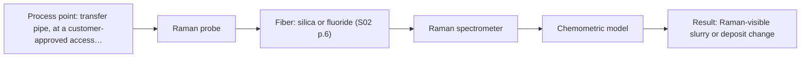
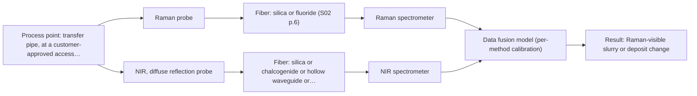

# First technical assessment: Pressure, flow and blockage of a slurry pipe

## Answer

**Customer request (our summary):** Customer asks for line pressure, flow rate, and early blockage warning for a slurry in a transfer pipe, and asks whether fiber-optic products can help. The enquiry does not specify an optical spectroscopy measurement, measurement ranges, installation constraints, or slurry optical properties.

### Brief answer

Fiber-optic spectroscopy is not a route to line pressure or flow rate in the supplied material; those need conventional pressure and flow sensors. For blockage, the first optical test should be a Raman probe, with NIR diffuse reflection only if the slurry is opaque and scattering. It is still open whether blockage produces a measurable optical change, and what lead time and false-alarm rate you need.

### Proposal

- **Best current option:** O2 (recommended)
- **Basis:** engineering judgement
- **What would change it:** If the customer confirms that pressure and flow must be optical, the request stays outside the supplied scope. If slurry tests show a clear NIR scattering change or a Raman-visible deposit, O1 or O3 would move ahead of O2.
- **Next step:** Clarify the pressure/flow measurement route and the expected optical change at blockage, then run the single-method Raman test on representative normal and incipient-blockage samples.

**Secondary evidence (external, not AFS material):** G1: E02 ¶8, E02 ¶72; G2: E01 ¶31, E01 ¶82; G3: no usable external source found; G4: no usable external source found. See Expert detail.

**Decision status:** Outside the supported scope

### Solution options

| ID | Tier | Methods | Confidence | Cost class, S01 Table 1 (p.6) | Ease of use | Maintenance | Performance fit | Sources |
|---|---|---|---|---|---|---|---|---|
| O1 | Simple | M2 NIR, diffuse reflection probe | Low: open question: Q2 (starts at Medium); sample clarity unknown; a parameter is not measurable in-line; status: outside supported scope | average cost (row 8) | remote silica fiber, simple optical access | window cleaning and calibration checks | tests bulk scattering change; conditional on opacity | [1: S01 p.17] [2: S01 p.10] [3: S01 p.10] |
| O2 | Recommended | M1 Raman probe | Low: open question: Q2 (starts at Medium); a parameter is not measurable in-line; status: outside supported scope | high cost (row 12) | immersion probe, fluorescence background to check | probe cleaning and fluorescence checks | water-tolerant molecular fingerprint; blockage proxy only | [4: S01 p.16] [5: S01 p.11] [6: S01 p.11] |
| O3 | Extended (multi-method) | M3 Raman probe + NIR (combination) | Low: open question: Q2 (starts at Medium); sample clarity unknown; a parameter is not measurable in-line; status: outside supported scope; multi-method, fusion benefit not yet shown | high cost (rows 8, 12) | two instruments, alignment and timing needed | two probes, separate cleaning and calibration | adds scattering to molecular data; hypothesis only | [7: S01 p.15] [8: S01 p.8] [9: S01 p.8] [2: S01 p.10] [6: S01 p.11] |

*Confidence rates the basis of the advice (how much is known and cited), not a predicted accuracy or probability of success. It starts at High, or at Medium when a key question on the method or the option is open, and drops one level per weakness listed (floor Low).*

*Cost class is the relative rating in S01 Table 1 (p.6) for the in-line method+technique rows named (the highest one for a multi-method option); it is not a price.*

### Setup sketch

*Recommended option O2; drawn by code from the option, a schematic, not a configuration.*

### Key questions

1. Are line pressure and flow rate to be measured by fiber-optic spectroscopy, or can conventional pressure and flow sensors be used alongside?
2. What optical change do you expect at the start of a blockage—solids concentration, turbidity, deposit on the pipe wall, or something else?
3. What are the slurry composition, solids loading, particle size, and is it opaque, coloured or fluorescent?

## Expert detail

**Customer enquiry**

> We need to know the line pressure and the flow rate of a slurry in our transfer pipe, and we want an early warning when the pipe starts to block. Could your fiber optic products help with this?

**Decision status:** Outside the supported scope. The supplied material covers optical spectral information about chemistry and morphology, not line pressure or flow rate. Slurry blockage warning is also not demonstrated, so only a conditional optical test for a blockage proxy can be proposed.

### Parameters

| ID | Parameter | Kind | Need | Measured by | Why | Sources |
|---|---|---|---|---|---|---|
| P1 | line pressure | quantitative | required | Not measurable in-line by spectroscopy; alternative: conventional pressure transmitter or gauge | Customer target; no supplied page shows pressure as an optical or spectroscopic measurement. | [10: S01 p.4] |
| P2 | flow rate | quantitative | required | Not measurable in-line by spectroscopy; alternative: conventional flow meter | Customer target; no supplied page shows flow rate as an optical or spectroscopic measurement. | [10: S01 p.4] |
| P3 | incipient pipe blockage | quantitative | required | Not measurable in-line by spectroscopy; alternative: customer-agreed differential-pressure, flow-derived or visual/deposit reference | Customer target; no source demonstrates an optical early-warning measurement for slurry blockage. | *(no verified source: engineering judgement)* |
| P4 | Raman-visible slurry or deposit change | quantitative | optional | Spectroscopy: Raman | It is the only optical proxy that could link a Raman spectrum to incipient blockage, but no source validates it; it should be available only as a test proxy. | *(no verified source: engineering judgement)* |
| P5 | slurry optical regime: opacity, scattering and fluorescence | qualitative | required | Reference lab method: customer sample inspection or laboratory optical characterization | It decides whether NIR diffuse reflection is viable and whether Raman fluorescence is manageable. | [1: S01 p.17] [5: S01 p.11] |

### Solution option details

- **O1 cost drivers:** NIR spectrometer, light source, diffuse-reflection probe, reference sampling
- **O2 cost drivers:** Raman spectrometer, laser, Raman probe, calibration runs
- **O3 cost drivers:** two spectrometers, combined or two probes, synchronisation, per-method calibration
- **O3 combining methods:** Low-level fusion of synchronised Raman and NIR diffuse-reflection spectra from the same probe window. Each method is calibrated separately, and the data are normalised to a common time step. The fused model must beat the best single method on held-out blockage states before the extra instrument is kept.

*Extended (multi-method) option O3; drawn by code from the option, a schematic, not a configuration.*

### Premise check

- **Not covered:** Fiber-optic products can measure line pressure and flow rate. The supplied pages describe spectral information about chemistry and morphology, not pressure or flow; no source shows a fiber-optic pressure or flow measurement. [10: S01 p.4]
- **Not covered:** An optical fiber probe can give early warning when a slurry pipe starts to block. No supplied page reports slurry blockage warning; the sources show composition and morphology measurements, so any blockage link is a hypothesis to test. [10: S01 p.4]

### Requirements

**Stated by the customer**

- "a slurry"
- "our transfer pipe"
- "line pressure"
- "flow rate"
- "early warning when the pipe starts to block"

**Key unknowns**

- Whether blockage onset produces a measurable optical change in the slurry or on a probe window.
- Slurry composition, solids loading, particle size, opacity, colour and fluorescence.
- Pipe access, diameter, wall thickness, operating pressure/temperature and distance to the analyzer.
- Required pressure and flow ranges, accuracy and response time.
- Required blockage lead time, false-alarm tolerance and reference method.
- Cleaning and fouling tolerance for any in-line probe or window.

### Clarification questions (most decision-relevant first)

Q1. Are line pressure and flow rate to be measured by fiber-optic spectroscopy, or can conventional pressure and flow sensors be used alongside? *Why it matters:* This decides whether the request is within the optical scope at all. *(affects: status)*
Q2. What optical change do you expect at the start of a blockage—solids concentration, turbidity, deposit on the pipe wall, or something else? *Why it matters:* It decides whether a surface-sensitive or bulk-sensitive optical method is worth testing. *(affects: method)*
Q3. What are the slurry composition, solids loading, particle size, and is it opaque, coloured or fluorescent? *Why it matters:* It decides whether NIR diffuse reflection is viable and whether Raman fluorescence is manageable. *(affects: technique)*
Q4. What pipe access, diameter, wall thickness, operating pressure/temperature, and distance to the analyzer are available? *Why it matters:* It decides the probe geometry, fiber link and installation. *(affects: installation)*
Q5. What lead time, false-alarm tolerance and reference method define a successful blockage warning? *Why it matters:* It sets the go/no-go criteria for M1 and any later combination. *(affects: M1)*

### Recommendation

- **M1 · Primary candidate: Raman probe.** Raman is a viable single method and is explicitly water-tolerant, so it is the least speculative first optical test for a slurry-related change. A blockage warning would still depend on a Raman-visible change in the slurry or deposit, which is not demonstrated. *Conditions:* Test only if blockage onset is expected to change the slurry's molecular composition or the deposit at the probe, and if fluorescence background can be checked. [4: S01 p.16] [5: S01 p.11]
- **M2 · Conditional candidate: NIR, diffuse reflection probe.** NIR diffuse reflection is a practical remote geometry for opaque, scattering media, but the slurry's optical regime is unknown. It applies only if the slurry is opaque/scattering and blockage correlates with solids or water changes. *Conditions:* Proceed only if the slurry is confirmed opaque/scattering and a NIR-visible solids or water change accompanies blockage. [1: S01 p.17] [3: S01 p.10]
- **M3 · Conditional candidate: Raman probe + NIR (combination).** Combining Raman with NIR diffuse reflection is a later hypothesis: NIR adds scattering/solids information while Raman adds molecular information, but no slurry blockage gain is shown. It must be tested only after the single-method tests and compared with the best single method. *Conditions:* Test only if both single methods show a blockage-related signal and the same probe window can sample the same slurry volume. [7: S01 p.15] [8: S01 p.8] [9: S01 p.8]

### Measurement concept

- **Probe and geometry:** Raman or NIR diffuse-reflection probes inserted or flush-mounted at a pipe access point.
- **Location:** transfer pipe, at a customer-approved access point
- **Fiber link:** fiber type and length are not specified; usable range depends on the selected instrument, fiber and probe. *(no verified source: engineering judgement)*

### Spectral range

- **NIR:** NIR nominal range 780-2500 nm; usable range depends on instrument, fiber and probe. [2: S01 p.10]
- **Raman:** Raman shift in cm-1, with laser excitation wavelength stated separately; usable range depends on instrument, fiber and probe. [6: S01 p.11]

### Risks and uncertainty

- The request may be fundamentally non-optical: line pressure and flow rate are not measured by the supplied fiber-optic spectroscopy material. *(no verified source: engineering judgement)*
- Blockage may produce no measurable optical change at the probe, or the change may be masked by slurry variability and fouling. *(no verified source: engineering judgement)*
- Raman signal may be swamped by fluorescence or particle scattering in the slurry. *(no verified source: engineering judgement)*
- NIR diffuse reflection may fail if the slurry is transparent, very dark or has an uncontrolled optical path. *(no verified source: engineering judgement)*

### First feasibility experiment

1. **Agree the normal and incipient-blockage states with the customer, and record independent reference measurements for pressure, flow and blockage before any spectral test.** Establish the reference states and the go/no-go basis. [11: REF §3]
2. **Collect samples or runs across the expected variation in solids loading, particle size, temperature, flow and blockage state, keeping the probe position fixed.** Cover chemical and physical variation without changing the sampling point. [12: S01 p.7]
3. **Run the Raman single-method test first on all states and record fluorescence background and signal quality.** Test the primary single method before any combination. [5: S01 p.11]
4. **If Raman shows no usable blockage-related change, run NIR diffuse reflection only on the confirmed opaque/scattering states.** Test the conditional single method without overbuilding. [1: S01 p.17]
5. **Validate the chosen single method on held-out runs or batches against the reference; only then test the Raman+NIR combination and require it to beat the best single method. The go/no-go thresholds for lead time, false alarms and sensitivity must come from the customer.** Separate single-method validation from combination hypothesis testing. [11: REF §3] [9: S01 p.8]

**Reference measurements:** Customer-agreed pressure, flow and blockage reference measurements; no optical reference is assumed.

**Decision basis:** Go/no-go thresholds for lead time, false alarms and sensitivity must be set by the customer.

### Assumptions

- Pressure and flow rate can be measured by conventional sensors outside the optical assessment.
- A blockage proxy, if any, is a change in the slurry or a deposit at the probe.

### Not covered by the supplied sources

- Measurement of line pressure by fiber-optic spectroscopy.
- Measurement of flow rate by fiber-optic spectroscopy.
- Demonstrated early blockage warning for a slurry transfer pipe.
- Slurry-specific probe installation, fouling and cleaning practice.

### Further notes

- **Chemometrics:** Raman and NIR both need matrix-specific calibration or classification models; reference data must cover normal and incipient-blockage states and be validated on held-out runs.
- **Real-time tracking:** If a spectral proxy is found, it can be tracked in-line continuously, but response time and false alarms must be established against the customer's reference.
- **Future direction:** After single-method feasibility, evaluate a combined Raman/NIR probe only if the fused model beats the best single method.

### Secondary evidence (external, not AFS material)

*Found by a literature search for gaps the supplied AFS sources leave open. Not AFS material and not proof for this case; every quote below was verified verbatim against the fetched text.*

*Live search unavailable (library only: cache miss (europepmc); cache miss (openalex)); curated library only.*

**G1 · decision status:** outside supported scope: The supplied material covers optical spectral information about chemistry and morphology, not line pressure or flow rate. Slurry blockage warning is also not demonstrated, so only a conditional optical test for a blockage proxy can be proposed.

- **E02 ¶8** The source describes continuous fixed-probe operation as a steady-state window where online monitoring is aimed at drift and out-of-specification detection rather than rapidly changing composition. *How it applies:* This could inform a conditional optical test that watches for drift or out-of-specification signals as a blockage-related proxy, while not treating it as pressure or flow measurement. *Limits and transfer risks:* The source is about reactive liquid-liquid extraction in lithium recycling, not slurry transfer; probe fouling, slurry optical properties and blockage states are not addressed.
  > "In contrast, a continuous process at a fixed probe location is intended to operate in a steady-state window, which simplifies the model design: calibrations can be narrower and centered on the operational envelope, validation can rely on independent steady-state runs, and online monitoring focuses on drift and out-of-specification detection rather than resolving the rapidly changing composition."
  > Process Analytical Technology-Integrated FT-IR and Raman Spectroscopies for Efficient Reactive Liquid-Liquid Extraction Processing in Lithium Recycling. (2025) · ACS omega · doi:10.1021/acsomega.5c05705 · https://europepmc.org/article/PMC/PMC12573149 · retrieved 2026-10-17, full text, licence: cc by, via curated library
- **E02 ¶72** The source notes that in-line methods need maintenance such as calibration and that baseline checks in pure-component phases can help monitor drift and aging. *How it applies:* This could inform planning for baseline and drift checks and maintenance in any optical trial, especially before interpreting a blockage proxy. *Limits and transfer risks:* The source refers to pure-component phases in a process, which may not exist in a slurry transfer line; transfer to slurry and blockage warning is not established.
  > "Potential typical drawbacks of any in-line method are maintenance efforts like calibration, and actions to sensor drift and aging could be easily overcome by checking the baseline in each cycle of pure component phases of process operation and monitoring any drift in order to be able to react."
  > Process Analytical Technology-Integrated FT-IR and Raman Spectroscopies for Efficient Reactive Liquid-Liquid Extraction Processing in Lithium Recycling. (2025) · ACS omega · doi:10.1021/acsomega.5c05705 · https://europepmc.org/article/PMC/PMC12573149 · retrieved 2026-10-17, full text, licence: cc by, via curated library

**G2 · multi-method:** Combining several spectroscopy methods (data fusion) (Low-level fusion of synchronised Raman and NIR diffuse-reflection spectra from the same probe window. Each method is calibrated separately, and the data are normalised to a common time step. The fused model must beat the best single method on held-out blockage states before the extra instrument is kept.)

- **E01 ¶31** The review describes low-level data fusion as the simplest way to combine inputs by rearranging variables from different sources into a new data matrix. *How it applies:* This supports the proposed low-level fusion of synchronised Raman and NIR data as a practical starting architecture, subject to held-out testing against the best single method. *Limits and transfer risks:* The review is general PAT data fusion, not a slurry blockage study or a same-probe Raman/NIR setup; performance in this application is not shown. *(supports O3)*
  > "Low-level data fusion (LLDF) is considered the simplest method to achieve a combination of inputs. In this case, the data is rearranged into a new data matrix, where the variables coming from different sources are placed one after the other."
  > Challenges and Opportunities of Implementing Data Fusion in Process Analytical Technology-A Review. (2022) · Molecules (Basel, Switzerland) · doi:10.3390/molecules27154846 · https://europepmc.org/article/PMC/PMC9369811 · retrieved 2026-10-17, full text, licence: cc by, via curated library
- **E01 ¶82** The review states that before fusing multiple sources, it is essential to evaluate each dataset's contribution and complementarity. *How it applies:* This supports requiring per-method calibration and checking whether the fused model beats the best single method before keeping the extra instrument. *Limits and transfer risks:* The statement is a general review recommendation, not evidence that Raman and NIR are complementary for slurry blockage; the specific slurry and probe conditions still need testing. *(supports O3)*
  > "Before fusing data from multiple sources, it is essential to evaluate the contribution of each dataset to the model and its complementarity."
  > Challenges and Opportunities of Implementing Data Fusion in Process Analytical Technology-A Review. (2022) · Molecules (Basel, Switzerland) · doi:10.3390/molecules27154846 · https://europepmc.org/article/PMC/PMC9369811 · retrieved 2026-10-17, full text, licence: cc by, via curated library

**G3 · not in the supplied sources:** Measurement of line pressure by fiber-optic spectroscopy.

- No usable external source found.

**G4 · not in the supplied sources:** Measurement of flow rate by fiber-optic spectroscopy.

- No usable external source found.

### Evidence (verified quotes)

1. ✓ **S01 p.17** (application precedent): "NIR Reflection is primarily used for opaque or highly concentrated dairy products, such as yogurt, butter, or whole milk concentrates."
2. ✓ **S01 p.10** (general): "NIR spectra (780-2500 nm) contain predominantly overtones and component bands of fundamental vibrations"
3. ✓ **S01 p.10** (general): "The broad absorption bands observed in this region overlap, suggesting the use of chemometrics for quantitative and qualitative analysis of spectral data."
4. ✓ **S01 p.16** (general): "Raman is particularly well-suited for aqueous environments, as it exhibits low absorbance for water molecules compared to infrared methods."
5. ✓ **S01 p.11** (general): "superposition of luminescence (fluorescence), which has a significantly higher intensity."
6. ✓ **S01 p.11** (general): "The Raman shift is used as the horizontal (spectral) axis in Raman spectroscopy"
7. ✓ (precedent only) **S01 p.15** (method gain): "The combination of these techniques is particularly effective because it captures complementary chemical information: NIR detects hydrogen bonds and asymmetric polar groups, while Raman provides information on the molecular backbone and symmetrical non-polar groups."
8. ✓ **S01 p.8** (general): "It is crucial that the spectral information obtained by different methods-Mid-IR, NIR, Raman, and fluorescence spectra-is collected from the same small, even pinpoint, area of the sample."
9. ✓ **S01 p.8** (general): "Ultimately, the measurement data must be normalized to a common time step."
10. ✓ **S01 p.4** (general): "Spectral analysis provides information about the chemistry and morphology of the sample being studied: the concentrations of its components, their distribution, and particle sizes."
11. ✓ **REF §3** (general): "Representative samples or process states, independent reference measurements, what is compared, and the basis for the go / no-go decision."
12. ✓ **S01 p.7** (general): "Morphological factors, such as sample inhomogeneity (e.g., biological tissue) or process turbulence, must also be considered when selecting a measurement technique."

### Verification

- Citations verified: 32 of 32 (exact or whitespace/hyphen-tolerant match on the cited page, scope checked).
- Hard check failures before deterministic corrections: 0; still open: 0; soft warnings: 2; repair rounds: 0.
- Corrected deterministically after verification (1):
  - ⚠ recommendations[2].combined_with: combined_with normalised to ['NIR'] (duplicates and the entry's own method removed)
- External evidence (cache): 4 quote(s) verified verbatim (exact or whitespace/hyphen-tolerant, at most 400 characters and 2 sentences, against the cited paragraph); 0 item(s) dropped.
- External search: 5 query(ies), 0 hit(s), 3 source(s) (3 from the curated library); ⚠ library only: cache miss (europepmc); cache miss (openalex).
- External step: 2 model call(s), 21.5 s extra (cost in the run JSON).

*Run A05-20261018T072334Z-b158 · models deepseek/deepseek-v4.1-flash-1017*
