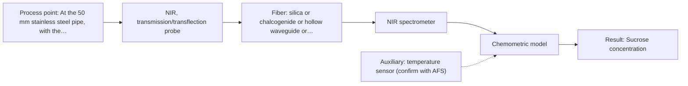

# First technical assessment: Complete enquiry for sugar concentration in a clear solution

## Answer

**Customer request (our summary):** Customer wants an in-line optical spectroscopy method/probe to monitor sucrose concentration in a clear, colourless aqueous sucrose solution flowing in a 50 mm stainless steel pipe, with a lab refractometer as reference.

### Brief answer

Test NIR transmission/transflection first, with a controlled pathlength and a calibration against the laboratory refractometer; it fits a clear aqueous stream and a 10 m silica-fibre link. Compare MIR ATR only if the NIR trial cannot reach ±0.3 % w/w. The open points are the refractometer basis, other solutes or turbidity, and hot-caustic CIP compatibility.

### Proposal

- **Best current option:** O2 (recommended)
- **Basis:** engineering judgement, with secondary external support E03 ¶13 (not AFS material)
- **What would change it:** If the refractometer reference is not sucrose-specific, if other solutes or turbidity dominate, or if the NIR trial cannot meet ±0.3 % w/w, the choice moves to MIR ATR or a combination.
- **Next step:** Run a bench or at-line NIR transmission/transflection trial on representative 5-15 % w/w samples with controlled temperature and refractometer reference values.

**Secondary evidence (external, not AFS material):** G1: no usable external source found; G2: E03 ¶13; G3: E01 ¶4; G4: no usable external source found. See Expert detail.

**Decision status:** Provisional feasibility assessment

### Solution options

| ID | Tier | Methods | Confidence | Cost class, S01 Table 1 (p.6) | Ease of use | Maintenance | Performance fit | Sources |
|---|---|---|---|---|---|---|---|---|
| O1 | Simple | M2 MIR, ATR probe | Low: open question: Q1 (starts at Medium); uncited auxiliary sensor | high cost (row 2) | Single contact probe; no pathlength cell | Crystal cleaning and CIP compatibility checks | Fingerprint selectivity for aqueous sucrose | [1: S01 p.9] [2: S01 p.10] |
| O2 | Recommended | M1 NIR, transmission/transflection probe | Low: open question: Q1 (starts at Medium); uncited auxiliary sensor | average cost (row 7) | Simple fibre link; standard silica optics | Window cleaning and pathlength checks | Clear-liquid transmission with remote fibre link | [3: S01 p.18] [4: S02 p.7] [5: S01 p.10] [6: S01 p.10] |

*Confidence rates the basis of the advice (how much is known and cited), not a predicted accuracy or probability of success. It starts at High, or at Medium when a key question on the method or the option is open, and drops one level per weakness listed (floor Low).*

*Cost class is the relative rating in S01 Table 1 (p.6) for the in-line method+technique rows named (the highest one for a multi-method option); it is not a price.*

### Setup sketch

*Recommended option O2; drawn by code from the option, a schematic, not a configuration.*

### Key questions

1. What other dissolved species, particles, bubbles, colour or turbidity are present or vary in the stream?
2. What are the flow rate, velocity and whether the 50 mm pipe is full at the proposed probe point?
3. What are the hot-caustic CIP concentration, temperature, duration and rinse steps, and what probe materials and hygienic requirements apply?

## Expert detail

**Customer enquiry**

> We produce a clear, colourless aqueous sucrose solution and want to monitor its sucrose concentration in-line. The solution flows through a 50 mm stainless steel pipe at 20 to 30 °C and normal pressure; the expected range is 5 to 15 % w/w and our quality limit is plus or minus 0.3 % w/w. Our laboratory refractometer is the reference method and stays in use. The analyser can stand in a dry, safe room 10 m from the pipe, and the line is cleaned in place with hot caustic once a day. A reading every minute is enough. Please propose a method and probe for a first trial.

**Decision status:** Provisional feasibility assessment. The central premises on accuracy, refractometer adequacy and hot-caustic CIP are not covered by the sources, but a provisional shortlist is possible because NIR transmission is a recognized geometry for clear liquids.

### Parameters

| ID | Parameter | Kind | Need | Measured by | Why | Sources |
|---|---|---|---|---|---|---|
| P1 | Sucrose concentration | quantitative | required | Spectroscopy: NIR | This is the in-line target and the value compared with the refractometer. | [5: S01 p.10] |
| P2 | Solution temperature | quantitative | required | Auxiliary sensor: temperature sensor (engineering judgement: confirm availability with AFS) | Temperature is needed to compensate the sucrose measurement and to compare with the refractometer reference. | *(no verified source: engineering judgement)* |

### Solution option details

- **O1 cost drivers:** MIR spectrometer, ATR probe, fibre link
- **O2 cost drivers:** NIR spectrometer, transmission probe, flow cell

### Premise check

- **Not covered:** A quality limit of plus or minus 0.3 % w/w is achievable for in-line sucrose concentration. No supplied page gives an accuracy or detection limit for sucrose at 5-15 % w/w. *(no verified source: engineering judgement)*
- **Not covered:** A laboratory refractometer is an adequate reference method for sucrose and can remain in use. No supplied page evaluates a laboratory refractometer as a sucrose reference or gives its uncertainty. *(no verified source: engineering judgement)*
- **Not covered:** A probe can tolerate daily hot-caustic clean-in-place. No supplied page addresses hot-caustic CIP compatibility, cleaning validation or probe materials for this duty. *(no verified source: engineering judgement)*

### Requirements

**Stated by the customer**

- "50 mm stainless steel pipe"
- "20 to 30 °C"
- "normal pressure"
- "The analyser can stand in a dry, safe room 10 m from the pipe"
- "monitor its sucrose concentration in-line"
- "expected range is 5 to 15 % w/w"
- "our quality limit is plus or minus 0.3 % w/w"
- "A reading every minute is enough"
- *Further statements: see the customer enquiry above.*

**Key unknowns**

- Other dissolved species, particles, bubbles, colour or turbidity and their variation.
- Flow rate, velocity and whether the 50 mm pipe is full at the probe point.
- Hot-caustic CIP concentration, temperature, duration and rinse, plus probe material and hygienic requirements.
- Refractometer scale and traceability (Brix or sucrose % w/w), sample temperature control and uncertainty.
- Acceptance criteria for bias, precision and calibration frequency in the first trial.
- Ambient conditions and routing for the 10 m fibre link and analyser room.

### Clarification questions (most decision-relevant first)

Q1. What other dissolved species, particles, bubbles, colour or turbidity are present or vary in the stream? *Why it matters:* The choice between NIR transmission and ATR, and the calibration, depend on whether sucrose is the only varying component and whether the optical path stays clear. *(affects: method)*
Q2. What are the flow rate, velocity and whether the 50 mm pipe is full at the proposed probe point? *Why it matters:* Flow and fill determine whether a transmission/transflection cell or an insertion ATR probe samples representatively. *(affects: technique)*
Q3. What are the hot-caustic CIP concentration, temperature, duration and rinse steps, and what probe materials and hygienic requirements apply? *Why it matters:* CIP compatibility and food-contact requirements can exclude a probe or window material before any trial. *(affects: installation)*
Q4. What scale and traceability does the laboratory refractometer use (Brix or sucrose % w/w), how is sample temperature controlled, and what is its uncertainty? *Why it matters:* The calibration and comparison depend on a reference that is sucrose-specific and temperature-controlled. *(affects: status)*
Q5. What numerical bias, precision and calibration-frequency criteria define acceptance for the first trial? *Why it matters:* The go/no-go basis must come from the customer rather than being assumed. *(affects: M1)*
Q6. What are the ambient conditions and cable/fibre routing in the dry room, and are there electrical or safety classifications for the analyser? *Why it matters:* The 10 m link and analyser location need installation details before probe and fibre selection. *(affects: installation)*

### Recommendation

- **M1 · Primary candidate: NIR, transmission/transflection probe.** NIR transmission/transflection is the preferred geometry for clear liquids and can be run remotely through silica fibres. Sucrose has OH/CH overtone bands in the NIR, but the broad bands require a calibration. *Conditions:* Use a controlled transmission/transflection pathlength and confirm the usable NIR range with the selected probe. [3: S01 p.18] [4: S02 p.7] [5: S01 p.10] [6: S01 p.10]
- **M2 · Comparison candidate: MIR, ATR probe.** MIR ATR gives well-defined fingerprint bands and suits liquids in contact with an ATR crystal. It is a useful comparison for selectivity, but the 10 m MIR link and CIP compatibility are open. *Conditions:* Confirm an MIR fibre link and probe materials for the 10 m separation and daily hot-caustic CIP before testing. [1: S01 p.9] [2: S01 p.10]
- **M3 · Conditional candidate: Raman probe.** Raman is well suited to aqueous samples and can add molecular specificity if the single-method trials fall short. Its weak signal and possible fluorescence background make it conditional. *Conditions:* Test only if NIR/MIR cannot meet the target and the real samples show low fluorescence background and adequate Raman signal. [7: S01 p.16] [8: S01 p.11] [9: S01 p.11]

### Measurement concept

- **Probe and geometry:** NIR transmission or transflection through a flow cell or insertion probe with a controlled optical pathlength; MIR ATR as a comparison.
- **Location:** At the 50 mm stainless steel pipe, with the analyser in the dry room about 10 m away.
- **Fiber link:** Silica fibres for NIR; MIR link length must be confirmed before MIR ATR is installed. *(no verified source: engineering judgement)*

### Spectral range

- **NIR:** Nominal NIR range 780-2500 nm; the usable range depends on the instrument, fibre and probe selected. [5: S01 p.10]
- **MIR:** Nominal MIR range 4000-400 cm-1; the usable range depends on the fibre, crystal and probe selected. [1: S01 p.9]

### Risks and uncertainty

- The NIR signal from sucrose in water may be too small at 5 % w/w or too pathlength-sensitive to reach ±0.3 % w/w without a careful calibration. *(rules: R-GEN-3, R-GEN-4, R-NIR-2)* *(no verified source: engineering judgement)*
- Hot-caustic CIP may attack the probe window, seals or fibre coupling, or leave fouling that changes the measurement. *(rules: R-MIR-3)* *(no verified source: engineering judgement)*
- Bubbles, particles, flow turbulence or an incompletely filled 50 mm pipe can make the optical sample unrepresentative. *(rules: R-GEN-5)* *(no verified source: engineering judgement)*
- A 10 m MIR fibre link is not supported by a stated length in the sources; if MIR is compared, the link length must be confirmed. *(rules: R-FIB-2)* *(no verified source: engineering judgement)*

### First feasibility experiment

1. **Collect representative samples across 5-15 % w/w and 20-30 °C, including any expected composition or turbidity variation, with independent refractometer reference values at controlled temperature.** Cover the expected chemical and physical variation and provide independent reference data. [10: REF §3]
2. **Run the NIR transmission/transflection single-method trial first, with a controlled pathlength and temperature, and compare the spectra with the refractometer values.** Test the best single method before any combination. [3: S01 p.18] [11: S01 p.18]
3. **If NIR cannot meet the customer's ±0.3 % w/w criterion, run the MIR ATR single-method trial on the same samples and compare it with the best single method.** Test the main single-method alternative before considering any combination. [2: S01 p.10]
4. **Build the calibration on one sample or batch set and check it on held-out runs or batches; report bias and precision against the refractometer.** Test whether the model holds outside the calibration set. *(no verified source: engineering judgement)*
5. **Set the go/no-go basis with the customer's numerical acceptance criteria and confirm CIP/probe compatibility before any in-line installation.** Make the trial decision explicit and include the installation constraints. *(no verified source: engineering judgement)*

**Reference measurements:** Laboratory refractometer values at controlled sample temperature, with the scale and uncertainty confirmed before calibration.

**Decision basis:** Customer-defined bias and precision criteria against the refractometer on held-out runs or batches.

### Assumptions

- The sucrose solution is homogeneous and clear at the probe point, without significant bubbles or particles.
- A controlled NIR pathlength and temperature compensation can be provided in the trial.
- The 10 m separation is bridged with silica fibres for NIR; MIR link length is not assumed.

### Not covered by the supplied sources

- No supplied page gives an accuracy or detection limit for sucrose at 5-15 % w/w, so the ±0.3 % w/w limit cannot be confirmed from the sources.
- No supplied page addresses hot-caustic CIP compatibility, cleaning validation or food-contact/hygienic approval for a probe.
- No supplied page gives a numerical pressure rating or a specific probe/port configuration for the 50 mm stainless steel pipe.
- No supplied page states an achievable MIR fibre link length at 10 m; the long-cable statement is for low-OH silica fibres.

### Further notes

- **Chemometrics:** M1 needs a sucrose calibration built on refractometer reference values and tested on held-out batches; see M1 for the NIR band and chemometrics citations.
- **Real-time tracking:** The one-minute update is part of O2; confirm whether the value is instantaneous or averaged (Q5).
- **Future direction:** If single-method trials fall short, a later hypothesis is a combined NIR + MIR ATR option tested against the best single method.

### Secondary evidence (external, not AFS material)

*Found by a literature search for gaps the supplied AFS sources leave open. Not AFS material and not proof for this case; every quote below was verified verbatim against the fetched text.*

*Live search unavailable (library only: cache miss (europepmc); cache miss (openalex)); curated library only.*

**G1 · auxiliary sensor:** In-line measurement of Solution temperature with temperature sensor

- No usable external source found.

**G2 · not in the supplied sources:** No supplied page gives an accuracy or detection limit for sucrose at 5-15 % w/w, so the ±0.3 % w/w limit cannot be confirmed from the sources.

- **E03 ¶13** NIRS signals are harder to interpret than conventional methods because absorption bands overlap due to spectral complexity. *How it applies:* For a sucrose NIR method, overlapping water and sucrose bands would need to be handled by calibration against the lab refractometer and tested across the customer's concentration range; this does not confirm the customer's target accuracy limit. *Limits and transfer risks:* The source is a review of pharmaceutical unit operations, not a sucrose solution study, and it gives no numerical accuracy or detection limit. *(supports O2)*
  > "However, a disadvantage of NIRS is that it is more difficult to interpret a signal than by using conventional analysis methods, such as chromatography, ultraviolet/visible (UV-VIS) light, and others, because the absorption bands overlap due to spectral complexity."
  > Process Analytical Technology Tools for Monitoring Pharmaceutical Unit Operations: A Control Strategy for Continuous Process Verification. (2021) · Pharmaceutics · doi:10.3390/pharmaceutics13060919 · https://europepmc.org/article/PMC/PMC8234957 · retrieved 2026-10-17, full text, licence: cc by, via curated library

**G3 · not in the supplied sources:** No supplied page addresses hot-caustic CIP compatibility, cleaning validation or food-contact/hygienic approval for a probe.

- **E01 ¶4** ATR probes can be used for in-line measurements in demanding environments and reaction mixtures containing highly oxidative or corrosive substances such as strong acids and bases. *How it applies:* This suggests ATR probe materials could be considered for caustic exposure, but compatibility with hot-caustic CIP, cleaning validation and food-contact approval would still need specific evidence. *Limits and transfer risks:* The source concerns polysiloxane reaction monitoring, not CIP or food-contact use, and it gives no cleaning-validation data. *(supports O1)*
  > "Attenuated total reflection probes (ATR) allow in-line measurements even in demanding measurement environments and reaction mixtures with highly oxidative and corrosive substances, such as chlorosilanes or strong acids and bases."
  > A Process Analytical Concept for In-Line FTIR Monitoring of Polysiloxane Formation. (2020) · Polymers · doi:10.3390/polym12112473 · https://europepmc.org/article/PMC/PMC7693933 · retrieved 2026-10-17, full text, licence: cc by, via curated library

**G4 · not in the supplied sources:** No supplied page gives a numerical pressure rating or a specific probe/port configuration for the 50 mm stainless steel pipe.

- No usable external source found.

### Evidence (verified quotes)

1. ✓ **S01 p.9** (general): "Vibrational spectroscopy in the mid-IR range (4000-400 cm-1) is one of the most informative methods of chemical analysis."
2. ✓ **S01 p.10** (general): "ATR fiber probes (Fig.1) enable the analysis of liquids and solid elastic samples"
3. ✓ **S01 p.18** (general): "Transmission is the preferred method for transparent or semi-transparent liquids, such as skim milk, whey, or permeate."
4. ✓ **S02 p.7** (performance figure): "Robust 100-300m cables made with Silica fibers of low OH-content (<0.1ppm OH) enable remote industrial process-control"
5. ✓ **S01 p.10** (general): "NIR spectra (780-2500 nm) contain predominantly overtones and component bands of fundamental vibrations of molecules and atomic groups, such as -OH, -NH2=NH, -CH3, =CH2, ≥CH, etc., found in many organic and inorganic compounds."
6. ✓ **S01 p.10** (general): "The broad absorption bands observed in this region overlap, suggesting the use of chemometrics for quantitative and qualitative analysis of spectral data."
7. ✓ **S01 p.16** (general): "Raman is particularly well-suited for aqueous environments, as it exhibits low absorbance for water molecules compared to infrared methods."
8. ✓ **S01 p.11** (general): "signals, which are several orders of magnitude weaker than IR absorption peaks"
9. ✓ **S01 p.11** (general): "superposition of luminescence (fluorescence), which has a significantly higher intensity."
10. ✓ **REF §3** (general): "Representative samples or process states, independent reference measurements, what is compared, and the basis for the go / no-go decision."
11. ✓ (precedent only) **S01 p.18** (performance figure): "the precise control of the optical pathlength (usually 1 - 10 mm); if the pathlength is too wide, the signal is lost to absorption; if too narrow, the sample represents a negligible volume."

### Verification

- Citations verified: 17 of 17 (exact or whitespace/hyphen-tolerant match on the cited page, scope checked).
- Hard check failures before deterministic corrections: 0; still open: 0; soft warnings: 2; repair rounds: 1.
- External evidence (cache): 2 quote(s) verified verbatim (exact or whitespace/hyphen-tolerant, at most 400 characters and 2 sentences, against the cited paragraph); 0 item(s) dropped.
- External search: 5 query(ies), 0 hit(s), 3 source(s) (3 from the curated library); ⚠ library only: cache miss (europepmc); cache miss (openalex).
- External step: 2 model call(s), 19.8 s extra (cost in the run JSON).

*Run A07-20261018T072334Z-4652 · models deepseek/deepseek-v4.1-flash-1017*
