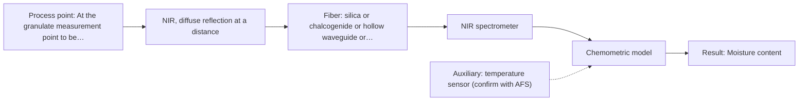
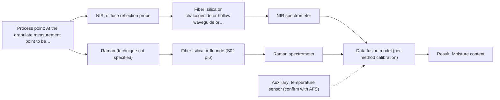

# First technical assessment: Accuracy guarantee, regulatory approval and price

## Answer

**Customer request (our summary):** Customer requests written confirmation that an NIR system will measure granulate moisture to ±0.1 % and that a regulator will approve it for release testing, plus price for the complete system before ordering.

### Brief answer

NIR diffuse reflection is the first method to test for moisture in granulate, using representative samples and an independent moisture reference. The supplied sources do not confirm ±0.1 % accuracy, regulatory acceptance for release testing, or a complete-system price; those depend on your moisture range, sample presentation, reference method and validation. Please provide these details before a configuration can be considered.

### Proposal

- **Best current option:** O1 (simple)
- **Basis:** engineering judgement
- **What would change it:** A defined moisture range and ±0.1 % basis, or a granulate better suited to transmission/transflection, would change the technique; if NIR alone cannot meet the target, O3 becomes relevant.
- **Next step:** Run the O1 lab feasibility test with representative granulate and an independent moisture reference before discussing a complete system.

**Secondary evidence (external, not AFS material):** G1: E01 ¶12; G2: E02 ¶82, E02 ¶36; G3: no usable external source found; G4: no usable external source found. See Expert detail.

**Decision status:** Provisional feasibility assessment

### Solution options

| ID | Tier | Methods | Confidence | Cost class, S01 Table 1 (p.6) | Ease of use | Maintenance | Performance fit | Sources |
|---|---|---|---|---|---|---|---|---|
| O1 | Simple | M1 NIR, diffuse reflection probe | Medium: open question: Q1 (starts at Medium) | average cost (row 8) | Simple lab probe, easy sampling | Probe cleaning and reference checks | Answers whether NIR sees moisture with least effort | [1: S01 p.10] [2: S01 p.10] [3: REF §5] |
| O2 | Recommended | M2 NIR, diffuse reflection at a distance | Medium: open question: Q1 (starts at Medium) | average cost (row 10) | Fixed remote probe, in-line mounting | Window fouling and fiber checks | Fits in-line mounting and keeps spectrometer remote | [4: S01 p.5] [5: S01 p.15] |
| O3 | Extended (multi-method) | M3 NIR, diffuse reflection probe + Raman (combination) | Low: open question: Q1 (starts at Medium); multi-method, fusion benefit not yet shown | at least average cost (row 8); Raman row not identified | Two instruments, more alignment needed | Two probes and two calibrations | Adds orthogonal Raman information if NIR is confounded | [6: S01 p.15] [7: S01 p.16] |

*Confidence rates the basis of the advice (how much is known and cited), not a predicted accuracy or probability of success. It starts at High, or at Medium when a key question on the method or the option is open, and drops one level per weakness listed (floor Low).*

*Cost class is the relative rating in S01 Table 1 (p.6) for the in-line method+technique rows named (the highest one for a multi-method option); it is not a price.*

### Setup sketch

*Recommended option O2; drawn by code from the option, a schematic, not a configuration.*

### Key questions

1. What is the expected moisture range in the granulate, and does ±0.1 % mean absolute percentage points or relative error?
2. What are the granulate composition, particle-size range and bulk density, and how will the material be presented at the probe?
3. Which reference moisture method and validation protocol will be used, and which regulatory route applies for release testing?

## Expert detail

**Customer enquiry**

> Before we order, please confirm in writing that your NIR system will measure the moisture of our granulate to plus or minus 0.1 % and guarantee that our regulator will approve it for release testing. Please also include the price of the complete system.

**Decision status:** Provisional feasibility assessment. NIR diffuse reflection is a reasonable first method to test for granulate moisture, but the supplied sources do not establish ±0.1 % accuracy or regulatory acceptance for release testing. The assessment remains provisional until the moisture range, sample presentation, reference method and validation route are defined.

### Parameters

| ID | Parameter | Kind | Need | Measured by | Why | Sources |
|---|---|---|---|---|---|---|
| P1 | Moisture content | quantitative | required | Spectroscopy: NIR | The customer's release target is moisture, so it is the primary quantitative variable for calibration and validation. | [8: S02 p.12] |
| P2 | Temperature at the measurement point | quantitative | optional | Auxiliary sensor: temperature sensor (engineering judgement: confirm availability with AFS) | Should be available because NIR water bands and granulate optical properties can vary with temperature and affect calibration. | *(no verified source: engineering judgement)* |
| P3 | Particle size and surface condition | quantitative | optional | Reference lab method: sieve analysis or particle-size analysis | Should be available because diffuse reflection is sensitive to particle size and surface characteristics, which can confound the moisture signal. | [9: S01 p.17] |

### Solution option details

- **O1 cost drivers:** Probe, spectrometer, reference moisture analyses
- **O2 cost drivers:** Remote probe, fiber link, mounting
- **O3 cost drivers:** Second spectrometer, Raman probe, fusion modeling
- **O3 combining methods:** Low-level fusion of NIR and Raman spectra is a later hypothesis, not a first test. Both probes must sample the same granulate volume at the same time or be synchronized to a common time step, and each method needs its own calibration. The fused model must beat the best single-method NIR model on held-out batches; otherwise the extra Raman instrument is not justified.

*Extended (multi-method) option O3; drawn by code from the option, a schematic, not a configuration.*

### Premise check

- **Precedent only:** NIR is suitable for measuring moisture in the customer's granulate. A supplied source shows NIR sensing for moisture and NIR diffuse reflection for scattering products, but not this granulate or a release-testing application. [8: S02 p.12]
- **Not covered:** NIR can achieve ±0.1 % moisture accuracy for the granulate. No supplied source states a ±0.1 % moisture accuracy for granulate or for any NIR system. *(no verified source: engineering judgement)*
- **Not covered:** A vendor can assure the customer's regulator will accept the NIR system for release testing. No supplied source addresses regulatory acceptance or release-testing validation. *(no verified source: engineering judgement)*

### Requirements

**Stated by the customer**

- "Before we order"
- "confirm in writing"
- "NIR system"
- "measure the moisture of our granulate to plus or minus 0.1 %"
- *Further statements: see the customer enquiry above.*

**Key unknowns**

- Expected moisture range and whether ±0.1 % means absolute percentage points or relative error.
- Granulate composition, particle size, bulk density and presentation at the measurement point.
- Reference moisture method and regulatory acceptance route for release testing.
- Process temperature, pressure, vibration, hazardous-area and cleaning requirements at the probe location.
- Required fiber/probe distance and response time for the in-line measurement.
- Calibration model maintenance and transfer across batches or sites.

### Clarification questions (most decision-relevant first)

Q1. What is the expected moisture range in the granulate, and does ±0.1 % mean absolute percentage points or relative error? *Why it matters:* This sets the sensitivity and validation criterion the method must meet. *(affects: method)*
Q2. What are the granulate composition, particle-size range and bulk density, and how will the material be presented at the probe? *Why it matters:* These determine whether diffuse reflection is representative and whether a transmission or transflection geometry is feasible. *(affects: technique)*
Q3. Which reference moisture method and validation protocol will be used, and which regulatory route applies for release testing? *Why it matters:* This decides what independent reference data and acceptance evidence are needed. *(affects: status)*
Q4. What are the temperature, pressure, vibration, hazardous-area and cleaning requirements at the planned probe location? *Why it matters:* These can rule out a probe or fiber installation before any method is tested. *(affects: installation)*
Q5. What fiber or probe distance and response time are required for the in-line measurement? *Why it matters:* This decides whether a remote diffuse reflection probe is practical and how data must be synchronized. *(affects: M2)*
Q6. How should the moisture calibration be maintained and transferred across batches or sites? *Why it matters:* This sets the long-term model maintenance burden for the proposed NIR option. *(affects: M1)*

### Recommendation

- **M1 · Primary candidate: NIR, diffuse reflection probe.** NIR carries O-H overtone information used for moisture, and diffuse reflection suits scattering solid or dispersed samples. This is the first single method to test on representative granulate. *Conditions:* Test only with representative granulate at a reproducible probe presentation and an independent reference moisture method. [1: S01 p.10] [2: S01 p.10] [3: REF §5]
- **M2 · Comparison candidate: NIR, diffuse reflection at a distance.** A remote diffuse reflection probe gives the same NIR information while keeping the spectrometer away from the process. It is worth comparing with the contact probe for installation fit and signal quality. *Conditions:* Only if the required fiber length and probe window maintain adequate signal at the granulate. [4: S01 p.5] [5: S01 p.15]
- **M3 · Conditional candidate: NIR, diffuse reflection probe + Raman (combination).** If NIR alone cannot separate moisture from matrix or scatter effects, adding Raman could provide orthogonal vibrational information. The gain is a hypothesis and must be compared with the best single-method NIR model. *Conditions:* Only after single-method NIR tests fail to meet the moisture target and fluorescence background on the granulate has been checked. [6: S01 p.15] [7: S01 p.16]

### Measurement concept

- **Probe and geometry:** NIR diffuse reflection from a granulate surface or flowing bed; remote fiber-probe option if the spectrometer must be away from the process.
- **Location:** At the granulate measurement point to be defined; not yet fixed.
- **Fiber link:** NIR silica fiber link; exact length, probe rating and usable range depend on the selected configuration and are not yet defined. *(no verified source: engineering judgement)*

### Spectral range

- **NIR:** 780-2500 nm nominal [1: S01 p.10] [3: REF §5]

### Risks and uncertainty

- The ±0.1 % target may be absolute or relative, and the supplied sources do not establish that NIR can reach it for this granulate. *(no verified source: engineering judgement)*
- Particle size, bulk density and sample presentation can change the diffuse reflectance and be mistaken for moisture variation. *(no verified source: engineering judgement)*
- The reference moisture method and regulatory acceptance route are unknown, so release-testing validation cannot be assessed. *(no verified source: engineering judgement)*
- Remote fiber length, probe fouling and process conditions at the mounting point are unknown and could rule out the proposed installation. *(no verified source: engineering judgement)*

### First feasibility experiment

1. **Collect representative granulate samples across the expected moisture range, particle-size/bulk-density variation and production batches; record temperature and sample presentation.** Cover the expected chemical and physical variation before comparing methods. [10: REF §3]
2. **Measure each sample with the NIR diffuse reflection probe (M1) under reproducible presentation; repeat measurements to estimate repeatability and check for scatter effects.** Test the single method first under controlled laboratory conditions. *(no verified source: engineering judgement)*
3. **Obtain independent reference moisture values on the same samples using the customer's validated laboratory method.** Provide an independent reference for calibration and validation. *(no verified source: engineering judgement)*
4. **Build and validate a moisture calibration on held-out batches; compare prediction error with the customer's ±0.1 % criterion and test whether particle-size or temperature variation confounds it.** Validate on held-out runs or batches, not only on calibration data. *(no verified source: engineering judgement)*
5. **Go/no-go: the customer defines the acceptable moisture range, accuracy, repeatability and validation evidence; if NIR alone fails, test the NIR + Raman combination (M3) as a later hypothesis.** Use numerical criteria from the customer and keep combinations as a later test. *(no verified source: engineering judgement)*

**Reference measurements:** Independent reference moisture values on the same samples, using the customer's validated laboratory method.

**Decision basis:** Customer-defined numerical criteria for moisture range, accuracy, repeatability and validation evidence.

### Assumptions

- The granulate can be presented reproducibly to a diffuse reflection probe.
- An independent reference moisture method can be performed on the same samples.
- The ±0.1 % target is a customer acceptance criterion to be defined numerically.

### Not covered by the supplied sources

- No supplied source states a ±0.1 % moisture accuracy for granulate or for any NIR system.
- No supplied source addresses regulatory acceptance for release testing.
- No supplied source gives a price or a complete-system configuration.

### Further notes

- **Chemometrics:** NIR moisture measurement needs a calibration model built on representative granulate samples with independent reference values and validated on held-out batches; matrix, particle-size or temperature changes require re-validation.
- **Real-time tracking:** In-line NIR can track moisture continuously if the probe interface and sample presentation are representative; response time and synchronization must be defined with the customer.
- **Future direction:** If NIR alone is insufficient, a later NIR + Raman fusion study could test whether orthogonal vibrational information improves moisture prediction.

### Secondary evidence (external, not AFS material)

*Found by a literature search for gaps the supplied AFS sources leave open. Not AFS material and not proof for this case; every quote below was verified verbatim against the fetched text.*

*Live search unavailable (library only: cache miss (europepmc); cache miss (openalex)); curated library only.*

**G1 · auxiliary sensor:** In-line measurement of Temperature at the measurement point with temperature sensor

- **E01 ¶12** The review notes that temperature sensitivity of OH bands is a severe drawback for measuring aqueous solutions by NIR and MIR, making tempered sample holders necessary. *How it applies:* This supports measuring or controlling temperature at the NIR measurement point, since temperature variation could affect the moisture-related signal. It could inform whether the proposed setup needs a temperature sensor or tempered sampling interface. *Limits and transfer risks:* The statement concerns aqueous solutions in NIR/MIR and tempered sample holders, not granulate moisture or an in-line granulate probe. Transfer to the customer's matrix and measurement geometry would need testing. *(supports O1)*
  > "Additionally, the temperature sensitivity of the OH bands is a severe drawback for measuring aqueous solution in NIR and MIR, which makes tempered sample holders necessary [29]."
  > A critical review of recent trends, and a future perspective of optical spectroscopy as PAT in biopharmaceutical downstream processing. (2020) · Analytical and bioanalytical chemistry · doi:10.1007/s00216-020-02407-z · https://europepmc.org/article/PMC/PMC7072065 · retrieved 2026-10-17, full text, licence: cc by, via curated library

**G2 · multi-method:** Combining several spectroscopy methods (data fusion) (Low-level fusion of NIR and Raman spectra is a later hypothesis, not a first test. Both probes must sample the same granulate volume at the same time or be synchronized to a common time step, and each method needs its own calibration. The fused model must beat the best single-method NIR model on held-out batches; otherwise the extra Raman instrument is not justified.)

- **E02 ¶82** The review states that before fusing data from multiple sources, it is essential to evaluate each dataset's contribution to the model and its complementarity. *How it applies:* This supports a staged data-fusion assessment: first check whether Raman adds complementary information to NIR, then compare the fused model against the best single-method NIR model on held-out batches. It could inform what to test before justifying the extra Raman instrument. *Limits and transfer risks:* This is general guidance from a PAT data-fusion review, not a result for NIR/Raman fusion of granulate moisture. The specific sample, probe volumes, synchronization, and calibration approach would still need experimental verification. *(supports O3)*
  > "Before fusing data from multiple sources, it is essential to evaluate the contribution of each dataset to the model and its complementarity."
  > Challenges and Opportunities of Implementing Data Fusion in Process Analytical Technology-A Review. (2022) · Molecules (Basel, Switzerland) · doi:10.3390/molecules27154846 · https://europepmc.org/article/PMC/PMC9369811 · retrieved 2026-10-17, full text, licence: cc by, via curated library
- **E02 ¶36** The review reports that in some situations instrument complementarity alone was not sufficient to improve prediction of several CQAs in a Raman and FT-IR food analytical study. *How it applies:* This is a caution that adding a second spectroscopy method may not improve the model even if the instruments seem complementary. It supports requiring the fused NIR/Raman model to outperform the best single-method NIR model before accepting the extended option. *Limits and transfer risks:* The cited case is a Raman and FT-IR food analytical study, not NIR and Raman on granulate moisture. Its outcome may not transfer to different samples, matrices, instruments, or fusion methods. *(supports O3)*
  > "In some situations, instrument complementarity (not data complementarity) was not sufficient to improve the performance of predictive several CQAs, as shown by a Raman and FT-IR data based food analytical study [73]."
  > Challenges and Opportunities of Implementing Data Fusion in Process Analytical Technology-A Review. (2022) · Molecules (Basel, Switzerland) · doi:10.3390/molecules27154846 · https://europepmc.org/article/PMC/PMC9369811 · retrieved 2026-10-17, full text, licence: cc by, via curated library

**G3 · not in the supplied sources:** No supplied source states a ±0.1 % moisture accuracy for granulate or for any NIR system.

- No usable external source found.

**G4 · not in the supplied sources:** No supplied source addresses regulatory acceptance for release testing.

- No usable external source found.

### Evidence (verified quotes)

1. ✓ **S01 p.10** (general): "NIR spectra (780-2500 nm) contain predominantly overtones and component bands of fundamental vibrations"
2. ✓ **S01 p.10** (general): "high light scattering by solid and dispersed samples, which enables measurements using diffuse reflectance"
3. ✓ **REF §5** (general): "It is not a product specification: actual spectral coverage, fiber length, component ratings, detection limits and accuracy depend on the configuration and the sample."
4. ✓ **S01 p.5** (general): "making it ideal for online applications, including remote measurements via fiber optic probes."
5. ✓ **S01 p.15** (general): "located safely away from the vibration and dust of the manufacturing floor."
6. ✓ **S01 p.15** (general): "NIR detects hydrogen bonds and asymmetric polar groups, while Raman provides information on the molecular backbone and symmetrical non-polar groups."
7. ✓ **S01 p.16** (general): "Raman is particularly well-suited for aqueous environments, as it exhibits low absorbance for water molecules compared to infrared methods."
8. ✓ **S02 p.12** (application precedent): "Optimal set of wavelengths to see moisture of media in contact"
9. ✓ **S01 p.17** (general): "the method is sensitive to the surface characteristics and fat globule size."
10. ✓ **REF §3** (general): "Representative samples or process states, independent reference measurements, what is compared, and the basis for the go / no-go decision."

### Verification

- Citations verified: 13 of 13 (exact or whitespace/hyphen-tolerant match on the cited page, scope checked).
- Hard check failures before deterministic corrections: 0; still open: 0; soft warnings: 0; repair rounds: 1.
- External evidence (cache): 3 quote(s) verified verbatim (exact or whitespace/hyphen-tolerant, at most 400 characters and 2 sentences, against the cited paragraph); 0 item(s) dropped.
- External search: 4 query(ies), 0 hit(s), 3 source(s) (3 from the curated library); ⚠ library only: cache miss (europepmc); cache miss (openalex).
- External step: 2 model call(s), 15.8 s extra (cost in the run JSON).

*Run A08-20261018T072334Z-c663 · models deepseek/deepseek-v4.1-flash-1017*
