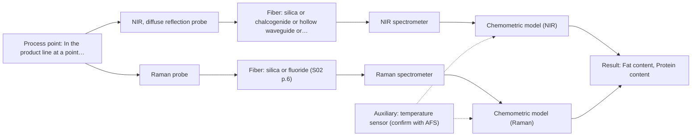

# First technical assessment: Fat and protein monitoring in opaque dairy product

## Answer

**Customer request (our summary):** Customer produces an opaque, concentrated milk product flowing through a processing line, currently samples it for fat and protein analysis, and wants earlier information about composition changes via an initial spectroscopy concept and a practical comparison experiment while retaining laboratory checks.

### Brief answer

Test NIR diffuse reflection first on representative opaque concentrated product, with laboratory fat and protein reference and recorded temperature/texture. A Raman single-probe comparison is worth including to see whether it adds molecular information or is swamped by fluorescence. The method choice remains provisional until accuracy, response time, installation and cleaning requirements are known.

### Proposal

- **Best current option:** O2 (recommended)
- **Basis:** engineering judgement, with secondary external support E02 ¶27 (not AFS material)
- **What would change it:** If NIR alone meets the customer's numerical accuracy and response-time targets across the temperature/texture range, the Raman comparison can be dropped; if Raman is swamped by fluorescence or neither single method separates texture from composition, the comparison or fusion plan changes.
- **Next step:** Run the representative-sample comparison with NIR diffuse reflection first, with laboratory fat/protein reference and recorded temperature and texture.

**Secondary evidence (external, not AFS material):** G1: E01 ¶19; G2: E02 ¶27, E02 ¶13; G3: no usable external source found; G4: no usable external source found. See Expert detail.

**Decision status:** Provisional feasibility assessment

### Solution options

| ID | Tier | Methods | Confidence | Cost class, S01 Table 1 (p.6) | Ease of use | Maintenance | Performance fit | Sources |
|---|---|---|---|---|---|---|---|---|
| O1 | Simple | M1 NIR, diffuse reflection probe | Low: open question: Q1, Q2 (starts at Medium); uncited auxiliary sensor | average cost (row 8) | Single probe, standard dairy NIR interface | Probe cleaning and calibration maintenance | Direct fat/protein measurement in opaque dairy | [1: S01 p.17] [2: S01 p.17] [3: S01 p.10] |
| O2 | Recommended | M1 NIR, diffuse reflection probe; M2 Raman probe | Low: open question: Q1, Q2 (starts at Medium); uncited auxiliary sensor | high cost (rows 8, 12) | Two probes and synchronised acquisition | Two instruments, two calibrations, more drift checks | NIR dairy workhorse plus Raman comparison | [1: S01 p.17] [2: S01 p.17] [3: S01 p.10] [4: S01 p.16] [5: S01 p.11] |

*Confidence rates the basis of the advice (how much is known and cited), not a predicted accuracy or probability of success. It starts at High, or at Medium when a key question on the method or the option is open, and drops one level per weakness listed (floor Low).*

*Cost class is the relative rating in S01 Table 1 (p.6) for the in-line method+technique rows named (the highest one for a multi-method option); it is not a price.*

### Setup sketch

*Recommended option O2; drawn by code from the option, a schematic, not a configuration.*

### Key questions

1. What numerical accuracy and precision, and what response time, must the in-line measurement meet for fat and protein?
2. What are the expected fat and protein concentration ranges, and what other components or interferences are present?
3. What are the temperature range, texture/viscosity range, flow rate and pressure at the intended measurement point?

## Expert detail

**Customer enquiry**

> We produce an opaque, concentrated milk product that flows through a processing line. We currently sample it for fat and protein analysis and would like earlier information about composition changes. Product temperature and texture vary during production. We want an initial spectroscopy concept and a practical comparison experiment, while retaining our laboratory checks.

**Decision status:** Provisional feasibility assessment. NIR diffuse reflection is a defensible first method for opaque concentrated dairy, but the customer's accuracy, response-time, temperature/texture range and installation requirements are not yet known. The assessment is therefore provisional and the comparison experiment should use representative product with laboratory reference.

### Parameters

| ID | Parameter | Kind | Need | Measured by | Why | Sources |
|---|---|---|---|---|---|---|
| P1 | Fat content | quantitative | required | Spectroscopy: NIR | Fat is one of the two composition targets and the dairy NIR example uses PLS to quantify it. | [2: S01 p.17] |
| P2 | Protein content | quantitative | required | Spectroscopy: NIR | Protein is the other composition target and is quantified with fat in the same dairy NIR example. | [2: S01 p.17] |
| P3 | Product temperature | quantitative | required | Auxiliary sensor: temperature sensor (engineering judgement: confirm availability with AFS) | Product temperature varies and must be recorded to separate thermal effects from composition changes. | *(no verified source: engineering judgement)* |
| P4 | Texture or viscosity | quantitative | optional | Not measurable in-line by spectroscopy; alternative: laboratory rheology or texture measurement | Texture variation can change NIR scattering, so a reference texture or viscosity value helps interpret spectral variation; it is not a control target. | [6: S01 p.17] |

### Solution option details

- **O1 cost drivers:** NIR spectrometer, diffuse-reflection probe, reference analyses and calibration effort
- **O2 cost drivers:** NIR and Raman instruments, probes, synchronization and two calibrations

### Premise check

- **Supported:** In-line spectroscopy can provide earlier information about composition changes than the current sampling approach. The source describes online fiber-probe analysis directly in the process flow, without sampling, eliminating delays. [7: S01 p.3]
- **Supported:** An initial spectroscopy concept and a practical comparison experiment can be defined before all method-selection facts are known. The source supports testing optical approaches on samples of incompletely known composition to select the most suitable method or combination. [8: S01 p.3]
- **Not covered:** Laboratory checks can be retained alongside an in-line spectroscopy measurement. No supplied source addresses retaining existing laboratory checks alongside an in-line measurement. *(no verified source: engineering judgement)*

### Requirements

**Stated by the customer**

- "We produce an opaque, concentrated milk product"
- "flows through a processing line"
- "We currently sample it for fat and protein analysis"
- "would like earlier information about composition changes"
- *Further statements: see the customer enquiry above.*

**Key unknowns**

- Required accuracy, precision and response time for fat and protein.
- Fat and protein concentration ranges and other matrix components or interferences.
- Temperature and texture/viscosity variation at the intended measurement point.
- Flow rate, pressure and installation location.
- Cleaning, fouling and sanitation requirements.
- Reference laboratory methods and sampling frequency.

### Clarification questions (most decision-relevant first)

Q1. What numerical accuracy and precision, and what response time, must the in-line measurement meet for fat and protein? *Why it matters:* These thresholds decide whether NIR alone is sufficient and set the go/no-go basis. *(affects: M1)*
Q2. What are the expected fat and protein concentration ranges, and what other components or interferences are present? *Why it matters:* They determine whether NIR bands are usable and whether a second method is needed. *(affects: method)*
Q3. What are the temperature range, texture/viscosity range, flow rate and pressure at the intended measurement point? *Why it matters:* They affect probe geometry, pathlength and whether reflection or another technique is practical. *(affects: technique)*
Q4. Where will the probe be installed, and what cleaning, fouling and sanitation constraints apply? *Why it matters:* They determine the probe interface and maintenance effort. *(affects: installation)*
Q5. Which laboratory methods and sampling frequency will be retained for fat and protein reference? *Why it matters:* They define the reference data available for calibration and validation. *(affects: status)*

### Recommendation

- **M1 · Primary candidate: NIR, diffuse reflection probe.** NIR diffuse reflection is the dairy example for opaque or concentrated products and has been used with PLS to quantify fat and protein. It is also described as the most common online fiber-probe NIR method, so it is the first single method to test. *Conditions:* Test on representative product across the stated temperature and texture range, with laboratory fat and protein reference values. [1: S01 p.17] [2: S01 p.17] [3: S01 p.10]
- **M2 · Comparison candidate: Raman probe.** Raman gives a molecular fingerprint and is less affected by water than infrared methods, so it is a useful single-method comparison for composition changes. Its weak signal and possible fluorescence background must be checked on the real product. *Conditions:* Only include if the real product's fluorescence background leaves usable Raman bands and a Raman calibration is acceptable. [4: S01 p.16] [5: S01 p.11]

### Measurement concept

- **Probe and geometry:** Start with a flush-mounted NIR diffuse-reflection fiber probe; a Raman probe is the later single-method comparison.
- **Location:** In the product line at a point representative of the flowing opaque concentrate.
- **Fiber link:** NIR uses silica Vis-NIR fibers; Raman also uses silica fibers, with metal-coated fibers where polymer-jacket fluorescence matters. [9: S01 p.17]

### Spectral range

- **NIR:** Nominal NIR range is 780-2500 nm; the usable range depends on the instrument, fiber and probe actually selected. [10: S01 p.10]
- **Raman:** Raman shift is stated in cm-1 and the laser excitation wavelength is stated separately; the usable range depends on the selected laser, spectrometer, fiber and probe. [11: S01 p.11]

### Risks and uncertainty

- Texture and temperature variation may change NIR scattering more than fat or protein absorption, so a single NIR model could confuse physical variation with composition. *(rules: R-GEO-6)* [6: S01 p.17]
- The opaque, concentrated product may foul the probe window or change flow at the measurement point, and no cleaning or fouling requirement is known yet. *(rules: R-MIR-3)* *(no verified source: engineering judgement)*
- Raman may be swamped by fluorescence from the product, so the Raman comparison could be uninformative. *(rules: R-RAM-1)* [5: S01 p.11]
- The customer's required accuracy, precision and response time are unknown, so the go/no-go basis for the comparison cannot yet be set. *(rules: R-PRO-2)* *(no verified source: engineering judgement)*

### First feasibility experiment

1. **Collect representative samples or process states across the expected fat/protein, temperature and texture variation, and retain laboratory fat/protein reference values.** Collect representative samples or process states across the expected fat/protein, temperature and texture variation, and retain laboratory fat/protein reference values. [12: REF §3]
2. **Measure each sample first with NIR diffuse reflection using a flush-mounted fiber probe, recording product temperature at each measurement.** Measure each sample first with NIR diffuse reflection using a flush-mounted fiber probe, recording product temperature at each measurement. [9: S01 p.17]
3. **Measure the same samples with the Raman probe as a single-method comparison and check whether fluorescence leaves usable Raman bands.** Measure the same samples with the Raman probe as a single-method comparison and check whether fluorescence leaves usable Raman bands. [5: S01 p.11]
4. **Build chemometric calibrations for fat and protein from the NIR data and check them on held-out runs or batches against the laboratory reference.** Build chemometric calibrations for fat and protein from the NIR data and check them on held-out runs or batches against the laboratory reference. [13: S01 p.10]
5. **Set the customer-supplied numerical go/no-go thresholds for fat and protein accuracy, precision and response time, and compare NIR alone and Raman alone before any fusion.** Set the customer-supplied numerical go/no-go thresholds for fat and protein accuracy, precision and response time, and compare NIR alone and Raman alone before any fusion. *(no verified source: engineering judgement)*

**Reference measurements:** Laboratory fat and protein reference values on the same samples or runs, at a sampling frequency agreed with the customer.

**Decision basis:** Customer-defined numerical thresholds for fat and protein accuracy, precision and response time; no numerical thresholds are assumed here.

### Assumptions

- The product can be presented to a flush-mounted probe at a representative point in the line.
- The customer's laboratory fat/protein method is suitable as an independent reference.
- The product's fluorescence background is low enough for Raman to be interpretable, which is unknown.

### Not covered by the supplied sources

- No supplied source gives accuracy, response time or an installation and fouling assessment for this specific opaque concentrated milk product.
- No supplied source states that existing laboratory checks can be retained alongside an in-line measurement.

### Further notes

- **Chemometrics:** NIR fat and protein quantification needs a chemometric calibration, for example PLS, built on the customer's laboratory reference data and checked on held-out runs; broad overlapping NIR bands make this necessary.
- **Real-time tracking:** In-line NIR can give near real-time information, but the required update rate and synchronization with temperature and laboratory reference are not yet known.
- **Future direction:** If single-method tests show that texture or temperature variation masks composition, test a fused NIR+Raman model with a combined probe after checking fluorescence background and time alignment.

### Secondary evidence (external, not AFS material)

*Found by a literature search for gaps the supplied AFS sources leave open. Not AFS material and not proof for this case; every quote below was verified verbatim against the fetched text.*

*Live search unavailable (library only: cache miss (europepmc); cache miss (openalex)); curated library only.*

**G1 · auxiliary sensor:** In-line measurement of Product temperature with temperature sensor

- **E01 ¶19** The source reports that temperature was varied together with acid concentrations and ionic strength to obtain a robust model. *How it applies:* For O2, this suggests treating product temperature as a calibration variable and testing whether an in-line temperature reading improves the composition assessment. *Limits and transfer risks:* The work concerns reactive liquid-liquid extraction in lithium recycling, not an in-line temperature sensor in opaque concentrated milk; the benefit of temperature logging would need to be tested on this product and line. *(supports O2)*
  > "The concentrations of nitric acid and hydrochloric acid as well as the ionic strength and temperature were varied to obtain a robust model."
  > Process Analytical Technology-Integrated FT-IR and Raman Spectroscopies for Efficient Reactive Liquid-Liquid Extraction Processing in Lithium Recycling. (2025) · ACS omega · doi:10.1021/acsomega.5c05705 · https://europepmc.org/article/PMC/PMC12573149 · retrieved 2026-10-17, full text, licence: cc by, via curated library

**G2 · not in the supplied sources:** No supplied source gives accuracy, response time or an installation and fouling assessment for this specific opaque concentrated milk product.

- **E02 ¶27** The source notes that contamination of the probe window can make an accurate measurement impossible in a process where a binder is added. *How it applies:* For O2, this supports including a probe-window fouling and cleaning check in the practical comparison, for example by comparing signal before and after cleaning. *Limits and transfer risks:* This is a pharmaceutical process with a binder, not an opaque concentrated milk product; the fouling mechanism, rate and cleanability may differ. *(supports O2)*
  > "However, an accurate measurement may not be possible because of contamination of the probe window due to the addition of a binder during the process, which is a disadvantage."
  > Process Analytical Technology Tools for Monitoring Pharmaceutical Unit Operations: A Control Strategy for Continuous Process Verification. (2021) · Pharmaceutics · doi:10.3390/pharmaceutics13060919 · https://europepmc.org/article/PMC/PMC8234957 · retrieved 2026-10-17, full text, licence: cc by, via curated library
- **E02 ¶13** The source states that NIRS signals are harder to interpret than conventional analysis methods because overlapping absorption bands make the spectra complex. *How it applies:* For O1, this suggests planning spectral interpretation support and retaining reference analyses in the comparison experiment to check whether fat and protein changes are distinguishable. *Limits and transfer risks:* This is a general NIRS limitation, not a result for this opaque concentrated milk product or a specific instrument; spectral complexity and interpretability would need to be tested here. *(supports O1)*
  > "However, a disadvantage of NIRS is that it is more difficult to interpret a signal than by using conventional analysis methods, such as chromatography, ultraviolet/visible (UV-VIS) light, and others, because the absorption bands overlap due to spectral complexity."
  > Process Analytical Technology Tools for Monitoring Pharmaceutical Unit Operations: A Control Strategy for Continuous Process Verification. (2021) · Pharmaceutics · doi:10.3390/pharmaceutics13060919 · https://europepmc.org/article/PMC/PMC8234957 · retrieved 2026-10-17, full text, licence: cc by, via curated library

**G3 · not in the supplied sources:** No supplied source states that existing laboratory checks can be retained alongside an in-line measurement.

- No usable external source found.

**G4 · premise not covered:** Laboratory checks can be retained alongside an in-line spectroscopy measurement.

- No usable external source found.

### Evidence (verified quotes)

1. ✓ **S01 p.17** (application precedent): "NIR Reflection is primarily used for opaque or highly concentrated dairy products, such as yogurt, butter, or whole milk concentrates."
2. ✓ **S01 p.17** (application precedent): "before using Partial Least Squares (PLS) regression to quantify fat and protein."
3. ✓ **S01 p.10** (general): "Near-IR vibrational spectroscopy (NIR) is the most common online analysis method performed using fiber optic probes."
4. ✓ **S01 p.16** (general): "Raman is particularly well-suited for aqueous environments, as it exhibits low absorbance for water molecules compared to infrared methods."
5. ✓ **S01 p.11** (general): "superposition of luminescence (fluorescence), which has a significantly higher intensity."
6. ✓ **S01 p.17** (general): "the method is sensitive to the surface characteristics and fat globule size."
7. ✓ **S01 p.3** (general): "It allows for in-process analysis, i.e., directly in the process flow or reactor without sampling, eliminating delays and the risk of sample contamination."
8. ✓ **S01 p.3** (general): "samples of incompletely known composition, in order to select the most suitable method or combination of methods."
9. ✓ **S01 p.17** (application precedent): "the probe is flush-mounted into a pipe or vat to interact directly with the flowing medium."
10. ✓ **S01 p.10** (general): "NIR spectra (780-2500 nm) contain predominantly overtones and component bands of fundamental vibrations"
11. ✓ **S01 p.11** (general): "The Raman shift is used as the horizontal (spectral) axis in Raman spectroscopy"
12. ✓ **REF §3** (general): "Representative samples or process states, independent reference measurements, what is compared, and the basis for the go / no-go decision."
13. ✓ **S01 p.10** (general): "The broad absorption bands observed in this region overlap, suggesting the use of chemometrics for quantitative and qualitative analysis of spectral data."

### Verification

- Citations verified: 19 of 19 (exact or whitespace/hyphen-tolerant match on the cited page, scope checked).
- Hard check failures before deterministic corrections: 0; still open: 0; soft warnings: 1; repair rounds: 1.
- External evidence (cache): 3 quote(s) verified verbatim (exact or whitespace/hyphen-tolerant, at most 400 characters and 2 sentences, against the cited paragraph); 0 item(s) dropped.
- External search: 5 query(ies), 0 hit(s), 3 source(s) (3 from the curated library); ⚠ library only: cache miss (europepmc); cache miss (openalex).
- External step: 2 model call(s), 19.7 s extra (cost in the run JSON).

*Run D02-20261018T072334Z-e119 · models deepseek/deepseek-v4.1-flash-1017*
