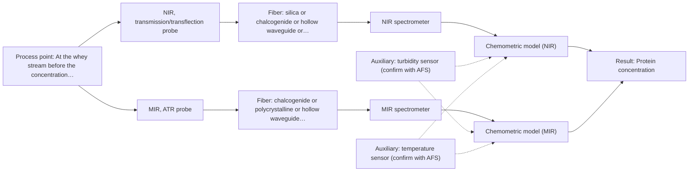
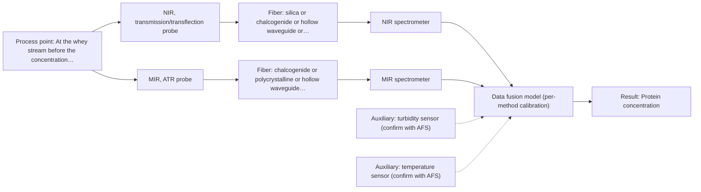

# First technical assessment: A clear whey stream before concentration

## Answer

**Customer request (our summary):** Dairy whey stream before a concentration stage; investigate whether spectroscopy can track protein concentration as the stream changes, using laboratory results as reference, while allowing for turbidity increases under some operating conditions.

### Brief answer

Test NIR transmission/transflection first on representative clear and turbid whey samples, using laboratory protein results as reference. Add MIR ATR as a comparison for turbid episodes. The whey-specific calibration, turbidity range, required accuracy and acceptance criteria are still open, so the assessment is provisional.

### Proposal

- **Best current option:** O2 (recommended)
- **Basis:** engineering judgement
- **What would change it:** If the turbidity range is narrow and NIR transflection alone meets the agreed criteria, O1 would become the better choice. If both single methods fail, O3 fusion or a different method would need to be tested.
- **Next step:** Clarify the protein range, turbidity conditions and acceptance criteria, then run the feasibility experiment with NIR first and MIR ATR as the comparison.

**Secondary evidence (external, not AFS material):** G1: no usable external source found; G2: E03 ¶12; G3: no usable external source found; G4: no usable external source found. See Expert detail.

**Decision status:** Provisional feasibility assessment

### Solution options

| ID | Tier | Methods | Confidence | Cost class, S01 Table 1 (p.6) | Ease of use | Maintenance | Performance fit | Sources |
|---|---|---|---|---|---|---|---|---|
| O1 | Simple | M1 NIR, transmission/transflection probe | Low: open question: Q1, Q2, Q3 (starts at Medium); uncited auxiliary sensor | average cost (row 7) | standard NIR probe, simple optics | probe cleaning and calibration checks | least effort for clear whey protein tracking | [1: S01 p.18] [2: S01 p.18] [3: S01 p.17] |
| O2 | Recommended | M1 NIR, transmission/transflection probe; M2 MIR, ATR probe | Low: open question: Q1, Q2, Q3 (starts at Medium); uncited auxiliary sensor | high cost (rows 2, 7) | two probes, more alignment and setup | two probe systems, separate checks | NIR with MIR check for turbid episodes | [1: S01 p.18] [2: S01 p.18] [3: S01 p.17] [4: S04 p.3] [5: S01 p.10] [6: REF §5] |
| O3 | Extended (multi-method) | M3 NIR, transmission/transflection probe + MIR (combination) | Low: open question: Q1 (starts at Medium); uncited auxiliary sensor; multi-method, fusion benefit not yet shown | high cost (rows 2, 7) | complex dual-probe setup, synchronized data | two instruments, separate calibrations | fusion only if single methods fall short | [7: S01 p.7] [8: S01 p.8] [9: S01 p.8] |

*Confidence rates the basis of the advice (how much is known and cited), not a predicted accuracy or probability of success. It starts at High, or at Medium when a key question on the method or the option is open, and drops one level per weakness listed (floor Low).*

*Cost class is the relative rating in S01 Table 1 (p.6) for the in-line method+technique rows named (the highest one for a multi-method option); it is not a price.*

### Setup sketch

*Recommended option O2; drawn by code from the option, a schematic, not a configuration.*

### Key questions

1. What protein concentration range and expected change must be tracked, and what accuracy, precision, response time and go/no-go criteria apply?
2. Under which operating conditions does the stream become turbid, how turbid does it become, and for how long?
3. What are the exact measurement location and process conditions: temperature, pressure, flow, and cleaning or fouling constraints?

## Expert detail

**Customer enquiry**

> Our dairy process includes a relatively clear whey stream before a concentration stage. We want to investigate whether spectroscopy can track protein concentration as the stream changes, with laboratory results used as the reference. The stream can become more turbid under some operating conditions. We need a first measurement concept that handles this change rather than assuming the liquid always remains clear.

**Decision status:** Provisional feasibility assessment. The shortlist rests on method-level evidence, not on whey-specific performance; no source gives a whey protein calibration or a turbidity limit. The status is provisional until the customer's protein range, turbidity range and go/no-go criteria are known.

### Parameters

| ID | Parameter | Kind | Need | Measured by | Why | Sources |
|---|---|---|---|---|---|---|
| P1 | Protein concentration | quantitative | required | Spectroscopy: NIR | This is the target variable the customer wants to track as the stream changes. | [3: S01 p.17] |
| P2 | Turbidity or optical density | quantitative | required | Auxiliary sensor: turbidity sensor (cited; confirm availability with AFS) | The stream can become turbid, and scatter changes the NIR or MIR signal, so turbidity must be recorded to stratify and correct the calibration. | [10: S01 p.17] |
| P3 | Temperature | quantitative | required | Auxiliary sensor: temperature sensor (engineering judgement: confirm availability with AFS) | Temperature affects spectra and probe compatibility, so it is needed to compare clear and turbid states and to maintain calibration. | *(no verified source: engineering judgement)* |

### Solution option details

- **O1 cost drivers:** NIR spectrometer, fiber probe, pathlength cell, calibration
- **O2 cost drivers:** NIR and MIR hardware, two probes, calibration
- **O3 cost drivers:** two spectrometers, combined probe, data fusion, calibration
- **O3 combining methods:** Low-level fusion of synchronized NIR and MIR ATR spectra, with per-method calibration and block scaling. The probes must view the same small whey volume and the data must be aligned to a common time step. The fused model must beat the best single method on held-out runs before it is adopted.

*Extended (multi-method) option O3; drawn by code from the option, a schematic, not a configuration.*

### Premise check

- **Precedent only:** A single measurement concept can handle both the relatively clear and the more turbid states. A dairy example shows that a transflection probe can work for low-fat and high-fat milk products, but this is a reason to test, not proof for whey or for the customer's turbidity range. [2: S01 p.18]
- **Supported:** NIR transmission/transflection is suitable for a relatively clear whey stream. A source states that transmission is preferred for transparent or semi-transparent liquids and names whey. [1: S01 p.18]
- **Precedent only:** NIR can quantify protein in dairy streams with a laboratory reference. A dairy example uses PLS regression to quantify fat and protein, but it is a milk example, not a whey validation. [3: S01 p.17]

### Requirements

**Stated by the customer**

- Track protein concentration in a relatively clear whey stream before a concentration stage.
- Use laboratory results as the reference.
- Handle operating conditions in which the stream becomes more turbid.

**Key unknowns**

- Protein concentration range and the expected direction and magnitude of change.
- Required accuracy, precision, response time and go/no-go criteria.
- Turbidity conditions, frequency and range.
- Process temperature, pressure, flow and measurement location.
- Laboratory reference protein method and sampling protocol.
- Cleaning, fouling and maintenance constraints.

### Clarification questions (most decision-relevant first)

Q1. What protein concentration range and expected change must be tracked, and what accuracy, precision, response time and go/no-go criteria apply? *Why it matters:* These values decide whether NIR sensitivity is adequate and define the criteria for the feasibility test. *(affects: method, status, M1)*
Q2. Under which operating conditions does the stream become turbid, how turbid does it become, and for how long? *Why it matters:* The turbidity range decides whether a single NIR transflection probe can cover both states or whether MIR ATR is needed. *(affects: technique, M1, M2)*
Q3. What are the exact measurement location and process conditions: temperature, pressure, flow, and cleaning or fouling constraints? *Why it matters:* Location and process conditions determine probe geometry, materials, fouling risk and whether in-line measurement is practical. *(affects: installation, M1, M2)*
Q4. What is the laboratory reference protein method and the sampling protocol, including sample point, timing and replicates? *Why it matters:* A mismatched reference would invalidate the calibration comparison and could wrongly reject a workable method. *(affects: status, M1)*
Q5. Must the measurement be in-line, at-line or offline, and at what frequency? *Why it matters:* The required measurement mode and frequency decide whether a fiber-probe system or grab sampling is appropriate. *(affects: installation, technique)*

### Recommendation

- **M1 · Primary candidate: NIR, transmission/transflection probe.** NIR is the dairy workhorse, and transmission/transflection suits clear to semi-transparent liquids. Transflection may cover low- and high-turbidity states in some cases, but this is a hypothesis to test. *Conditions:* Confirm the usable NIR range, pathlength or probe geometry, and calibration on whey, including turbid episodes. [1: S01 p.18] [2: S01 p.18] [3: S01 p.17]
- **M2 · Comparison candidate: MIR, ATR probe.** MIR ATR gives protein amide bands and samples a thin surface layer, making it a useful comparison when turbidity varies. ATR requires contact and is prone to fouling, so it is a comparison rather than the primary. *Conditions:* Use only if ATR contact and fouling can be managed on the whey stream. [4: S04 p.3] [5: S01 p.10] [6: REF §5]
- **M3 · Conditional candidate: NIR, transmission/transflection probe + MIR (combination).** A combined NIR + MIR ATR test may add complementary information if neither single method covers both clear and turbid states. The gain is a hypothesis and must be compared with the best single method. *Conditions:* Test only after single-method tests if neither NIR nor MIR ATR meets the agreed criteria. [7: S01 p.7] [8: S01 p.8] [9: S01 p.8]

### Measurement concept

- **Probe and geometry:** Start with an NIR transmission or transflection fiber probe in contact with the whey stream; compare with an MIR ATR fiber probe only if turbidity episodes make the NIR result ambiguous.
- **Location:** At the whey stream before the concentration stage, with the sampling point and reference sampling protocol fixed before calibration.
- **Fiber link:** Fiber family and length must be selected for the actual NIR and MIR ranges; the supplied sources do not give a whey-specific link length. [11: REF §5]

### Spectral range

- **NIR:** Nominal NIR range 780-2500 nm; the usable range depends on the instrument, fiber and probe actually selected. [12: S01 p.10]
- **MIR:** Nominal MIR range 4000-400 cm-1 (2.5-25 µm); the usable range depends on the fiber and ATR crystal actually selected. [13: S01 p.9]

### Risks and uncertainty

- Turbidity may make the NIR transmission/transflection calibration fail to transfer across clear and turbid states, because scatter and pathlength effects can mimic protein changes. *(rules: R-GEO-6, R-NIR-2, R-CAL-1)* *(no verified source: engineering judgement)*
- MIR ATR may foul or lose contact on whey, so the comparison could be unrepresentative or high-maintenance. *(rules: R-MIR-3)* *(no verified source: engineering judgement)*
- The laboratory protein reference may not match the in-line sampling point or timing, so calibration error could be mistaken for method failure. *(rules: R-GEN-2)* *(no verified source: engineering judgement)*
- If the protein change is small or the required precision is high, NIR may lack sensitivity and the method choice may need to change. *(rules: R-NIR-4)* *(no verified source: engineering judgement)*

### First feasibility experiment

1. **Collect representative whey samples across the expected protein range and turbidity states (clear, transitional, turbid) from several runs or batches, with process metadata.** Cover the chemical and physical variation the method must handle. [14: REF §3]
2. **Measure each sample with NIR transmission/transflection first, controlling pathlength or probe geometry and recording spectra with the laboratory protein reference.** Test the primary single method before any combination. [15: S01 p.18]
3. **Measure the same samples with MIR ATR as a comparison, checking contact, repeatability and fouling on whey.** Test whether the turbidity-robust comparison adds useful protein information. [16: S04 p.4]
4. **Build separate NIR and MIR calibration models and validate them on held-out runs or batches, with turbidity state as a factor; compare each against the laboratory reference.** Check that the models generalise beyond the calibration samples. *(no verified source: engineering judgement)*
5. **Only if the single methods miss the agreed criteria, test NIR + MIR ATR fusion on the same spot and time step, and require it to beat the best single method.** Treat the combination as a later hypothesis, not a default. [8: S01 p.8] [9: S01 p.8]

**Reference measurements:** Laboratory protein results supplied by the customer, sampled at the same point and time as the spectral measurements where possible.

**Decision basis:** The customer's numerical accuracy, precision, response-time and turbidity-range criteria; unknown until Q1 and Q2 are answered.

### Assumptions

- The whey stream is liquid and can be brought into contact with a fiber probe.
- The laboratory protein reference is independent and traceable to the customer's routine method.
- The stream's turbidity change is not so extreme that the probe fouls immediately.

### Not covered by the supplied sources

- Whey-specific protein calibration performance, accuracy, precision and detection limit are not covered; the sources give dairy or milk examples and general method statements.
- The effect of the stated turbidity changes on a whey protein calibration is not covered; it must be tested.

### Further notes

- **Chemometrics:** NIR protein calibration will need representative whey spectra, laboratory protein reference values, scatter correction and validation on held-out runs; turbidity state should be included as a factor.
- **Real-time tracking:** In-line NIR can track changes continuously; record time-resolved spectra alongside grab samples to check response and sampling lag.
- **Future direction:** If the single-method tests are promising, a combined NIR + MIR ATR probe or a fused model could be evaluated for turbid episodes.

### Secondary evidence (external, not AFS material)

*Found by a literature search for gaps the supplied AFS sources leave open. Not AFS material and not proof for this case; every quote below was verified verbatim against the fetched text.*

*Live search unavailable (library only: cache miss (europepmc); cache miss (openalex)); curated library only.*

**G1 · auxiliary sensor:** In-line measurement of Turbidity or optical density with turbidity sensor

- No usable external source found.

**G2 · auxiliary sensor:** In-line measurement of Temperature with temperature sensor

- **E03 ¶12** The review states that temperature sensitivity of OH bands is a severe drawback for aqueous NIR and MIR measurements, making tempered sample holders necessary. *How it applies:* This supports treating temperature as a controlled or monitored variable for an aqueous whey stream, and suggests testing whether temperature fluctuations affect the spectroscopic protein signal. *Limits and transfer risks:* This is a review statement about aqueous NIR/MIR measurements, not a whey-specific or in-line temperature-sensor study; a tempered sample holder in a laboratory may not represent a flowing, turbid process stream. *(supports O2)*
  > "Additionally, the temperature sensitivity of the OH bands is a severe drawback for measuring aqueous solution in NIR and MIR, which makes tempered sample holders necessary [29]."
  > A critical review of recent trends, and a future perspective of optical spectroscopy as PAT in biopharmaceutical downstream processing. (2020) · Analytical and bioanalytical chemistry · doi:10.1007/s00216-020-02407-z · https://europepmc.org/article/PMC/PMC7072065 · retrieved 2026-10-17, full text, licence: cc by, via curated library

**G3 · multi-method:** Combining several spectroscopy methods (data fusion) (Low-level fusion of synchronized NIR and MIR ATR spectra, with per-method calibration and block scaling. The probes must view the same small whey volume and the data must be aligned to a common time step. The fused model must beat the best single method on held-out runs before it is adopted.)

- No usable external source found.

**G4 · not in the supplied sources:** Whey-specific protein calibration performance, accuracy, precision and detection limit are not covered; the sources give dairy or milk examples and general method statements.

- No usable external source found.

### Evidence (verified quotes)

1. ✓ **S01 p.18** (general): "Transmission is the preferred method for transparent or semi-transparent liquids, such as skim milk, whey, or permeate."
2. ✓ **S01 p.18** (application precedent): "In some cases, a Transflection probe can already be a combined solution working well for low-fat and high-fat containing milk products."
3. ✓ **S01 p.17** (application precedent): "using Partial Least Squares (PLS) regression to quantify fat and protein."
4. ✓ **S04 p.3** (general): "These are, respectively, the amide I and II bands, two major absorption peaks of the protein peptide group in the infrared region."
5. ✓ **S01 p.10** (general): "ATR fiber probes (Fig.1) enable the analysis of liquids and solid elastic samples"
6. ✓ **REF §5** (general): "Usable range limited by fiber and crystal; contact, fouling, compatibility."
7. ✓ **S01 p.7** (general): "The analysis of such systems may require a combination of two or even more spectral methods."
8. ✓ **S01 p.8** (general): "It is crucial that the spectral information obtained by different methods-Mid-IR, NIR, Raman, and fluorescence spectra-is collected from the same small, even pinpoint, area of the sample."
9. ✓ **S01 p.8** (general): "data synchronization can be challenging, as the acquisition rates of different spectra can vary greatly-from milliseconds to minutes"
10. ✓ **S01 p.17** (general): "the method is sensitive to the surface characteristics and fat globule size."
11. ✓ **REF §5** (general): "It is not a product specification: actual spectral coverage, fiber length, component ratings, detection limits and accuracy depend on the configuration and the sample."
12. ✓ **S01 p.10** (general): "NIR spectra (780-2500 nm) contain predominantly overtones and component bands of fundamental vibrations"
13. ✓ **S01 p.9** (general): "Vibrational spectroscopy in the mid-IR range (4000-400 cm-1) is one of the most informative methods of chemical analysis."
14. ✓ **REF §3** (general): "Representative samples or process states, independent reference measurements, what is compared, and the basis for the go / no-go decision."
15. ✓ **S01 p.18** (general): "the precise control of the optical pathlength (usually 1 - 10 mm)"
16. ✓ **S04 p.4** (general): "suitability of analyzed samples for ATR measurements, which is true for liquid or soft solid samples and their components, allowing a tight contact with the probe head."

### Verification

- Citations verified: 22 of 22 (exact or whitespace/hyphen-tolerant match on the cited page, scope checked).
- Hard check failures before deterministic corrections: 0; still open: 0; soft warnings: 0; repair rounds: 1.
- External evidence (cache): 1 quote(s) verified verbatim (exact or whitespace/hyphen-tolerant, at most 400 characters and 2 sentences, against the cited paragraph); 0 item(s) dropped.
- External search: 6 query(ies), 0 hit(s), 3 source(s) (3 from the curated library); ⚠ library only: cache miss (europepmc); cache miss (openalex).
- External step: 2 model call(s), 10.8 s extra (cost in the run JSON).

*Run D03-20261018T072334Z-213f · models deepseek/deepseek-v4.1-flash-1017*
