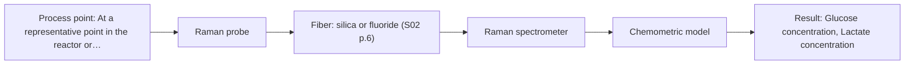
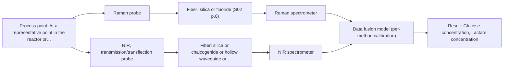

# First technical assessment: Glucose and lactate trends in an aqueous bioprocess

## Answer

**Customer request (our summary):** Customer is exploring an in situ spectroscopy pilot for a cell culture process in aqueous medium, with glucose and lactate currently measured from samples. They want to check the pilot against existing laboratory measurements and have not selected a probe or calibration strategy.

### Brief answer

Test Raman spectroscopy first, because it is the best-supported single method for glucose and lactate in aqueous cell culture. Keep NIR transmission/transflection and MIR-ATR as comparisons, with NIR only if the medium stays clear enough. The probe, concentration ranges, required accuracy, optical regime and reference-method timing are still open, so start with a small feasibility comparison against your existing laboratory measurements.

### Proposal

- **Best current option:** O2 (recommended)
- **Basis:** supplied AFS sources
- **What would change it:** If the medium is too turbid for Raman or fluorescence masks the glucose/lactate bands, NIR or MIR-ATR comparisons may become more important; if the required accuracy is tighter than the method can reach, the pilot may not be suitable.
- **Next step:** Run a small feasibility set with Raman and the existing laboratory reference, then compare NIR or MIR-ATR only if a stated target is not met.

**Secondary evidence (external, not AFS material):** G1: E03 ¶31, E03 ¶36; G2: E02 ¶20; G3: no usable external source found; G4: no usable external source found. See Expert detail.

**Decision status:** Provisional feasibility assessment

### Solution options

| ID | Tier | Methods | Confidence | Cost class, S01 Table 1 (p.6) | Ease of use | Maintenance | Performance fit | Sources |
|---|---|---|---|---|---|---|---|---|
| O1 | Simple | M2 MIR, ATR probe | Medium: open question: Q2 (starts at Medium) | high cost (row 2) | Direct immersion; no pathlength. | ATR crystal cleaning and fouling checks. | High-selectivity fingerprint; contact and water limits. | [1: S01 p.9] [2: S01 p.10] [3: S01 p.5] [4: S04 p.4] |
| O2 | Recommended | M1 Raman probe | Medium: open question: Q2 (starts at Medium) | high cost (row 12) | Single probe; fluorescence background check. | Probe cleaning; laser and calibration checks. | Aqueous glucose/lactate fingerprint; best source fit. | [5: S01 p.16] [6: S01 p.16] [7: S01 p.11] [8: S01 p.11] |
| O3 | Extended (multi-method) | M1 Raman probe; M3 NIR, transmission/transflection probe | Low: open question: Q2 (starts at Medium); sample clarity unknown; multi-method, fusion benefit not yet shown | high cost (rows 7, 12) | Two instruments; more alignment effort. | Two probes and separate calibrations. | Complementary NIR/Raman data; only if single fails. | [9: S01 p.15] [10: S01 p.8] [11: S01 p.8] [12: S01 p.8] [13: S01 p.9] [14: S01 p.9] [5: S01 p.16] [6: S01 p.16] [7: S01 p.11] [8: S01 p.11] [15: S01 p.10] [16: S01 p.16] [17: S01 p.18] [18: S01 p.18] |

*Confidence rates the basis of the advice (how much is known and cited), not a predicted accuracy or probability of success. It starts at High, or at Medium when a key question on the method or the option is open, and drops one level per weakness listed (floor Low).*

*Cost class is the relative rating in S01 Table 1 (p.6) for the in-line method+technique rows named (the highest one for a multi-method option); it is not a price.*

### Setup sketch

*Recommended option O2; drawn by code from the option, a schematic, not a configuration.*

### Key questions

1. What is the optical regime of the medium during the run (turbidity, cell density, foaming, gas bubbles, and whether it stays transparent or becomes opaque)?
2. What are the required glucose and lactate concentration ranges, accuracy, precision and update interval for the pilot?
3. What is the timing, uncertainty and sampling procedure of the existing laboratory glucose/lactate measurements?

## Expert detail

**Customer enquiry**

> We run a cell culture process in an aqueous medium. Glucose and lactate are measured from samples, and the delay makes it difficult to see changes promptly. We are exploring an in situ spectroscopy pilot that can be checked against those existing laboratory measurements. The medium and cell population change during the run; we have not yet selected a probe or a calibration strategy.

**Decision status:** Provisional feasibility assessment. The sources support a conditional single-method shortlist, but not a specific probe, calibration or performance claim for this cell-culture process. The assessment is therefore provisional and depends on the open questions below.

### Parameters

| ID | Parameter | Kind | Need | Measured by | Why | Sources |
|---|---|---|---|---|---|---|
| P1 | Glucose concentration | quantitative | required | Spectroscopy: Raman | Primary target; glucose uptake indicates the cell culture metabolic state. | [5: S01 p.16] |
| P2 | Lactate concentration | quantitative | required | Spectroscopy: Raman | Primary target; lactate accumulation indicates metabolic shift or stress. | [5: S01 p.16] |
| P3 | Cell density or viability | quantitative | optional | Reference lab method: viable cell count | The cell population changes during the run and alters scattering and matrix, so it should be recorded with the spectra. | *(no verified source: engineering judgement)* |

### Solution option details

- **O1 cost drivers:** FTIR spectrometer, ATR fiber probe, reference samples.
- **O2 cost drivers:** Raman spectrometer, laser, fiber probe, calibration samples.
- **O3 cost drivers:** Raman and NIR instruments, two probes, synchronisation, fusion.
- **O3 combining methods:** Low-level fusion of Raman and NIR spectra is a later hypothesis, not the first test. The probes must view the same medium or use a combined probe, data must be synchronised to a common time step, and each method needs its own calibration. The fused model must beat the best single method on held-out runs; otherwise drop the extra instrument.

*Extended (multi-method) option O3; drawn by code from the option, a schematic, not a configuration.*

### Premise check

- **Not covered:** The existing laboratory measurements are suitable as a reference for checking the in situ spectroscopy pilot. The sources call for independent reference measurements in a feasibility comparison, but they do not assess this laboratory method, its sampling delay or its uncertainty. *(no verified source: engineering judgement)*
- **Precedent only:** A single in situ spectroscopy method can monitor both glucose and lactate in an aqueous cell culture. A process example reports Raman for glucose, acetate and lactate in a reactor and low water absorbance; this is a reason to test, not proof for this process. [5: S01 p.16] [6: S01 p.16]
- **Precedent only:** In situ fiber-probe spectroscopy will give results promptly enough to remove the sampling delay. The source describes fiber probes in reactors enabling online analysis in near real time, but not a response time for this cell culture. [19: S01 p.2]

### Requirements

**Stated by the customer**

- "cell culture process in an aqueous medium"
- "Glucose and lactate are measured from samples"
- "the delay makes it difficult to see changes promptly"
- "in situ spectroscopy pilot"
- *Further statements: see the customer enquiry above.*

**Key unknowns**

- Glucose and lactate concentration ranges and required accuracy/response time.
- Optical regime of the medium during the run, including turbidity, cell density, foaming and gas bubbles.
- Timing and uncertainty of the existing laboratory glucose/lactate method.
- Probe installation, sterilisation, cleaning and fouling or biofilm constraints.
- Calibration strategy and frequency of reference sampling.
- Raman fluorescence background and whether it masks the glucose/lactate bands.

### Clarification questions (most decision-relevant first)

Q1. What is the optical regime of the medium during the run (turbidity, cell density, foaming, gas bubbles, and whether it stays transparent or becomes opaque)? *Why it matters:* It decides whether NIR transmission/transflection is usable or whether a scattering-tolerant geometry such as NIR diffuse reflection or Raman is needed. *(affects: technique)*
Q2. What are the required glucose and lactate concentration ranges, accuracy, precision and update interval for the pilot? *Why it matters:* These targets decide whether a single method can meet the need and set the go/no-go criteria for the feasibility test. *(affects: method)*
Q3. What is the timing, uncertainty and sampling procedure of the existing laboratory glucose/lactate measurements? *Why it matters:* They are the intended reference, and their delay and uncertainty determine whether they can validate prompt in-line results. *(affects: status)*
Q4. Where can the probe be installed, and what sterility, cleaning, fouling or biofilm constraints apply at that point? *Why it matters:* Installation and fouling determine whether contact probes such as Raman or MIR-ATR can represent the bulk medium and be maintained. *(affects: installation)*
Q5. Which calibration strategy and reference-sampling frequency can be supported during the run? *Why it matters:* Matrix-specific calibrations need reference data across the changing medium and cell population, so sampling frequency affects feasibility. *(affects: method)*
Q6. Does the medium or any planned indicator fluoresce strongly enough to mask Raman bands? *Why it matters:* Fluorescence background is a known Raman limitation and would decide whether Raman remains the first single-method test. *(affects: M1)*

### Recommendation

- **M1 · Primary candidate: Raman probe.** Raman is the single method best aligned with an aqueous cell-culture matrix and is reported for direct detection of glucose and lactate in a reactor. Weak Raman signal and fluorescence background must be checked on the real medium before relying on it. *Conditions:* Applies if the Raman probe can be installed at a representative point and the glucose/lactate bands are not masked by fluorescence in the real medium. [5: S01 p.16] [6: S01 p.16] [7: S01 p.11] [8: S01 p.11]
- **M2 · Comparison candidate: MIR, ATR probe.** MIR-ATR is a single vibrational method with high structural selectivity and direct contact with liquid samples. It is a useful orthogonal comparison to Raman, but water absorption and the very thin ATR sampling depth limit representativeness. *Conditions:* Applies if a fouling-resistant ATR probe can keep tight contact with the medium and the glucose/lactate bands remain visible above water absorption. [1: S01 p.9] [2: S01 p.10] [3: S01 p.5] [4: S04 p.4]
- **M3 · Conditional candidate: NIR, transmission/transflection probe.** NIR is the most common online fiber-probe method and is reported to track major components such as glucose, but its transmission geometry depends on a clear, controlled path. It is a conditional comparison because the medium's optical regime is unknown. *Conditions:* Applies only if the medium stays low-scattering and a controlled optical pathlength can be maintained; if it becomes opaque, NIR transmission is not suitable. [15: S01 p.10] [16: S01 p.16] [17: S01 p.18] [18: S01 p.18]

### Measurement concept

- **Probe and geometry:** Start with a single Raman fiber probe in direct contact with the aqueous medium; keep MIR-ATR and NIR transmission/transflection as comparison geometries.
- **Location:** At a representative point in the reactor or flow path where the medium is well mixed and the probe can be cleaned.
- **Fiber link:** Fiber family and link length must be selected for the chosen method and installation; no specific length is stated in the sources for this case. *(no verified source: engineering judgement)*

### Spectral range

- **Raman:** Raman shift (cm-1); excitation wavelength stated separately (not yet selected); no numeric Raman shift range is given in the supplied sources. [20: S01 p.11]
- **MIR:** 4000-400 cm-1 (2.5-25 µm); usable range depends on the instrument, fiber and probe actually selected. [1: S01 p.9]
- **NIR:** 780-2500 nm; usable range depends on the instrument, fiber and probe actually selected. [21: S01 p.10]

### Risks and uncertainty

- Raman bands for glucose and lactate may be weak and overlapped by fluorescence from the medium or cells, so the required detection limits may not be reached. [7: S01 p.11] [8: S01 p.11]
- NIR transmission/transflection may fail if the medium becomes turbid or the pathlength cannot be controlled, making the measurement unrepresentative. [18: S01 p.18] [22: S01 p.18]
- Calibrations are matrix-specific; as the medium and cell population change, a model built on one state may not hold for another. [23: S01 p.10] [24: S01 p.7]
- ATR or Raman probe contact may foul or be difficult to sterilise, so the measurement may not represent the bulk medium or fit the installation. [25: S01 p.13] [4: S04 p.4]

### First feasibility experiment

1. **Collect representative process samples or states across the run, covering low and high glucose and lactate, different cell densities and turbidity, and the expected medium changes; record the existing laboratory glucose/lactate results and cell counts.** Cover the expected chemical and physical variation before any method is selected. *(no verified source: engineering judgement)*
2. **Measure each single method first on the same samples: Raman, NIR transmission/transflection only where the medium is clear enough, and MIR-ATR as an orthogonal comparison.** Single methods first; combinations only after. [5: S01 p.16] [17: S01 p.18] [2: S01 p.10]
3. **Build a separate calibration per method using the reference results, check fluorescence background and scattering effects, and test the model on held-out runs or batches rather than on the calibration samples.** Independent validation on held-out runs or batches. [23: S01 p.10] [8: S01 p.11]
4. **Only if a single method misses a stated target, test Raman and NIR together on the same sampling spot with synchronised data and separate calibration per block; compare the fused result with the best single method.** Combinations are a later hypothesis, not the first test. [9: S01 p.15] [10: S01 p.8] [11: S01 p.8]
5. **Make the go/no-go decision against customer-defined accuracy, precision and response-time criteria on the held-out runs; if these are not met, do not proceed to a pilot installation.** Go/no-go basis whose numerical criteria come from the customer. *(no verified source: engineering judgement)*

**Reference measurements:** Use the existing laboratory glucose/lactate measurements as the independent reference where their timing and uncertainty are known; add cell counts where available.

**Decision basis:** Customer-defined numerical criteria on held-out runs, not calibration fit alone.

### Not covered by the supplied sources

- The supplied material does not give glucose or lactate detection limits, accuracy or response time for a cell-culture medium.
- The supplied material does not specify a sterilizable or fouling-resistant probe installation for this cell-culture process.

### Further notes

- **Chemometrics:** Calibration or classification models will be specific to the medium and cell state; reference glucose/lactate and cell-density data should cover the expected run variation, with held-out runs used for checking.
- **Real-time tracking:** The pilot is for in-line, time-resolved tracking; align the spectroscopy timestamps with the existing laboratory sampling times and record the delay.
- **Future direction:** If Raman single-method tests are insufficient, the Raman+NIR extended option or a reduced multisensor system could be evaluated later.

### Secondary evidence (external, not AFS material)

*Found by a literature search for gaps the supplied AFS sources leave open. Not AFS material and not proof for this case; every quote below was verified verbatim against the fetched text.*

*Live search unavailable (library only: cache miss (europepmc); cache miss (openalex)); curated library only.*

**G1 · multi-method:** Combining several spectroscopy methods (data fusion) (Low-level fusion of Raman and NIR spectra is a later hypothesis, not the first test. The probes must view the same medium or use a combined probe, data must be synchronised to a common time step, and each method needs its own calibration. The fused model must beat the best single method on held-out runs; otherwise drop the extra instrument.)

- **E03 ¶31** The review describes low-level data fusion as the simplest way to combine inputs by rearranging variables from different sources into one new data matrix. *How it applies:* This could inform a first fusion test by defining a combined variable matrix, but the pilot should still compare the fused model against the best single method on held-out runs. *Limits and transfer risks:* The source is a review, not a cell-culture Raman/NIR study, and it does not establish that fusion improves glucose or lactate prediction in this process. *(supports O3)*
  > "Low-level data fusion (LLDF) is considered the simplest method to achieve a combination of inputs. In this case, the data is rearranged into a new data matrix, where the variables coming from different sources are placed one after the other."
  > Challenges and Opportunities of Implementing Data Fusion in Process Analytical Technology-A Review. (2022) · Molecules (Basel, Switzerland) · doi:10.3390/molecules27154846 · https://europepmc.org/article/PMC/PMC9369811 · retrieved 2026-10-17, full text, licence: cc by, via curated library
- **E03 ¶36** The review notes that in some situations instrument complementarity was not sufficient to improve prediction of several quality attributes, citing a Raman and FT-IR food study. *How it applies:* This cautions that adding NIR to Raman should be justified by a held-out comparison against the best single method, rather than assumed from complementary instruments. *Limits and transfer risks:* The cited study is food analysis with Raman/FT-IR, not cell-culture Raman/NIR, so it does not predict performance for glucose or lactate here. *(supports O3)*
  > "In some situations, instrument complementarity (not data complementarity) was not sufficient to improve the performance of predictive several CQAs, as shown by a Raman and FT-IR data based food analytical study [73]."
  > Challenges and Opportunities of Implementing Data Fusion in Process Analytical Technology-A Review. (2022) · Molecules (Basel, Switzerland) · doi:10.3390/molecules27154846 · https://europepmc.org/article/PMC/PMC9369811 · retrieved 2026-10-17, full text, licence: cc by, via curated library

**G2 · not in the supplied sources:** The supplied material does not give glucose or lactate detection limits, accuracy or response time for a cell-culture medium.

- **E02 ¶20** Raman is described as frequently used in upstream processing because of high selectivity and low water interference, though measurement times are relatively long. *How it applies:* This could support considering Raman for aqueous cell-culture medium, while prompting the pilot to record measurement time as a performance characteristic. *Limits and transfer risks:* The statement is general and does not report glucose or lactate detection limits, accuracy, or a numeric response time in cell-culture medium. *(supports O2)*
  > "Raman spectroscopy is frequently applied in upstream processing in research and industry due to its high selectivity and low water interference [55] despite the relatively long measurement times."
  > A critical review of recent trends, and a future perspective of optical spectroscopy as PAT in biopharmaceutical downstream processing. (2020) · Analytical and bioanalytical chemistry · doi:10.1007/s00216-020-02407-z · https://europepmc.org/article/PMC/PMC7072065 · retrieved 2026-10-17, full text, licence: cc by, via curated library

**G3 · not in the supplied sources:** The supplied material does not specify a sterilizable or fouling-resistant probe installation for this cell-culture process.

- No usable external source found.

**G4 · premise not covered:** The existing laboratory measurements are suitable as a reference for checking the in situ spectroscopy pilot.

- No usable external source found.

### Evidence (verified quotes)

1. ✓ **S01 p.9** (general): "Vibrational spectroscopy in the mid-IR range (4000-400 cm-1) is one of the most informative methods of chemical analysis."
2. ✓ **S01 p.10** (general): "ATR fiber probes (Fig.1) enable the analysis of liquids and solid elastic samples"
3. ✓ **S01 p.5** (general): "strong absorption in the mid-IR region limits the corresponding spectral method to the analysis of very thin samples (usually less than 50 μm), but it opens up the possibility of using attenuated total reflectance (ATR)"
4. ✓ **S04 p.4** (general): "suitability of analyzed samples for ATR measurements, which is true for liquid or soft solid samples and their components, allowing a tight contact with the probe head."
5. ✓ **S01 p.16** (application precedent): "Raman spectroscopy can be used in the same reactor to provide a "molecular fingerprint" for direct detection of specific metabolites like glucose, acetate, or lactate."
6. ✓ **S01 p.16** (general): "Raman is particularly well-suited for aqueous environments, as it exhibits low absorbance for water molecules compared to infrared methods."
7. ✓ **S01 p.11** (general): "signals, which are several orders of magnitude weaker than IR absorption peaks"
8. ✓ **S01 p.11** (general): "superposition of luminescence (fluorescence), which has a significantly higher intensity."
9. ✓ **S01 p.15** (application precedent): "The combination of these techniques is particularly effective because it captures complementary chemical information: NIR detects hydrogen bonds and asymmetric polar groups, while Raman provides information on the molecular backbone and symmetrical non-polar groups."
10. ✓ **S01 p.8** (general): "It is crucial that the spectral information obtained by different methods-Mid-IR, NIR, Raman, and fluorescence spectra-is collected from the same small, even pinpoint, area of the sample."
11. ✓ **S01 p.8** (general): "two or more probes, belonging to different methods, can be used for measurements, but the data from each method must be obtained simultaneously."
12. ✓ **S01 p.8** (general): "Ultimately, the measurement data must be normalized to a common time step."
13. ✓ **S01 p.9** (general): "One of the challenges of multispectral analysis is the need to simultaneously connect at least two independently operating measuring instruments."
14. ✓ **S01 p.9** (general): "Furthermore, methods containing a larger number of variables have a greater impact on the model."
15. ✓ **S01 p.10** (general): "Near-IR vibrational spectroscopy (NIR) is the most common online analysis method performed using fiber optic probes."
16. ✓ (precedent only) **S01 p.16** (performance figure): "NIR spectroscopy is effective for tracking major components like glucose or glycerol in the millimolar range but may lack the sensitivity to detect trace compounds below 0.1 percent."
17. ✓ **S01 p.18** (general): "Transmission is the preferred method for transparent or semi-transparent liquids, such as skim milk, whey, or permeate."
18. ✓ **S01 p.18** (general): "it fails when the milk becomes too "thick" or fat-rich, as the light cannot penetrate the sample."
19. ✓ **S01 p.2** (general): "Fiber optic probes and cells are being integrated into reactors and production lines of ongoing technological processes, enabling on-site online analysis and obtaining results in near real time."
20. ✓ **S01 p.11** (general): "The Raman shift is used as the horizontal (spectral) axis in Raman spectroscopy"
21. ✓ **S01 p.10** (general): "NIR spectra (780-2500 nm) contain predominantly overtones and component bands of fundamental vibrations"
22. ✓ (precedent only) **S01 p.18** (performance figure): "the precise control of the optical pathlength (usually 1 - 10 mm); if the pathlength is too wide, the signal is lost to absorption; if too narrow, the sample represents a negligible volume."
23. ✓ **S01 p.10** (general): "The broad absorption bands observed in this region overlap, suggesting the use of chemometrics for quantitative and qualitative analysis of spectral data."
24. ✓ **S01 p.7** (general): "Morphological factors, such as sample inhomogeneity (e.g., biological tissue) or process turbulence, must also be considered when selecting a measurement technique."
25. ✓ **S01 p.13** (general): "typically at a depth of few microns"

### Verification

- Citations verified: 48 of 48 (exact or whitespace/hyphen-tolerant match on the cited page, scope checked).
- Hard check failures before deterministic corrections: 0; still open: 0; soft warnings: 3; repair rounds: 1.
- External evidence (cache): 3 quote(s) verified verbatim (exact or whitespace/hyphen-tolerant, at most 400 characters and 2 sentences, against the cited paragraph); 0 item(s) dropped.
- External search: 6 query(ies), 0 hit(s), 3 source(s) (3 from the curated library); ⚠ library only: cache miss (europepmc); cache miss (openalex).
- External step: 2 model call(s), 16.9 s extra (cost in the run JSON).

*Run D04-20261018T072334Z-a496 · models deepseek/deepseek-v4.1-flash-1017*
