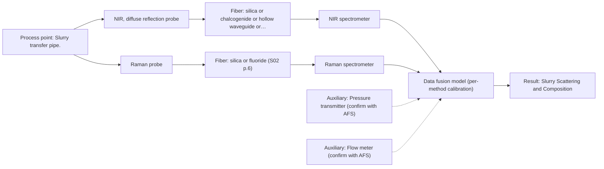

# First technical assessment: Pressure, flow and blockage of a slurry pipe

## Answer

**Customer request (our summary):** The customer is asking if fiber optic products can measure line pressure, flow rate, and provide an early warning for blockage in a slurry transfer pipe.

### Brief answer

Fiber-optic spectroscopy can monitor slurry scattering and composition to provide early warning of pipe blockage, but line pressure and flow rate require auxiliary mechanical sensors. We recommend testing NIR diffuse reflection combined with pressure and flow transmitters. Further details on slurry optical properties and required warning times are needed to finalize the setup.

### Proposal

- **Best current option:** O2 (recommended)
- **Basis:** engineering judgement, with secondary external support E03 ¶20 (not AFS material)
- **What would change it:** Customer confirmation that pressure and flow monitoring are not needed, or that optical scattering alone is insufficient for blockage detection.
- **Next step:** Review auxiliary sensor integration requirements and conduct laboratory trials on representative slurry samples.

**Secondary evidence (external, not AFS material):** G1: no usable external source found; G2: no usable external source found; G3: no usable external source found; G4: E03 ¶20. See Expert detail.

**Decision status:** Insufficient information for a method choice

### Solution options

| ID | Tier | Methods | Confidence | Cost class, S01 Table 1 (p.6) | Ease of use | Maintenance | Performance fit | Sources |
|---|---|---|---|---|---|---|---|---|
| O1 | Simple | M1 NIR, diffuse reflection probe | Low: open question: Q1, Q3 (starts at Medium); sample clarity unknown; precedent only; a customer premise is contradicted, status: insufficient information | average cost (row 8) | Easy inline probe operation | Periodic window cleaning | Tracks slurry scattering and composition changes for blockage warning. | [1: S01 p.17] |
| O2 | Recommended | M1 NIR, diffuse reflection probe; M2 Raman probe | Low: open question: Q1, Q3 (starts at Medium); sample clarity unknown; uncited auxiliary sensor; a customer premise is contradicted, status: insufficient information; multi-method, fusion benefit not yet shown | high cost (rows 8, 12) | Moderate integration complexity | Multi-sensor upkeep | Combines auxiliary pressure/flow sensors with optical spectroscopy for complete target coverage. | [1: S01 p.17] [2: S01 p.16] |

*Confidence rates the basis of the advice (how much is known and cited), not a predicted accuracy or probability of success. It starts at High, or at Medium when a key question on the method or the option is open, and drops one level per weakness listed (floor Low).*

*Cost class is the relative rating in S01 Table 1 (p.6) for the in-line method+technique rows named (the highest one for a multi-method option); it is not a price.*

### Setup sketch

*Recommended option O2; drawn by code from the option, a schematic, not a configuration.*

### Key questions

1. Are you willing to combine auxiliary mechanical sensors (pressure transmitters and flow meters) with fiber-optic spectroscopic sensors to cover all stated targets?
2. What is the optical nature and turbidity of the slurry (e.g., highly scattering, opaque, or translucent)?
3. What specific physical or compositional changes occur in the slurry when the pipe begins to block?

## Expert detail

**Customer enquiry**

> We need to know the line pressure and the flow rate of a slurry in our transfer pipe, and we want an early warning when the pipe starts to block. Could your fiber optic products help with this?

**Decision status:** Insufficient information for a method choice. The customer's request includes measuring line pressure and flow rate, which are mechanical parameters that cannot be measured directly by optical spectroscopy and require auxiliary sensors, while optical spectroscopy can address pipe blockage via scattering and composition monitoring.

### Parameters

| ID | Parameter | Kind | Need | Measured by | Why | Sources |
|---|---|---|---|---|---|---|
| P1 | Line Pressure | quantitative | required | Auxiliary sensor: Pressure transmitter (engineering judgement: confirm availability with AFS) | Stated core target of the customer enquiry. | *(no verified source: engineering judgement)* |
| P2 | Flow Rate | quantitative | required | Auxiliary sensor: Flow meter (engineering judgement: confirm availability with AFS) | Stated core target of the customer enquiry. | *(no verified source: engineering judgement)* |
| P3 | Slurry Scattering and Composition | qualitative | required | Spectroscopy: NIR | Used to detect early stages of pipe blockage via optical scattering and compositional variations. | [3: S01 p.17] |

### Solution option details

- **O1 cost drivers:** Single NIR spectrometer and diffuse reflection probe
- **O2 cost drivers:** Spectrometer, optical probe, and auxiliary pressure/flow transmitters
- **O2 combining methods:** Combines auxiliary sensor data streams with NIR spectral features via software integration for simultaneous pressure, flow, and blockage monitoring.

### Premise check

- **Contradicted:** Fiber optic products can measure line pressure and flow rate directly. Optical spectroscopy measures chemical composition and optical properties, whereas line pressure and flow rate are mechanical fluid dynamics parameters requiring dedicated pressure transmitters and flow meters. [4: S01 p.2]

### Requirements

**Stated by the customer**

- line pressure
- flow rate
- pipe blockage early warning

**Key unknowns**

- Slurry optical transmission and turbidity regime
- Required response time and lead time for blockage warning
- Process temperature and pressure operating ranges
- Willingness to integrate auxiliary pressure and flow sensors

### Clarification questions (most decision-relevant first)

Q1. Are you willing to combine auxiliary mechanical sensors (pressure transmitters and flow meters) with fiber-optic spectroscopic sensors to cover all stated targets? *Why it matters:* Spectroscopy cannot measure pressure or flow directly, so a hybrid installation is required to meet all customer requirements. *(affects: installation, method)*
Q2. What is the optical nature and turbidity of the slurry (e.g., highly scattering, opaque, or translucent)? *Why it matters:* Determines the optimal optical probe geometry (diffuse reflection versus transmission). *(affects: technique)*
Q3. What specific physical or compositional changes occur in the slurry when the pipe begins to block? *Why it matters:* Guides the selection of spectroscopic features and chemometric modeling for early blockage detection. *(affects: method)*

### Recommendation

- **M1 · Primary candidate: NIR, diffuse reflection probe.** NIR diffuse reflection is well-suited for opaque scattering media like slurries and can monitor changes in scattering and composition that signal incipient blockage. [1: S01 p.17]
- **M2 · Comparison candidate: Raman probe.** Raman spectroscopy provides molecular specificity in aqueous environments with minimal water interference. *Conditions:* Applies if chemical fingerprinting of slurry components is needed alongside scattering analysis. [2: S01 p.16]

### Measurement concept

- **Probe and geometry:** NIR diffuse reflection fiber optic probe flush-mounted into the transfer pipe wall.
- **Location:** Slurry transfer pipe.
- **Fiber link:** Low-OH silica fiber optic cable connecting the probe to the spectrometer located safely away from process vibration. [5: S01 p.17] [6: S01 p.15]

### Spectral range

- **NIR:** Nominal range 780-2500 nm; usable range depends on the instrument, fiber, and probe actually selected. [7: S01 p.10]

### Risks and uncertainty

- Optical spectroscopy cannot directly measure mechanical line pressure or flow rate. *(rules: R-GEN-1)* [8: S01 p.2]
- Slurry opacity and high scattering may saturate standard optical signals if probe geometry is incorrect. *(rules: R-GEO-3, R-GEO-6)* [1: S01 p.17]

### First feasibility experiment

1. **Collect representative slurry samples across normal flow and incipient blockage states.** Capture chemical and physical variation of the process. *(no verified source: engineering judgement)*
2. **Perform benchtop spectroscopic measurements using fiber probes.** Identify information-rich spectral regions for scattering and composition. *(no verified source: engineering judgement)*
3. **Gather independent reference measurements for slurry properties and flow/pressure conditions.** Provide ground truth for calibration. *(no verified source: engineering judgement)*
4. **Develop and validate multivariate calibration models to detect scattering anomalies predicting blockage.** Establish predictive capability for early warning. *(no verified source: engineering judgement)*

**Reference measurements:** Standard laboratory analysis of slurry composition, density, and independent pressure/flow meter readings.

**Decision basis:** Go/no-go based on customer-defined false alarm rates and early warning lead time for pipe blockage.

### Assumptions

- The customer is open to combining optical sensors with standard mechanical pressure and flow transmitters.
- Slurry scattering and composition change detectably prior to complete pipe blockage.

### Not covered by the supplied sources

- Specific slurry composition and rheological properties for this application.

### Further notes

- **Chemometrics:** Multivariate calibration (such as PLS) is required to relate spectral scattering and absorption changes to slurry state and blockage warning.
- **Real-time tracking:** High-speed spectral acquisition enables near real-time tracking of slurry dynamics in the transfer pipe.
- **Future direction:** Integration into an automated process control system to trigger corrective action upon early blockage warning.

### Secondary evidence (external, not AFS material)

*Found by a literature search for gaps the supplied AFS sources leave open. Not AFS material and not proof for this case; every quote below was verified verbatim against the fetched text.*

*Live search unavailable (library only: cache miss (europepmc); cache miss (openalex)); curated library only.*

**G1 · decision status:** insufficient information: The customer's request includes measuring line pressure and flow rate, which are mechanical parameters that cannot be measured directly by optical spectroscopy and require auxiliary sensors, while optical spectroscopy can address pipe blockage via scattering and composition monitoring.

- No usable external source found.

**G2 · auxiliary sensor:** In-line measurement of Line Pressure with Pressure transmitter

- No usable external source found.

**G3 · auxiliary sensor:** In-line measurement of Flow Rate with Flow meter

- No usable external source found.

**G4 · not in the supplied sources:** Specific slurry composition and rheological properties for this application.

- **E03 ¶20** Raman spectroscopy is frequently applied in upstream processing due to its high selectivity and low water interference despite the relatively long measurement times. *How it applies:* This suggests that Raman probes could be considered when evaluating slurry composition monitoring where water interference might be a concern, though measurement times must be tested. *Limits and transfer risks:* The cited work relates to biopharmaceutical upstream processing rather than slurry transfer pipes, so the matrix and process conditions differ significantly. *(supports O2)*
  > "Raman spectroscopy is frequently applied in upstream processing in research and industry due to its high selectivity and low water interference [55] despite the relatively long measurement times."
  > A critical review of recent trends, and a future perspective of optical spectroscopy as PAT in biopharmaceutical downstream processing. (2020) · Analytical and bioanalytical chemistry · doi:10.1007/s00216-020-02407-z · https://europepmc.org/article/PMC/PMC7072065 · retrieved 2026-10-17, full text, licence: cc by, via curated library

### Evidence (verified quotes)

1. ✓ **S01 p.17** (application precedent): "NIR Reflection is primarily used for opaque or highly concentrated dairy products, such as yogurt, butter, or whole milk concentrates."
2. ✓ **S01 p.16** (general): "Raman is particularly well-suited for aqueous environments, as it exhibits low absorbance for water molecules compared to infrared methods."
3. ✓ **S01 p.17** (general): "the method is sensitive to the surface characteristics and fat globule size."
4. ✓ **S01 p.2** (general): "Optical spectral analysis occupies a special place among physicochemical methods for studying substances and materials. It is based on measuring the result of the interaction of electromagnetic radiation with a sample over a wide range of wavelengths"
5. ✓ **S01 p.17** (general): "the probe is flush-mounted into a pipe or vat to interact directly with the flowing medium."
6. ✓ **S01 p.15** (general): "The use of fiber optics is critical here, as it allows the sensitive spectrometers to be located safely away from the vibration and dust of the manufacturing floor."
7. ✓ **S01 p.10** (general): "NIR spectra (780-2500 nm) contain predominantly overtones and component bands of fundamental vibrations"
8. ✓ **S01 p.2** (general): "Optical spectral analysis occupies a special place among physicochemical methods for studying substances and materials."

### Verification

- Citations verified: 9 of 9 (exact or whitespace/hyphen-tolerant match on the cited page, scope checked).
- Hard check failures before deterministic corrections: 0; still open: 0; soft warnings: 1; repair rounds: 0.
- External evidence (cache): 1 quote(s) verified verbatim (exact or whitespace/hyphen-tolerant, at most 400 characters and 2 sentences, against the cited paragraph); 0 item(s) dropped.
- External search: 3 query(ies), 0 hit(s), 3 source(s) (3 from the curated library); ⚠ library only: cache miss (europepmc); cache miss (openalex).
- External step: 2 model call(s), 3.1 s extra (cost in the run JSON).

*Run A05-20261018T072422Z-5be7 · models google/gemini-3.5-flash-lite*
