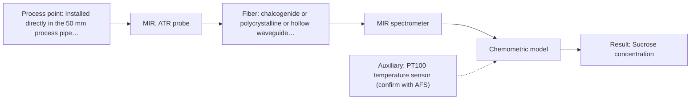

# First technical assessment: Complete enquiry for sugar concentration in a clear solution

## Answer

**Customer request (our summary):** The customer wants to monitor the concentration of a clear aqueous sucrose solution in-line using a remote analyzer connected via fiber or optics.

### Brief answer

We recommend testing NIR transmission or transflection spectroscopy as the primary method to monitor the aqueous sucrose concentration in-line, connected via a 10 m fiber link to a remote analyzer. MIR ATR serves as a strong comparison option. Material compatibility with daily hot caustic cleaning should be verified before final installation.

### Proposal

- **Best current option:** O1 (simple)
- **Basis:** supplied AFS sources
- **What would change it:** If optical interference or severe absorption requires fundamental fingerprint region analysis, a transition to MIR ATR would be considered.
- **Next step:** Conduct feasibility trials using representative sucrose solutions and a 10 m fiber-coupled NIR setup.

**Secondary evidence (external, not AFS material):** G1: no usable external source found; G2: no usable external source found; G3: E03 ¶12. See Expert detail.

**Decision status:** Provisional feasibility assessment

### Solution options

| ID | Tier | Methods | Confidence | Cost class, S01 Table 1 (p.6) | Ease of use | Maintenance | Performance fit | Sources |
|---|---|---|---|---|---|---|---|---|
| O1 | Simple | M1 NIR, transmission/transflection probe | Medium: uncited auxiliary sensor | average cost (row 7) | Standard fiber-coupled spectrometer operation | Periodic optical window cleaning and calibration check | Directly monitors sucrose concentration via NIR transmission | [1: S01 p.18] |
| O2 | Recommended | M2 MIR, ATR probe | Medium: uncited auxiliary sensor | high cost (row 2) | Benchtop spectrometer setup with ATR probe | Regular crystal cleaning and independent calibration | Provides high molecular specificity via MIR ATR absorption bands | [2: S01 p.10] [3: S01 p.10] |

*Confidence rates the basis of the advice (how much is known and cited), not a predicted accuracy or probability of success. It starts at High, or at Medium when a key question on the method or the option is open, and drops one level per weakness listed (floor Low).*

*Cost class is the relative rating in S01 Table 1 (p.6) for the in-line method+technique rows named (the highest one for a multi-method option); it is not a price.*

### Setup sketch

*Recommended option O2; drawn by code from the option, a schematic, not a configuration.*

### Key questions

1. What specific elastomer or window sealing materials (e.g., PEEK, sapphire, FFKM) are compatible with your daily hot caustic cleaning protocol?
2. What exact process flange or pipe connection standard is available on the 50 mm stainless steel line?

## Expert detail

**Customer enquiry**

> We produce a clear, colourless aqueous sucrose solution and want to monitor its sucrose concentration in-line. The solution flows through a 50 mm stainless steel pipe at 20 to 30 °C and normal pressure; the expected range is 5 to 15 % w/w and our quality limit is plus or minus 0.3 % w/w. Our laboratory refractometer is the reference method and stays in use. The analyser can stand in a dry, safe room 10 m from the pipe, and the line is cleaned in place with hot caustic once a day. A reading every minute is enough. Please propose a method and probe for a first trial.

**Decision status:** Provisional feasibility assessment. The customer provided clear process and fluid parameters for an aqueous sucrose solution, allowing a justified technical shortlist of optical methods and probes despite minor open questions on CIP material compatibility.

### Parameters

| ID | Parameter | Kind | Need | Measured by | Why | Sources |
|---|---|---|---|---|---|---|
| P1 | Sucrose concentration | quantitative | required | Spectroscopy: NIR | It is the core target variable requested by the customer. | *(no verified source: engineering judgement)* |
| P2 | Solution temperature | quantitative | required | Auxiliary sensor: PT100 temperature sensor (engineering judgement: confirm availability with AFS) | Process temperature variations affect optical properties and require compensation. | *(no verified source: engineering judgement)* |

### Solution option details

- **O1 cost drivers:** Single NIR spectrometer and optical transflection probe
- **O2 cost drivers:** Mid-IR spectrometer and specialized ATR probe

### Premise check

- **Supported:** A 10 m remote analyzer connection via fiber optics is feasible for industrial process control. Robust low-OH silica cables are established for remote industrial process control over 100-300 m distances. [4: S02 p.7]

### Requirements

**Stated by the customer**

- Monitor clear, colourless aqueous sucrose solution concentration in-line (5 to 15 % w/w range, plus or minus 0.3 % w/w quality limit).
- Process conditions: 50 mm stainless steel pipe, 20 to 30 °C, normal pressure.
- Analyzer location: dry, safe room 10 m from the pipe.
- Cleaning: cleaned in place (CIP) with hot caustic once a day.
- Sampling rate: one reading every minute is sufficient.
- Reference method: laboratory refractometer.

**Key unknowns**

- Optical window and seal material compatibility with daily hot caustic CIP
- Specific mechanical flange standard or mounting port on the 50 mm pipe

### Clarification questions (most decision-relevant first)

Q1. What specific elastomer or window sealing materials (e.g., PEEK, sapphire, FFKM) are compatible with your daily hot caustic cleaning protocol? *Why it matters:* CIP chemical compatibility affects probe lifetime and prevents seal degradation. *(affects: installation, technique)*
Q2. What exact process flange or pipe connection standard is available on the 50 mm stainless steel line? *Why it matters:* Determines the mechanical mounting interface for the inline probe. *(affects: installation)*

### Recommendation

- **M1 · Primary candidate: NIR, transmission/transflection probe.** NIR transmission or transflection probes are ideal for online analysis of liquid streams, offering robust fiber-optic remote coupling and penetration across clear aqueous media. *Conditions:* Pathlength must be optimized to prevent signal saturation or loss. [1: S01 p.18]
- **M2 · Comparison candidate: MIR, ATR probe.** Mid-IR ATR spectroscopy provides high molecular specificity and well-defined absorption bands for aqueous solutions. *Conditions:* Requires fiber compatibility with mid-IR ranges (e.g., PIR fibers) and strict control over fouling on the ATR crystal. [3: S01 p.10]

### Measurement concept

- **Probe and geometry:** Insertion NIR transflection probe mounted flush or via a suitable port into the 50 mm pipe, directing light across a controlled optical gap.
- **Location:** Installed directly in the 50 mm process pipe operating at 20 to 30 °C.
- **Fiber link:** A 10 m low-OH silica fiber optic cable connecting the probe in the process line to the remote analyzer located in a dry, safe room. [4: S02 p.7]

### Spectral range

- **NIR:** Nominal range 780-2500 nm; usable range depends on the selected spectrometer, fiber bundle, and probe configuration. [5: S01 p.10]

### Risks and uncertainty

- Fouling or optical window degradation during daily hot caustic cleaning-in-place. *(rules: R-MIR-3)* [2: S01 p.10]
- Process temperature fluctuations shifting spectral baselines if uncompensated in chemometric models. *(rules: R-NIR-2)* [6: S01 p.10]

### First feasibility experiment

1. **Collect representative aqueous sucrose solution samples spanning the expected concentration range.** Gather calibration samples across process variation. *(no verified source: engineering judgement)*
2. **Conduct laboratory spectral measurements using NIR and MIR optical setups.** Evaluate optical response and signal quality. *(no verified source: engineering judgement)*
3. **Acquire independent reference measurements using the customer laboratory refractometer.** Establish ground truth for chemometric modeling. *(no verified source: engineering judgement)*
4. **Develop and cross-validate initial calibration models relating spectra to sucrose concentration.** Assess prediction accuracy against quality targets. *(no verified source: engineering judgement)*

**Reference measurements:** Laboratory refractometer measurements provided by the customer.

**Decision basis:** Go/no-go is determined by achieving a prediction error within the customer quality limit of plus or minus 0.3 % w/w on validation samples.

### Assumptions

- The 50 mm pipe allows insertion of a standard industrial process immersion probe.
- Hot caustic cleaning conditions are compatible with standard optical window and seal materials.

### Not covered by the supplied sources

- Exact chemical concentration limits and degradation kinetics during hot caustic cleaning.

### Further notes

- **Chemometrics:** Partial least-squares (PLS) regression models must be built using calibration sets covering the 5 to 15 % w/w range, incorporating temperature variation and scatter correction preprocessing.
- **Real-time tracking:** A 1-minute reading interval is well within the acquisition speed of modern fiber-optic spectrometers.
- **Future direction:** Integration of automated temperature compensation and cloud-based IoT sensor monitoring.

### Secondary evidence (external, not AFS material)

*Found by a literature search for gaps the supplied AFS sources leave open. Not AFS material and not proof for this case; every quote below was verified verbatim against the fetched text.*

*Live search unavailable (library only: cache miss (europepmc); cache miss (openalex)); curated library only.*

**G1 · auxiliary sensor:** In-line measurement of Solution temperature with PT100 temperature sensor

- No usable external source found.

**G2 · not in the supplied sources:** Exact chemical concentration limits and degradation kinetics during hot caustic cleaning.

- No usable external source found.

**G3 · parameter without a source:** Measuring Sucrose concentration: It is the core target variable requested by the customer.

- **E03 ¶12** The text notes that temperature sensitivity of OH bands poses a severe drawback for measuring aqueous solutions in NIR and MIR, requiring tempered sample holders. *How it applies:* This suggests that temperature compensation or control should be tested when measuring aqueous sucrose concentration to mitigate OH band sensitivity. *Limits and transfer risks:* The cited text addresses general aqueous solutions in biopharmaceutical processing rather than sucrose specifically, so transfer to this exact system requires validation. *(supports O1)*
  > "Additionally, the temperature sensitivity of the OH bands is a severe drawback for measuring aqueous solution in NIR and MIR, which makes tempered sample holders necessary [29]."
  > A critical review of recent trends, and a future perspective of optical spectroscopy as PAT in biopharmaceutical downstream processing. (2020) · Analytical and bioanalytical chemistry · doi:10.1007/s00216-020-02407-z · https://europepmc.org/article/PMC/PMC7072065 · retrieved 2026-10-17, full text, licence: cc by, via curated library

### Evidence (verified quotes)

1. ✓ **S01 p.18** (general): "Transmission is the preferred method for transparent or semi-transparent liquids, such as skim milk, whey, or permeate."
2. ✓ **S01 p.10** (general): "ATR fiber probes (Fig.1) enable the analysis of liquids and solid elastic samples"
3. ✓ **S01 p.10** (general): "ATR fiber probes (Fig.1) enable the analysis of liquids and solid elastic samples, such as biological tissue, using specialized probes utilizing high-transmission fiber optics in the Mid-IR region."
4. ✓ **S02 p.7** (general): "Robust 100-300m cables made with Silica fibers of low OH-content (<0.1ppm OH) enable remote industrial process-control"
5. ✓ **S01 p.10** (general): "NIR spectra (780-2500 nm) contain predominantly overtones and component bands of fundamental vibrations"
6. ✓ **S01 p.10** (general): "The broad absorption bands observed in this region overlap, suggesting the use of chemometrics for quantitative and qualitative analysis of spectral data."

### Verification

- Citations verified: 9 of 9 (exact or whitespace/hyphen-tolerant match on the cited page, scope checked).
- Hard check failures before deterministic corrections: 0; still open: 0; soft warnings: 2; repair rounds: 1.
- External evidence (cache): 1 quote(s) verified verbatim (exact or whitespace/hyphen-tolerant, at most 400 characters and 2 sentences, against the cited paragraph); 0 item(s) dropped.
- External search: 3 query(ies), 0 hit(s), 3 source(s) (3 from the curated library); ⚠ library only: cache miss (europepmc); cache miss (openalex).
- External step: 2 model call(s), 2.3 s extra (cost in the run JSON).

*Run A07-20261018T072422Z-8184 · models google/gemini-3.5-flash-lite*
