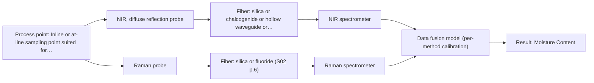

# First technical assessment: Accuracy guarantee, regulatory approval and price

## Answer

**Customer request:** Before we order, please confirm in writing that your NIR system will measure the moisture of our granulate to plus or minus 0.1 % and guarantee that our regulator will approve it for release testing. Please also include the price of the complete system.

### Brief answer

AFS does not provide performance assertions or regulatory approvals prior to testing. We recommend starting with NIR diffuse reflection laboratory trials on representative granulate samples to establish calibration accuracy against reference methods. Please contact us to discuss sample testing.

### Proposal

- **Best current option:** O2 (recommended)
- **Basis:** supplied AFS sources
- **What would change it:** Feasibility trials showing inadequate NIR calibration accuracy or high physical scattering interference.
- **Next step:** Conduct multi-method laboratory trials using representative granulate samples and independent reference measurements.

**Secondary evidence (external, not AFS material):** G1: no usable external source found; G2: E02 ¶31; G3: no usable external source found; G4: no usable external source found. See Expert detail.

**Decision status:** Insufficient information for a method choice

### Solution options

| ID | Tier | Methods | Confidence | Cost class, S01 Table 1 (p.6) | Ease of use | Maintenance | Performance fit | Sources |
|---|---|---|---|---|---|---|---|---|
| O1 | Simple | M2 Raman probe | Low: open question: Q1 (starts at Medium); a customer premise is contradicted, status: insufficient information | high cost (row 12) | Alternative benchtop Raman probe interface | Routine optical component checks | Alternative molecular backbone tracking | [1: S01 p.11] |
| O2 | Recommended | M1 NIR, diffuse reflection probe | Low: open question: Q1, Q2 (starts at Medium); a customer premise is contradicted, status: insufficient information | average cost (row 8) | Standard benchtop probe interface | Routine optical window cleaning | Optimal diffuse reflection moisture sensing | [2: S01 p.10] |
| O3 | Extended (multi-method) | M1 NIR, diffuse reflection probe; M2 Raman probe | Low: open question: Q1, Q2 (starts at Medium); a customer premise is contradicted, status: insufficient information; multi-method, fusion benefit not yet shown | high cost (rows 8, 12) | Dual-instrument fiber setup | Independent per-block calibration | Multispectral fusion for complex matrices | [3: S01 p.8] [2: S01 p.10] [1: S01 p.11] |

*Confidence rates the basis of the advice (how much is known and cited), not a predicted accuracy or probability of success. It starts at High, or at Medium when a key question on the method or the option is open, and drops one level per weakness listed (floor Low).*

*Cost class is the relative rating in S01 Table 1 (p.6) for the in-line method+technique rows named (the highest one for a multi-method option); it is not a price.*

### Setup sketch

*Recommended option O2; drawn by code from the option, a schematic, not a configuration.*

### Key questions

1. What reference laboratory method will be used to generate calibration and validation reference values for moisture?
2. What is the expected particle size range and physical bulk density of the granulate?
3. What are the exact temperature and installation interface requirements at the measurement point?

## Expert detail

**Customer enquiry**

> Before we order, please confirm in writing that your NIR system will measure the moisture of our granulate to plus or minus 0.1 % and guarantee that our regulator will approve it for release testing. Please also include the price of the complete system.

**Decision status:** Insufficient information for a method choice. The customer requests binding commitments of measurement accuracy and regulatory approval along with system pricing, which require experimental calibration and site-specific validation trials on representative samples before any performance claims can be established.

### Parameters

| ID | Parameter | Kind | Need | Measured by | Why | Sources |
|---|---|---|---|---|---|---|
| P1 | Moisture Content | quantitative | required | Spectroscopy: NIR | Primary quality attribute required for release testing. | [2: S01 p.10] |

### Solution option details

- **O1 cost drivers:** Raman spectrometer and laser probe hardware
- **O2 cost drivers:** Standard NIR spectrometer and reflection probe hardware
- **O3 cost drivers:** Multiple spectrometers and combined probe hardware
- **O3 combining methods:** Combine NIR and Raman spectra using low-level data fusion with block autoscaling, ensuring data is collected from the same spot and synchronized to a common time step, validated against independent test runs to prove it beats single-method models.

*Extended (multi-method) option O3; drawn by code from the option, a schematic, not a configuration.*

### Premise check

- **Contradicted:** An NIR system can assure an accuracy of plus or minus 0.1% for moisture in granulate without calibration trials. Analytical performance depends on calibration, sample matrix, and measurement configuration; suppliers cannot state specific accuracy figures without experimental feasibility trials. [4: REF §5]
- **Contradicted:** Suppliers can provide formal assurances that a regulator will approve the system for release testing. Regulatory validation and approval are the responsibility of the end-user based on site-specific validation studies, not something suppliers can assure. [5: REF §3]

### Requirements

**Stated by the customer**

- NIR system for moisture measurement
- Granulate sample type
- Requested accuracy of plus or minus 0.1%
- Application for release testing
- System pricing request

**Key unknowns**

- Granulate particle size distribution and optical scattering properties
- Reference laboratory method used for moisture determination
- Exact temperature and physical process environment
- Specific regulatory validation protocols required

### Clarification questions (most decision-relevant first)

Q1. What reference laboratory method will be used to generate calibration and validation reference values for moisture? *Why it matters:* Spectroscopic calibrations depend entirely on the accuracy and consistency of the reference laboratory method. *(affects: method, status)*
Q2. What is the expected particle size range and physical bulk density of the granulate? *Why it matters:* Physical variations and scattering properties directly affect diffuse reflection measurement repeatability. *(affects: technique, M1)*
Q3. What are the exact temperature and installation interface requirements at the measurement point? *Why it matters:* Determines probe mechanical design and optical window selection for continuous operation. *(affects: installation)*

### Recommendation

- **M1 · Primary candidate: NIR, diffuse reflection probe.** NIR diffuse reflection is the standard approach for measuring moisture and chemical composition in powders and granular solids. [2: S01 p.10]
- **M2 · Comparison candidate: Raman probe.** Raman spectroscopy provides complementary molecular backbone information if NIR calibration encounters matrix interferences. *Conditions:* Applies if initial NIR multivariate calibration shows insufficient specificity. [1: S01 p.11]

### Measurement concept

- **Probe and geometry:** NIR diffuse reflection probe with sapphire window for powder contact measurement.
- **Location:** Inline or at-line sampling point suited for granular flow.
- **Fiber link:** Vis-NIR silica fiber cable connecting the spectrometer to the remote probe. [6: S01 p.10]

### Spectral range

- **NIR:** Nominal NIR range is 780-2500 nm, though the usable range depends on the instrument, fiber, and probe configuration. [6: S01 p.10]

### Risks and uncertainty

- Physical variations such as particle size changes can mimic chemical concentration shifts in diffuse reflection. *(rules: R-GEO-6)* [7: S01 p.17]
- Calibration models are matrix-specific and require re-validation when granulate composition changes. *(rules: R-CAL-1)* [8: REF §5]

### First feasibility experiment

1. **Collect representative granulate samples across the expected moisture variation range.** Ensure calibration spans the anticipated operational domain. *(no verified source: engineering judgement)*
2. **Perform independent reference laboratory measurements for moisture on all samples.** Provide accurate ground-truth data for chemometric model training. *(no verified source: engineering judgement)*
3. **Acquire NIR diffuse reflection spectra using a fiber-coupled spectrometer setup.** Capture raw spectral data corresponding to moisture variations. *(no verified source: engineering judgement)*
4. **Develop and cross-validate a partial least squares (PLS) regression calibration model.** Establish the predictive relationship between spectra and moisture content. *(no verified source: engineering judgement)*
5. **Validate the model on independent held-out sample batches.** Test prediction accuracy against customer-defined numerical criteria. *(no verified source: engineering judgement)*

**Reference measurements:** Standard laboratory reference method for moisture analysis.

**Decision basis:** Go/no-go decision based on whether validation prediction error meets the customer's specified numerical accuracy threshold.

### Assumptions

- The granulate sample is sufficiently homogeneous for diffuse reflection measurements.
- Reference laboratory measurements are available and accurate.

### Not covered by the supplied sources

- System pricing information
- Specific regulatory approval commitments for release testing

### Further notes

- **Chemometrics:** Quantitative moisture prediction requires partial least squares (PLS) regression models built on diffuse reflection spectra with appropriate scatter correction preprocessing.
- **Real-time tracking:** Continuous online tracking of moisture is feasible using high-speed NIR spectral acquisition.
- **Future direction:** Integration of cloud-based IoT sensor architectures for automated remote process control.

### Secondary evidence (external, not AFS material)

*Found by a literature search for gaps the supplied AFS sources leave open. Not AFS material and not proof for this case; every quote below was verified verbatim against the fetched text.*

*Live search unavailable (library only: cache miss (europepmc); cache miss (openalex)); curated library only.*

**G1 · decision status:** insufficient information: The customer requests binding commitments of measurement accuracy and regulatory approval along with system pricing, which require experimental calibration and site-specific validation trials on representative samples before any performance claims can be established.

- No usable external source found.

**G2 · multi-method:** Combining several spectroscopy methods (data fusion) (Combine NIR and Raman spectra using low-level data fusion with block autoscaling, ensuring data is collected from the same spot and synchronized to a common time step, validated against independent test runs to prove it beats single-method models.)

- **E02 ¶31** Low-level data fusion rearranges data into a new matrix where variables from different sources are placed sequentially. *How it applies:* This approach could inform how to structure combined spectral inputs for testing, though its benefit depends on whether the individual datasets provide genuine complementarity. *Limits and transfer risks:* The reviewed fusion concepts come from general literature and food analysis studies rather than the specific customer granulate matrix or instrument setup, so transfer success remains unproven. *(supports O3)*
  > "Low-level data fusion (LLDF) is considered the simplest method to achieve a combination of inputs. In this case, the data is rearranged into a new data matrix, where the variables coming from different sources are placed one after the other."
  > Challenges and Opportunities of Implementing Data Fusion in Process Analytical Technology-A Review. (2022) · Molecules (Basel, Switzerland) · doi:10.3390/molecules27154846 · https://europepmc.org/article/PMC/PMC9369811 · retrieved 2026-10-17, full text, licence: cc by, via curated library

**G3 · not in the supplied sources:** System pricing information

- No usable external source found.

**G4 · not in the supplied sources:** Specific regulatory approval commitments for release testing

- No usable external source found.

### Evidence (verified quotes)

1. ✓ **S01 p.11** (general): "This property makes mid-IR and Raman spectra complementary, that is, they complement each other."
2. ✓ **S01 p.10** (general): "Near-IR vibrational spectroscopy (NIR) is the most common online analysis method performed using fiber optic probes."
3. ✓ **S01 p.8** (general): "It is crucial that the spectral information obtained by different methods-Mid-IR, NIR, Raman, and fluorescence spectra-is collected from the same small, even pinpoint, area of the sample."
4. ✓ **REF §5** (general): "It is not a product specification: actual spectral coverage, fiber length, component ratings, detection limits and accuracy depend on the configuration and the sample."
5. ✓ **REF §3** (general): "a published application is a reason to test a method, not proof that it will work for a new customer."
6. ✓ **S01 p.10** (general): "NIR spectra (780-2500 nm) contain predominantly overtones and component bands of fundamental vibrations"
7. ✓ **S01 p.17** (general): "the method is sensitive to the surface characteristics and fat globule size."
8. ✓ **REF §5** (general): "Weak signal, fluorescence background; calibration specific to the matrix."

### Verification

- Citations verified: 12 of 12 (exact or whitespace/hyphen-tolerant match on the cited page, scope checked).
- Hard check failures before deterministic corrections: 0; still open: 0; soft warnings: 1; repair rounds: 2.
- External evidence (cache): 1 quote(s) verified verbatim (exact or whitespace/hyphen-tolerant, at most 400 characters and 2 sentences, against the cited paragraph); 0 item(s) dropped.
- External search: 2 query(ies), 0 hit(s), 3 source(s) (3 from the curated library); ⚠ library only: cache miss (europepmc); cache miss (openalex).
- External step: 2 model call(s), 2.3 s extra (cost in the run JSON).

*Run A08-20261018T072422Z-b9dd · models google/gemini-3.5-flash-lite*
