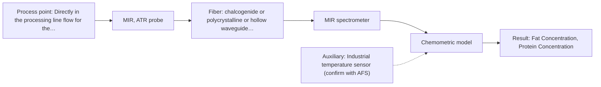

# First technical assessment: Fat and protein monitoring in opaque dairy product

## Answer

**Customer request (our summary):** The customer wants an in-line spectroscopy concept for monitoring fat and protein in an opaque, concentrated milk product with varying temperature and texture.

### Brief answer

For your opaque, concentrated milk product, we recommend starting feasibility trials with NIR diffuse reflection, which is established for concentrated dairy products like whole milk concentrates. MIR ATR can be tested as a comparison option. A practical experiment with representative samples and scatter correction is necessary to handle temperature and texture variations.

### Proposal

- **Best current option:** O1 (simple)
- **Basis:** supplied AFS sources
- **What would change it:** If NIR scattering models fail due to extreme textural changes, switch to MIR ATR comparison.
- **Next step:** Conduct multi-method lab trials using representative samples across the expected temperature and texture range.

**Secondary evidence (external, not AFS material):** G1: E01 ¶4; G2: no usable external source found; G3: no usable external source found. See Expert detail.

**Decision status:** Provisional feasibility assessment

### Solution options

| ID | Tier | Methods | Confidence | Cost class, S01 Table 1 (p.6) | Ease of use | Maintenance | Performance fit | Sources |
|---|---|---|---|---|---|---|---|---|
| O1 | Simple | M1 NIR, diffuse reflection probe | Low: open question: Q2 (starts at Medium); precedent only | average cost (row 8) | Flush-mounted NIR reflection probe | Regular window cleaning | Directly suited for concentrated dairy scattering | [1: S01 p.17] |
| O2 | Recommended | M2 MIR, ATR probe | Low: open question: Q2 (starts at Medium); uncited auxiliary sensor | high cost (row 2) | ATR probe installation | Crystal cleaning against fouling | High chemical specificity via fingerprint region | [2: S01 p.6] |

*Confidence rates the basis of the advice (how much is known and cited), not a predicted accuracy or probability of success. It starts at High, or at Medium when a key question on the method or the option is open, and drops one level per weakness listed (floor Low).*

*Cost class is the relative rating in S01 Table 1 (p.6) for the in-line method+technique rows named (the highest one for a multi-method option); it is not a price.*

### Setup sketch

*Recommended option O2; drawn by code from the option, a schematic, not a configuration.*

### Key questions

1. What are the exact flow rate, temperature range, and pressure conditions in the processing line?
2. What target accuracy and precision are required for fat and protein quantification?
3. What is the standard laboratory reference method used for current fat and protein sample analyses?

## Expert detail

**Customer enquiry**

> We produce an opaque, concentrated milk product that flows through a processing line. We currently sample it for fat and protein analysis and would like earlier information about composition changes. Product temperature and texture vary during production. We want an initial spectroscopy concept and a practical comparison experiment, while retaining our laboratory checks.

**Decision status:** Provisional feasibility assessment. Sufficient source evidence supports NIR diffuse reflection and MIR ATR for in-line measurement of concentrated dairy products, allowing a provisional shortlist to be tested.

### Parameters

| ID | Parameter | Kind | Need | Measured by | Why | Sources |
|---|---|---|---|---|---|---|
| P1 | Fat Concentration | quantitative | required | Spectroscopy: NIR | Core target component requested for in-line monitoring. | [3: S01 p.17] |
| P2 | Protein Concentration | quantitative | required | Spectroscopy: NIR | Core target component requested for in-line monitoring. | [3: S01 p.17] |
| P3 | Product Temperature | quantitative | required | Auxiliary sensor: Industrial temperature sensor (engineering judgement: confirm availability with AFS) | Temperature varies during production and affects spectral response. | *(no verified source: engineering judgement)* |

### Solution option details

- **O1 cost drivers:** Single NIR spectrometer and reflection probe
- **O2 cost drivers:** MIR FTIR spectrometer and ATR probe

### Premise check

- **Supported:** An initial spectroscopy concept and a practical comparison experiment will fulfill measurement needs for an opaque, concentrated milk product while retaining lab checks. Sources confirm that NIR reflection and ATR methods are well-suited for concentrated dairy products and comparative trials. [1: S01 p.17]

### Requirements

**Stated by the customer**

- Opaque, concentrated milk product flowing through a processing line
- Fat and protein analysis
- Product temperature and texture vary during production
- Initial spectroscopy concept and practical comparison experiment while retaining lab checks

**Key unknowns**

- Exact pipe dimensions and optical path constraints
- Required accuracy and detection limits for fat and protein
- Details of the laboratory reference method

### Clarification questions (most decision-relevant first)

Q1. What are the exact flow rate, temperature range, and pressure conditions in the processing line? *Why it matters:* Process conditions determine probe mechanical and thermal compatibility. *(affects: installation)*
Q2. What target accuracy and precision are required for fat and protein quantification? *Why it matters:* Required precision dictates whether single-method calibration or multi-method fusion is necessary. *(affects: method)*
Q3. What is the standard laboratory reference method used for current fat and protein sample analyses? *Why it matters:* Reference method accuracy directly limits chemometric calibration performance. *(affects: status)*

### Recommendation

- **M1 · Primary candidate: NIR, diffuse reflection probe.** NIR diffuse reflection is established for opaque and concentrated dairy products like whole milk concentrates and butter. [1: S01 p.17]
- **M2 · Comparison candidate: MIR, ATR probe.** MIR ATR provides high molecular specificity for functional groups via the fingerprint region, serving as a robust single-method comparison. *Conditions:* Requires flush-mounting and cleanable ATR crystal interface to handle varying texture and fouling. [2: S01 p.6]

### Measurement concept

- **Probe and geometry:** NIR diffuse reflection fiber probe flush-mounted into the processing line wall or pipe.
- **Location:** Directly in the processing line flow for the opaque, concentrated milk product.
- **Fiber link:** Robust Vis-NIR silica fiber cable connecting the probe to the spectrometer safely away from process vibration. [1: S01 p.17]

### Spectral range

- **NIR:** Nominal range 780-2500 nm; usable range depends on instrument, fiber, and probe selection. [4: S01 p.10]
- **MIR:** Nominal range 4000-400 cm-1; usable range depends on crystal and fiber configuration. [5: S01 p.9]

### Risks and uncertainty

- Physical variations in texture and fat globule size can alter scattering and mimic concentration changes in NIR reflection spectra. *(rules: R-GEO-6)* [6: S01 p.17]
- Temperature variations during production can shift spectral baselines and calibration models if not compensated. *(rules: R-CAL-1)* [7: REF §5]
- Fouling or coating on the probe tip can compromise optical contact and signal stability. *(rules: R-MIR-3)* [8: REF §5]

### First feasibility experiment

1. **Collect representative samples covering the full expected range of fat, protein, temperature, and texture variations.** Collect representative samples covering the full expected range of fat, protein, temperature, and texture variations. [9: REF §3]
2. **Perform independent laboratory reference measurements for fat and protein on all trial samples.** Perform independent laboratory reference measurements for fat and protein on all trial samples. [9: REF §3]
3. **Test single-method NIR diffuse reflection and MIR ATR probes against the sample set.** Test single-method NIR diffuse reflection and MIR ATR probes against the sample set. [9: REF §3]
4. **Build chemometric calibration models using scatter correction preprocessing to handle textural variability.** Build chemometric calibration models using scatter correction preprocessing to handle textural variability. [10: S01 p.17]

**Reference measurements:** Standard laboratory reference methods used by the customer for fat and protein quantification.

**Decision basis:** Go/no-go based on customer-defined accuracy and precision targets for fat and protein prediction.

### Assumptions

- The concentrated milk product is pumpable and can accommodate a flush-mounted fiber probe in the processing line.
- Laboratory reference values are available for model calibration.

### Not covered by the supplied sources

- Exact fat and protein concentration ranges of the customer's specific concentrated milk product.
- Specific pipe diameter and flow velocity.

### Further notes

- **Chemometrics:** Partial least squares (PLS) regression combined with scatter correction (such as SNV or MSC) is required to remove physical interference from variable texture and fat globule size.
- **Real-time tracking:** In-line probe installation provides real-time tracking of fat and protein changes directly in the processing line without sampling delays.
- **Future direction:** Potential integration of temperature compensation variables or multi-method fusion if texture variations cause severe spectral baseline shifts.

### Secondary evidence (external, not AFS material)

*Found by a literature search for gaps the supplied AFS sources leave open. Not AFS material and not proof for this case; every quote below was verified verbatim against the fetched text.*

*Live search unavailable (library only: cache miss (europepmc); cache miss (openalex)); curated library only.*

**G1 · auxiliary sensor:** In-line measurement of Product Temperature with Industrial temperature sensor

- **E01 ¶4** Attenuated total reflection probes allow in-line measurements in demanding environments, and optical fiber systems can be used to reduce thermal influences. *How it applies:* This supports considering ATR probes with fiber optics for challenging matrices, though thermal effects should still be tested. *Limits and transfer risks:* The cited study focuses on chlorosilanes and strong acids rather than concentrated milk products, meaning fouling and temperature responses may differ significantly. *(supports O2)*
  > "Attenuated total reflection probes (ATR) allow in-line measurements even in demanding measurement environments and reaction mixtures with highly oxidative and corrosive substances, such as chlorosilanes or strong acids and bases."
  > A Process Analytical Concept for In-Line FTIR Monitoring of Polysiloxane Formation. (2020) · Polymers · doi:10.3390/polym12112473 · https://europepmc.org/article/PMC/PMC7693933 · retrieved 2026-10-17, full text, licence: cc by, via curated library

**G2 · not in the supplied sources:** Exact fat and protein concentration ranges of the customer's specific concentrated milk product.

- No usable external source found.

**G3 · not in the supplied sources:** Specific pipe diameter and flow velocity.

- No usable external source found.

### Evidence (verified quotes)

1. ✓ **S01 p.17** (application precedent): "NIR Reflection is primarily used for opaque or highly concentrated dairy products, such as yogurt, butter, or whole milk concentrates."
2. ✓ **S01 p.6** (general): "ATR-platform absorption liquid,paste, soft 1-6 mu average high high"
3. ✓ **S01 p.17** (application precedent): "quantify fat and protein."
4. ✓ **S01 p.10** (general): "NIR spectra (780-2500 nm) contain predominantly overtones and component bands of fundamental vibrations"
5. ✓ **S01 p.9** (general): "Vibrational spectroscopy in the mid-IR range (4000-400 cm-1) is one of the most informative methods of chemical analysis."
6. ✓ **S01 p.17** (general): "the method is sensitive to the surface characteristics and fat globule size."
7. ✓ **REF §5** (general): "physical variation; calibration specific to the matrix."
8. ✓ **REF §5** (general): "Usable range limited by fiber and crystal; contact, fouling, compatibility."
9. ✓ **REF §3** (general): "Representative samples or process states, independent reference measurements, what is compared, and the basis for the go / no-go decision."
10. ✓ **S01 p.17** (application precedent): "Standard Normal Variate (SNV) transformations to remove physical interference caused by the scattering nature of the milk particles before using Partial Least Squares (PLS) regression to quantify fat and protein."

### Verification

- Citations verified: 17 of 17 (exact or whitespace/hyphen-tolerant match on the cited page, scope checked).
- Hard check failures before deterministic corrections: 0; still open: 0; soft warnings: 1; repair rounds: 1.
- External evidence (cache): 1 quote(s) verified verbatim (exact or whitespace/hyphen-tolerant, at most 400 characters and 2 sentences, against the cited paragraph); 0 item(s) dropped.
- External search: 2 query(ies), 0 hit(s), 3 source(s) (3 from the curated library); ⚠ library only: cache miss (europepmc); cache miss (openalex).
- External step: 2 model call(s), 2.0 s extra (cost in the run JSON).

*Run D02-20261018T072422Z-7ca1 · models google/gemini-3.5-flash-lite*
